An airfoil is a cross section curve defined by a chord and a thickness, from a family of shapes: the NACA series,
simple supersonic shapes, a few analytic families, or points read from a file.  Wings and propellers are built from
them, and Fuselages, Stacks and Bodies of Revolution can use them too, from the same *Choose Type* list as the body
shapes on [Cross Section Curves](XSecCurves.md).  The Modify tab of the Wing, Propeller and Body of Revolution then
reshapes an airfoil's edges: it closes, trims, caps and flaps them, and shifts, turns and scales the whole section.

| Topic                                                             | Tab            |
|:------------------------------------------------------------------|:---------------|
| [How an Airfoil Is Laid Out](#how-an-airfoil-is-laid-out)         | XSec, Airfoil  |
| [Controls Every Airfoil Has](#controls-every-airfoil-has)         | XSec, Airfoil  |
| [Design Lift Coefficient](#design-lift-coefficient)               | XSec, Airfoil  |
| [The Airfoil Families](#the-airfoil-families)                     | XSec, Airfoil  |
| [The Modify Tab](#the-modify-tab)                                 | Modify         |
| [Shift, Rotate and Scale](#shift-rotate-and-scale)                | Modify         |
| [Closure](#closure)                                               | Modify         |
| [Trim](#trim)                                                     | Modify         |
| [Plain Flap](#plain-flap)                                         | Modify         |
| [Caps](#caps)                                                     | Modify         |
| [Scripting](#scripting)                                           |                |

## How an Airfoil Is Laid Out

An airfoil's curve starts at the trailing edge, runs forward along the lower surface to the leading edge, which it
reaches halfway round, and returns along the upper surface to the trailing edge (Figure 1).  The chord runs from the
leading edge to the trailing edge.  On a Wing the airfoil lies in the wing's $XZ$ plane with the chord along $+X$; on
a Fuselage or Stack the chord takes the place of the section's width, along $Y$, with the leading edge toward $-Y$.

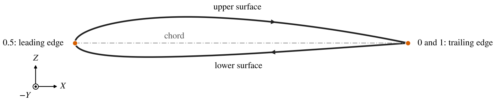

*Figure 1. NACA 2412 on a wing: where its curve starts, which way it runs, and its chord.*

## Controls Every Airfoil Has

| Control        | Meaning                                                                                                  |
|:---------------|:---------------------------------------------------------------------------------------------------------|
| Chord          | Length from the leading edge to the trailing edge.                                                       |
| T/C            | Maximum thickness as a fraction of the chord.  An output for Karman-Trefftz and CST airfoils, whose shape sets it. |
| Invert Airfoil | Swaps the upper and lower surfaces, so a cambered airfoil turns upside down.  Not on biconvex airfoils.  |
| Sharpen TE     | NACA 4- and 5-digit, their modified forms and the 16-series: close the trailing edge to a point.  Off, it has the small thickness of the published definition. |
| Fit CST        | Replace the airfoil with a [CST airfoil](#cst) of the chosen *Degree*, fitted to it.  Not on biconvex, wedge or CST airfoils. |

On a Wing the chord comes from the wing's planform, and on a Propeller the chord, thickness and design lift coefficient
come from the blade curves; see [Wing](Wing.md) and [Propeller](Propeller.md#cross-sections).  Between two sections
of a propeller blade, OpenVSP builds a true airfoil at every radius when both are of the same family defined by
equations, and otherwise blends the two shapes; the Propeller page's [Cross Sections](Propeller.md#cross-sections)
explains this, and why to use as few families as possible.

*Fit CST* fits the airfoil as its family defines it, before any Modify operation.  The fit comes with the shift,
rotation and scale that put the fitted shape where the original was, and these are combined with the Modify tab's
Delta X/C, Delta Y/C, Theta, Scale and Shift LE, so the section keeps its shape and place.  If the airfoil has a blunt
trailing edge, the fit also sets a SKEW BOTH trailing edge closure of that thickness.  The other Modify settings are
kept.

## Design Lift Coefficient

The design lift coefficient, or ideal lift coefficient $C_{l_i}$, is the lift coefficient at which the flow meets the
leading edge smoothly; it is set by the camber.  The NACA 5-digit, 5-digit modified, 16-series and 6-series families
take it directly, as *Ideal CL*.  The NACA 4-digit and 4-digit modified families are defined by their maximum camber
instead, so for them *Camber* and *Ideal CL* are alternatives: pick one with the toggle beside it, and the other is
computed.  The relation is thin airfoil theory's

$$
C_{l_i} = \pi A_1, \qquad A_1 = \frac{2}{\pi}\int_0^\pi \frac{dz_c}{dx}\,\cos\theta\,d\theta, \qquad
x = \frac{1 - \cos\theta}{2}
$$

where $z_c(x)$ is the mean line.  For the 4-digit mean line $C_{l_i}$ is proportional to the maximum camber $m$, with a
factor that depends on the camber position $p$: at $p = 0.4$, $C_{l_i} = 12.8\,m$.  This is how a propeller's CLi curve
sets the camber of these families.

The other families have no design lift coefficient.  Biconvex airfoils have no camber, and wedge, Karman-Trefftz, CST
and file airfoils keep the camber their own parameters or points give them.

## The Airfoil Families

Figure 2 shows one of each family defined by equations.

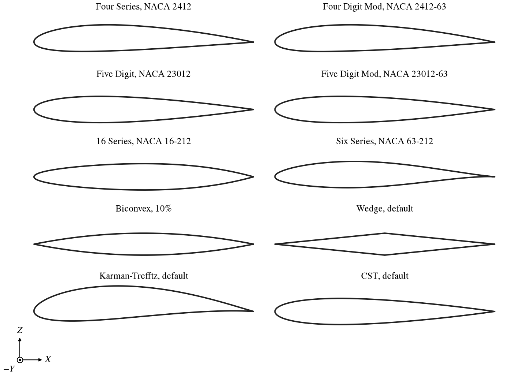

*Figure 2. One airfoil of each family defined by equations, all at one scale.*

### NACA 4-Digit

FOUR_SERIES.  The NACA 4-digit airfoil: *Camber* $m$ (the maximum camber, as a fraction of the chord), *CamberLoc* $p$
(its position along the chord) and *T/C*.  *Name* shows the designation, NACA 2412 for $m = 0.02$, $p = 0.4$, T/C 0.12.

### NACA 4-Digit Modified

FOUR_DIGIT_MOD.  The 4-digit airfoil with two more parameters for its thickness (Figure 3).  *T/CLoc* places the
maximum thickness, from 0.2 to 0.6 of the chord; the plain 4-digit airfoil has it at 0.3.  *LERadIndx* sets the
leading edge radius: 6 is the 4-digit airfoil's radius, 0 is a sharp leading edge, and the radius grows with the
square of the index up to 8, then to three times the normal radius at 9.  The designation adds the two as a suffix:
NACA 2412-63 has index 6 and maximum thickness at 0.3.

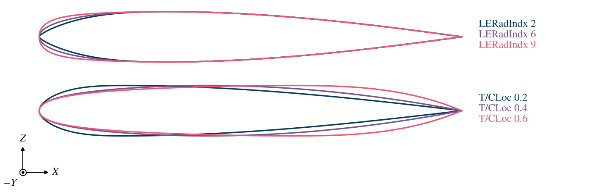

*Figure 3. A 12% thick 4-digit modified airfoil with three leading edge radius indices (top) and three positions of
maximum thickness (bottom).*

### NACA 5-Digit and 5-Digit Modified

FIVE_DIGIT and FIVE_DIGIT_MOD.  The 4-digit thickness with the 5-digit (non-reflexed) mean line, set by *Ideal CL*
and *CamberLoc*, the position of maximum camber.  NACA 23012 has Ideal CL 0.3 and CamberLoc 0.15.  The modified form
adds *T/CLoc* and *LERadIndx*, as for the 4-digit modified airfoil.

### NACA 16-Series

16_SERIES.  The NACA 16 thickness form, thickest at half the chord, with the $a = 1$ mean line, which loads the chord
uniformly.  It is set by *Ideal CL* and *T/C*: NACA 16-212 has Ideal CL 0.2 and T/C 0.12.  Propellers use it widely.

### NACA 6-Series

SIX_SERIES.  The NACA 6-series airfoils, computed by the NACA 6-series generation method.  *Series* chooses the
thickness form, 63- to 67- or the A forms 63A to 65A; *Ideal CL* and *a* set the mean line, where *a* is the fraction of
the chord over which the loading is uniform.  The A forms always use $a = 0.8$.  T/C may be up to 0.5.  A script sets
*Series* with `SIX_SERIES_63` ... `SIX_SERIES_65A`.

### Biconvex

BICONVEX.  Two parabolic arcs, upper and lower, meeting in sharp edges: $z = \pm 2\,(t/c)\,x(1 - x)$.  Only *T/C*
shapes it.  It is a common supersonic section.

### Wedge

WEDGE.  A section of straight lines: a sharp leading and trailing edge, and on each surface a corner at the maximum
thickness, or a flat between two corners (Figure 4).

| Control                | Meaning                                                                                  |
|:-----------------------|:-----------------------------------------------------------------------------------------|
| Thick X, Thick X Low   | Position of the first upper and lower corner, as a fraction of the chord.                |
| Flat Up, Flat Low      | Length of the flat after it, as a fraction of the chord.                                 |
| Symm Thickness         | Use the upper surface's Thick X and Flat for the lower surface too.                      |
| Camber                 | Raises the corners, as a fraction of the chord, leaving the edges on the chord line.     |
| U Fwd Up, U Fwd Low    | Where the first corner of each surface falls in the curve's parameter.                   |
| dU Flat Up, dU Flat Low | How much of the curve's parameter the flat takes.                                       |

The U parameters do not change the shape.  They decide which part of the curve meets which part of the neighboring
sections in the loft, so give neighboring wedge sections the same values to make their corners line up.

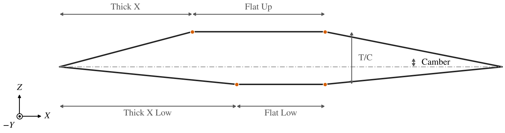

*Figure 4. A wedge with T/C 0.12, Thick X 0.3, Flat Up 0.3, Thick X Low 0.4, Flat Low 0.2 and Camber 0.02.  The dots are
the corners.*

### Airfoil File

AF_FILE.  *Read File* reads an airfoil's coordinates in one of three formats:

- Selig (`.dat`): a name line, then $x$ $z$ pairs from the upper trailing edge forward around the leading edge and back
  along the lower surface.
- Lednicer (`.dat`): a name line, a line with the number of upper and lower points, then the upper surface and the
  lower surface, each from the leading edge.
- OpenVSP (`.af`): a first line containing `AIRFOIL FILE`, a name line, a symmetry flag, the number of points on the
  upper surface (and on the lower, unless symmetric), then the upper points, one line that is skipped (left blank),
  and the lower points (none for a symmetric airfoil).

OpenVSP splits the airfoil into a mean line and a thickness distribution.  *Base T/C* is the file's thickness, and
*T/C* scales the thickness about the mean line, so changing it keeps the camber.

### CST

CST_AIRFOIL.  A Class-Shape Transformation airfoil (Kulfan): each surface is

$$
z(x) = \sqrt{x}\,(1 - x)\,\sum_{i=0}^{n} A_i\,\binom{n}{i}\,x^i(1 - x)^{n-i}
$$

with its own *Degree* $n$ and coefficients $A_i$, listed under *Upper Surface* and *Lower Surface*.  The first
coefficient sets the leading edge radius, $r = A_0^2/2$, and the last the angle at the trailing edge.  *Enforce
Continuous LE Radius* makes the lower surface's first coefficient the negative of the upper's, so the two surfaces
share one leading edge radius.  *Promote* raises a surface's degree without changing its shape, which gives more
coefficients to work with; *Demote* lowers it and approximates the shape.  The trailing edge is sharp; use the Modify
tab to thicken it.  *T/C* is an output.

CST airfoils are smooth and have few parameters, which suits them to optimization (Figure 5).  *Fit CST* on the other
families converts an airfoil to one.

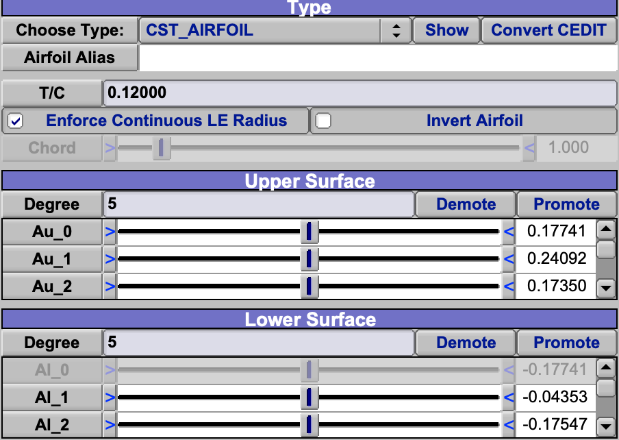

*Figure 5. NACA 2412 as a CST airfoil of degree 5 on each surface, on the Airfoil tab of a Wing.  Each list of
coefficients scrolls; Al_0 is greyed because Enforce Continuous LE Radius sets it from Au_0, and T/C is shown, not
set.*

### Karman-Trefftz

KARMAN_TREFFTZ.  The conformal map of a circle, from potential flow theory (Figure 6).  *Epsilon* moves the circle's
center to thicken the airfoil, *Kappa* moves it up to camber it, and *Tau* is the trailing edge angle in degrees; 0
gives a cusp.  The chord is scaled to *Chord*, and *T/C* is an output.  The pressure distribution of these airfoils is
known exactly, which makes them useful test cases; the API's `GetVKTAirfoilCpDist` gives it.

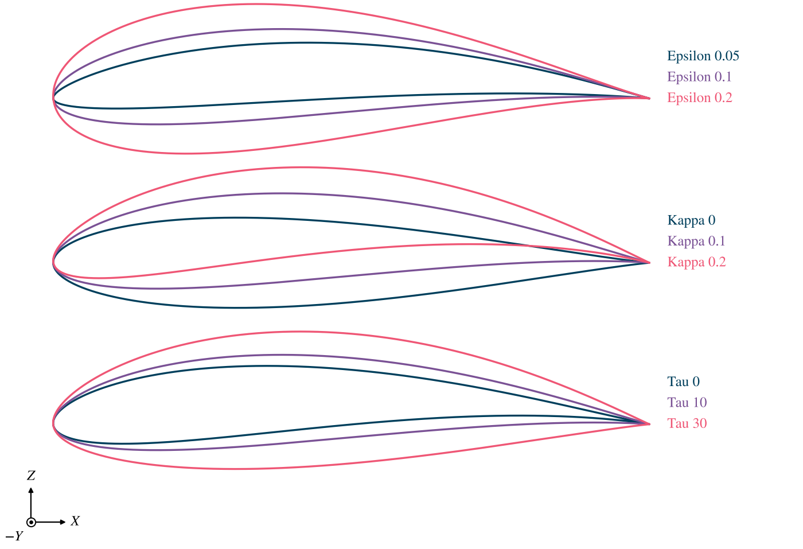

*Figure 6. Karman-Trefftz airfoils: Epsilon, Kappa and Tau each varied from the defaults, Epsilon 0.1, Kappa 0.1 and
Tau 10.*

## The Modify Tab

The Wing, Propeller and Body of Revolution have a Modify tab that reshapes the active airfoil.  Its operations are
applied in a fixed order, each to the result of the one before:

1. Trailing edge closure
2. Trailing edge trim
3. Trailing edge flap
4. Leading edge closure
5. Leading edge trim
6. Trailing edge cap
7. Leading edge cap
8. Rotate and scale, then shift

So a cap rounds the face that a closure or trim made, a flap turns the trimmed trailing edge, and shifting, rotating
and scaling move the finished section.  The order does not change; to trim and then close, for example, is not
possible.

Lengths are given either absolutely, *Abs*, in model units, or relative to the chord, *Rel*.  The one not chosen is
shown, updated to match.  Use Rel on a wing whose sections differ in chord, so that a modification keeps its
proportion along the span.

## Shift, Rotate and Scale

*Theta* turns the section about its leading edge, positive moving the trailing edge up, toward $+Z$ on a wing.
*Scale* scales it about its leading edge.  *Delta X/C* and *Delta Y/C* then move it along and across the chord, in
chords (Figure 7).

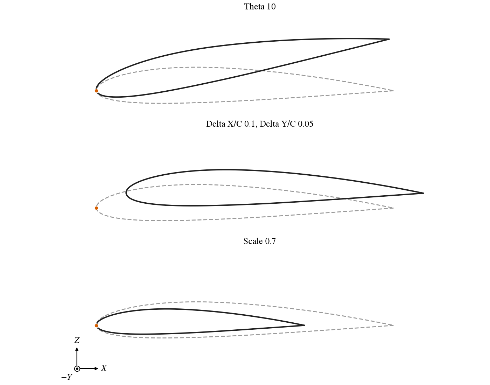

*Figure 7. NACA 2412 turned by Theta, moved by Delta X/C and Delta Y/C, and scaled; dashed, before.  The dot is the
leading edge before.*

*Shift LE* changes where the curve's leading edge falls, not the shape: the point halfway round the curve moves onto
the upper surface for positive values and the lower surface for negative ones (Figure 8).  The surface's leading edge
line, where the wing's upper and lower surfaces meet in its parameters, moves with it.  It is for airfoils whose
geometric leading edge is not where their curve puts it, such as a drooped or turned airfoil.

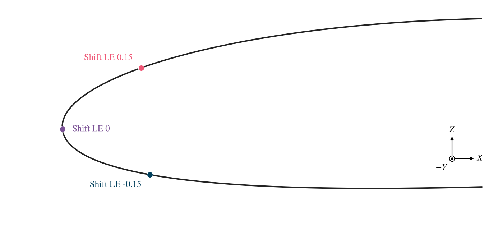

*Figure 8. The point halfway round NACA 2412's curve, with three values of Shift LE.*

## Closure

A closure shears one or both surfaces so that an edge becomes a flat face of thickness *T*: it opens a sharp edge, or,
with T 0, closes a blunt one.

At the trailing edge (Figure 9), *SKEW LOWER* shears the lower surface, *SKEW UPPER* the upper, and *SKEW BOTH* each
by half; each shears the surface across the chord, so the change grows linearly from nothing at the leading edge.
*EXTRAPOLATE* instead extends both surfaces along their directions at the trailing edge until they are T apart; it
lengthens the airfoil without changing anything ahead of the old trailing edge, and acts only where the two surfaces
converge.  It is the way to close a blunt trailing edge to a point.

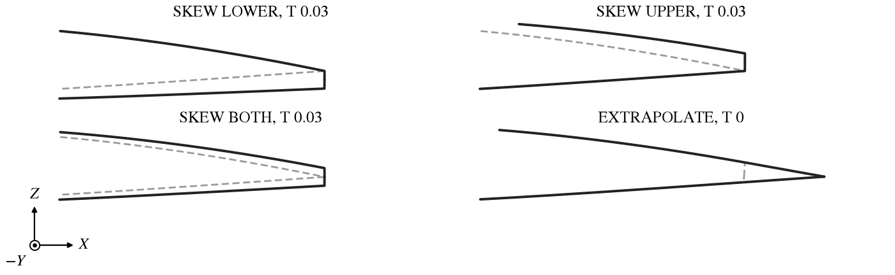

*Figure 9. Trailing edge closures on NACA 2412, aft part; dashed, before.  EXTRAPOLATE is shown on the same airfoil
already cut off where it is 0.03 thick, closed to T 0.*

At the leading edge (Figure 10) the shear grows from nothing at the trailing edge instead, and opens the leading edge
into a flat face T high.

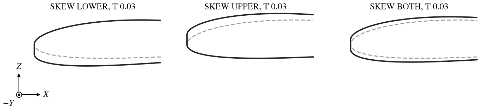

*Figure 10. Leading edge closures on NACA 2412, forward part; dashed, before.*

## Trim

A trim cuts an edge off, leaving a flat face (Figure 11).  *X* cuts at the points that distance from the edge, *THICK*
where the airfoil is T thick.  The chord parameter does not change, so a trimmed airfoil is shorter than its chord.

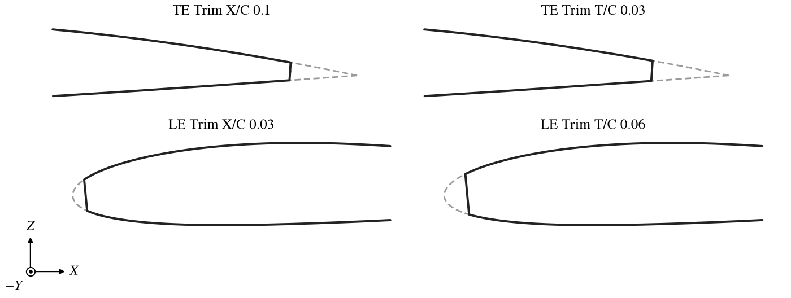

*Figure 11. Trailing and leading edge trims on NACA 2412; dashed, before.*

## Plain Flap

*PLAIN* deflects the aft part of the airfoil as a plain flap (Figure 12).  The hinge is *X* from the trailing edge
(the flap's chord, Abs or Rel) and *Y/T* of the way across the airfoil there, from the lower surface at 0 to the upper
at 1.  *Deflection* is in degrees, positive trailing edge down.  The side toward which the flap turns gets a sharp
corner, and the other side an arc about the hinge, so the surface stays closed.

The flap works on a Wing, a Propeller and a Body of Revolution.

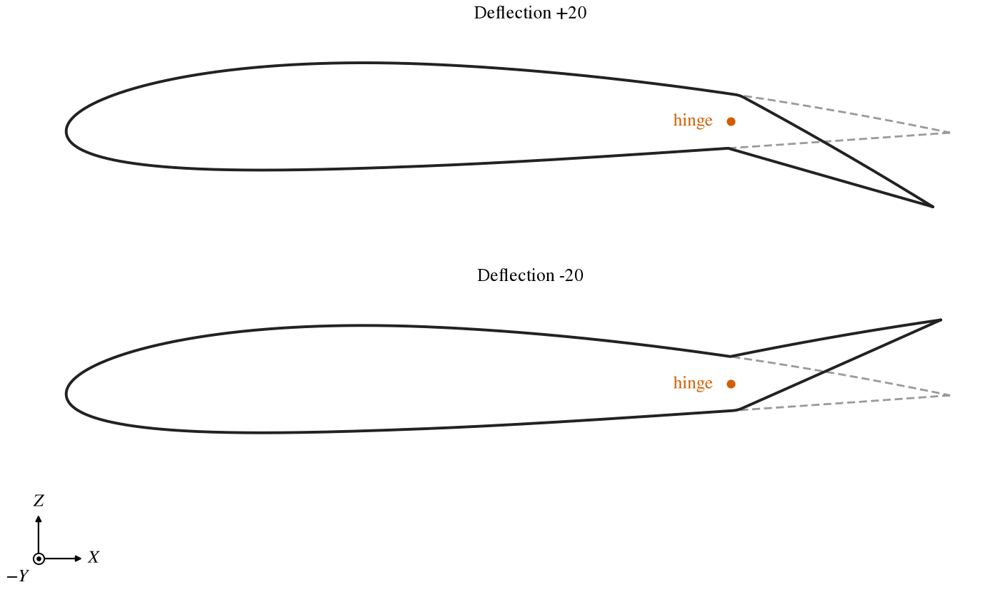

*Figure 12. A plain flap of X/C 0.25 and Y/T 0.5 on NACA 2412, deflected 20 degrees each way; dashed, undeflected.*

## Caps

A cap shapes the flat face of a blunt edge, whether it comes from the airfoil itself, a closure or a trim
(Figure 13).  *FLAT* leaves the face flat.  *ROUND* replaces it with an arc tangent to both surfaces.  *EDGE* replaces
it with two straight lines that meet in a point, and *SHARP* with two curves that meet in a point.

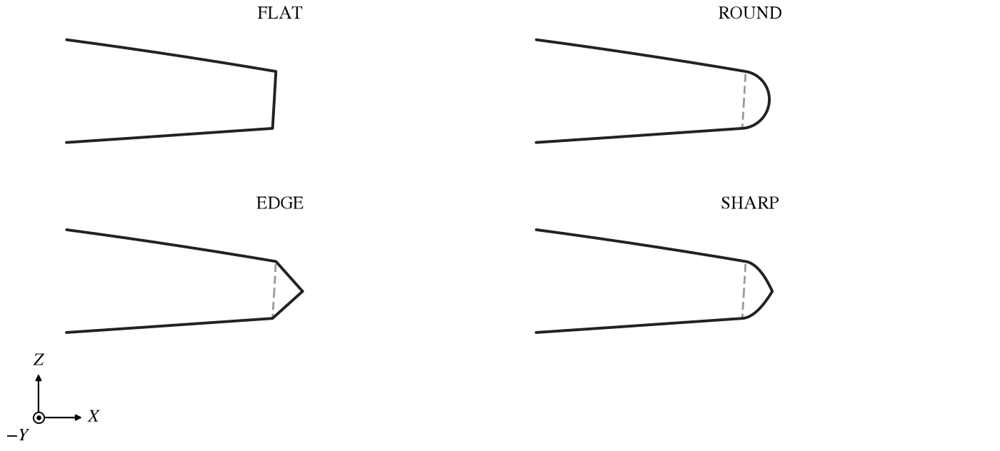

*Figure 13. Trailing edge caps on NACA 2412 cut off where it is 0.04 thick; dashed, the flat face.*

Three parameters adjust a cap (Figure 14):

- *Length* stretches it along the chord: 1 is a circular arc for ROUND, and for EDGE and SHARP puts the point half the
  face's height beyond it.
- *Offset* moves the tip across the face, as a fraction of its height.  Positive is toward the upper surface at the
  trailing edge and toward the lower surface at the leading edge.
- *Strength*, for SHARP only, sets how full the two curves are: 0 makes them straight, like EDGE, and 1 fullest.

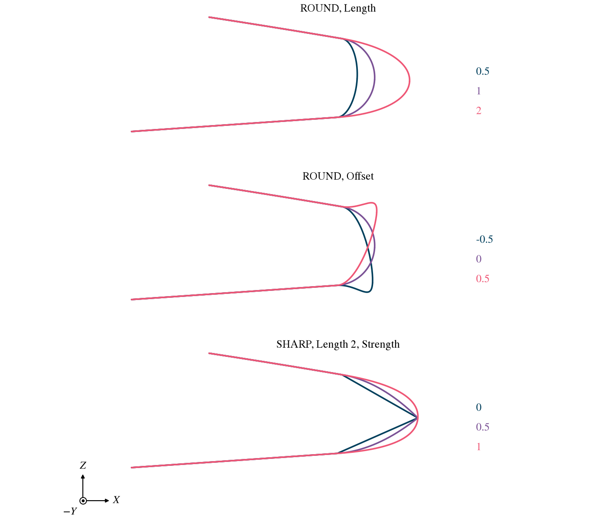

*Figure 14. ROUND with three Lengths and three Offsets, and SHARP at Length 2 with three Strengths, on the same
trailing edge.*

## Scripting

The API reaches an airfoil as it does any cross section (see [Cross Section Curves](XSecCurves.md#scripting)), and
has functions of its own for airfoils:

| Call                                                                                     | Purpose                                            |
|:-----------------------------------------------------------------------------------------|:---------------------------------------------------|
| `ReadFileAirfoil`, `SetAirfoilPnts`, `SetAirfoilUpperPnts`, `SetAirfoilLowerPnts`         | Give an Airfoil File its points.                   |
| `GetAirfoilUpperPnts`, `GetAirfoilLowerPnts`, `GetAirfoilCoordinates`                    | Read an airfoil's points.                          |
| `SetUpperCST`, `SetLowerCST`, `GetUpperCSTCoefs`, `GetLowerCSTCoefs`, `GetUpperCSTDegree`, `GetLowerCSTDegree` | Set or read CST coefficients. |
| `PromoteCSTUpper`, `PromoteCSTLower`, `DemoteCSTUpper`, `DemoteCSTLower`                 | Change a CST surface's degree.                     |
| `FitAfCST`                                                                               | Convert an airfoil to CST, as *Fit CST* does.      |
| `GetVKTAirfoilPnts`, `GetVKTAirfoilCpDist`                                               | Karman-Trefftz points and pressure distribution.   |
| `WriteSeligAirfoil`, `WriteBezierAirfoil`                                                | Write the airfoil at a span station of a Geom.     |

The Modify tab's parameters are found by name with `GetXSecParm`: `Theta`, `Scale`, `DeltaX`, `DeltaY`, `ShiftLE`, and
`TE_Close_Type`, `TE_Trim_Type`, `TE_Cap_Type` and their `LE_` counterparts, and `TE_Flap_Type`, with the values in the
`XSEC_CLOSE_TYPE`, `XSEC_TRIM_TYPE`, `XSEC_FLAP_TYPE` and end cap enumerations.  The Abs/Rel toggles are
`TE_Close_AbsRel`, `TE_Trim_AbsRel` and `TE_Flap_AbsRel` (with `ABS` or `REL`), and the values they choose between are:

| Control           | Abs                         | Rel                               | Group |
|:------------------|:----------------------------|:----------------------------------|:------|
| Closure T         | `TE_Close_Thick`            | `TE_Close_Thick_Chord`            | Close |
| Trim X            | `TE_Trim_X`                 | `TE_Trim_X_Chord`                 | Trim  |
| Trim T            | `TE_Trim_Thick`             | `TE_Trim_Thick_Chord`             | Trim  |
| Flap X            | `TE_Flap_X`                 | `TE_Flap_X_Chord`                 | Flap  |

The flap's Y/T and Deflection are `TE_Flap_Y_Frc` and `TE_Flap_Deflection` (Flap), and a cap's Length, Offset and
Strength are `TE_Cap_Length`, `TE_Cap_Offset` and `TE_Cap_Strength` (Cap).  The leading edge has the same names with
`LE_` in place of `TE_`, except for the flap.
