The Auxiliary component builds a shape that describes another component rather than part of the aircraft: the region a
rotor's tips sweep, the zone a burst rotor's fragments fly through, the ground plane under a set of landing gear, a
tire's spray, a pilot's field of view.  Such shapes are implied by what the model already holds, and drawing them by
hand would be tedious and would not follow the design as it changes.  Each *Mode* computes its shape from the Auxiliary
component's parent, so an Auxiliary component is always added as the child of the component it describes, and it
follows that component: change the propeller or the gear, and the shape changes with it.

The shapes are used three ways: to inspect by eye, as a limit to move a part against with *Snap To* (in the Model
menu), and as the geometry of the [Geometry Analysis](GeometryAnalysis.md) manager's checks.

| Topic                                                   | Tab    |
|:--------------------------------------------------------|:-------|
| [Quick Start](#quick-start)                             |        |
| [Parent and Placement](#parent-and-placement)           | Design, XForm |
| [Rotor Tip Path](#rotor-tip-path)                       | Design |
| [Rotor Burst](#rotor-burst)                             | Design |
| [AC 20-128A Rotor Fragment](#ac-20-128a-rotor-fragment) | Design |
| [AC 25.905-1 Thrown Blade](#ac-25905-1-thrown-blade)    | Design |
| [Ground Planes](#ground-planes)                         | Design |
| [Single Gear](#single-gear)                             | Design |
| [ESDU 83042a Tire Spray Envelope](#esdu-83042a-tire-spray-envelope) | Design |
| [AMC 25.734 Wheel and Tire Failure](#amc-25734-wheel-and-tire-failure) | Design |
| [3pt Composite Clearance Envelope](#3pt-composite-clearance-envelope) | Design |
| [Super Cone](#super-cone)                               | Design |
| [Shared Tabs](#shared-tabs)                             | Gen, XForm, Mass, Sub |
| [Scripting](#scripting)                                 |        |
| [References](#references)                               |        |

## Quick Start

1. Select the component to be described -- a [Propeller](Propeller.md), a [Gear](Gear.md), a pilot -- and add an
   Auxiliary component, so that it is that component's child.
2. Choose its *Mode* on the Design tab.  The box under Mode says what kind of parent the mode needs.
3. Set the mode's parameters.  For the ground modes, choose the bogies of the parent Gear that touch the ground.
4. Use it as the geometry of an analysis in the Geometry Analysis manager.

## Parent and Placement

| Mode                             | Parent                  | Used by                                               |
|:---------------------------------|:------------------------|:------------------------------------------------------|
| Rotor Tip Path                   | A Propeller             | [External Interference](GeometryAnalysis.md#external-interference) |
| Rotor Burst                      | Any component           | [External Interference](GeometryAnalysis.md#external-interference) |
| AC 20-128A Rotor Fragment        | Any component           | [Risk Angle](GeometryAnalysis.md#risk-angle)                        |
| AC 25.905-1 Thrown Blade         | A Propeller             | [Risk Angle](GeometryAnalysis.md#risk-angle)                        |
| 3pt Ground Plane                 | A Gear                  | [Plane Min/Max Distance](GeometryAnalysis.md#plane-minmax-distance), [Weight Distribution](GeometryAnalysis.md#weight-distribution), [Ground Maneuverability](GeometryAnalysis.md#ground-maneuverability) |
| 2pt Ground Plane                 | A Gear                  | [Plane 2pt Angle Contact](GeometryAnalysis.md#plane-2pt-angle-contact), [Tipback Angle](GeometryAnalysis.md#tipback-angle), [Tipover Angle](GeometryAnalysis.md#tipover-angle) |
| 1pt Ground Plane                 | A Gear                  | [Plane 1pt Angle Contact](GeometryAnalysis.md#plane-1pt-angle-contact) |
| Single Gear                      | A Gear                  | [External](GeometryAnalysis.md#external-interference) and [Packaging](GeometryAnalysis.md#packaging-interference) Interference |
| ESDU 83042a Tire Spray Envelope  | A Gear                  | [External Interference](GeometryAnalysis.md#external-interference) |
| AMC 25.734 Wheel and Tire Failure | A Gear                 | [External Interference](GeometryAnalysis.md#external-interference) |
| 3pt Composite Clearance Envelope | A Gear                  | [Composite Clearance Envelope](GeometryAnalysis.md#composite-clearance-envelope) |
| Super Cone                       | Any component; a Human's eye point when the parent is a Human | [From Point Visibility](GeometryAnalysis.md#from-point-visibility), and Intersect sub-surfaces |

A Clone of a Propeller or of a Gear serves as such a parent too.

An Auxiliary component is always attached to its parent's component axes, and it takes its parent's symmetry and flip,
so it is mirrored wherever its parent is; these controls are greyed.  Its own location and rotation on the XForm tab
move it from the parent's origin and axes; leave them at zero unless the zone should sit elsewhere, such as at a rotor
inside a nacelle.  A rotor zone is built about its parent's $X$ axis, so for a parent whose axes do not lie along the
rotor's shaft, hang it from a [Blank](Blank.md) placed at the rotor's center instead.

Zones that reach far away -- the rotor fragment and thrown blade paths, the tire spray, the debris zones, the ground
planes -- are drawn out to $1.5$ times the length of the diagonal of the model's bounding box, so they reach past the
whole aircraft.

## Rotor Tip Path

A keep-out zone: the region the blade tips of a flapping rotor can sweep, which no part of the aircraft may enter.  It
is the parent propeller's tips flapping about a hinge at *r_flap/R* from the shaft, by up to *Theta Thrust* toward the
thrust and *Theta Anti Thrust* away from it, all the way around (Figure 1).  With *Automatic Diameter*, the default, the
diameter is the propeller's.  With *Automatic r_flap/R*, also the default, r_flap/R is the radial place of the
propeller's flap hinge (see [Hinges](Propeller.md#hinges)); it is on in models saved by earlier versions too, so their
tip paths now take the propeller's flap hinge.  Turn it off and set r_flap/R again to keep an earlier tip path.

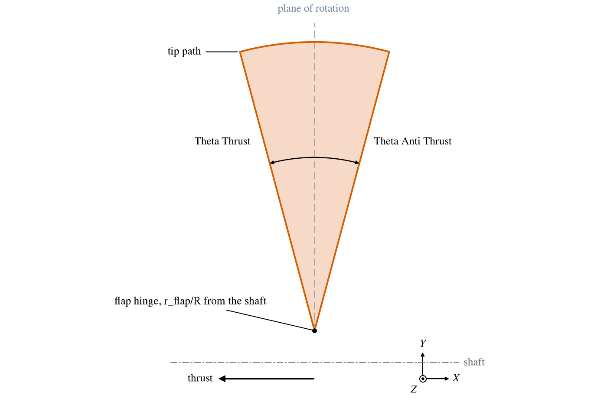

*Figure 1. The tip path of the default propeller, cut by the plane through its shaft and its first blade, with its flap
hinge moved to r/R 0.1 and both angles at their default, 15 degrees.*

## Rotor Burst

A keep-out zone for systems that a burst rotor must not disable: the zone its fragments are taken to pass through, a
ring about the parent's $X$ axis that is *Root Length* wide at the shaft and widens outward by *Theta Thrust* toward
$-X$ and *Theta Anti Thrust* toward $+X$ (Figure 2).  *Root Offset* is the fraction of Root Length ahead of the parent's
origin, 0.5 to center it.  With *Automatic Diameter* and a propeller parent, the diameter is $1.5$ times the length of
the diagonal of the model's bounding box.

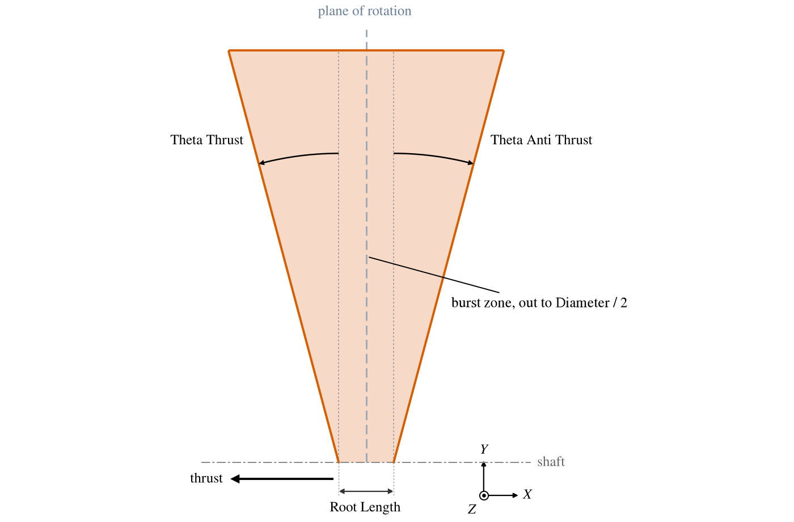

*Figure 2. A rotor burst zone about the default propeller, cut by the plane through its shaft and its first blade, with
Root Length 3 and a diameter of 45.*

## AC 20-128A Rotor Fragment

The path of a fragment thrown from a turbine rotor, as the FAA's AC 20-128A defines it [1], for the [Risk
Angle](GeometryAnalysis.md#risk-angle) analysis.  The fragment, *Fragment Length* long, leaves from its center of
gravity at *CG Radius* from the parent's $X$ axis, tangent to its circle, at *Release Angle* measured from $+Z$ in the
direction of rotation.  It spreads by *Forward* toward $-X$ and *Aft* toward $+X$ as it goes (Figure 3).  *Rotate
Direction* checked is rotation about $-X$, as a propeller turns normally; unchecked, about $+X$.

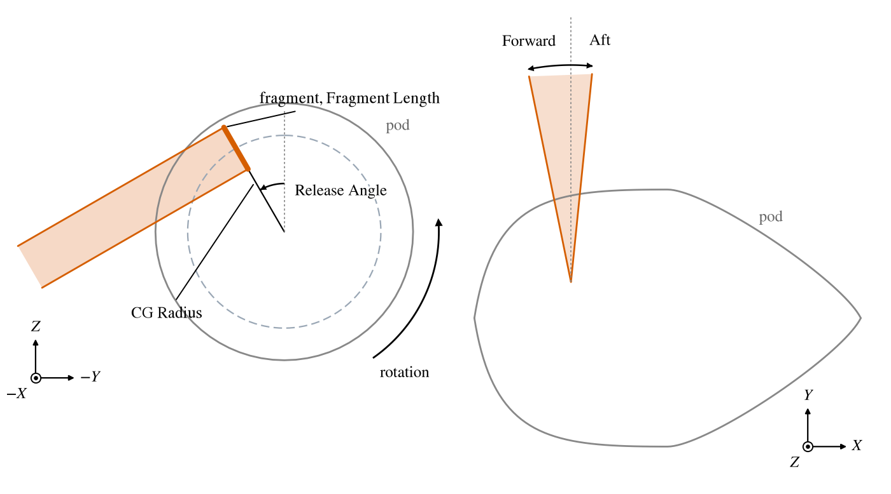

*Figure 3. A Generic Fragment from a rotor set back 2 from the nose of its pod, Release Angle 30, Forward 10 and Aft 5:
from upstream (left), and from above (right).  The dashed circle is the path of the fragment's center of gravity.*

*Model* chooses one of the fragments AC 20-128A defines, and computes Fragment Length, CG Radius and the spread from the
rotor's *Disk Radius*, *Blade Length* and *Blade Root Radius*:

| Model                       | Fragment Length       | CG Radius                 | Spread |
|:----------------------------|:----------------------|:--------------------------|:-------|
| One Third Rotor Fragment    | $2 r \sin 60^\circ$, $r = r_d + l_b/3$ | $r \cos 60^\circ$ | $3^\circ$ |
| Intermediate Rotor Fragment | $(r_d + l_b)/3$       | $r_d$                     | $5^\circ$ |
| Alternate Rotor Fragment    | as One Third          | as One Third              | $5^\circ$ |
| Fan Blade Fragment          | $l_b/3$               | $r_0 + 5 l_b/6$           | $15^\circ$ |
| Small Fragment              | $l_b/2$               | $r_0 + 3 l_b/4$           | $15^\circ$ |
| Generic Fragment            | given                 | given                     | given  |

where $r_d$ is the Disk Radius, $l_b$ the Blade Length and $r_0$ the Blade Root Radius; the spread is the same fore and
aft.  The values that a model computes are greyed.

## AC 25.905-1 Thrown Blade

The path of a propeller blade thrown from its hub, as the FAA's AC 25.905-1 defines it [2], for the Risk Angle
analysis.  It is the same shape as a rotor fragment, built from the parent propeller: the fragment is centered on
the blade's center of gravity, at *CG Fraction* of the blade's length from its root, and is long enough to reach
both the blade's root and its tip; the direction of rotation is the propeller's.  *Basic Blade* uses a CG Fraction
of 0.34 and a spread of $5^\circ$ fore and aft; *Unconventional Blade* takes them as given.

## Ground Planes

A [Gear](Gear.md) is its nominal ground plane: the ground with every bogie in its nominal state.  The ground plane modes
build off-nominal ground planes from it: the ground under chosen bogies of the parent Gear, each in a chosen state, and
turned about their contact points or axles as an analysis requires (Figure 5).  They draw the plane and those bogies'
tires with it.  Make one Auxiliary component for each condition to be checked.

For each bogie, *I Symm* chooses the bogie or its mirror image, for a Symmetrical bogie (Figure 4).  *Suspension Mode*
chooses the strut Nominal, Compressed or Extended: compressed moves the bogie's pivot by the Gear's Compression Travel
along the suspension direction, toward the aircraft, and extended moves it the other way by the Extension Travel.  *Tire
Mode* chooses the tire's radius below the pivot: Static Load (the static loaded radius, the tire under the aircraft's
weight), Unloaded (the unloaded tire's radius, as at first contact), Grown (the tire spinning at speed), or Flat (the
radius of the wheel's flanges, which a flat tire rolls on).  The bogie's contact point is its pivot, so moved, less that
radius.  The plane is the ground for that state of the gear, and each analysis reads the contact points and the Gear's
center of gravity range through it.

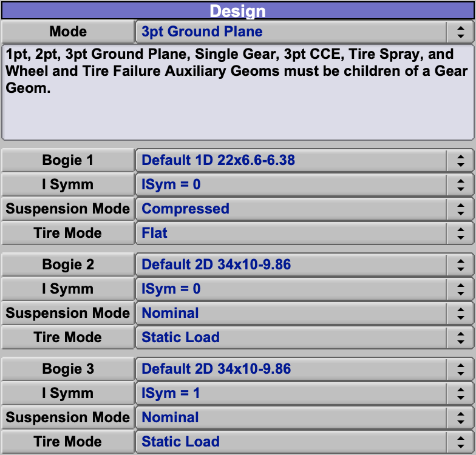

*Figure 4. The Design tab of the 3pt Ground Plane of Figure 5: the nose bogie with its strut Compressed and its tire
Flat, and the symmetrical main bogie twice, I Symm 0 for one side and 1 for its mirror image.*

| Mode            | The plane                                                                                       | Analyses |
|:----------------|:------------------------------------------------------------------------------------------------|:---------|
| 3pt Ground Plane | Through the contact points of three bogies.                                                    | [Plane Min/Max Distance](GeometryAnalysis.md#plane-minmax-distance), [Weight Distribution](GeometryAnalysis.md#weight-distribution), [Ground Maneuverability](GeometryAnalysis.md#ground-maneuverability) |
| 2pt Ground Plane | Through the line joining the contact points of two bogies, as level as that line allows.       | [Plane 2pt Angle Contact](GeometryAnalysis.md#plane-2pt-angle-contact), [Tipback Angle](GeometryAnalysis.md#tipback-angle), [Tipover Angle](GeometryAnalysis.md#tipover-angle) |
| 1pt Ground Plane | Through the contact point of one bogie's outermost tire, level.                                | [Plane 1pt Angle Contact](GeometryAnalysis.md#plane-1pt-angle-contact) |

The order in which the bogies are chosen does not matter; the plane's normal is always taken pointing up.

The angles of the 2pt and 1pt modes pose the plane drawn, so that a contact angle an analysis finds can be seen.  *Bogie
Theta* pitches bogies that have wheels in tandem about their pivots.  *Wheel Theta* turns the 2pt plane about the line
through the rear axles, for a positive angle, or the front axles, for a negative one, as the aircraft rotates onto its
tail or its nose; on the 1pt plane it pitches the plane.  *Roll Theta* turns the 1pt plane about the line through the
contact point along $X$, as the aircraft rolls onto a wing tip.  A positive Roll Theta lowers the plane toward $+Y$, as
the aircraft rolls onto its left wing tip about a left bogie (Figure 6); about a right bogie, roll onto the right wing
tip with a negative Roll Theta.

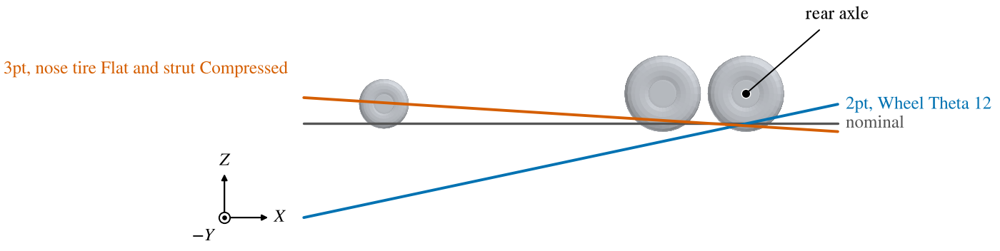

*Figure 5. Two off-nominal ground planes of a tricycle gear, from the side, with the Gear's tires drawn in their nominal
state.  The 2pt Ground Plane rests on the main gear and is turned by Wheel Theta 12 about the rear axles, as for a tail
strike; the 3pt Ground Plane has the nose tire Flat and the nose strut Compressed by 0.4, and so rises toward the nose.*

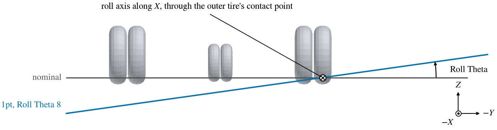

*Figure 6. A 1pt Ground Plane under the outer tire of the left main bogie, Roll Theta 8, from ahead.  The plane turns
about the line along $X$ through that tire's contact point and falls toward $+Y$.*

## Single Gear

One bogie of the parent Gear, alone, in a chosen state, to check the room the gear needs: that the retracted gear fits
its wheel well, with the [Packaging Interference](GeometryAnalysis.md#packaging-interference) analysis, or that the
extended gear clears the airframe, with [External Interference](GeometryAnalysis.md#external-interference).  *Gear Mode*
chooses it Down, Up, or Intermediate at *Retract*; I Symm and Suspension Mode are as above.  *Clearance Mode* chooses
the tire: Nominal, Grown (the tire spinning at speed, grown by the Tire and Rim Association's allowances [6]), or
Clearance (the TRA's clearance envelope around the grown tire [6, 7]), which a wheel well must leave room for.  The
[Gear](Gear.md#tires) page draws all three.

## ESDU 83042a Tire Spray Envelope

The spray thrown up by a bogie's front tires running through standing water, after ESDU 83042a [3], so that engine
intakes and other parts can be kept out of it.  It is almost always attached to the nose gear.  A side plume leaves from
beside the footprint of each outermost front tire and runs aft, rising at the *side elevation angle* $\gamma_s$ and
spreading outward at the *plan angle* $\theta_s$ (Figure 7).  The *incremental angle* $\lambda_s$ sets its width,
which grows by $\tan\lambda_s$ for each unit the plume runs aft, and the *inclination angle* $\phi_s$ leans its sides
outward (Figure 8).  A bogie with two or more wheels across and one in tandem also throws a center plume between each
pair of neighboring wheels, rising at the *center elevation angle* $\gamma_c$, $\Delta y_c$ wide.

The *Tire Contact* width $b_g$ and half length $h$, and $\Delta y_c$, are given as fractions of the tire diameter $D$:
*Width (b_g/D)*, *Half Length (h/D)* and $\Delta y_c/D$.  Each tire's footprint is $b_g$ wide and $2h$ long, centered on
its contact point.  The plumes leave the ground $h$ ahead of the footprints, the side plumes $b_g/4$ outboard of them
(Figure 9).

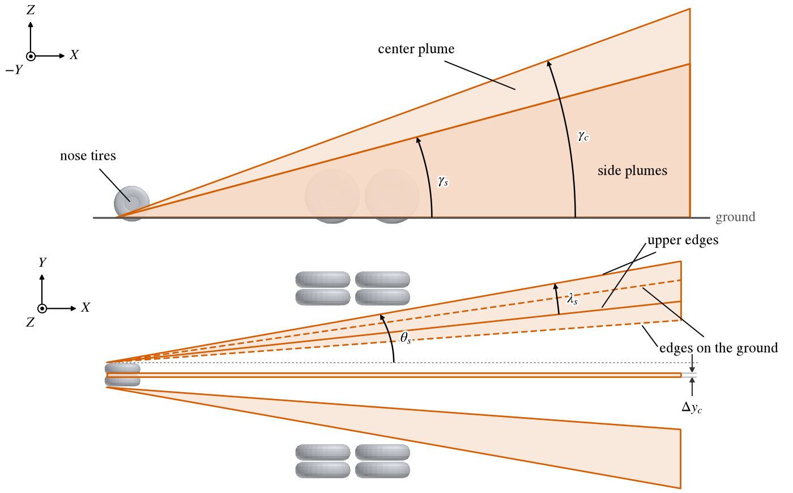

*Figure 7. The side plumes and center plume of a nose bogie, two across and one in tandem, at the default angles, from
the side (top) and from above (bottom).  From above, the upper edges of the side plume on the $+Y$ side are solid and
its edges on the ground dashed.*

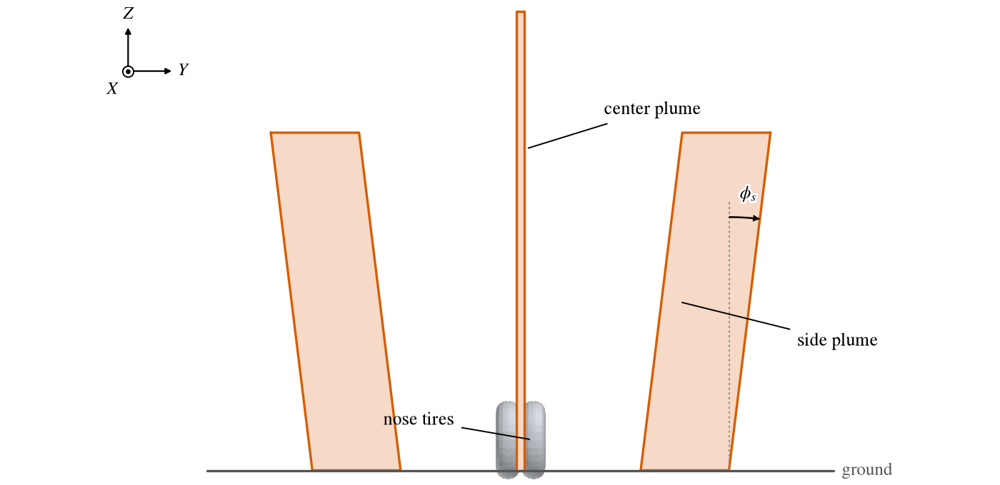

*Figure 8. The plumes of Figure 7 from behind, cut square to $X$ far aft of the bogie.*

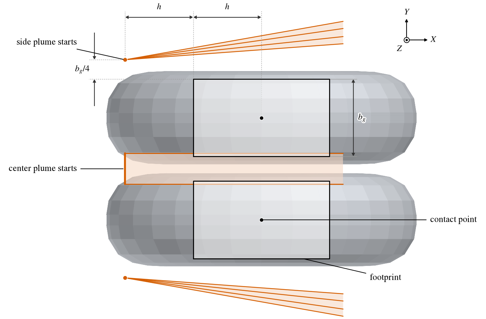

*Figure 9. Where the plumes of Figure 7 start, under the nose tires, from above.*

The mode draws the envelope; it does not find it.  ESDU 83042a gives the angles and widths from the aircraft's tire and
operating conditions, such as tire pressure and ground speed; work them out with the ESDU method and enter them here.
Then check the envelope with [External Interference](GeometryAnalysis.md#external-interference): that engine intakes
are clear of the spray, and that it does not strike structure or systems it could damage.

## AMC 25.734 Wheel and Tire Failure

The zones that debris from a failed wheel or tire can reach, after EASA AMC 25.734 and the wheel and tire failure model
it adopts [4, 8], for the bogie chosen.  They are keep-out zones for the systems a failure must not disable, such as
hydraulic and fuel lines, checked with [External Interference](GeometryAnalysis.md#external-interference):

| Model         | Zone                                                                                                    |
|:--------------|:--------------------------------------------------------------------------------------------------------|
| Model 1 Large | Large tire debris: a fan above the axle in the plane of the wheels, spreading $15^\circ$ to each side; a strip along the ground ahead of the tires and a wedge below $45^\circ$ behind them are cut from it as negative volumes. |
| Model 1 Small | Small tire debris: as Model 1 Large, spreading $30^\circ$ to each side.                                 |
| Model 2       | Wheel flange fragments: from the outer side of each outermost wheel, a cone about the axle starting at the flange diameter and opening at $20^\circ$ from the axle. |
| Model 3E      | A flailing tire strip, with the gear extended: a ring about each tire, as far out as a strip $2.5$ shoulder widths long can reach. |
| Model 3R      | As Model 3E, with the gear retracted.                                                                   |

Model 1's zone is the fan less its two negative volumes (Figure 10); the interference analysis, like CompGeom, removes
them.

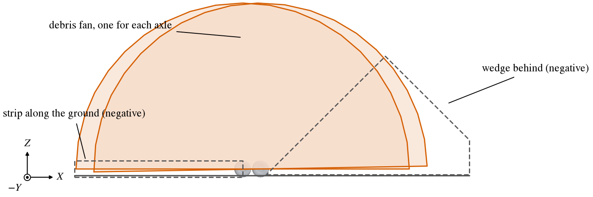

*Figure 10. Model 1 Large on a main bogie with two axles, from the side: a fan above each axle (shaded), and the strip
along the ground ahead of the tires and the wedge below 45 degrees behind them (dashed), which are cut from it.*

## 3pt Composite Clearance Envelope

A clearance envelope, read from a file, swept along the ground under the aircraft, for the [Composite Clearance
Envelope](GeometryAnalysis.md#composite-clearance-envelope) analysis.  The envelope is a profile across the aircraft's
track, such as the obstacles a taxiing aircraft must clear.  It is swept along the line from the contact point of the
*Nose Gear Bogie* toward the midpoint of *Main Bogie 1* and *Main Bogie 2*, in the plane of the three contact points,
with its origin at the nose gear's contact point.

*Read File* reads the profile: a text file of two numbers on each line, the lateral position and the height of each
point of the profile, in order.  A positive lateral position is toward the Gear's $+Y$, the aircraft's right as seen
from behind, looking forward (Figure 11); a profile taken from a drawing seen from ahead has the signs of its lateral
positions reversed.  *Envelope Length Units* is the unit of the file, or *Consistent* for the model's own units; the
parent Gear's Model Units convert it.

Such envelopes come from the equipment an aircraft must taxi over or be launched from.  The composite clearance envelope
of a carrier's nose gear catapult launching system [9], for example, is a profile across the catapult track, in inches,
of the deck fittings to either side that the airframe must clear.  NASA CR-175104 [10] shows such an envelope applied to
an aircraft design.

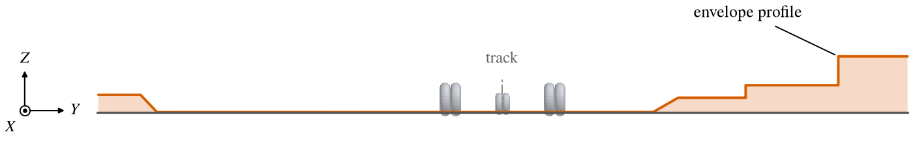

*Figure 11. An example envelope under a tricycle gear, seen from behind, looking forward: deck fittings at three heights
to the right of the track and one to the left, which the airframe must clear.  The file's lateral positions and heights
are in inches; the Gear's Model Units are feet.*

The aircraft need not sit square on its track.  With the nose gear on the track, the main gear may be off its center:
a catapult launching system allows the main gear's center up to 24 in off the track in the hookup position [9, 10].
*Main Gear Offset* represents this.  It turns the track about the nose gear's contact point, toward Main Bogie 2 for a
positive offset, so that the main gear's center lies the offset to the other side of the track, measured square to the
track (Figure 12).  It is in the Gear's Model Units, not the file's.

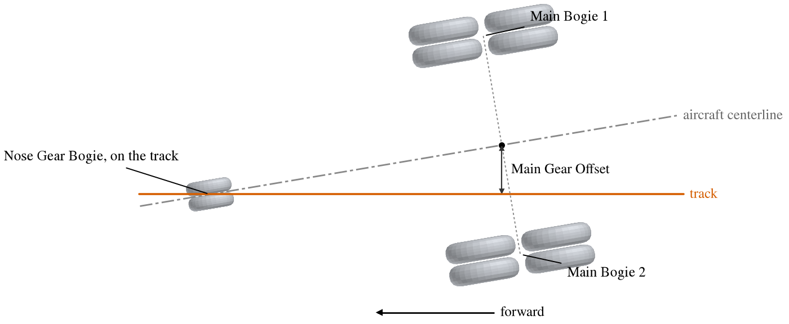

*Figure 12. Main Gear Offset 2 on the tricycle gear, from above, as the aircraft sits on the track: the track straight,
the aircraft turned about its nose gear's contact point, and the main gear's center 2 off the track, measured square to
it.*

## Super Cone

A cone from a point, whose cross section is any cross-section curve: for example a pilot's field of view, for the [From
Point Visibility](GeometryAnalysis.md#from-point-visibility) analysis, which uses the cone's apex as its viewpoint and
the cone as its field of view.  The *Profile* is drawn in degrees: its width is azimuth and its height elevation, seen
from the apex looking forward along $-X$, positive azimuth toward $+Y$ and positive elevation up.  The default profile
is the [AC 25.773 pilot vision envelope](XSecCurves.md#ac-25773-pilot-vision) [5] (Figure 13); the other curves are
described in [XSecCurves](XSecCurves.md).

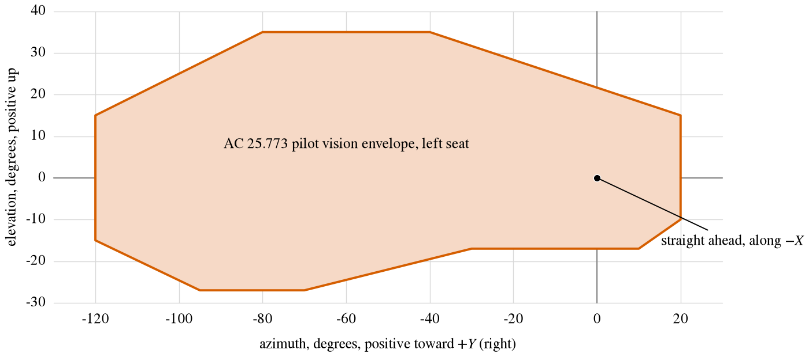

*Figure 13. The default Super Cone profile, the AC 25.773 pilot vision envelope for the left seat, in azimuth and
elevation.*

The profile is read as azimuth and elevation and projected onto a sphere about the apex, so its outline is a set of
directions (Figure 14), and the cone reaches out to the distance the other zones are drawn to.  The apex is the
parent's origin, or the eye point of a [Human](Human.md) parent.  *World* aligns the cone with the model's axes,
whatever the parent's rotation; *Object* aligns it with the parent's axes, or the Human's head.  For any other point or
direction, hang the Super Cone from a [Blank](Blank.md).

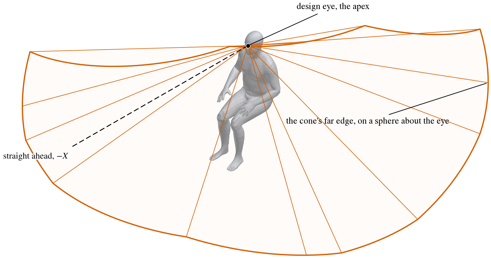

*Figure 14. The default Super Cone on a seated [Human](Human.md): every direction from the design eye inside the
profile of Figure 13, out to the cone's far edge.  The straight lines run from the eye to the profile's corners.*

The cone also marks surfaces.  An Intersect sub-surface on the fuselage (see
[Sub-Surface Types](SubTab.md#sub-surface-types)) whose Intersect Geom is a pilot's Super Cone outlines the part of the
fuselage the required view passes through: the region a windshield must cover.

## Shared Tabs

The Gen, XForm, Mass and Sub tabs are common to every component; see [Gen](GenTab.md),
[XForm](XFormTab.md), [Mass](MassTab.md) and [Sub-Surfaces](SubTab.md).

## Scripting

A script adds an Auxiliary component with `AddGeom( "AUXILIARY", parent_id )` and chooses its mode with the parm
`AuxiliaryGeomType` (`AUX_GEOM_MODE`) in the group `Design`, where its other parms are too.  The bogies of the ground,
gear and spray modes are set with `SetAuxiliaryGeomContactPtID( geom_id, index, bogie_id )` and read with
`GetAuxiliaryGeomContactPtID`, index 0, 1 or 2; `ReadAuxiliaryGeomCCEFile` reads a clearance envelope.

## References

1. Federal Aviation Administration, "Design Considerations for Minimizing Hazards Caused by Uncontained Turbine
   Engine and Auxiliary Power Unit Rotor Failure," Advisory Circular AC 20-128A, March 25, 1997.
2. Federal Aviation Administration, "Minimizing the Hazards from Propeller Blade and Hub Failures," Advisory Circular
   AC 25.905-1, September 27, 2000.
3. ESDU, "Estimation of Spray Patterns Generated from the Sides of Aircraft Tyres Running in Water or Slush," ESDU
   Data Item 83042, December 1983, Amendment A, April 1998.
4. European Union Aviation Safety Agency, "Protection against wheel and tyre failures," AMC 25.734, Certification
   Specifications and Acceptable Means of Compliance for Large Aeroplanes (CS-25).
5. Federal Aviation Administration, "Pilot Compartment View Design Considerations," Advisory Circular AC 25.773-1,
   January 8, 1993.
6. The Tire and Rim Association, Inc., "2025 Aircraft Year Book," 2025.  General Notes for Use of Aircraft Tire
   Data, note 13, Bias (Diagonal) Ply Aircraft Tire Standard Growth and Minimum Clearance Allowance, pp. 8-9.
7. The Tire and Rim Association, Inc., "Engineering Design Information: Aircraft Tires and Rim Contours," Akron, OH,
   index of October 30, 2024.  Page AC-12, Clearance Envelope Geometry Definition, Radial and Bias.
8. European Aviation Safety Agency, "Wheel and Tyre Failure Model," TGM/25/08 Issue 2, 2002; Appendix 1 of Notice of
   Proposed Amendment (NPA) 2013-02, 2013.
9. "Launching System, Nose Gear Type, Aircraft," MIL-L-22589D, 1979.
10. Engelbeck, R. M., et al., "Multiple-Purpose Subsonic Naval Aircraft (MPSNA) - Multiple Application Propfan Study
    (MAPS)," NASA CR-175104, Boeing Military Airplane Company, 1986.
