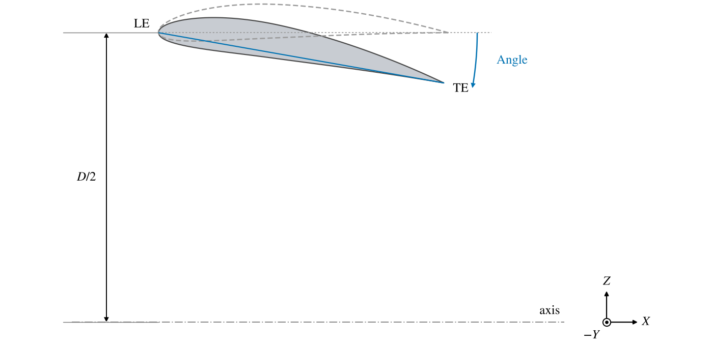
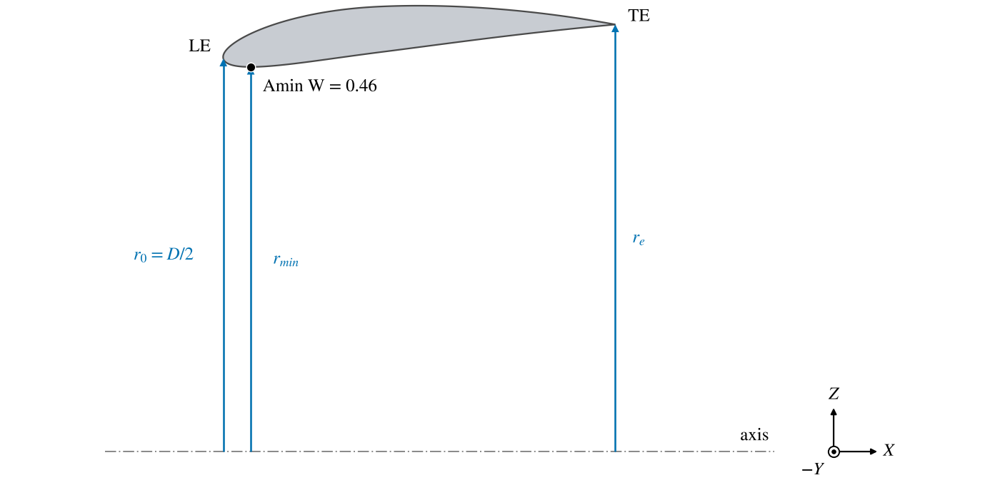
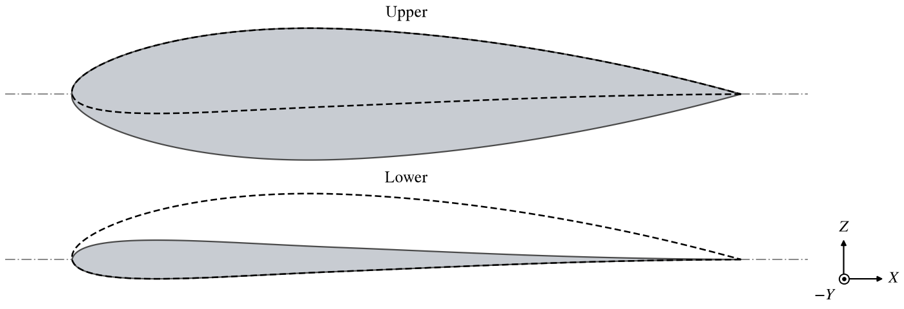

The Body of Revolution (BOR) sweeps a single cross section once around the $X$ axis.  In *Flowthrough* mode the
section is set off from the axis, and the result is an open ring: a duct, a fan shroud, a ring wing or a short
nacelle, with an airfoil for its wall.  In *Upper* and *Lower* mode the axis runs along the section's chord, and the
result is a closed, streamlined body whose radius follows the section's upper or lower surface.

| Topic                                                   | Tab    |
|:--------------------------------------------------------|:-------|
| [Quick Start](#quick-start)                             |        |
| [Flowthrough](#flowthrough)                             | Design |
| [Upper and Lower](#upper-and-lower)                     | Design |
| [The Cross Section](#the-cross-section)                 | XSec, Modify |
| [Tessellation](#tessellation)                           | Design |
| [Scripting](#scripting)                                 |        |

The [Gen](GenTab.md), [XForm](XFormTab.md), [Mass](MassTab.md) and [Sub](SubTab.md) tabs are described on their own
pages.

## Quick Start

### A duct

1. Add a Body of Revolution.  A new one is a torus: a circle of diameter 1 swept around a circle of diameter 2.
2. Place it with the XForm tab.
3. Choose an airfoil for the section on the XSec tab, and set its chord and *T/C*.
4. Set *Diameter* and *Angle* on the Design tab.

### A streamlined body

1. Add a Body of Revolution and set *Mode* to Upper.
2. Place it with the XForm tab.
3. Choose a symmetric airfoil for the section on the XSec tab.
4. Set the chord to the body's length, and *T/C* to its diameter over its length.

## Flowthrough

The section is laid with its chord along $X$, its leading edge at $X = 0$ and at a radius of half the *Diameter*,
and its upper surface outward (Figure 1).  *Angle* then turns the section about its leading edge; a positive angle
turns its trailing edge toward the axis, so the ring narrows toward the back.  The section is swept a full turn around
the $X$ axis; its inner surface is the inside of the duct.

*Figure 1. A Flowthrough BOR cut through its axis, above the axis: a NACA 4412 section, chord 1, Diameter 2, at Angle
0 (dashed) and 10 degrees.*

Four areas are reported, each the area of a circle about the axis:

| Output | Area                                                                                         |
|:-------|:---------------------------------------------------------------------------------------------|
| A0     | Enclosed by the leading edge: the capture area of a duct, $\pi (D/2)^2$.                     |
| Ae     | Enclosed by the trailing edge: the exit area.                                                |
| Amin   | Enclosed by the point of the section nearest the axis: the throat.                           |
| Amin W | Where that point lies: the fraction $W$ of the way around the section from the trailing edge.  |

In Upper and Lower mode they are zero.

Figure 2 shows the radius behind each area.  Once a positive *Angle* turns the trailing edge in far enough, the trailing
edge is the point nearest the axis, and *Amin* equals *Ae*; on the section of Figure 1 that happens from an *Angle* of
about 2 degrees.

*Figure 2. The section of Figure 1 at Angle -5 degrees, cut through the axis above it, with the radii of the circles
whose areas are A0, Ae and Amin: $A_0 = \pi r_0^2$, $A_e = \pi r_e^2$, $A_{min} = \pi r_{min}^2$.  The dot is the
point nearest the axis, on the inner surface.*

A Flowthrough BOR is the quickest model of a round duct or nacelle: one airfoil, a diameter and an angle.  It is always
the open ring, though, and always round.  When an analysis needs the nacelle closed at its lips or faces, a flowpath
that cuts through the wing or fuselage it is buried in, or an inlet carried upstream to the edge of a CFD domain, or
when the nacelle is not round, build it as a Stack from a nacelle preset (see [Stack Presets](StackPresets.md)) and
choose its representation with the [Engine Model](EngineModel.md).

## Upper and Lower

In *Upper* mode the section's chord lies on the $X$ axis, leading edge at the origin, and its upper surface is swept
around the axis, so the body's radius at each point along the chord is the height of the upper surface there.
*Lower* does the same with the lower surface, measured below the chord.  The result is closed at both ends, and as
long as the chord (Figure 3).  *Diameter* and *Angle* are not used, and are greyed.

The radius of the body is the section's thickness above (or below) its chord line, so a symmetric section of
thickness ratio $t/c$ gives a body of diameter $t$ and length-to-diameter ratio $c/t$.  Camber makes the Upper body
fatter and the Lower body thinner.

*Figure 3. The Upper (above) and Lower (below) bodies of a NACA 4412 section of chord 1, cut through their axis, with
the section (dashed).*

## The Cross Section

The section may be any of the [Cross Section Curves](XSecCurves.md) or [Airfoils](Airfoils.md), and the Modify tab
treats it as it treats a wing's airfoil (see [Airfoils](Airfoils.md)).

A new BOR's section is a circle of diameter 1.  An airfoil chosen in its place keeps its width and height, so it
starts with a chord of 1 and a *T/C* of 1: set the thickness straight away.

In every mode the BOR is a wing-type surface with the section as its airfoil, so analyses that reduce wings to thin
lifting surfaces (DegenGeom, the VSPAERO vortex lattice) treat a Flowthrough BOR as a ring wing, and treat an Upper or
Lower BOR as a lifting surface too, not as a body.  Model a streamlined body that such an analysis should see as a
body with a [Fuselage or Stack](FuselageStack.md) or a [Pod](Pod.md).

## Tessellation

The Gen tab's *Num_U* sets the points around the axis, and *Num_W* the points around the section.  *LE Clustering*
and *TE Clustering* on the Design tab bunch the points around the section toward its leading and trailing edges
(values below 1 bunch them).  *Cap Tess* sets the points across the section's trailing edge when the Modify tab
leaves it blunt.

## Scripting

| Control         | Parm                     | Default                                              |
|:----------------|:-------------------------|:-----------------------------------------------------|
| Mode            | `Mode`                   | `BOR_FLOWTHROUGH`; also `BOR_UPPER`, `BOR_LOWER`     |
| Diameter        | `Diameter`               | 2                                                    |
| Angle           | `Angle`                  | 0                                                    |
| A0, Ae, Amin, Amin W | `A0`, `Ae`, `Amin`, `AminW` | outputs                                     |
| LE, TE Clustering | `LECluster`, `TECluster` | 0.25                                               |

All are in the *Design* group.  The section is changed with `ChangeBORXSecShape` and read with `GetBORXSecShape`;
its parameters are in the BOR's *XSecCurve* group.  `ReadBORFileXSec`, `ReadBORFileAirfoil`, `SetBORXSecPnts`,
`SetBORAirfoilPnts` and the `...BORCST...` calls set a section from a file, from points, or as a CST airfoil.
