CFD Mesh makes an unstructured triangle mesh of a model's outer surface, the surface grid a CFD solver starts from.
It intersects the components, removes the parts of each that lie inside the others, and meshes what is left as one
closed surface whose edge lengths follow the model's curvature and the sizes asked for with sources (Figure 1).  It
can cut the model in half at a symmetry plane, enclose it in a far field boundary and trail wakes from wings, and it
writes the mesh in the formats of many solvers.  Surface Intersection shares the intersection and trimming but
writes curves and CAD surfaces instead of a mesh.

The triangles are isotropic: each is as near equilateral as the mesher can make it, with no stretching along the
surface.  The mesh suits panel and Euler codes and volume meshers that start from a surface (CBAero, FlightStream,
Cart3D, FUN3D, TetGen, AFLR3, Pointwise).  For Navier-Stokes the boundary layer's stretched cells are grown from this
surface by another tool, such as AFLR, Pointwise, Capstone or the Chimera Grid Tools.

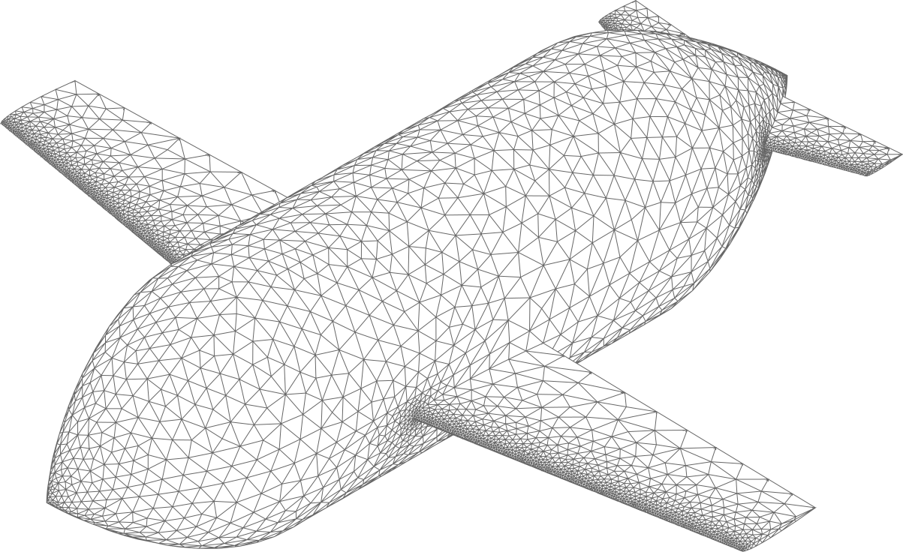

*Figure 1. The mesh of a small aircraft at the default settings.  The wing and tail are cut where they meet the
fuselage, and their parts inside it are gone.*

| Topic                                                           | Tab               |
|:----------------------------------------------------------------|:------------------|
| [Quick Start](#quick-start)                                     |                   |
| [How the Mesh Is Made](#how-the-mesh-is-made)                   |                   |
| [How Edge Lengths Are Chosen](#how-edge-lengths-are-chosen)     | Global            |
| [Choosing Settings](#choosing-settings)                         | Global            |
| [Global Settings](#global-settings)                             | Global            |
| [Display](#display)                                             | Display           |
| [Output Files](#output-files)                                   | Output            |
| [Sources](#sources)                                             | Sources           |
| [Half Mesh and Far Field](#half-mesh-and-far-field)             | Domain            |
| [Wakes](#wakes)                                                 | Wakes             |
| [Running and Checking the Mesh](#running-and-checking-the-mesh) |                   |
| [Scripting](#scripting)                                         |                   |

## Quick Start

### A closed surface mesh

1. Put the components to mesh in a Set with the [Set Editor](SetEdit.md), and choose it as the *Normal Set* on the
   Global tab.
2. Set *Max Edge Len* from the model's size, and *Min Edge Len* to the shortest edge the curvature rules may ask for;
   sources may go below it (see [Choosing Settings](#choosing-settings)).
3. On the Output tab, turn on the files the solver reads and turn the others off.
4. Press *Mesh and Export*.  The console under the tabs ends with "Is Water Tight" when the mesh is closed.
5. On the Display tab, color the mesh by *Reason* to see which setting sized each part, and adjust.

### A half mesh in a far field box

1. Choose the Set as above; the model should be symmetric about $Y = 0$.
2. Set *Max Edge Len* and *Min Edge Len* as above.
3. On the Domain tab, turn on *Generate Half Mesh* and *Generate Far Field Mesh*, and set the far field's *Max Edge
   Len* and the box's *Length*, *Width* and *Height*.
4. Press *Mesh and Export*, and check the console for "Is Water Tight".
5. Color the mesh by *Reason*, and adjust.

## How the Mesh Is Made

A run takes the surfaces of every component in the Normal Set, and the thin-surface form of every component in the
Degen Set.  It cuts them where they cross, keeps the pieces that face the outside, and meshes each piece so that its
edges along a cut are shared exactly with the piece on the other side.  The result is one surface with no gaps.

What is kept depends on each component's kind:

- An ordinary component keeps the parts of its surface that are outside every other component.
- A component marked [Negative Volume](GenTab.md#negative-volume) on its Gen tab is a cutter.  Its surface is kept
  only where it lies inside another component, facing inward, so its volume is removed from the model (Figure 2).
- A surface that other components pass through, such as a propeller drawn as a disk (Figure 3) or a component used as
  the far field, keeps the parts outside the ordinary components.  A negative volume does not cut it.

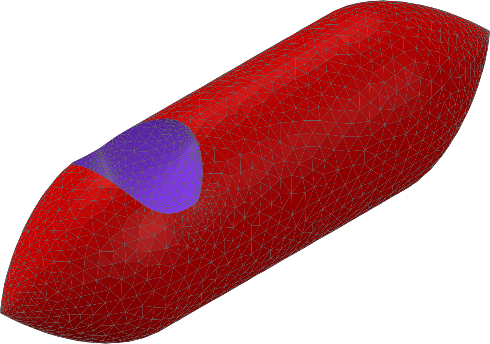

*Figure 2. A Pod marked Negative Volume, sunk into the top of a Fuselage, colored by tag.  The part of the Pod inside
the Fuselage is kept as the wall of a cavity, and the Fuselage's skin over it is removed.*

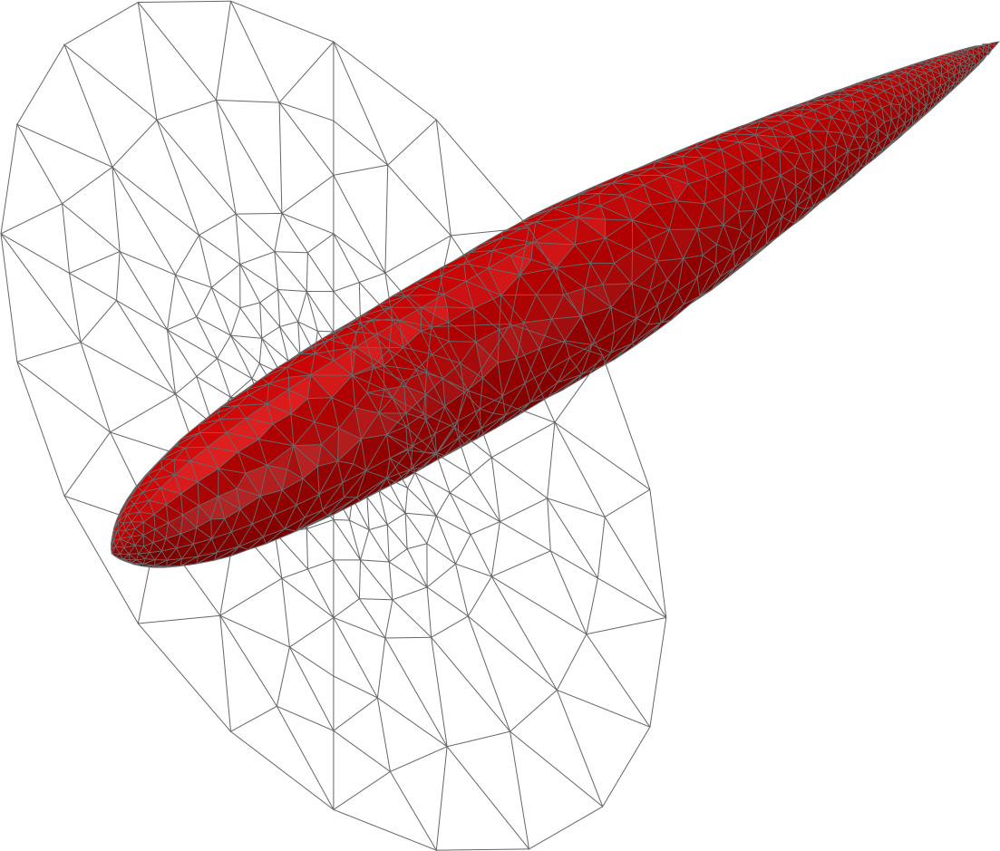

*Figure 3. A Propeller drawn as a disk around a Pod.  The disk is meshed around the Pod and stays in the mesh as a
surface of its own, for a solver that models the rotor as an actuator disk; OpenVSP draws it as its edges alone.*

### Inlets, ducts and propellers

A [Propeller](Propeller.md) is meshed as a disk when its *Prop Mode* is *Disk* or *Both*; in *Blades* mode it gives
no disk.  The disk is a surface that other components pass through, so it is kept wherever it is outside the
ordinary components, and its free rim is left open.

A flow-through nacelle is made with a Negative Volume: a body for the nacelle, and a second, slimmer body marked
*Negative Volume* that passes through both of its ends.  The cutter removes the core, and its own surface becomes the
duct's wall, with the nacelle's lips where the two cross.  A disk placed across the duct is trimmed to the duct's
wall, and the mesh stays closed (Figure 4).  Mark the inlet and exit faces with [Sub-surfaces](SubTab.md) to give
them tags of their own, so a solver can apply its boundary conditions there.

A disk that lies exactly on a line where a body's surface is joined, such as the middle section of a Pod, can fail
to mesh; move it a little along the axis.

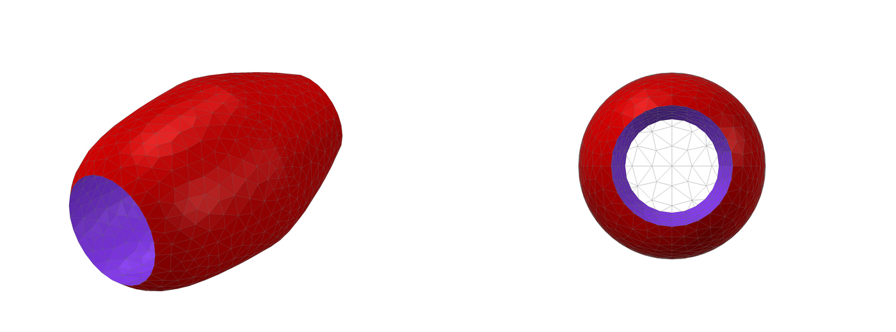

*Figure 4. A flow-through nacelle cut by a Negative Volume Pod (the duct's wall, violet), with a Propeller disk across
its duct, from above and to the side and from upstream.  The disk is trimmed to the duct's wall; OpenVSP draws it as
its edges alone.*

The mesh is made on the components' smooth surfaces and on the exact curves where they cross, not on the
tessellation drawn on the screen, so a component's *Num_U* and *Num_W* do not change it.

Wings and bodies are meshed as patches.  Each surface is cut at its feature lines (the cross sections, the leading
and trailing edges, the start of the end caps) and every patch is meshed on its own, with matching edges on the lines
between them.

The [Sub-surfaces](SubTab.md) of a component are cut into the mesh when *Intersect Subsurfaces* is on (the default).
Their outlines become lines of the mesh, and the triangles inside each sub-surface carry a tag of their own in the
files, so a solver can report on a control surface or apply a boundary condition to an inlet face.

A run hides every component.  The default Normal Set is *Shown*, so a second run straight after the first finds
nothing to mesh: the console reports "No Surfaces To Mesh" and no file is written.  Mesh a named Set, or show the
components again, before running again.

## How Edge Lengths Are Chosen

Every point of every surface has a target edge length $t$, the length the mesher aims each edge near it at.  The
target is the smallest of the lengths that each rule asks for there:

- *Max Edge Len*, everywhere.
- Two curvature rules, *Max Gap* and *Num Circle Segments*, held to no less than *Min Edge Len*.
- The surface's width, when *Num Width Segments* is on, also held to no less than *Min Edge Len*.
- Every source whose region reaches the point.  Sources are not held to *Min Edge Len*; they are the way to ask for
  shorter edges than it allows.

*Max Edge Len* and *Min Edge Len* are not rules of their own so much as bounds on the others: the target is the
smallest length the rules ask for, subject to *Max Edge Len* above and, for the curvature and width rules,
*Min Edge Len* below (Figure 5).  Figure 5 is laid out as the reason key on the Display tab is, in its colors.

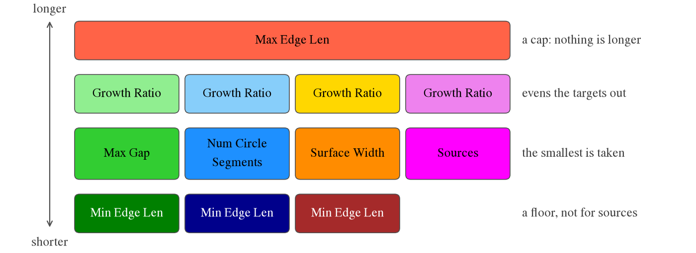

*Figure 5. The sizing rules, in the colors of the reason key.  Each column is a rule, the Growth Ratio box above it
the growth from a region that rule sized, and the Min Edge Len box below it the floor under it; sources have no
floor.  Max Edge Len caps them all.*

Colored by *Reason* on the Display tab, the mesh shows which of these set each part (Figure 6).  Each triangle takes
the color of the rule that gave its nearest background map point its target: a rule's own color where the rule set
it, the lighter color above it where the growth ratio lowered it from a region that rule set, and the darker color
below it where the rule asked for less than *Min Edge Len* and was held there.  With *Rigorous 3D Growth Limiting* on,
the growth ratio carries a region's color onto nearby components too.  The far field, the symmetry plane and a wake
are colored by the same rules.

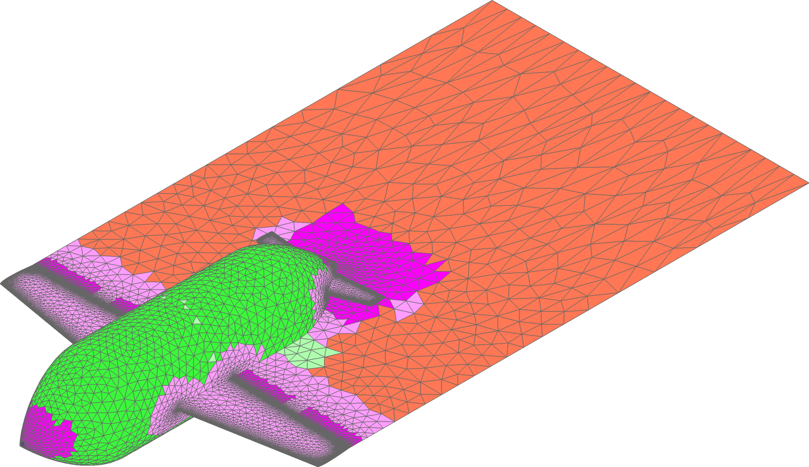

*Figure 6. The aircraft of Figure 1 with the default sources of every component and the wing's wake, colored by Reason.
The fuselage is sized by Max Gap away from its ends, where its default sources and the growth from them take over; the
wing and tail are sized by their sources along their edges, and the wake by *Max Edge Len* away from the aircraft and
by the sources and the growth from them near it.*

The targets are then evened out with the *Growth Ratio*, so that they nowhere change faster than it allows (see
[Growth](#growth)).  They are worked out on a grid of points over each surface, its background map, and the mesher
reads them from it (see [The background map](#the-background-map)).

### Curvature

A surface curved with radius $r$ is resolved by two rules (Figure 7).  *Max Gap* $g$ is the largest distance allowed
between an edge and the surface it spans; an edge that leaves a gap $g$ on a circle of radius $r$ is

$$
t_g = 2\,\sqrt{2\,r\,g - g^2}
$$

long, or $2\,g$ on a curve tighter than the gap itself, $r \le g$.  *Num Circle Segments* $N$ is the number of edges
that would go round a full circle of radius $r$, so each is

$$
t_N = 2\,r\,\sin\left(\frac{\pi}{N}\right)
$$

long, for $N > 2$.  Below that the rule becomes $t_N = 4\,r / N$, which grows without bound as $N$ falls to zero; that
is how a very small *Num Circle Segments* turns the rule off (see [Choosing Settings](#choosing-settings)).

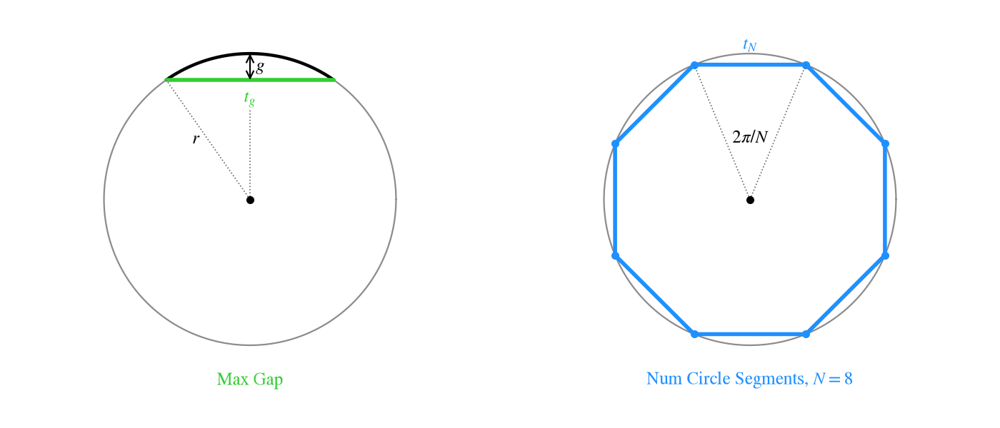

*Figure 7. The two curvature rules on a circle of radius r.  Max Gap limits the gap g between an edge and the arc it
spans; Num Circle Segments divides the full circle into N equal edges.*

The tighter of the two principal curvatures is used.  $t_g$ grows with the square root of the radius and $t_N$ in
proportion to it, so *Num Circle Segments* sets the length on tight curves, such as a leading edge or a small body,
and *Max Gap* on gentle ones, such as a fuselage or the middle of a wing.  They take over from each other at

$$
r = \frac{g}{1 - \cos( \pi / N )}
$$

which is $0.26$ at the defaults.  Figure 8 shows the target length that results at the default settings, and the
median edge length of spheres of radii from 0.03 to 40 meshed with them.

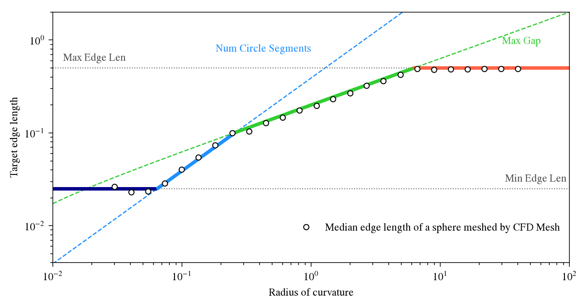

*Figure 8. Target edge length against radius of curvature at the default settings (Max Edge Len 0.5, Min Edge Len
0.025, Max Gap 0.005, Num Circle Segments 16), drawn in the colors of the Display tab's reason key.*

On one body the regimes follow each other as the radius changes.  Figure 9 shows a slender Pod, 0.5 in radius in the
middle and pointed at both ends, at the defaults and without sources, colored by Reason: *Max Gap* (lime green) sizes
its middle, *Num Circle Segments* (blue) takes over toward the ends where the radius falls below $0.26$, and
*Min Edge Len* (dark blue) holds the edges at the very tips, where the radius falls to nothing.  The lighter shades
around each are the growth from it.

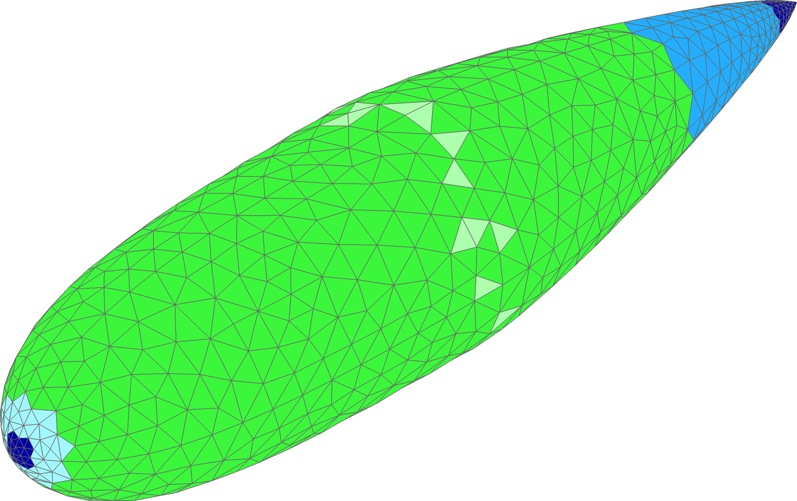

*Figure 9. A slender Pod at the default settings, colored by Reason.*

Below a radius of $0.064$ the default *Min Edge Len* governs, and above $6.25$ the default *Max Edge Len* does.  A
curve tighter than *Min Edge Len* can resolve, such as a small leading edge radius, is meshed at *Min Edge Len*; the
curvature rules cannot make edges shorter than it.  A sharp edge, where two surfaces meet at an angle, has no
curvature of its own and is not refined by these rules (Figure 22); use a source there.

### Surface width

A surface narrower than the edges asked of it, such as the strip that closes a blunt trailing edge or a thin end cap,
cannot be meshed well: its sides are divided more coarsely than it is wide, and every triangle across it is a sliver.
When the toggle beside *Num Width Segments* is on (the default), the target on each surface is held to its width
divided by *Num Width Segments*, and held to no less than *Min Edge Len*.  The width is measured along the surface's
own parameter lines, from side to side.  Lines that close on themselves, such as the way round a fuselage, and lines
that taper to a point, such as those into a nose, do not count as a width.

Figures 10-11 show a wing with a trailing edge $0.02$ thick, meshed at the default settings with the toggle off and
on.  With it off, 1.7% of the triangles have an angle under $17^\circ$ and 56 have one under $5^\circ$; with it on,
0.04% and none.  The edges along the trailing edge come down to *Min Edge Len*, since the strip is narrower than that,
and the growth ratio carries the change onto the skins.

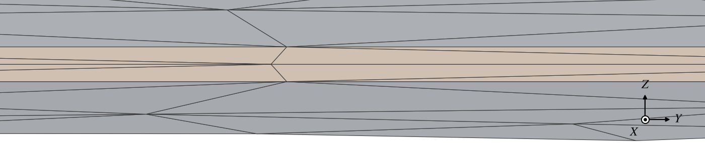

*Figure 10. A stretch of a blunt trailing edge seen from behind, with the width limit off.  The trailing edge strip,
in the darker color, is crossed by slivers as long as the edges of the skins above and below it.*

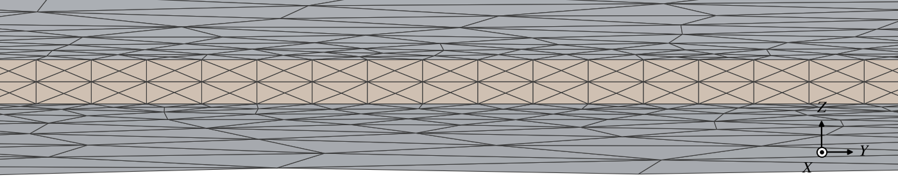

*Figure 11. The same stretch of trailing edge with the width limit on.*

### Growth

The *Growth Ratio* $G$ limits how fast the target may change anywhere on the surface.  Between any two points a
distance $d$ apart, the larger target is held to at most the smaller one plus $(G - 1)\,d$.  The limit is applied
between every pair of nearby points, not only outward from the smallest target, so it flattens any part of a source,
curvature or width target that rises faster than it allows, and stretches a fine region beyond where the rule that
made it ends (Figure 21 shows it taking over from a source).  The default, $1.3$, lets neighboring edges differ by
about 30%.  A smaller ratio spreads each refinement further and gives better shaped triangles; a larger one keeps
refinements local (Figure 12).  On the aircraft of Figure 1 with the default sources of every component, growth ratios
of 1.1, 1.3 and 2.0 give 0.03%, 0.08% and 0.17% of the triangles an angle under $17^\circ$.

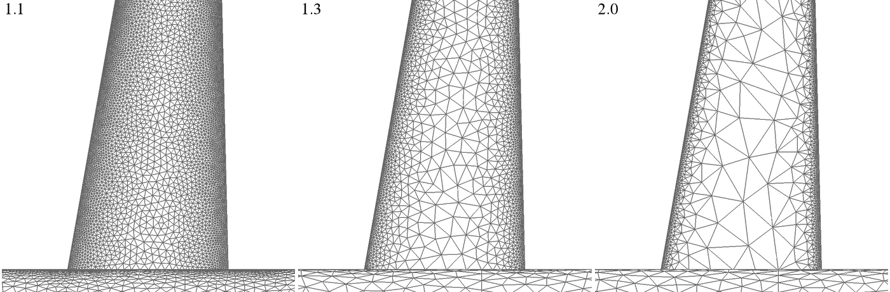

*Figure 12. The root of the wing of Figure 1 with its default sources, from above, at Growth Ratios 1.1, 1.3 and 2.0.
The leading and trailing edge sources set the same lengths along the edges in each; the ratio decides how far from
them the short edges reach.*

By default the limit is applied between the points of each surface, and from one surface to the next across the
curves where they meet.  Two parts that do not touch share no curve, so the fine sizing one needs reaches the other
only along the surfaces, and a part close to it in space can stay coarse.  *Rigorous 3D Growth Limiting* applies the
same limit between the points of different surfaces as well, by straight-line distance through space, so a fine
region on one part also refines a nearby part that it does not touch.  It takes longer, and is off by default.

Figure 13 shows the case it is for: a small ball 0.05 above the flat face of a large box, meshed with Max Edge Len 1,
Min Edge Len 0.01 and Max Gap 0.001.  The ball is meshed finely for its curvature.  With the limit off, the box's
face beside it is meshed at Max Edge Len, its edges within 0.5 of the point under the ball 0.94 long; with the limit
on they are 0.15, and 0.27 within 2 of it, growing from the ball's lengths at the growth ratio.  Colored by Reason
(Figure 14), the face is Max Edge Len with the limit off, and Growth Ratio from the ball's Max Gap with it on.  Turn
it on where separate parts lie close together and one has much finer features than the other, such as a small
antenna or probe near a large flat skin, or a nacelle close under a wing.

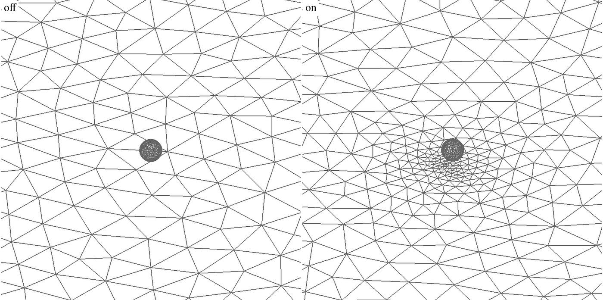

*Figure 13. A ball of radius 0.25 hovering 0.05 above the flat top of a large box, seen from above and to the side,
with Rigorous 3D Growth Limiting off and on.  The box's face directly under the ball is refined only with it on.*

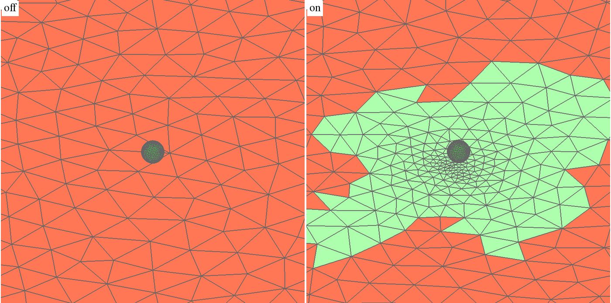

*Figure 14. Figure 13 colored by Reason: Max Edge Len (red) with the limit off, Growth Ratio from Max Gap (light
green) with it on.*

### The background map

The targets are not worked out at every point the mesher looks at.  Each surface carries a background map: a grid
of points with ten intervals across each patch of the surface's own definition in each direction, such as ten along
the span of each wing section.  Every rule above is evaluated at the points of the map, the growth ratio is applied
across them, and the mesher interpolates the target from the map wherever it places or moves a point.

So the map sets the finest detail a target can follow.  A source whose region is small beside the spacing of the
map's points is caught only where a map point falls inside it, and its effect is patchy or lost.  A Line source of
*Rad* 0.6 across a single wing section 12 long, whose map points are 1.2 apart along the span, gives edges of 0.06 at
its middle, where it passes a map point, and 0.13 to 0.15 at its ends.  Give a source a *Rad* of at least two map
spacings, or divide a long section into shorter ones, which gives it more map points.

The pieces of a symmetry plane carry maps of a hundred intervals each way (see [Far field](#far-field)).

## Choosing Settings

Settle the sizing one rule at a time, coarsest first, and color the mesh by *Reason* after each run to see which rule
sized each part:

1. Set *Max Edge Len* from the model's size; *Rel* gives it as a fraction of the model's diagonal.  Set *Min Edge Len*
   equal to it, which turns the curvature and width rules off, and leave out sources.  Adjust *Max Edge Len* until
   this uniform, coarsest mesh is right for the flat and gently curved parts of the model, most of its area.
2. Lower *Min Edge Len*, to a twentieth of *Max Edge Len* to begin with (5%, the default under *Rel*).  It should be
   no longer than the edge the curvature rules ask for on the smallest radius $r$ that must be resolved,
   $2\,r\,\sin(\pi / N)$, about $0.4\,r$ at 16 segments.  It is a floor, not a target: set longer, it leaves that
   radius coarse; set much shorter, it lets every smaller, tightly curved part be refined down to it.
3. Choose one curvature rule, *Max Gap* or *Num Circle Segments*, turn the other off (see the table below), and adjust
   the one chosen until the curved parts are resolved.  Then check *Min Edge Len* again: are the shortest edges short
   enough?  Figure 8 shows which rule governs at a given radius, and Figure 9 how the two meet on one body.
4. If wanted, bring the other curvature rule back.
5. Add sources last, where the flow needs resolution the geometry does not show.  The default sources of a wing, along
   its leading and trailing edges and across its tip, are a good start.

Keep the *Growth Ratio* near the default.  Lower it, toward $1.1$, for better triangles in the transitions; raise it to
keep each refinement more local.  At the end, color by *Angle* to check the shape of the triangles, and by *Length*
to see where they miss their targets.

Each rule can be turned off by setting it so that it never governs:

| Rule                | To turn it off                                                                          |
|:--------------------|:----------------------------------------------------------------------------------------|
| Max Edge Len        | Very large, such as 100 times the model's size                                          |
| Min Edge Len        | Very small, such as a millionth of the model's size, so it holds no rule up              |
| Max Gap             | Very large, such as 10 times the model's size                                           |
| Num Circle Segments | Very small, such as 0.00001: below 2 its length is $4\,r / N$, which grows without bound |
| Num Width Segments  | Its toggle off                                                                          |
| Growth Ratio        | 10, the largest it takes, so each refinement stays where it is asked for                 |
| Sources             | None                                                                                    |

*Min Edge Len* equal to *Max Edge Len* turns off both curvature rules and the width rule at once, since each is held
to no less than *Min Edge Len* and every target to no more than *Max Edge Len*.

With the width limit on, a blunt trailing edge thinner than *Min Edge Len* is meshed at *Min Edge Len* along its
strip, so lowering *Min Edge Len* refines every such trailing edge in the model.  A sharp trailing edge has no strip.

## Global Settings

The Global tab (Figure 15) holds the sizing rules for the whole model, the buttons that scale every source, the choice
of what is meshed and how, and threading.

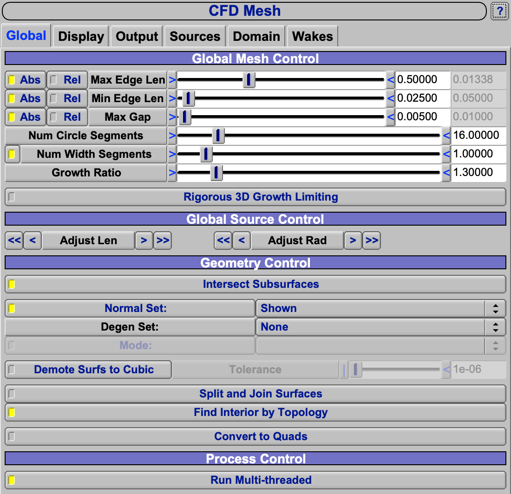

*Figure 15. The Global tab.*

### Global Mesh Control

*Max Edge Len*, *Min Edge Len* and *Max Gap* can each be given as an absolute length (*Abs*, the default) or
relative to something else (*Rel*); the box at the right of each shows the other form.  Relative *Max Edge Len* is a
fraction of the diagonal of the bounding box of the components being meshed, those of the Normal and Degen Sets, so
it follows the model's size.  Relative *Min Edge Len* and *Max Gap* are fractions of *Max Edge Len*, so a coarser or
finer mesh keeps their proportions; at the defaults they are 5% and 1%.  The form chosen is the one a run uses, from the
screen or from a script; the other is worked out from it.

| Control                     | Default | Meaning                                                                    |
|:----------------------------|:--------|:---------------------------------------------------------------------------|
| Max Edge Len                | 0.5     | Longest edge anywhere on the model                                         |
| Min Edge Len                | 0.025   | Shortest edge the curvature and width rules may ask for                    |
| Max Gap                     | 0.005   | Largest distance between an edge and the curved surface it spans           |
| Num Circle Segments         | 16      | Edges round a full circle of the local radius of curvature                 |
| Num Width Segments          | 1, on   | Edges across the width of a narrow surface; the toggle turns the rule on   |
| Growth Ratio                | 1.3     | Largest ratio of neighboring edge lengths                                  |
| Rigorous 3D Growth Limiting | off     | Growth limited across space between surfaces, not only along them          |

All lengths are in the model's units.

### Global Source Control

*Adjust Len* and *Adjust Rad* scale the *Len* or the *Rad* of every source on every component at once: `<<` divides
by 1.5, `<` by 1.1, `>` multiplies by 1.1 and `>>` by 1.5.

### Geometry Control

*Normal Set* chooses the components meshed as they are; *Degen Set* chooses components meshed in their thin-surface
form instead, for solvers that model lifting surfaces as sheets (Figure 16).  A wing in the Degen Set is meshed as its
camber surface.  A body is meshed as two flat plates through its axis that cross there, one in the component's own
X-Z plane and one in its X-Y plane, each with a tag of its own; a symmetric copy is meshed as its own two plates.
*Mode* uses a Mode's settings and its two Sets instead of the Sets chosen here; it is available when the model has
Modes, and the Mode is applied when the screen is opened and at each run.

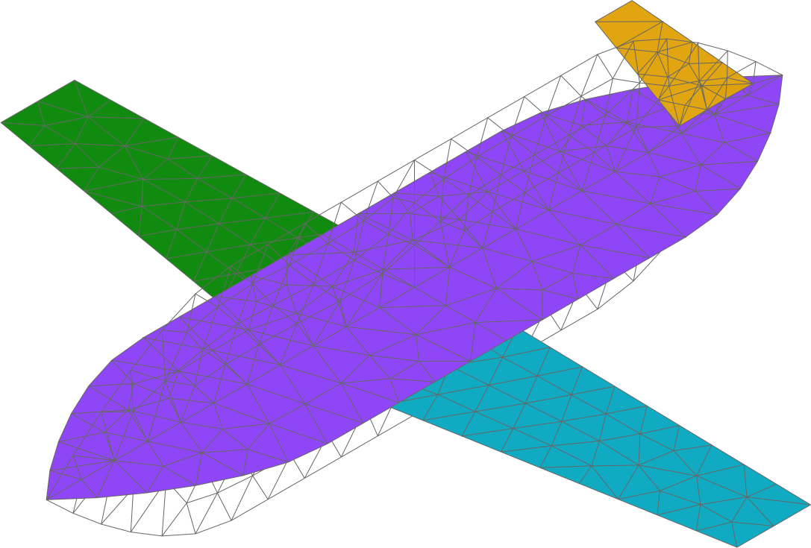

*Figure 16. The aircraft of Figure 1 meshed as a Degen Set: the wing and tail as their camber surfaces and the
fuselage as two crossed plates.*

### Split and Join Surfaces

CFD Mesh cuts every surface into patches along all of its feature lines, the black lines OpenVSP draws on a
component in its normal view, and meshes each patch.  *Split and Join Surfaces*, off by default, is for POGS output,
which works better with fewer, larger surfaces that are still split where it needs them.  With it on, the patches
are joined back together after the cut, and degenerate patches dropped, except at the lines that carry a feature,
such as a leading or trailing edge or the edge of a cap.  The mesh lines are kept along the joined boundaries, so the
mesh is much the same either way.

What changes is the surfaces POGS is given.  A body comes out as two halves around its circumference instead of
four; a blunt trailing edge is one surface instead of two; and a wing's end caps have fewer surfaces where they can.
At the defaults a Fuselage meshes 2 patches instead of 8, a wing with a blunt trailing edge 5 instead of 8, a wing
with a sharp trailing edge 4 instead of 6, and the aircraft of Figure 1 14 instead of 24.  *Show Patch Join Curves*
on the Display tab draws the lines where patches were joined.

### Find Interior by Topology

*Find Interior by Topology*, on by default, decides which pieces of the surfaces lie inside other components from
how the intersection curves connect, instead of by casting a ray from each triangle, and is faster.  Surfaces it
cannot classify fall back to rays.  Turning it off goes back to rays alone; do so only to check a mesh where you
suspect triangles were wrongly kept or removed.

### Demote Surfs to Cubic

*Demote Surfs to Cubic* replaces each surface of higher degree with a cubic one that matches it to within
*Tolerance* before the surfaces are intersected.  It is kept in case a surface of higher degree ever meshes badly;
there is no case known where it is recommended, so leave it off.

### Convert to Quads

*Convert to Quads* splits every triangle into three quadrilaterals, through the midpoints of its edges and its
center, for solvers that want them.  The triangles are made longer first, so the quadrilaterals' edges come out near
the lengths asked for.  The .obj, .msh, .poly and .vspgeom files keep the quadrilaterals; .stl, .tri, .facet and the
NASCART .dat split each back into two triangles.  The number of triangles the console and the CFDMesh Result report
is the number before the triangles are split into quadrilaterals.

### Process Control

*Run Multi-threaded*, on by default, meshes the surfaces on several threads at once.  The mesh is the same either
way; turning it off makes the run several times slower.

## Display

The Display tab (Figure 17) chooses what the 3D view shows of the mesh and the curves it was built on.

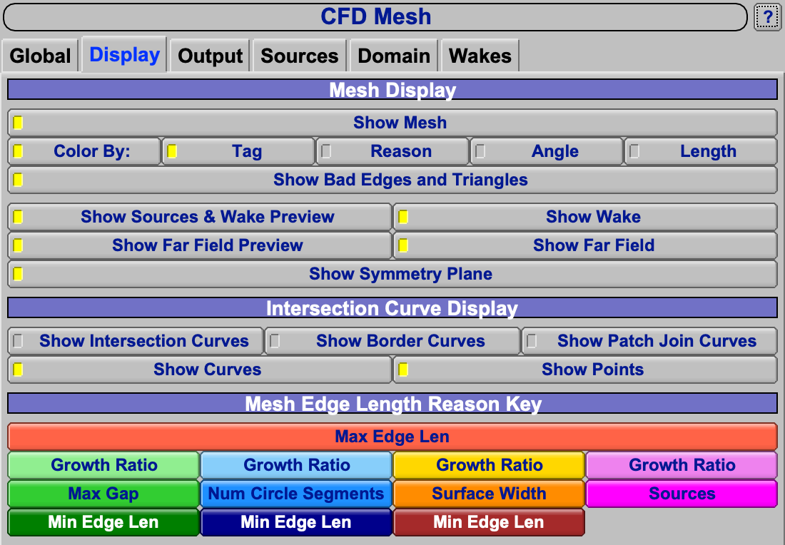

*Figure 17. The Display tab, with the reason key.*

*Color By* chooses what the color of the mesh shows:

- *Tag* colors each component and sub-surface its own color, the parts the files tag apart.
- *Reason* colors each triangle by the rule that set its target length, in the colors of the reason key at the
  bottom of the tab.  The colored names are the rules, *Growth Ratio* above a rule's name meaning a length set by the
  growth ratio from a region that rule set, and *Min Edge Len* below it meaning one that rule asked for but that was
  held up to *Min Edge Len*.
- *Angle* colors each face by its smallest angle, from $0^\circ$ to $60^\circ$.
- *Length* colors each face by how far its worst edge is from the target it was made for, from on target to a factor
  of two off.

*Reason* is the way to tune a mesh: it shows at once whether a region is sized by curvature, by a source, by the
growth ratio, or by *Max Edge Len* or *Min Edge Len*, and so which setting to change (see
[How Edge Lengths Are Chosen](#how-edge-lengths-are-chosen)).  *Angle* finds the poorly shaped triangles.

*Show Bad Edges and Triangles* marks the edges of a mesh that is not closed: those with one triangle, and those with
more than two.  *Show Wake*, *Show Far Field* and *Show Symmetry Plane* show or hide those parts of the finished mesh.
The intersection curve toggles draw the curves where components cross, the edges of the patches, and the joins *Split
and Join Surfaces* made, as curves and as the points the mesh places on them.

The two preview toggles show, before a run, what the settings as they stand will add.  *Show Sources & Wake
Preview* draws the sources of the components in the Normal and Degen Sets, and the wakes, stretched by *Scale Wake*
as the meshed wakes are.  *Show Far Field Preview* draws the far field box.

## Output Files

Each run writes every file whose toggle on the Output tab (Figure 18) is on.  All are on by default except POGS, so
turn off the ones not needed; writing them takes a large part of a run on a big mesh.  Each file is named after the
model file, in its folder, until another name is chosen with its *...* button.

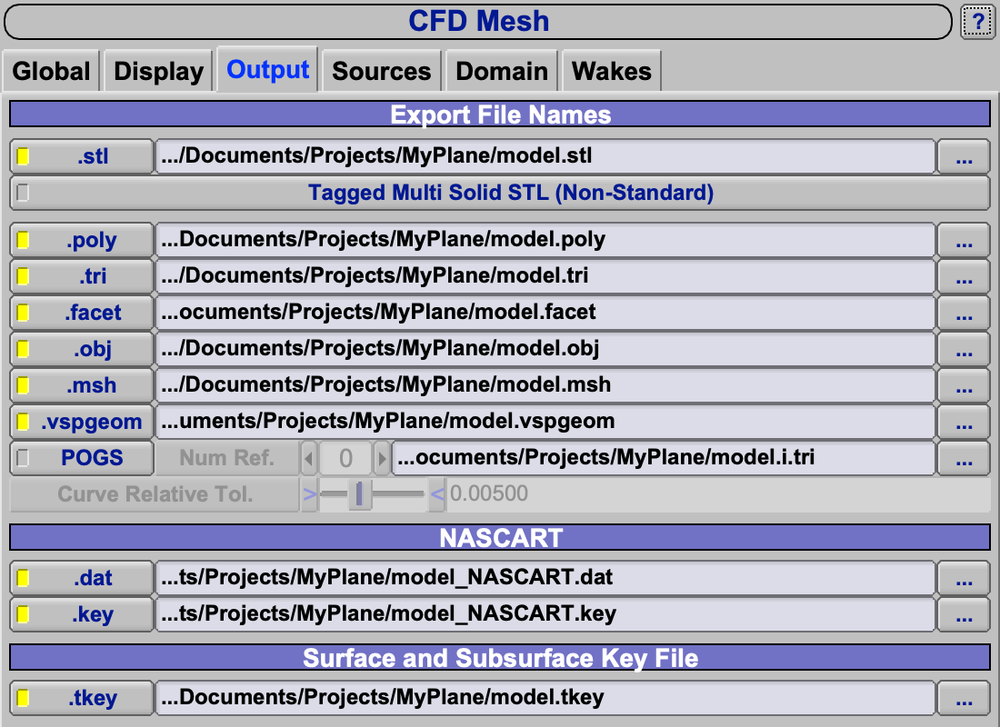

*Figure 18. The Output tab.*

| File       | Format                                                                          |
|:-----------|:--------------------------------------------------------------------------------|
| .stl       | Stereolithography                                                               |
| .poly      | TetGen surface description, for volume meshing                                  |
| .tri       | Cart3D surface triangulation, with a tag on each triangle                       |
| .facet     | Facet file                                                                      |
| .obj       | Wavefront OBJ                                                                   |
| .msh       | Gmsh mesh                                                                       |
| .vspgeom   | The VSPAERO geometry file                                                       |
| POGS       | The input files of POGS, for overset structured grids (see [POGS](#pogs))       |
| .dat, .key | NASCART geometry and its key file                                               |
| .tkey      | The key to the tags: what each tag number stands for                            |

*Tagged Multi Solid STL* writes one solid in the .stl for each tag instead of one for the whole mesh, which few
programs read.

The tags number each surface of each component in turn, and each combination of a surface with the sub-surfaces
covering it after that.  The .tkey file lists the component, surface and sub-surfaces of each number, so a solver's
results can be named; the far field and symmetry plane have tags of their own.

### POGS

POGS, the Pre-processor for Overset Grid Simulations, is part of the Chimera Grid Tools (CGT) developed by William
Chan and others at NASA Ames Research Center.  From a set of surface files it builds an overset structured grid
system: surface grids over every face, edge and corner of the geometry, near-body and off-body volume grids, the
connectivity between them, and input files for the Overflow and LAVA flow solvers (Reference 1).  POGS usually takes
its input from a CAD solid through a companion tool, EGADS2SRF; the POGS output of CFD Mesh is that same set of
files made from the OpenVSP model, so POGS can start from it directly.

The POGS output, named after the .i.tri file chosen, is:

| File     | Contents                                                                                     |
|:---------|:---------------------------------------------------------------------------------------------|
| .i.tri   | The trimmed surface triangulation, in Cart3D format: the CFD Mesh itself                     |
| .uvin    | Each surface's untrimmed grid on its own U and W lines (Plot3D), iblanks marking trimmed points |
| .cur     | The curves where the surfaces meet, as Plot3D curve grids                                    |
| .topo    | The topology: the face on each side of each curve, and the sense of each face's normal       |
| .gcomp   | The components: which faces belong to each surface of each component                         |
| .pogs.i  | The POGS input parameters                                                                    |

*Num Ref.* refines the tessellation of the surfaces in the .uvin file, and *Curve Relative Tol.* is the tolerance the
curves in the .cur file are fitted to, as a fraction of each segment's length.  The .pogs.i file starts POGS from
the CFD Mesh settings: its maximum grid spacing is *Max Edge Len*, its maximum stretching ratio the *Growth Ratio*,
and its maximum dihedral angle $360^\circ$ divided by *Num Circle Segments*.  Its other parameters, among them the
wall spacing of the volume grids and the distance to the far field, are defaults to be edited for the case.

## Sources

A source asks for shorter edges in a region of a component's surface, below what *Max Edge Len* and the curvature
rules give there.  Use sources where the flow needs resolution the geometry does not show: leading and trailing
edges, wing tips, the junction of a wing and a body, the region of a shock, an inlet lip.  They are made and edited on
the Sources tab (Figure 19).

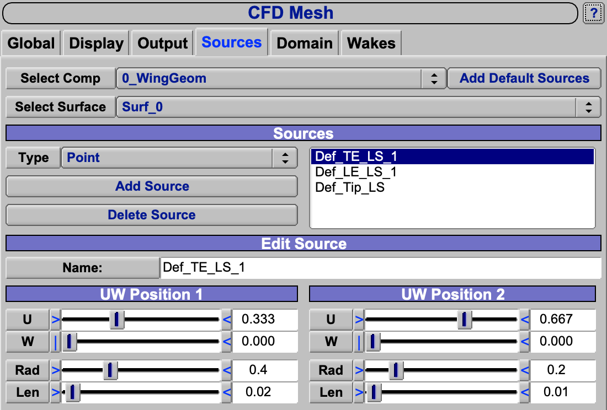

*Figure 19. The Sources tab with the default sources of a wing, the first selected.*

A source belongs to one main surface of one component, chosen with *Select Comp* and *Select Surface*, and is placed
by its $U$ and $W$ coordinates on that surface, each from 0 to 1, as sub-surfaces are.  It moves and resizes with
the component, and a symmetric copy of the component carries a copy of each source.  On a wing, $U$ runs from root to
tip, each section and each end cap taking an equal share, and $W$ runs from the trailing edge along the lower surface
to the leading edge at $0.5$ and back along the upper surface.  On a body, $U$ runs from nose to tail and $W$ once
round each cross section.  Several sources can be selected at once to delete them together.

The five types differ in where they are placed and the region they cover (Figure 20):

- A *Point* source is placed at one $U$, $W$ point and covers a sphere of radius *Rad* about it.
- A *Line* source is placed at two points and covers a capsule about the straight line between them; *Len* and *Rad*
  vary along it from one end's values to the other's.  It runs straight through space, not along the surface, so on a
  curved surface use several short ones, or a U Line or W Line source.
- A *Box* source is placed at two corners.  The box is aligned with the model's axes and bounds the patch of surface
  between the two corners, so on a curved or slanted patch it covers more than the patch.  Inside the box the target
  is *Len*; outside, it grows in proportion to the distance from the box, not its square, and reaches *Max Edge Len*
  at *Rad*.
- A *U Line* or *W Line* source covers everything within *Rad* of the line of constant $U$ or $W$ on the surface, and
  follows the surface.

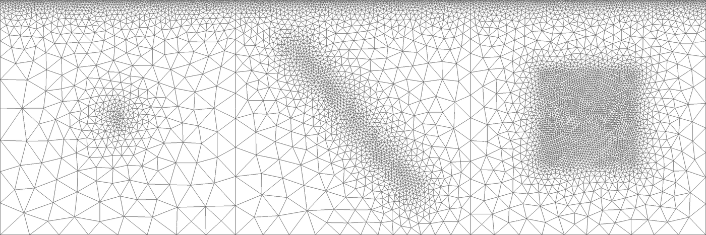

*Figure 20. The upper surface of a thin wing of three sections, from above, turned so that the span runs across the
page with the root at the left and the leading edge at the top, with a Point, a Line and a Box source, each of Len
0.04.  The Line source runs from near the leading edge of one section to near the trailing edge of the next.*

Every source has a length *Len* $\ell$, the target at its center, and a radius *Rad* $R$, the distance at which its
effect ends.  Between them the target of a Point, Line, U Line or W Line source grows with the square of the
distance $d$:

$$
t(d) = \ell + \left(\frac{d}{R}\right)^2 \left( t_{max} - \ell \right), \qquad d < R
$$

where $t_{max}$ is *Max Edge Len*.  The growth ratio limits this like any other target: where the source's target
rises faster than the ratio allows, the ratio takes over, and the target rises along a straight line of slope
$G - 1$ instead, reaching *Max Edge Len* beyond *Rad* (see [Growth](#growth)).  Figure 21 shows a point source on a
sphere and the edge lengths of the mesh around it.  The source's slope, $2\,(t_{max} - \ell)\,d / R^2$, reaches the
growth ratio's $0.3$ at $d = 2.53$; from there the target follows the line, and reaches *Max Edge Len* at
$d = 4.43$, past the source's *Rad* of 4.

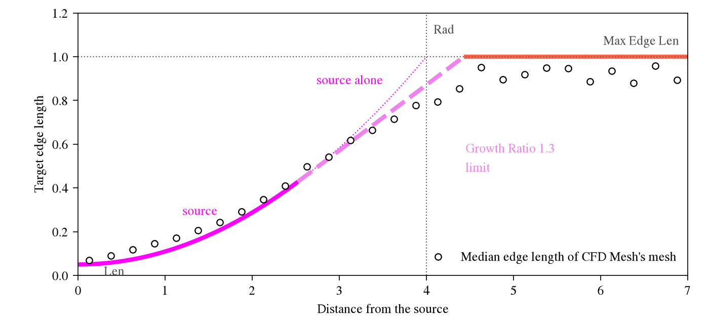

*Figure 21. Target edge length against distance from a point source with Len 0.05 and Rad 4 on a sphere of radius 10,
with Max Edge Len 1.  Min Edge Len and Max Gap are both 0.1, so that the sphere's curvature asks for nothing shorter
than Max Edge Len and only the source, the growth ratio and Max Edge Len set the lengths.  The thick line is the
target the mesher uses, in the colors of the Display tab's reason key: the source's own law (solid, magenta) up to a
distance of 2.53, then the Growth Ratio 1.3 limit (dashed, violet), a line of slope 0.3, up to Max Edge Len (red) at
4.43.  The thin dotted line is what the source alone would ask for.  The source's Len is below Min Edge Len, which a
source may ask for.*

A source acts on every surface within its region, whichever component the surface belongs to, so a source on a wing
near its root also refines the fuselage there.  It acts through each surface's background map, so keep its *Rad*
large beside the spacing of the map's points (see [The background map](#the-background-map)).

### Default sources

*Add Default Sources* adds a set of sources suited to the selected component.  A wing gets a Line source along the
leading edge and one along the trailing edge of each section, and one across its tip, each with *Len* 1% of the
local chord and *Rad* 20% of it (Figure 22).  A Fuselage, Stack or Propeller gets sources at its two ends, with *Len*
a tenth of *Max Edge Len*: a Point source at an end that closes to a point, or eight Line sources round one that does
not.  A Pod gets a Point source at each end and a Line source along its length, and a Custom component the sources its
script defines.  Components without defaults, such as an Ellipsoid, get none.  The defaults are a starting point;
edit them, or add the ones the flow needs.

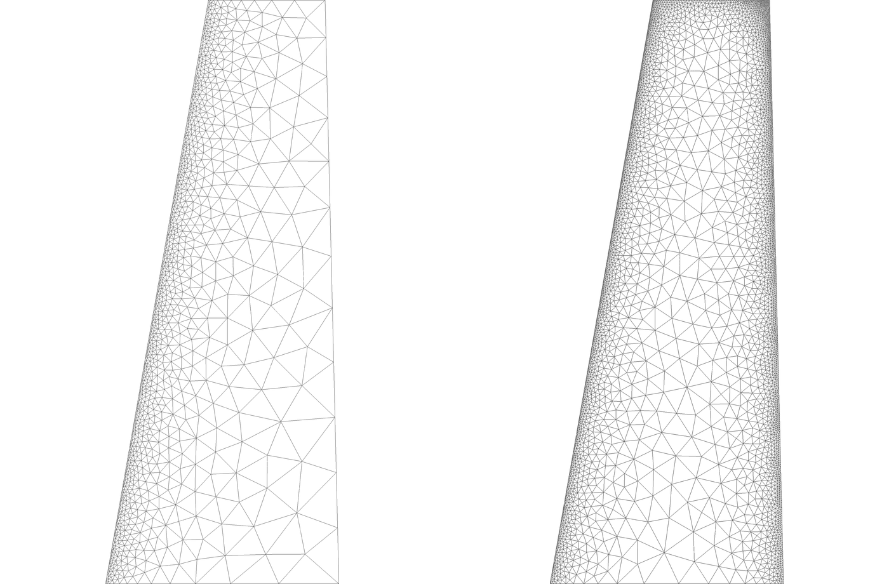

*Figure 22. The upper surface of a wing at the default settings, without sources (left) and with its default sources
(right).  Without them the leading edge is refined by its curvature, but the trailing edge, which is sharp, is not.
The default sources refine the leading edge, the trailing edge and the tip.*

*Show Sources & Wake Preview* on the Display tab draws each source's region over the model: a sphere of radius *Rad*
for a point source, spheres at the ends of a line source joined along it, and the selected source in its own color
(Figure 23).

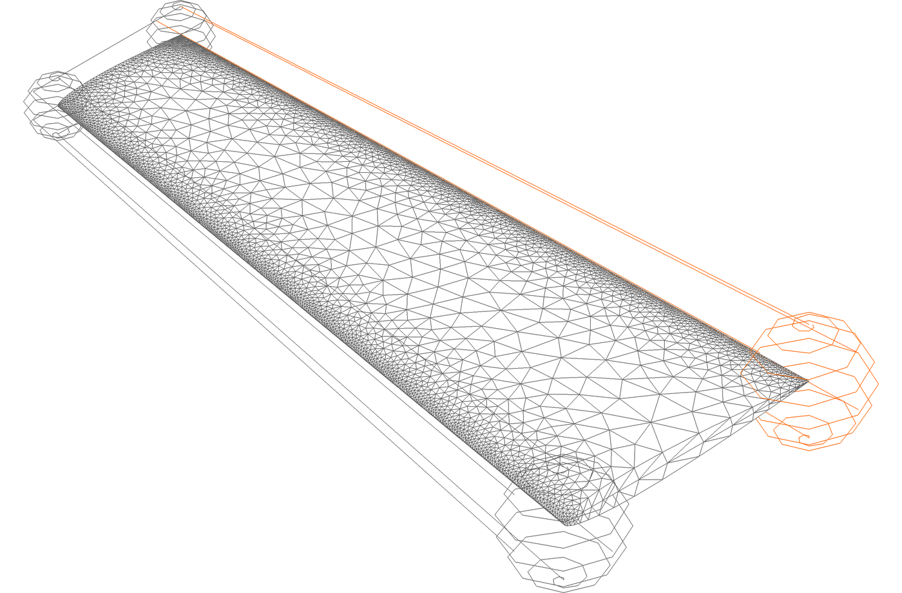

*Figure 23. A wing with its default sources and Show Sources & Wake Preview on: the leading and trailing edge line
sources and the tip source, with their spheres of Rad at each end.  The selected source is drawn in orange.*

## Half Mesh and Far Field

The Domain tab (Figure 24) cuts the model at its symmetry plane and encloses it in a far field.

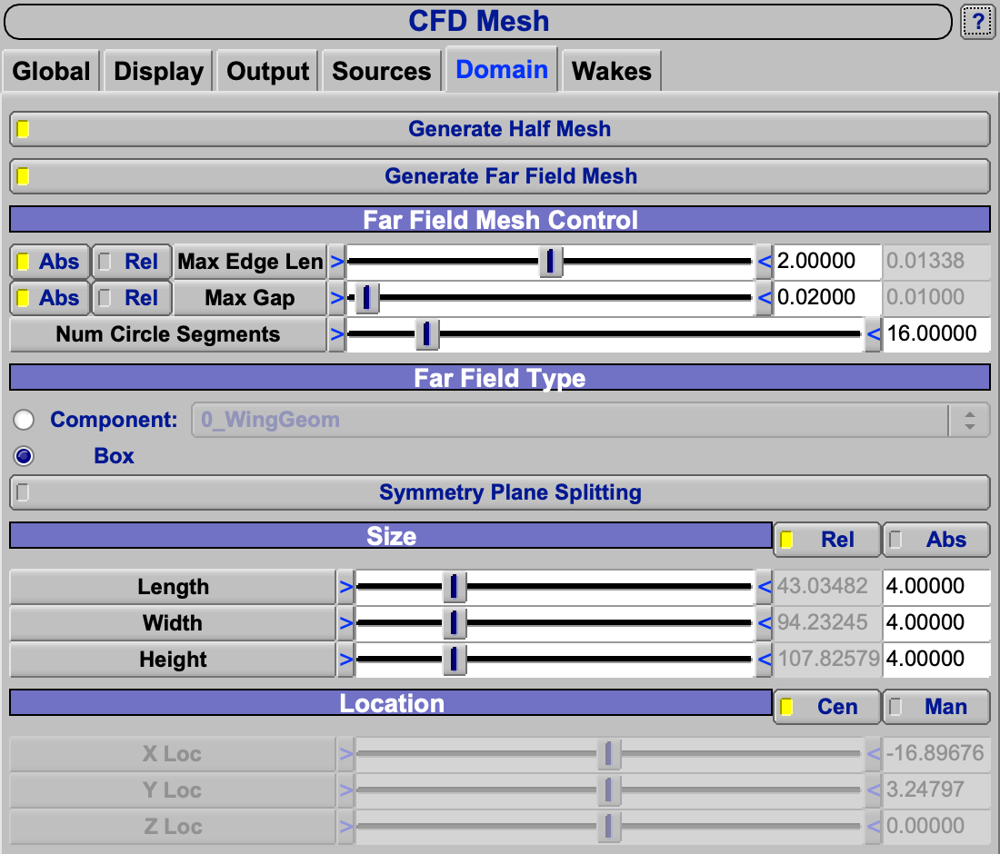

*Figure 24. The Domain tab.*

### Half mesh

*Generate Half Mesh* meshes only the part of the model on the $+Y$ side of $Y = 0$.  The model is cut at the plane,
and the edges along the cut lie on it.  Without a far field the mesh is left open along the cut, for a solver that
applies the symmetry itself; the water tight check does not count those open edges.  With a far field, the plane
between the model and the far field is meshed too, as the symmetry plane, and the mesh is closed.

The model should be symmetric; a half mesh of an asymmetric model is the $+Y$ half of it.

### Far field

*Generate Far Field Mesh* encloses the model in an outer boundary, for a solver that meshes the volume between them.
The far field is a *Box* by default, or a *Component* chosen from the model, whose surface is turned inside out to
face the model.  A component used as the far field must enclose the whole model; one that cuts through it gives a
mesh that is not closed.  Figure 25 shows a box and an Ellipsoid used as the far field, around the full model and
its half.

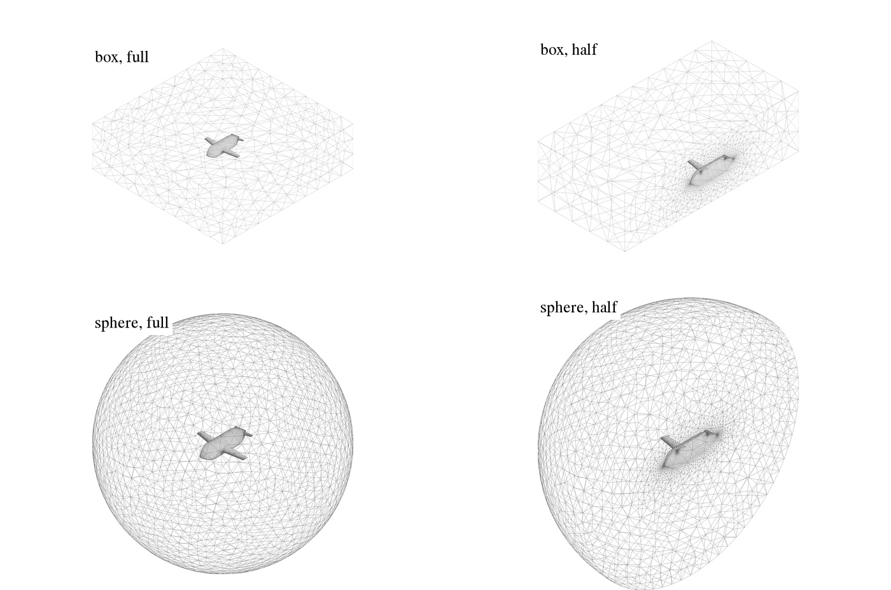

*Figure 25. The aircraft of Figure 1 in the default far field box and in an Ellipsoid of radius 20 centered on it
and used as the far field, as a full and a half mesh, with a far field Max Edge Len of 4.  OpenVSP draws the far
field as its edges alone.*

The box's size is given in one of two forms.  With *Rel*, the default, *Length*, *Width* and *Height* are multiples of
the length, width and height of the bounding box of every component in the model, not only those meshed; the
defaults are 4.  With *Abs* they are the box's lengths in model units.  The sliders move the form chosen, and the
boxes beside each slider show both.  With *Cen* the box is centered on the model's bounding box.  With *Man*, *X Loc*
is the box's upstream face, and *Y Loc* and *Z Loc* its center.  For a half mesh the box is the $+Y$ half of the full
box.

The far field, and the symmetry plane, are meshed with their own *Max Edge Len*, *Max Gap* and *Num Circle
Segments*, under Far Field Mesh Control, not with those of the Global tab.  The relative *Max Gap* is a fraction of
the far field's *Max Edge Len*.  The relative *Max Edge Len* is a fraction of the diagonal of the far field: the full
box, also for a half mesh, or the bounding box of the component used as the far field.  Where they meet the model,
the growth ratio holds their targets to those of the model's edges plus $(G - 1)$ times the distance, so they are
fine there and grow out to the far field's *Max Edge Len* (Figure 28).  Choose the far field *Max Edge Len* for the
outer boundary; the growth ratio takes care of the transition.

*Symmetry Plane Splitting* divides the symmetry plane of a half mesh in a box into five pieces, meshed as separate
surfaces: a rectangle around the model, and the four pieces between it and the edges of the plane above, below,
upstream and downstream (Figures 26-27).  The lines between them are lines of the mesh.  The rectangle is the model's
bounding box enlarged twice about its center; when the box's *Length* or *Height* is under 2, it is enlarged instead
by half of one more than the smaller of them.

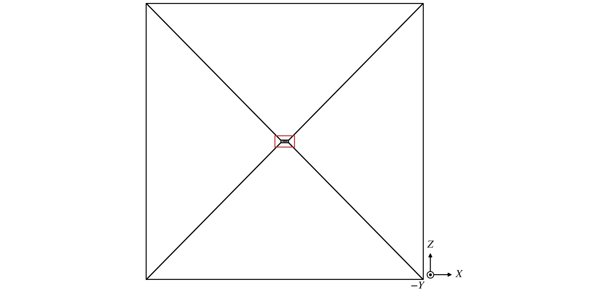

*Figure 26. The five pieces of a split symmetry plane in a far field box whose sides are all 50 times the diagonal of
the aircraft's bounding box, 723 units.  The aircraft's bounding box is shaded; the red frame is the region of Figure
20.*

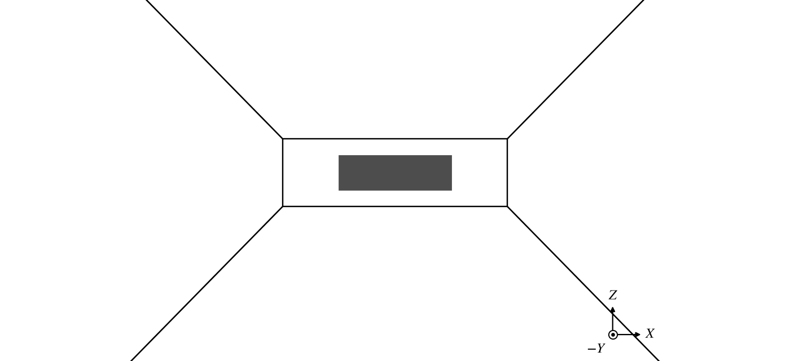

*Figure 27. The middle of Figure 26: the rectangle around the aircraft and the inner ends of the four trapezoids.*

The split is there for the background map.  Each piece of the symmetry plane carries a map of a hundred intervals each
way, so on an unsplit plane the map's points are a hundredth of the box apart, 7.2 units in the box of Figure 26.
The edges of the symmetry plane next to the model are those of the model's cross section, much shorter than that, and
the map is too coarse to follow how they grow out to the far field's lengths.  The rectangle of a split plane is only
twice the model's size, so its map points are 0.2 apart along the model and 0.06 across it, close enough to follow
the lengths near the model, and the four trapezoids around it have their map lines running from the rectangle out to
the box, along the way the lengths grow (Figure 28).

The split matters only when the box is large beside the model.  In the default box, 4 times the model each way, the
edges of the symmetry plane within 1 to 2 of the fuselage are 0.308 long without the split and 0.296 with it.  In the
box of Figure 26 they are 0.343 and 0.296, and within 2 to 4 of it 0.659 and 0.554: without the split the plane's
lengths near the model follow its coarse map, with it they keep to the default box's (Figures 28-29).

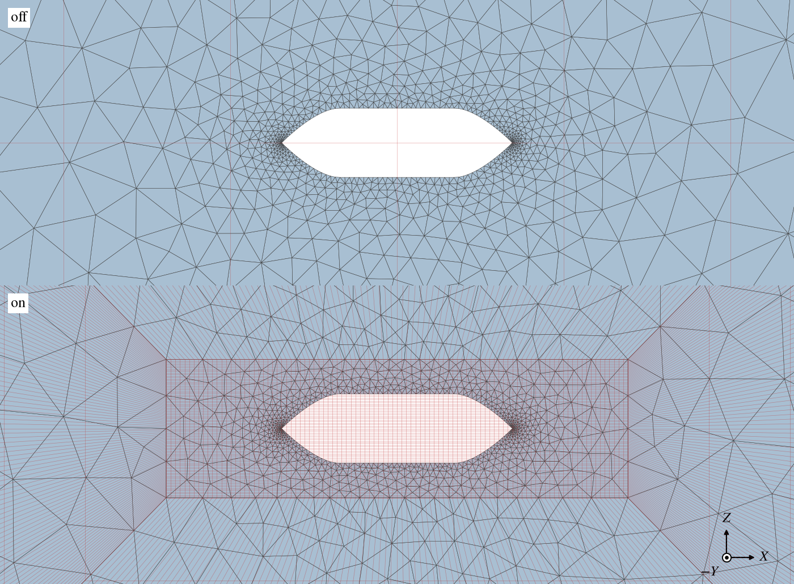

*Figure 28. The symmetry plane of the aircraft's half mesh near the fuselage, seen from the $-Y$ side, in the far field
box of Figure 26 with a far field Max Edge Len of 50, without (top) and with (bottom) Symmetry Plane Splitting.  The
thin red lines are the background maps of the plane's pieces: a hundredth of the box apart without the split, much
closer around the fuselage with it.  The hole is the fuselage's cross section on the plane.*

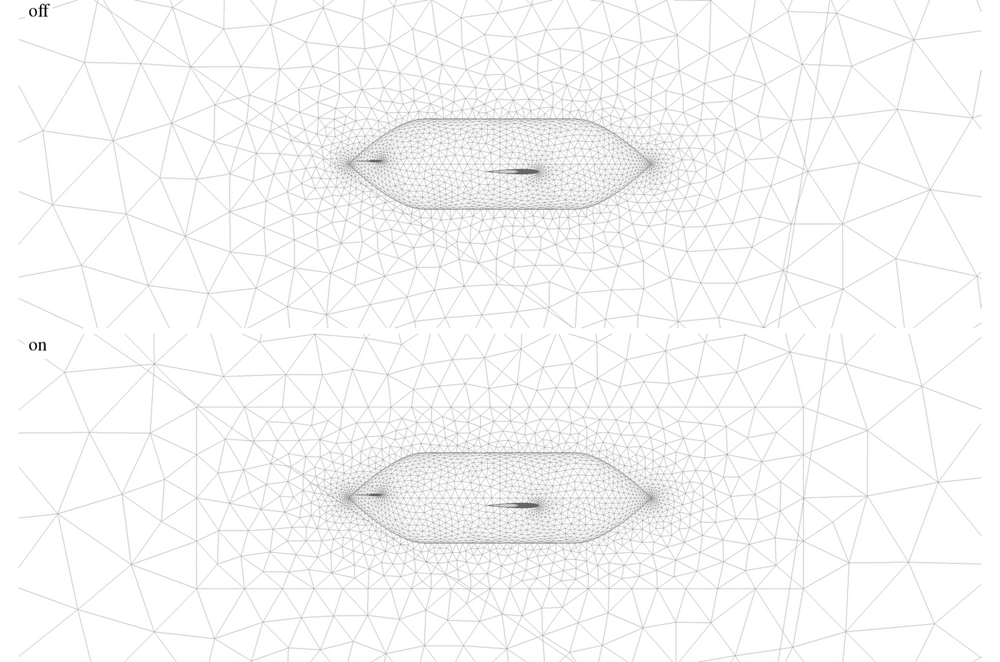

*Figure 29. The same two meshes as OpenVSP draws them, from the $-Y$ side.  It draws the symmetry plane as its edges
alone, so the half fuselage behind it shows through.*

## Wakes

A wake is a sheet trailed from the trailing edge of a wing, for solvers that need the wake as a surface.  The Wakes
tab lists the components with wing surfaces; choose one with *Comp* and turn on *Add Wake* to give it a wake.  The tab
is inactive when the model has no wings.

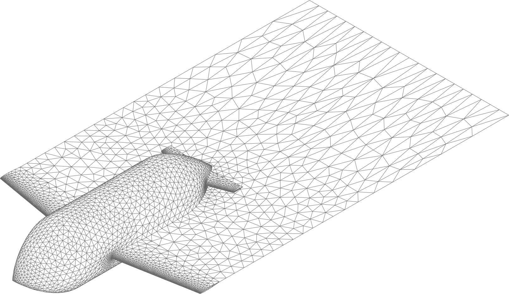

*Figure 30. The aircraft of Figure 1 with the wing's wake at the default Scale Wake of 2.  The wake is cut where it
passes through the fuselage, and is meshed with the Global tab's settings.*

The wake runs from the trailing edge downstream, in $+X$, to half the model's largest dimension behind the model's
last point; the model here is every component, as for the far field box.  *Wake Angle* tilts it from the $X$ axis, in
degrees; a positive angle raises it toward $+Z$.  It is cut where it passes through other components and is meshed
like any other surface (Figure 30).  The wake's points are kept apart from the model's, so the wake meets the
trailing edge without sharing its points, and wakes carry tags above 1000 in the .tri file.

Once meshed, the wake is stretched in $X$ by *Scale Wake* (default 2).  The stretch starts just behind the model and
grows with the square of the distance, so the wake's triangles near the model keep their size and those toward its
end are drawn out; its length behind the model is multiplied by *Scale Wake*.  At the default it reaches about the
model's largest dimension behind the model, and at 1 it is not stretched.  The stretch comes after the wake is cut,
so a wake stretched past the far field box passes through it; keep its end inside the box.

## Running and Checking the Mesh

*Mesh and Export* runs the mesher in the background; the console under the tabs reports each stage as it starts, the
number of triangles, and at the end whether the mesh is closed: "Is Water Tight", or "NOT Water Tight" with the
number of edges that have one triangle and that have more than two.  The open edges along the symmetry plane of a half
mesh without a far field are not counted, nor are those of the surfaces other components pass through, such as an
actuator disk or a wake, whose free edges are open by design; a far field and a symmetry plane are counted.  The
settings are taken when the run starts, so changing them during a run changes nothing until the next.

A mesh that is not water tight has a gap or an overlap somewhere, usually where components cross at a shallow angle,
touch without crossing, or have faces that lie on one another.  Turn on *Show Bad Edges and Triangles* to find it.
Then:

- Move a component slightly so the surfaces cross cleanly instead of touching or lying on one another.
- Add a source where the intersection curve is short or sharply bent, so the edges along it are short enough.
- Check that a component used as the far field encloses the whole model.

## Scripting

The API can set up and run CFD Mesh and manage its sources.  A run is made through the Analysis Manager, as the
analysis "CfdMeshAnalysis".  The older Compute functions are kept so that existing scripts still work, but new
scripts should use the Analysis Manager.

```python
import openvsp as vsp

pid = vsp.AddGeom( "POD" )
vsp.Update()

# A point source at the nose: Len, Rad, U, W
vsp.AddCFDSource( vsp.POINT_SOURCE, pid, 0, 0.02, 1.0, 0.0, 0.0 )

vsp.SetAnalysisInputDefaults( "CfdMeshAnalysis" )
vsp.SetDoubleAnalysisInput( "CfdMeshAnalysis", "BaseLen", [ 0.5 ] )
vsp.SetDoubleAnalysisInput( "CfdMeshAnalysis", "MinLen", [ 0.025 ] )
vsp.SetIntAnalysisInput( "CfdMeshAnalysis", "SelectedSetIndex", [ vsp.SET_ALL ] )

# Write the .tri file alone.
for f in [ "STL", "POLY", "FACET", "OBJ", "GMSH", "VSPGEOM", "POGS" ]:
    vsp.SetIntAnalysisInput( "CfdMeshAnalysis", f + "FileFlag", [ 0 ] )
vsp.SetIntAnalysisInput( "CfdMeshAnalysis", "TRIFileFlag", [ 1 ] )
vsp.SetStringAnalysisInput( "CfdMeshAnalysis", "TRIFileName", [ "pod.tri" ] )

settings = vsp.FindContainer( "CFDMeshSettings", 0 )
for f in [ "DAT", "KEY", "TKEY" ]:
    vsp.SetParmVal( vsp.FindParm( settings, f + "_Export", "ExportCFD" ), 0.0 )

rid = vsp.ExecAnalysis( "CfdMeshAnalysis" )
print( vsp.GetIntResults( rid, "Num_Tris" )[ 0 ], vsp.GetIntResults( rid, "Water_Tight" )[ 0 ] )
```

SetAnalysisInputDefaults fills the inputs from the model's current settings.  The inputs are applied for the run only;
the model's settings are put back afterward.  The inputs are:

- BaseLen, MinLen, MaxGap, NCircSeg and GrowRatio: Max Edge Len, Min Edge Len, Max Gap, Num Circle Segments and
  Growth Ratio.  Under *Rel* the fraction decides the length, so BaseLen, MinLen and MaxGap take effect only under
  *Abs*.
- RigorLimit, WidthLimit and NWidthSeg: Rigorous 3D Growth Limiting and the width rule.
- IntersectSubSurfs, SplitJoinSurfs, TopoInterior, ParallelMesh and GenerateHalfMesh: the toggles of those names.
- SelectedSetIndex, SelectedDegenSetIndex, UseMode and ModeID: what is meshed.
- STLFileFlag, POLYFileFlag, TRIFileFlag, FACETFileFlag, OBJFileFlag, GMSHFileFlag, VSPGEOMFileFlag and
  POGSFileFlag, each with a FileName input of the same stem (STLFileName and so on), and TaggedMultiSolid, POGSNRef
  and RelCurveTol.

The NASCART and .tkey files have no inputs; they are written as the Output tab's toggles say, which are on by default,
so the example turns them off.

The analysis returns a "CFDMesh" Result holding Num_Tris, Num_Surfs (the patches meshed), Num_Border_Edges and
Num_Over_Connected_Edges (edges with one triangle and with more than two), Water_Tight, Num_Topo_Surfs (the patches
classified by *Find Interior by Topology*) and Analysis_Duration_Sec.

The other settings, and the sources and wakes, are set with these functions:

| Function                                     | Use                                                          |
|:---------------------------------------------|:-------------------------------------------------------------|
| SetCFDMeshVal, GetCFDMeshVal                 | Set or read a setting, named by a CFD_CONTROL_TYPE           |
| SetCFDMeshModeID, GetCFDMeshModeID           | Choose the Mode used when UseMode is on                      |
| SetCFDWakeFlag, GetCFDWakeFlag               | Turn a wing's wake on or off                                 |
| SetCFDFarFieldGeomID, GetCFDFarFieldGeomID   | Choose the component used as the far field                   |
| AddCFDSource                                 | Add a source of a CFD_MESH_SOURCE_TYPE to a surface          |
| AddDefaultSources                            | Add the default sources to every component                   |
| GetNumCFDSources, GetCFDSourceIDVec          | List a component's sources                                   |
| DeleteCFDSource, DeleteAllCFDSources         | Remove sources                                               |
| AdjustAllCFDSourceLen, AdjustAllCFDSourceRad | Scale every source's Len or Rad                              |

SetCFDMeshModeID has an effect only while the "UseMode" Parm of the "CFDMeshSettings" container, group "Global", is
on; then the Mode's Sets are meshed, whatever Sets are chosen.  AddDefaultSources adds sources only when the model has
none, so call DeleteAllCFDSources first to replace the ones there are.

The controls without a CFD_CONTROL_TYPE are Parms, set with SetParmVal:

| Control                          | Parms                                  | Group          | Container       |
|:---------------------------------|:---------------------------------------|:---------------|:----------------|
| Num Width Segments, its toggle   | NWidthSeg, WidthLimit                  | CFDGridDensity | CFDGridDensity  |
| Abs and Rel                      | BaseAbsRel, MinAbsRel, MaxGapAbsRel    | CFDGridDensity | CFDGridDensity  |
| Relative values                  | BaseLenFrac, MinFrac, MaxGapFrac       | CFDGridDensity | CFDGridDensity  |
| Far field Abs and Rel            | FarAbsRel, FarMaxGapAbsRel             | CFDGridDensity | CFDGridDensity  |
| Far field relative values        | FarFrac, FarMaxGapFrac                 | CFDGridDensity | CFDGridDensity  |
| Convert to Quads                 | ConvertToQuadsFlag                     | Global         | CFDMeshSettings |
| Demote Surfs to Cubic            | DemoteSurfsCubicFlag, CubicSurfTolerance | Global       | CFDMeshSettings |
| Symmetry Plane Splitting         | SymmetrySplitting                      | FarField       | CFDMeshSettings |
| Component far field              | FarComp                                | FarField       | CFDMeshSettings |
| The NASCART and .tkey files      | DAT_Export, KEY_Export, TKEY_Export    | ExportCFD      | CFDMeshSettings |
| Tagged Multi Solid STL           | MultiSolid                             | STLSettings    | The Vehicle     |
| Scale Wake, Wake Angle           | WakeScale, WakeAngle                   | WakeSettings   | The wing        |

Find a container's ID with FindContainer, for example `FindContainer( "CFDGridDensity", 0 )`, and the Vehicle's with
GetVehicleID.

## References

1. Chan, W. M., Chuen, A. M., Jensen, J. C. and Schauerhamer, D. G., "Overset Structured Mesh Generation on Complex
   Configurations Using the EPOGS Toolset," AIAA Paper 2026-4121, AIAA Aviation Forum, 2026.
