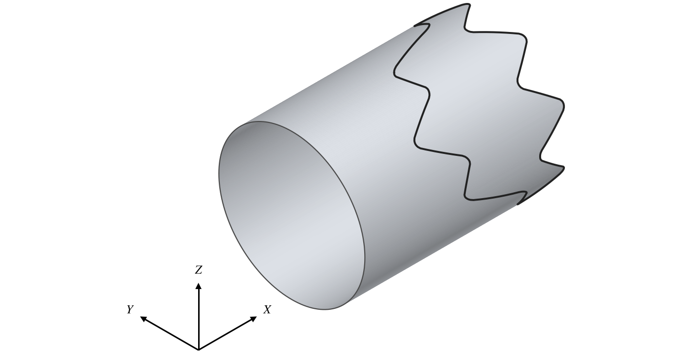
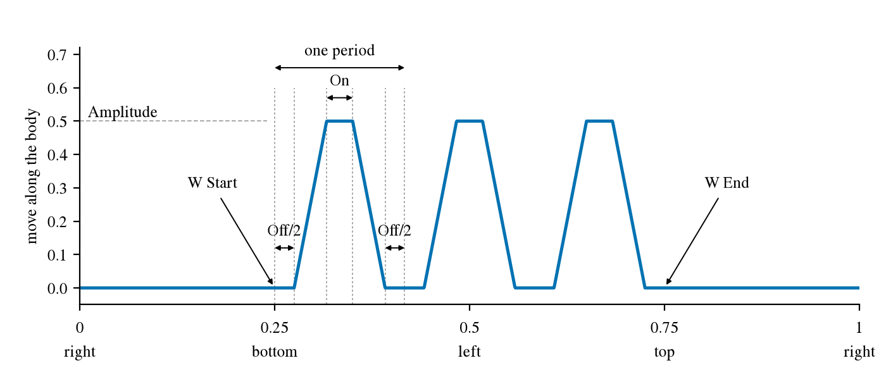
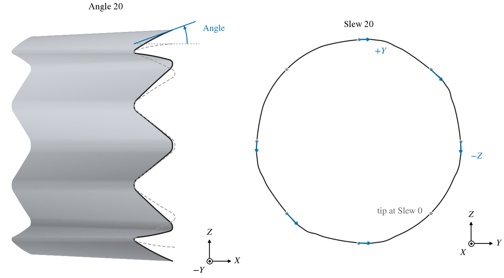

A chevron nozzle has a serrated trailing edge, a row of triangular teeth that mix the exhaust with the air around it.
OpenVSP makes chevrons by moving points of one section's curve along the body, so that the edge of the surface that
ends there is cut into teeth.  Chevrons are on the Modify tab of the Fuselage and the Stack, set section by section.
They are independent of the [Engine Model](EngineModel.md), and work on any section of either component.

| Topic                                     | Tab    |
|:------------------------------------------|:-------|
| [Quick Start](#quick-start)               |        |
| [The Teeth](#the-teeth)                   | Modify |
| [Extents](#extents)                       | Modify |
| [Shaping the Teeth](#shaping-the-teeth)   | Modify |
| [Scripting](#scripting)                   |        |

The rest of the Fuselage and Stack screens is described in [Fuselage and Stack](FuselageStack.md).

## Quick Start

1. Make the nacelle or exhaust, with its outlet lip as its last section.
2. On the Modify tab choose that section and set the Chevron *Type* to FULL.
3. Set *Number* and the *Amplitude* of the chevrons.
4. Shape them with *% On*, *% Off*, the corner radii, *Angle* and *Slew*.

## The Teeth

Choose the section with the selector at the top of the Modify tab, usually the last one, where the surface ends: the
teeth cut that edge (Figure 1).

*Figure 1. Eight chevrons on the end of a cylinder: Type FULL, Amplitude 0.5, % On 0.1, % Off 0.1, Peak and Valley
Radius 0.1.*

*Type* is NONE, PARTIAL or FULL.  FULL puts *Number* teeth evenly around the whole section; PARTIAL puts them between
two points of it.  Around the section, $W$ is the curve's parameter, from 0 to 1 once around (see
[How a Section Is Laid Out](XSecCurves.md#how-a-section-is-laid-out)): 0 at the right ($+Y$), 0.25 at the bottom,
0.5 at the left and 0.75 at the top.  Each tooth is one period of a wave (Figure 2): half of *% Off* at the bottom, a
straight rise to the peak, *% On* at the peak, a straight fall, and the other half of *% Off*, each a fraction of the
period.  With both zero the teeth are pure triangles.  *Peak* and *Valley* under Corner Rounding Radius round the
corners of the teeth, as radii in model units.

*Figure 2. How far each point of the section moves along the body, around the section from W = 0: Type PARTIAL, three
teeth from W Start 0.25 to W End 0.75, Amplitude 0.5, % On 0.2, % Off 0.3.*

## Extents

A PARTIAL set of teeth spans the extent given under *Extents*, either by *W Start* and *W End* or by *W Center* and *W
Width*, chosen by *Mode*.  Each end may be typed in (Free) or snapped to the right, bottom, left or top of the
section; Right 0 and Right 1 are the right at the start and the end of the perimeter.  An extent may run through
$W = 0$: a start of 0.875 and an end of 0.125 put the teeth around the right side.  For FULL only *W Start* is used,
to turn the pattern around the section.

## Shaping the Teeth

The teeth are shaped by an *Amplitude*, an *Angle* and a *Slew* set at each of the four sides, right, bottom, left
and top, and blended around the section between them: the amplitude in a straight line, the angles smoothly.

- *Amplitude* is how far the tip of a tooth moves, in model units, along the direction the sections run: aft, $+X$,
  on a component built along $+X$.  A negative amplitude moves it forward.
- *Angle* tilts the teeth outward, away from the axis, for a positive angle.
- *Slew* leans the teeth around the section: a positive slew leans the top and bottom teeth toward $+Y$, and the right
  and left teeth toward $-Z$.

*All Sym* gives every side the top's values.  *T/B Sym* gives the bottom the top's values, and *R/L Sym* the left the
right's values.  The slews are signed so that these make teeth that are mirror images across the horizontal and the
vertical planes.  The three are on by default.

With one slew on every side, the top and right teeth both lean clockwise as seen from aft, and the bottom and left
teeth counterclockwise (Figure 3).  Between two sides that lean the same way the teeth lean the most; between two that
lean opposite ways they hardly lean at all.

*Figure 3. The teeth of Figure 1, turned to put one at the top, with Angle 20 (left) and with Slew 20 (right), on every
side.  Left, the near half of the end; dashed, the edge at Angle 0.  Right, the edge seen from aft; arrows, how far
each tip moves from its place at Slew 0.*

## Scripting

The chevron parms belong to each section's curve, in its *Chevron* group: `Chevron_Type` (`CHEVRON_NONE`,
`CHEVRON_PARTIAL`, `CHEVRON_FULL`), `Number`, `On_Duty`, `Off_Duty`, `Peak_Radius`, `Valley_Radius`, `W01_Mode`
(`CHEVRON_W01_SE`, `CHEVRON_W01_CW`), `W01_Start`, `W01_End`, `W01_Center`, `W01_Width`, the guides
`W01_Start_Guide`, `W01_End_Guide`, `W01_Center_Guide` (`W_RIGHT_0`, `W_BOTTOM`, `W_LEFT`, `W_TOP`, `W_RIGHT_1`,
`W_FREE`), `TopAmplitude` and the like, `Top_Angle` and the like, `Top_Slew` and the like, and `AllSym`, `TBSym`,
`RLSym`.  A section's skinning has symmetry flags of the same names in its *XSec* group, so find these by group.

Before OpenVSP 3.56, `RightAmplitude` drove the left side and `LeftAmplitude` the right.  A model saved by an earlier
version opens with its right and left amplitudes traded, which shows where they differ; trade them back to keep the
earlier shape.  A script written for those versions must swap the two names.
