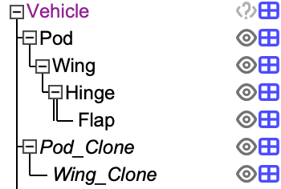
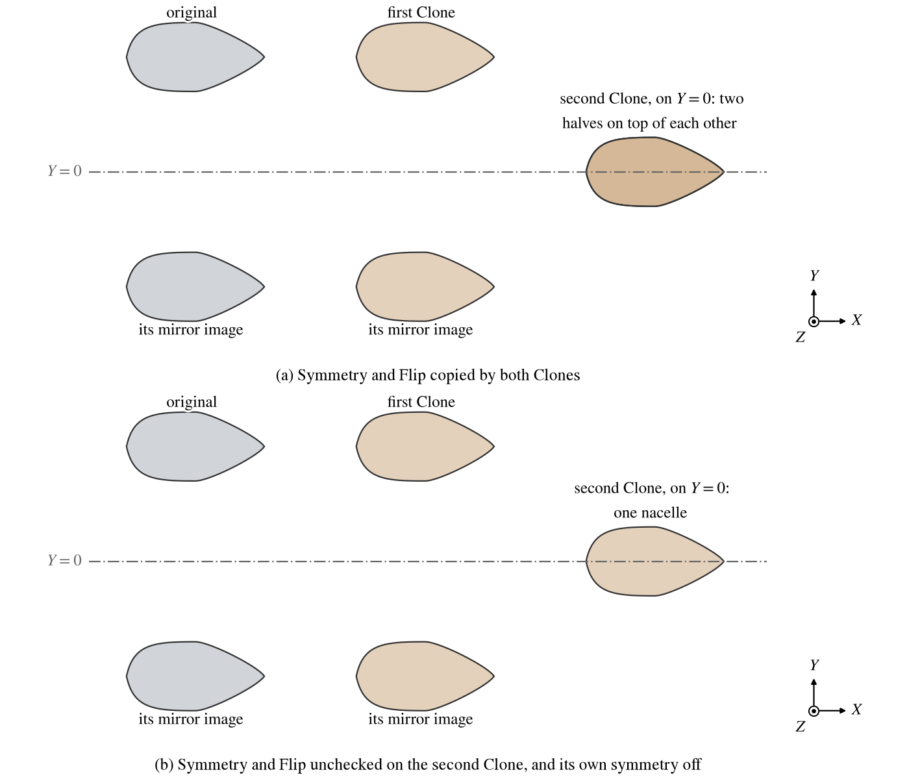

The Clone component shows the shape of another component, its original, placed by the Clone's own XForm.  A Clone stores
no shape of its own: every change to the original appears at once in each of its Clones.  Use Clones for parts that are
the same, such as the engines of a multi-engine aircraft, a row of seats or the propellers of a multirotor, so that each
design change is made once.

A Clone always takes its original's shape, at the original's scale, with the original's tessellation and end caps.
Everything else -- where it sits, its symmetry, its sets, its color, its mass and drag settings and more -- it either
takes from the original or keeps as its own, as chosen on the Clone tab.

| Topic                                                          | Tab        |
|:---------------------------------------------------------------|:-----------|
| [Quick Start](#quick-start)                                    |            |
| [Making Clones](#making-clones)                                |            |
| [The Original](#the-original)                                  | Clone      |
| [What a Clone Copies](#what-a-clone-copies)                    | Clone      |
| [Naming](#naming)                                              | Clone      |
| [Clones of Hinges and Propellers](#clones-of-hinges-and-propellers) | Clone |
| [Clones in Analyses](#clones-in-analyses)                      |            |
| [Deleting an Original](#deleting-an-original)                  |            |
| [Replacing a Clone with a Copy](#replacing-a-clone-with-a-copy) | Clone     |
| [Shared Tabs](#shared-tabs)                                    | Gen, XForm, Mass, Sub |
| [Scripting](#scripting)                                        |            |

## Quick Start

1. Select the component, or several, in the Geom browser and click *Clone*.  Give a name suffix, `_Clone` by default,
   and click *Clone*.
2. Each new Clone sits on top of its original.  Move it with its XForm tab.
3. Edit the original.  Every Clone follows.

## Making Clones

The *Clone* button of the Geom browser makes one Clone for each selected component and keeps the hierarchy among them: a
Clone of a child is made a child of the Clone of its parent.  The top Clone of each group is placed beside its original
in the tree, starts at the original's placement, and has its own transformation, free to move.  The Clones below it copy
their originals' placement relative to their parents, so moving the top Clone moves the whole group (Figure 1).  The
Clones also take their originals' display settings.

*Figure 1. The Geom browser after a pod and its child wing were cloned together: Pod_Clone sits beside Pod and
carries Wing_Clone, which has none of Wing's children.  The Clones' names are in italics because they follow their
originals' names.*

A Clone added from the Add menu has no original yet.  On its first update it takes its parent as its original, so select
the component to be copied before adding it; it starts with its own transformation at zero.  An original can also be
chosen afterwards on the Clone tab.

A Clone does not copy its original's children.  To copy a component together with its children, select all of them and
use the Clone button.

## The Original

*Original* on the Clone tab lists the components a Clone can copy: any component except the Clone itself, the components
attached below it, and any whose chain of Clones leads back to it.  A Clone of a Clone shows the shape at the end of the
chain.

## What a Clone Copies

The shape, with the original's scale, its tessellation (*Num_U*, *Num_W*) and its end caps are always the original's;
their controls are greyed on the Clone, and so is *Scale*: a Clone has no size of its own.  The rest is chosen under
*Copy From Original*.  Each item checked is copied on every update, and its controls are greyed on the Clone; an item
unchecked is the Clone's own and can be edited.  Unchecking an item keeps the last copied values as the starting point.

| Copy From Original | Default   | What is copied                                                                       |
|:-------------------|:----------|:-------------------------------------------------------------------------------------|
| Transformation     | off       | Location, rotation, rotation origin and the Abs/Rel choice.                          |
| Attachment         | on        | The attachment to the parent and its coordinates.                                    |
| Symmetry and Flip  | on        | The symmetry; the flip planes combine with the Clone's own.                          |
| Set Membership     | on        | Membership of the user's sets.                                                       |
| Color and Material | on        | The color, the material and the textures.                                            |
| Negative Volume    | on        | The CFD Mesh negative volume setting.                                                |
| Mass Properties    | on        | Density, priority, thin shell and the specified mass, CG and inertia.                |
| Parasite Drag      | on        | The Parasite Drag settings used for the Clone.                                       |
| Subsurfaces        | on        | The original's subsurfaces.                                                          |
| Joint Deflection   | on        | A Hinge's Translate and Rotate (see below).                                          |
| Rotor Rotation     | on        | A propeller's Rotate (see below).                                                    |

Symmetry is copied by default because the symmetric copies of the original are part of its shape.  The copied symmetry
mirrors the Clone where the Clone is placed: a Clone moved aft of a nacelle mirrored in $Y = 0$ makes a second pair,
and a Clone moved onto $Y = 0$, such as a center engine, shows its two halves on top of each other (Figure 2).  For a
single Clone on the mirror plane, uncheck Symmetry and Flip and then turn off the Clone's own symmetry, which keeps the
copied setting until changed.  The Clone's own Flip planes combine with the original's while Symmetry and Flip is
checked, so the same plane set on both cancels.  To make a Clone the mirror image of its original, set the mirror plane
on the Clone's Flip.

*Figure 2. A nacelle mirrored in $Y = 0$ and two Clones moved aft of it, the second onto $Y = 0$.  The second Clone's
two coincident halves in (a) show darker than the single nacelle in (b).*

Set membership covers the user's sets only; whether a Clone is shown is its own.

A Clone's subsurfaces are copies of the original's that keep their identity as the original changes, so control surface
groups and scripts that refer to them keep working.  Unchecking Subsurfaces keeps the copies as the Clone's own, to
edit, and lets more be added.  Checking it again picks up the same copies rather than adding new ones.

A Clone always keeps its own name (unless named after the original), parent, children, attributes, CFD sources and FEA
structures.

## Naming

With *Name After Original* checked, the default, a Clone is named after its original with *Suffix* appended, and the
name follows the original's when it is renamed.  The name on the Gen tab is greyed while this is checked.  The Geom
browser shows such a name in italics and will not rename it.  Uncheck it to give the Clone a name of its own; the
current name is kept as the starting point.

## Clones of Hinges and Propellers

A Clone of a [Hinge](Hinge.md) is a joint too: its own children ride on its joint, just as the Hinge's children ride on
the Hinge.  The Hinge decides which motions are allowed and their limits.  With *Joint Deflection* checked the Clone
takes the Hinge's deflection; unchecked, the Clone's own *Translate* and *Rotate* in the *Joint* group pose it, so two
Clones of one Hinge can sit at different angles.  *Rng* sets a slider's range to the Hinge's limits.

A Clone of a [Propeller](Propeller.md) takes the propeller's Rotate while *Rotor Rotation* is checked; unchecked, the
*Rotate* in the *Rotor* group places the Clone's blades, so Clones of one rotor can turn apart in phase.  See [Clones of
a Propeller](Propeller.md#clones-of-a-propeller) for counter-rotating rotors.

## Clones in Analyses

A Clone takes part in analyses as a component of its original's kind.  A Clone of a wing can be the reference wing of
VSPAERO and Parasite Drag, with the wing's span, area and mean aerodynamic chord; a Clone of a propeller is a rotor to
VSPAERO and to an [Auxiliary](Auxiliary.md) rotor zone; an Auxiliary component hung from a Clone of a [Gear](Gear.md)
measures against the Clone; a Clone of a [Routing](Routing.md) component is weighed by Mass Properties as a route.  A
Clone of a mesh, a point cloud, a wireframe or a polygon mesh is placed as one piece and has no symmetry; its symmetry
controls are greyed.

## Deleting an Original

When a component that has Clones is deleted or cut, OpenVSP asks what becomes of its Clones:

| Choice                 | Result                                                                              |
|:-----------------------|:------------------------------------------------------------------------------------|
| Cancel                 | Nothing is deleted.                                                                 |
| Leave Empty            | The Clones stay where they are, copying nothing.                                    |
| Replace                | Each Clone is replaced by a full copy of what it was copying (see below).           |
| Delete Too, or Cut Too | The Clones go with the original, and so do any Clones of those Clones.              |

A Clone left empty shows nothing, keeps its name and stops naming itself after an original; choose an original for it
again on the Clone tab.  The same happens, with a message, when a file is opened whose Clone has lost its original, or
when a Clone's original is moved to below the Clone in the tree.

## Replacing a Clone with a Copy

*Replace With Copy Of Original* turns a Clone into an ordinary, independent component: a full copy of the component at
the end of its chain of Clones.  The copy takes the Clone's place in the tree and its ID, so attached components, links,
design variables and control surface groups that referred to the Clone keep working.  It keeps what the Clone showed --
its name, placement, attachment, symmetry and flip, sets, mass and negative volume settings, the parasite drag settings
it used, color and material, display settings, joint deflection and rotor angle -- and the Clone's subsurfaces, CFD
sources, FEA structures and attributes.

A Clone of a polygon mesh cannot be replaced.  Some components place their own shape from other components, such as a
route or a conformal component; their copy may not land where the Clone stood, and a message says so.

## Shared Tabs

The Gen, XForm, Mass and Sub tabs are common to every component; see [Gen](GenTab.md),
[XForm](XFormTab.md), [Mass](MassTab.md) and [Sub-Surfaces](SubTab.md).  Controls
copied from the original are greyed on them.

## Scripting

The OpenVSP API makes and manages Clones with these functions:

| Call                                               | Purpose                                                                  |
|:---------------------------------------------------|:-------------------------------------------------------------------------|
| `CloneGeomVec`                                     | Clone a group of components, keeping their hierarchy, as the Clone button does. |
| `SetGeomCloneOriginal`, `GetGeomCloneOriginal`     | Set or read a Clone's original; an empty ID clears it.                   |
| `SetGeomCloneNameSuffix`, `GetGeomCloneNameSuffix` | The suffix of automatic naming.                                          |
| `FindGeomClones`                                   | The Clones of a set of components.                                       |
| `ReplaceCloneGeom`                                 | Replace a Clone with a copy of its original.                             |
| `DeleteGeom`, `DeleteGeomVec`, `CutGeomToClipboard` | Take a `CLONE_DELETE_TYPE` that says what becomes of the Clones.        |

`AddGeom( "CLONE" )` adds a Clone.  The Copy From Original switches are parms in the group `Behavior`: `CloneXForm`,
`CloneAttach`, `CloneSym`, `CloneSets`, `CloneAppearance`, `CloneNegativeVolume`, `CloneMassProps`, `CloneParasiteDrag`,
`CloneSubSurfs`, `CloneJoint` and `CloneRotate`, with `AutoName` for Name After Original.  A Clone's own joint
deflection is `JointTranslate` and `JointRotate` in the group `Hinge`, and its own rotor angle is `Rotate` in the group
`Rotor`.
