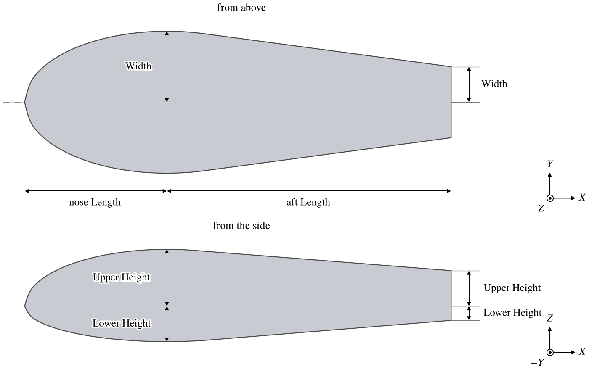
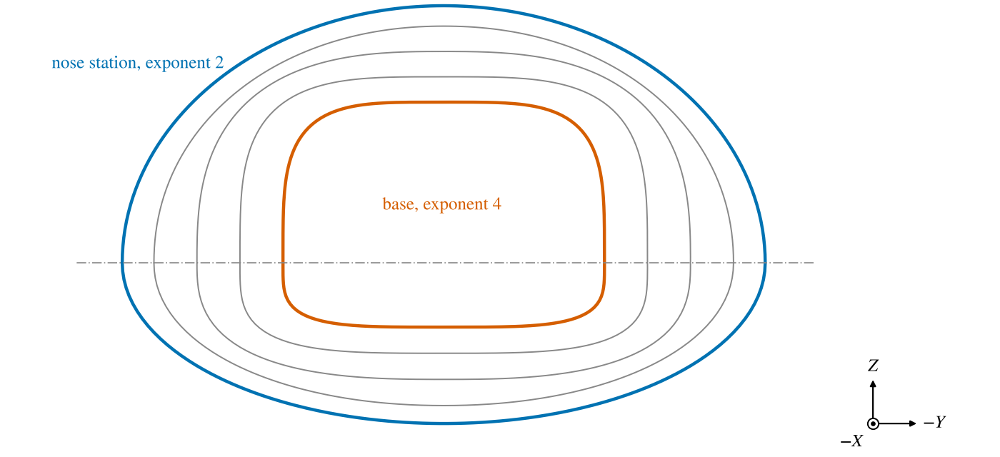

The Cobra is a forebody described by a handful of dimensions.  Its nose is a super-ellipse in planform and in
profile; its aft body runs straight back from the nose, tangent to it, to a flat base; and every cross section is a
super-ellipse whose upper and lower halves may differ, its corners filling out from the nose to the base.  It suits
blunt-based bodies such as missile and hypersonic forebodies, canopies and fairings, where a few numbers should set
the whole shape.

The shape is NASA's COBRA (Co-Optimization of Blunt-body Re-entry Analysis) body, defined at NASA Ames Research
Center as a parametric family of lifting entry vehicles and used to optimize mid lift-to-drag aeroshells for Mars
entry [1, 2].

The Cobra has one tab of its own, Design.  The [Gen](GenTab.md), [XForm](XFormTab.md), [Mass](MassTab.md) and
[Sub](SubTab.md) tabs are described on their own pages.

## Quick Start

1. Add a Cobra.  A new one is a hemisphere of radius 1 on a cylinder of length 1, closed by a flat base.
2. Place it with the XForm tab.
3. Set the nose's *Length*, *Width*, *Upper Height* and *Lower Height*, and *PowX* for the fullness of the nose.
4. Set the aft body's *Length*, and the *Width* and heights of the base, and the cross section exponents.

## Planform and Profile

The nose runs from its tip, at the origin, to the station a nose *Length* aft, $x_N$, where it reaches its full
half-width *Width* and half-heights *Upper Height* and *Lower Height* (Figure 1).  Seen from above its outline is the
super-ellipse

$$
\left|\frac{x - x_N}{x_N}\right|^{p_x} + \left|\frac{y}{w_N}\right|^{p_x} = 1
$$

where $w_N$ is the nose *Width* and $p_x$ is *PowX*; seen from the side, its upper and lower outlines are the same
curve with the heights in place of $w_N$.  *PowX* 2 gives an elliptical nose, larger values a blunter one, and 1 a
pointed one with straight sides.  Close to the tip the surface lies slightly inside this outline, which gives the tip a
small point: with the default *PowX* of 2, by up to 5 percent of the width, within the first 5 percent of the nose
*Length* (Figure 1).

The aft body ends in the base, an aft *Length* behind the nose station, with half-width *Width* and half-heights
*Upper Height* and *Lower Height*.  Its sides, top and bottom are straight lines from the edges of the base, each
tangent to the nose's outline.  An aft body narrower than the nose meets the nose just aft of its widest station; a
wider one, ahead of it; one of the same width runs straight back from it.  The body is the nose *Length* plus the aft
*Length* long, and *Rot Origin(X)* on the XForm tab is a fraction of that.

*Figure 1. A Cobra from above and from the side: nose Length 2, Width 1, Upper Height 0.8, Lower Height 0.5; aft
Length 4, Width 0.5, Upper Height 0.5, Lower Height 0.2; PowX 2.*

Either length may be zero.  With no aft length the body is the nose alone, closed flat at its widest station.  With no
nose length it is the aft body alone, running straight from the nose's section to the base, and its front is left
open.

## Cross Sections

Each cross section is a super-ellipse, its upper and lower halves separate:

$$
\left|\frac{y}{w}\right|^{p} + \left|\frac{z}{h}\right|^{p} = 1
$$

where $w$ is the half-width and $h$ the upper or lower half-height at that station, read from the outlines above.  The
exponent $p$ is *PowNU* (upper) or *PowNL* (lower) over the nose.  From the farther aft of the two points where the
aft body's sides and its top (or bottom) leave the nose, or from the nose's widest station if both lie ahead of it,
it changes smoothly, as a half cosine, to *PowAU* or *PowAL*
at the base (Figure 2).  An exponent of 2 gives
an ellipse, larger values fill out the corners toward a rectangle, and 1 gives a diamond.

*Figure 2. Cross sections of the Cobra of Figure 1, seen from the front: the nose's widest station, with exponent 2,
and the base, with exponent 4, and stations between them.*

*Nose ULSymm* and *Aft ULSymm* make the lower half the same as the upper, taking its height and exponent; the lower
controls are then greyed.  Both are on by default.

## Parameters

Every width and height is measured from the axis: *Width* is a half-width, and the two heights are the extents above
and below the axis, so a section's full height is their sum.

| Group | Control      | Parm         | Default | Meaning                                         |
|:------|:-------------|:-------------|:--------|:------------------------------------------------|
| Nose  | Length       | `XradN`      | 1       | Length of the nose, tip to widest station.      |
| Nose  | Width        | `YradN`      | 1       | Half-width at the widest station.               |
| Nose  | PowX         | `PowX`       | 2       | Exponent of the nose's planform and profile.    |
| Nose  | Upper Height | `ZradNU`     | 1       | Height above the axis at the widest station.    |
| Nose  | PowNU        | `PowNU`      | 2       | Exponent of the upper cross section.            |
| Nose  | Nose ULSymm  | `NoseULSymm` | on      | Lower half the same as the upper.               |
| Nose  | Lower Height | `ZradNL`     | 1       | Depth below the axis at the widest station.     |
| Nose  | PowNL        | `PowNL`      | 2       | Exponent of the lower cross section.            |
| Aft   | Length       | `XlenA`      | 1       | Length from the nose's widest station to the base. |
| Aft   | Width        | `YradA`      | 1       | Half-width of the base.                         |
| Aft   | Upper Height | `ZradAU`     | 1       | Height of the base above the axis.              |
| Aft   | PowAU        | `PowAU`      | 2       | Exponent of the upper cross section at the base. |
| Aft   | Aft ULSymm   | `AftULSymm`  | on      | Lower half the same as the upper.               |
| Aft   | Lower Height | `ZradAL`     | 1       | Depth of the base below the axis.               |
| Aft   | PowAL        | `PowAL`      | 2       | Exponent of the lower cross section at the base. |

The exponents run from 1 to 10.  All the parms are in the *Design* group.

## References

1. Brown, J. L., Garcia, J. A., Kinney, D. J., Bowles, J. V. and Mansour, N. N., "Co-optimization of Blunt Body
   Shapes for Moving Vehicles," U.S. Patent 8,725,470 B1, assigned to the National Aeronautics and Space
   Administration, 2014.
2. Garcia, J. A., Brown, J. L., Kinney, D. J., et al., "Co-Optimization of Mid Lift to Drag Vehicle Concepts for
   Mars Atmospheric Entry," AIAA Paper 2010-5052, 10th AIAA/ASME Joint Thermophysics and Heat Transfer Conference,
   Chicago, IL, 2010.
