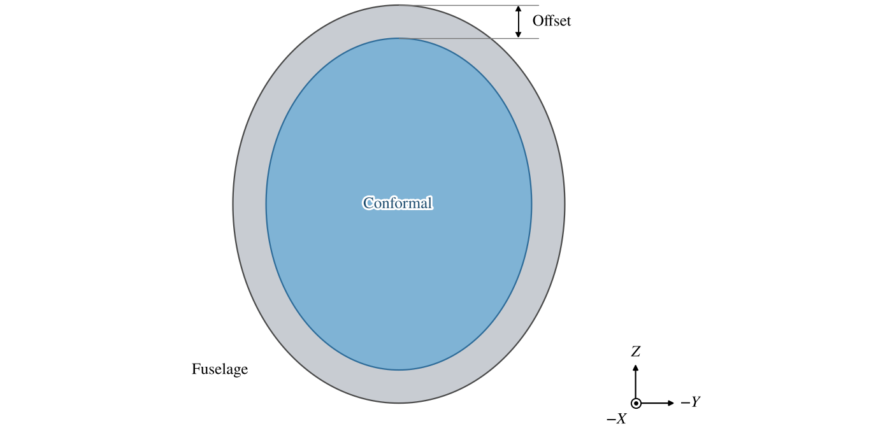
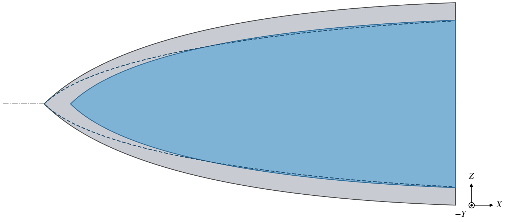
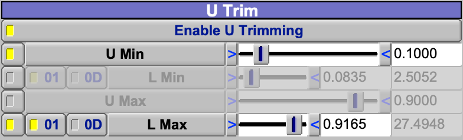
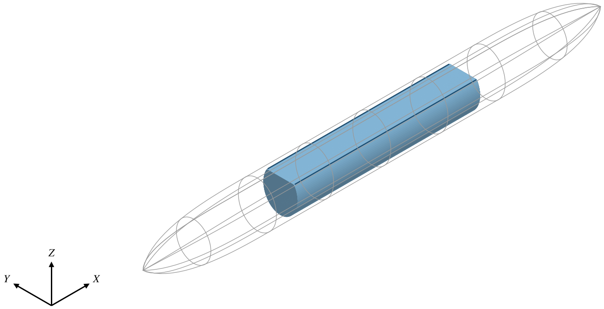
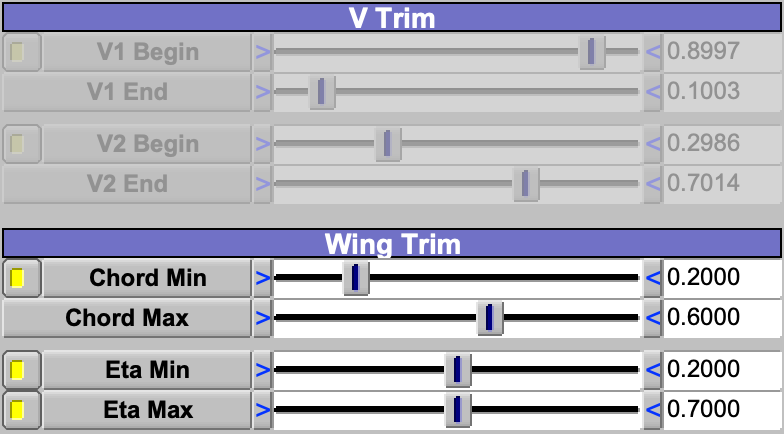
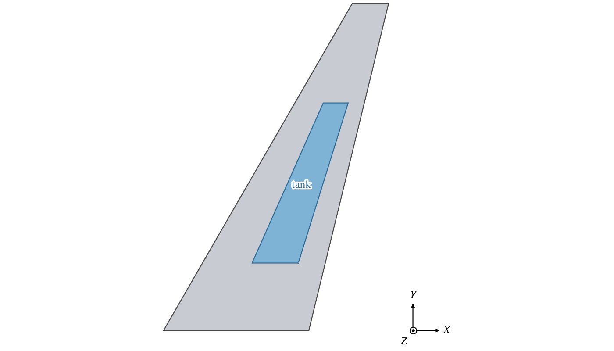
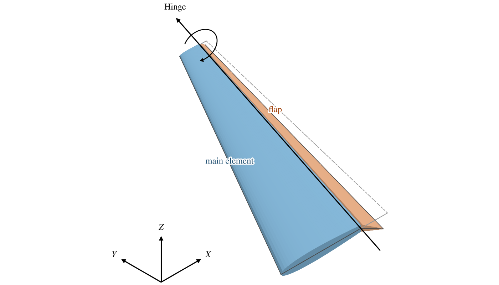

A Conformal is a surface that follows another component's surface a set distance inside it, or outside it.  It is
made from that component, its *conformal parent*, so it changes whenever the parent does.  It can be trimmed along the
parent's length and around it, so one Conformal can be a fuel tank in a wing, a cabin or a cargo hold in a fuselage,
the envelope of the structure under a skin, or a layer of coating or insulation over it.

| Topic                                         | Tab    |
|:----------------------------------------------|:-------|
| [Quick Start](#quick-start)                   |        |
| [The Conformal Parent](#the-conformal-parent) | Design |
| [Offset](#offset)                             | Design |
| [Trimming Along the Length](#trimming-along-the-length) | Design |
| [Trimming Around the Surface](#trimming-around-the-surface) | Design |
| [Trimming a Wing](#trimming-a-wing)           | Design |
| [A Hinged Flap](#a-hinged-flap)               | Design |
| [Scripting](#scripting)                       |        |

The [Gen](GenTab.md), [XForm](XFormTab.md), [Mass](MassTab.md) and [Sub](SubTab.md) tabs are described on their own
pages.

## Quick Start

### A tank in a fuselage

1. Choose the Fuselage, and add a Conformal: it becomes the Fuselage's child and lies on it.
2. Set *Offset* to the thickness of the structure between the skin and the tank.
3. Check *Enable U Trimming* and set where the tank begins and ends, by *L Min* and *L Max* along the length.
4. Cut its sides flat under Side Trim if it must clear a floor or a keel.

### A tank in a wing

1. Choose the Wing, and add a Conformal.
2. Set *Offset* to the thickness of the skin.
3. Check *Enable U Trimming*, choose *Eta Min* and *Eta Max*, and set the spanwise ends.
4. Check the toggle beside *Chord Min* under Wing Trim, and set the chordwise ends.

## The Conformal Parent

A new Conformal takes its shape from its parent in the model, and is attached to it, so it moves and mirrors with
it: its attachment and symmetry on the XForm tab are set to follow the parent, and greyed.

*Detach* frees its attachment.  The *Parent* chooser beside it then picks the conformal parent, any component with a
surface except a Gear (it lists other Conformals too, but choosing one has no effect), and the Conformal is placed by
its own XForm settings from its parent in the model, which may be a different component.  This is how a part of a skin
is made to move apart from the body it was shaped on, such as a door, a fairing or a flap
([A Hinged Flap](#a-hinged-flap)) on a hinge.  When the Conformal's parent in the model is a Hinge, *Position on Hinge
relative to Conformal Parent* places it, relative to the hinge, exactly where its conformal parent is, so that it lies
on the body with the hinge at rest and swings with the hinge.  A detached Conformal's symmetry still follows its
conformal parent's, and its symmetry controls stay greyed.

A Conformal can be made on a Fuselage, Stack, Wing, Pod, Ellipsoid, Body of Revolution, Cobra or Custom component,
or on a Clone of one, which gives it the Clone's placement.  It cannot be made on a Human, a Gear, nor on another
Conformal; OpenVSP reports an error instead.  On a component that has no notion of an offset, such as a Propeller, the
Conformal is a copy of the parent's surface.  A Conformal on a Cobra is offset but not trimmed: every trim is ignored.

## Offset

*Offset* is the distance from the parent's surface, positive inward (Figure 1).  A negative offset puts the Conformal
outside the parent.  The offset is held at the parent's cross sections and only approximately between them: on the
default Fuselage an offset of 0.1 lies between 0.092 and 0.104 from the skin.

*Figure 1. A Conformal of Offset 0.25 in the default Fuselage, cut across both at mid-length.*

*Offset Ends* moves the ends of the Conformal in as well, where the parent ends in a point or in a cap: each end moves
along the body until it is the offset from the parent's surface, so the Conformal closes inside the parent
(Figure 2).  Unchecked, the ends stay at the parent's nose and tail points and the Conformal touches the parent there.
On a Wing the ends move in along the span by the offset.  The check box acts on a component built from cross sections:
a Fuselage, Stack, Wing or custom component.  On a Pod, Ellipsoid, Body of Revolution or Cobra the ends always move in
by the offset, and the check box is greyed.

*Figure 2. The nose of the same Fuselage and Conformal, cut through the axis: with Offset Ends (filled) and without
(dashed).*

The Conformal's end caps are the parent's, unless it is trimmed along its length.

## Trimming Along the Length

*Enable U Trimming* cuts off the Conformal's ends.  Each end is set one of three ways, chosen by the toggles before the
sliders (Figure 3):

- *U Min* and *U Max*: a fraction of the parent's surface parameter $U$, which advances by the same amount from each
  cross section to the next, however far apart they are.
- *L Min* and *L Max*: a position along the body's length.  With *01* it is a fraction of the length, with *0D* a
  distance from the start.
- *Eta Min* and *Eta Max*: for a Wing, a fraction of the span (see [Trimming a Wing](#trimming-a-wing)).

*Figure 3. The U Trim group of a Conformal in the default Fuselage with U trimming on, the start set by U Min and the
end by L Max as a fraction of the length.  The forms not chosen are greyed and show the same end; beside each L is
its distance from the start.*

Each setting shows the same end in the other forms.  Use *L* to place an end at a known station of a body: on the
default Fuselage, *U* 0.1 falls 2.5 from the nose, while *L* 0.1 falls at about 3, a tenth of its length.  The ends
cannot cross; each is kept at least 0.001 short of the other.

The trimmed ends are closed by the caps chosen under *U Trim Tip Treatment*, Flat by default.  They work as the end
caps of a Fuselage do (see [End Caps](FuselageStack.md#end-caps)).

## Trimming Around the Surface

The trims around the surface cut a band off each cross section and close the cut with a straight line, so the
Conformal stays closed and is left with a flat face along it (Figure 4): the flat floor of a cabin, or the walls of a
tank between two spars.  $W$ is the fraction of the way around each section, as the parent's surface measures it.

*V Trim* cuts off bands given by $W$.  *V1* cuts off the band from *V1 Begin* to *V1 End*, going the way $W$
increases, and through $W = 0$ if *V1 Begin* is the larger; *V2* cuts a second band the same way.  The default bands
are centered on $W = 0$ and $W = 0.5$, each 0.2 wide.

Prefer *Side Trim* to *V Trim* off a Wing.  Each Side Trim is one number and stays centered on its side, so a flat
floor stays level as it is widened, and four sides can be cut; V Trim needs both ends of each band and gives only
two.  Use V Trim only for a band that is not centered on a side.

*Side Trim*, offered when the parent is not a Wing, cuts off a band centered on one side, *Side 1* to *Side 4* at
$W$ = 0, 0.5, 0.25 and 0.75; each value is the width of the band, as a fraction of the way around.  On a Fuselage, a
Stack or an Ellipsoid these are the right ($+Y$), left, bottom and top; on a Pod, whose $W$ starts at the top, they
are the top, bottom, right and left.  On a Body of Revolution $W$ runs around the section, not around the axis, and
*U* runs around the axis.

*Figure 4. A Conformal of Offset 0.15 in the default Fuselage (outline), trimmed to L 0.3 to 0.7, with Side 4 0.3
cutting its top flat.*

## Trimming a Wing

On a Wing, the Conformal's sections are the wing's airfoils, each offset into the wing, and its ends move in along
the span by the offset.  The Side Trim group is replaced by Wing Trim.

- *Chord Min* and *Chord Max*, with their toggle checked, keep the part of each airfoil between two fractions of the
  chord and cut off the leading and trailing edges, leaving flat walls where the spars of a tank would be.  They set
  *V1* and *V2*, which are then greyed (Figure 5).  The fractions are measured from the trailing edge of the
  Conformal's root airfoil, and the cut follows the same points of each airfoil out along the span: on the default Wing,
  Chord Min 0.2 and Chord Max 0.6 keep 0.41 to 0.79 of the chord from the leading edge at the root, and 0.38 to 0.71 at
  the tip (Figure 6).
- *Eta Min* and *Eta Max* trim along the span by the wing's span fraction, 0 at the root and 1 at the tip.  Choose them
  with the toggles before them, in place of *U* or *L*.

*Figure 5. The V Trim and Wing Trim groups of a Conformal of Offset 0.1 in the default Wing, with Chord Min 0.2 and
Chord Max 0.6 and Eta 0.2 to 0.7: the tank of Figure 6.  The chord trim has set V1 and V2, which are greyed.*

*Figure 6. A Conformal in the default Wing, seen from above: Offset 0.1, Eta 0.2 to 0.7, Chord Min 0.2 and Chord Max
0.6.*

## A Hinged Flap

A Wing can be split into a main element and a deflectable flap, each a Conformal, with the flap detached and hung
from a Hinge as described in [The Conformal Parent](#the-conformal-parent) (Figure 7).  Add two Conformals to the
Wing with *Offset* 0 and the chord trim of [Trimming a Wing](#trimming-a-wing): a main element that keeps the chord
ahead of the hinge, and a flap that keeps the part behind it, so that Chord Min of the main element is Chord Max of
the flap.  Add a [Hinge](Hinge.md) to the Wing, on the flap's front edge with its axis along it.  Move the flap under
the Hinge (*Cut* it, select the Hinge, *Paste*) and check *Detach*; the Wing stays its conformal parent.  The flap
then keeps its place on the wing while the Hinge is at rest and follows the Hinge's *Rotate*; a positive Rotate about
an axis pointing toward the tip turns its trailing edge down.  Leave the Wing itself out of the views and analyses, so
that the two Conformals stand in for it.

*Figure 7. The default Wing split by two Conformals meeting at a chord trim of 0.25, the flap hung from a Hinge along
its front edge and turned by Rotate 30.  The dashed outline is the flap at rest.*

## Scripting

| Control                | Parm                                        | Default         |
|:-----------------------|:--------------------------------------------|:----------------|
| Detach                 | `DetachFlag`                                | off             |
| Position on Hinge      | `HingeConformalPositionFlag`                | on              |
| Offset                 | `Offset`                                    | 0.1             |
| Offset Ends            | `OffSetEnds`                                | on              |
| Enable U Trimming      | `UTrimFlag`                                 | off             |
| Trim type of each end  | `UMinTrimTypeFalg`, `UMaxTrimTypeFalg`      | `U_TRIM`; also `L_TRIM`, `ETA_TRIM` |
| U Min, U Max           | `UTrimMin`, `UTrimMax`                      | 0.1, 0.9        |
| L Min, L Max           | `LTrimMin`, `LTrimMax`; `L0LenTrimMin`, `L0LenTrimMax` | 0.1, 0.9 |
| 01 or 0D               | `L01Min`, `L01Max`                          | 01              |
| Eta Min, Eta Max       | `EtaTrimMin`, `EtaTrimMax`                  | 0.1, 0.9        |
| V1, V2                 | `V1TrimFlag`, `V1TrimBegin`, `V1TrimEnd`, `V2TrimFlag`, `V2TrimBegin`, `V2TrimEnd` | off; 0.9, 0.1; 0.4, 0.6 |
| Chord trim             | `ChordTrimFlag`, `ChordTrimMin`, `ChordTrimMax` | off; 0.1, 0.9 |
| Side trims             | `Side1TrimFlag` ... `Side4TrimFlag`, `Side1Trim` ... `Side4Trim` | off; 0.1 |

These are in the *Design* group; note the spelling of `UMinTrimTypeFalg` and `UMaxTrimTypeFalg`.  The trim caps are
`CapUMinTrimOption`, `CapUMinTrimLength`, `CapUMinTrimOffset`, `CapUMinTrimStrength`, `CapUMinTrimSweepFlag` and their
`CapUMax...` counterparts, in the *EndCap* group.  A Conformal is added with `AddGeom( "CONFORMAL", parent_id )`,
and moved under a Hinge with `SetGeomParent`, which keeps its conformal parent.
