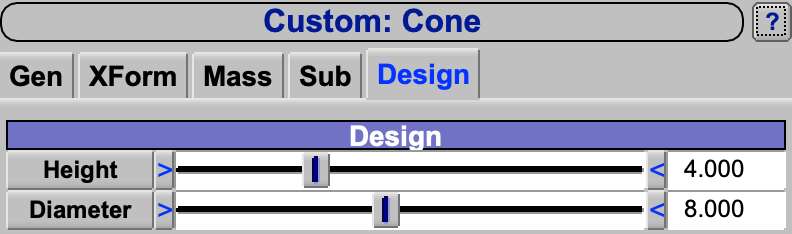

A custom component is a component type defined by a script rather than built into OpenVSP.  The script, a .vsppart
file, chooses the component's parameters, lays out the tabs of its screen, and builds its surfaces from cross sections
whenever a parameter changes.  It lets a user give a family of shapes the parameters that suit it -- a seat by its back
angle, a duct by its width and height -- with a screen that shows only those, and share it with others.  Once loaded,
a custom component is placed, saved, analyzed and meshed like any built-in one.

Because a custom component can be anything, its own parameters are the script author's to document.  This page covers
what every custom component shares: where OpenVSP finds the scripts, how a model carries them, how to get a script back
out of a model, and how a script is written.

| Topic                                                     |
|:----------------------------------------------------------|
| [Quick Start](#quick-start)                               |
| [Common Tabs](#common-tabs)                               |
| [Where Scripts Are Found](#where-scripts-are-found)       |
| [Custom Components in a Model](#custom-components-in-a-model) |
| [Exporting a Script](#exporting-a-script)                 |
| [Writing a Script](#writing-a-script)                     |
| [An Example: Cone](#an-example-cone)                      |
| [Building the Screen](#building-the-screen)               |
| [Building the Surfaces](#building-the-surfaces)           |
| [Limits](#limits)                                         |
| [Scripting](#scripting)                                   |

## Quick Start

### Using a custom component

1. Put its .vsppart file in a folder named CustomScripts in your home folder (see
   [Where Scripts Are Found](#where-scripts-are-found)).
2. Start OpenVSP.
3. In the Geom Browser, choose the type, listed by the script's file name below the line under the built-in types, and
   click *Add*.
4. Set its parameters on the tabs after Sub, and place it with the XForm tab.

### Writing a custom component

1. Copy one of the example scripts, such as Cone.vsppart, into the CustomScripts folder in your home folder, under a
   new name.
2. Edit its four functions (see [Writing a Script](#writing-a-script)).
3. Start OpenVSP, and watch the console it was started from for errors in the script.
4. Add the new type in the Geom Browser and try its parameters.

## Common Tabs

The Gen, XForm, Mass and Sub tabs of a custom component are the ones every component has; see
[Gen](GenTab.md), [XForm](XFormTab.md), [Mass](MassTab.md),
[Sub-Surfaces](SubTab.md) and [Attributes](GenTab.md#attributes).  The tabs after them come from
the script.

Two XForm controls depend on the script.  [Scale](XFormTab.md#scale) changes the shape only if the script has a
`Scale` function; without one, the shape keeps its size.  *Rot Origin(X)* turns the component about a point the script
places; a script without a `ComputeCenter` function gets a point that suits a body built along $X$ (see
[Building the Surfaces](#building-the-surfaces)).

## Where Scripts Are Found

When OpenVSP starts, it reads every file ending in .vsppart in three folders named CustomScripts, in this order:

1. `CustomScripts` in the working directory, the folder OpenVSP was started from;
2. `CustomScripts` in the user's home folder (`~/CustomScripts`; on Windows, in the user profile folder);
3. `CustomScripts` beside the OpenVSP program, where an OpenVSP installation puts the shipped examples.

Each script that compiles becomes a type, named after its file without the extension.  The folders are read once per
session: a script added or changed while OpenVSP runs is not seen until it is started again, and *File > New* does not
read them again.

A script with an error does not become a type; the compiler's messages, with line and column, are printed to the
console OpenVSP was started from.  A file whose content is identical to one already read adds no type, whatever its
name.  A file with the name of one already read but different content is loaded under that name with a number appended
(a second `Dup.vsppart` becomes `Dup0`), so a folder read later never replaces a type from one read earlier.

The home folder is the place for scripts of one's own: it is read whatever folder OpenVSP is started from, and is not
replaced when OpenVSP is reinstalled.  When OpenVSP runs from Python, the program is the Python interpreter, so the
third folder is beside the interpreter rather than the OpenVSP package; use the working directory or home folder there.

## Custom Components in a Model

A model file holds the whole script of every custom component in it, so it opens on a computer that does not have the
script.  When the script uses `#include`, the included files are written into the model in place of the directive.

The copy in the model file is the one used.  A component keeps the script it was saved with even when the file in
CustomScripts has changed since: the two are different scripts, and the model's copy is loaded under the name with a
number appended.  A component added from the Geom Browser uses the file in CustomScripts.  To bring a model up to a
newer script, add a component of the type and delete the old one.

A script that arrives only in a model is not added to the Geom Browser's list of types.  Copy and paste a component
of that type to make another, or export the script (below) into a CustomScripts folder and start OpenVSP again.

## Exporting a Script

*File > Export...*, then *Custom Script (.vsppart)*, lists every script OpenVSP has loaded, from the CustomScripts
folders and from the models opened in the session.  *Save To File* writes the chosen one to a .vsppart file, offering
the CustomScripts folder in the working directory and the script's name.

A model is therefore also a way to share a custom component: send the .vsp3 file, or post it to the VSP Hangar, and
the recipient exports the script from it.  A script exported from a model has its included files already written
into it.

## Writing a Script

A script is written in AngelScript, the C-like language of OpenVSP's .vspscript files, and uses the same API --
`GetParm`, `SetParmVal`, `GetXSec`, `SetXSecTanAngles` and the rest -- plus functions that act only on the custom
component being built.  Those are listed in the API documentation under Custom Geometry Functions; they exist only in
AngelScript and only inside a .vsppart file, so a custom component cannot be written in Python.

OpenVSP calls the script's functions at set times.  A function the script does not define is skipped.

| Function            | Called                                      | Does                                                         |
|:--------------------|:--------------------------------------------|:-------------------------------------------------------------|
| `Init()`            | Once, when a component is made or loaded.   | Adds the Parms, the cross section surfaces and their sections, default CFD sources and starting tessellation. |
| `InitGui()`         | Once, when a component is made or loaded.   | Describes the controls of the screen (`AddGui`).             |
| `UpdateGui()`       | Each time the screen is redrawn.            | Ties controls to Parms (`UpdateGui( gui_id, parm_id )`, or with two Parms for a two input slider), or cuts them loose. |
| `UpdateSurf()`      | Each time the component updates.            | Reads the Parms, sizes and places the cross sections, and skins them (`SkinXSecSurf`). |
| `Scale( double s )` | When the XForm tab's *Scale* changes.       | Multiplies the script's lengths by `s`, the ratio of the new scale to the previous one. |
| `ComputeCenter()`   | Each update.                                | Places the point *Rot Origin(X)* turns about (`SetCustomCenter`). |

Inside these functions `GetCurrCustomGeom()` gives the ID of the component being worked on, the way into its Parms.

`AddParm( type, name, group )` adds a Parm of type `PARM_DOUBLE_TYPE`, `PARM_INT_TYPE`, `PARM_BOOL_TYPE` or
`PARM_FRACTION_TYPE` to the component.  It starts at 0 with limits of $\pm 10^6$; set its value, limits and description
with `SetParmValLimits` and `SetParmDescript`.  These Parms are saved in the model, and can be linked, made design
variables and set from other scripts like any others.

A script is loaded once for each type, so its global variables are shared by every component of that type.  Keep a
component's state in its Parms, which belong to it alone; the examples keep only the indices `AddGui` returns in
globals, and those are the same for every component of the type.

An error that occurs while a function runs is printed to the console, and the component is left as far as the
function got.  An `#include` in a .vsppart file is found relative to the working directory, not the script's folder;
a script kept in one file works from any of the three folders.  A model holds a script with its included files
written in, so a script that uses `#include` never matches its copy in a model, and a model always loads that copy
as a second type with a number appended (see [Custom Components in a Model](#custom-components-in-a-model)).

## An Example: Cone

The Cone example, abridged here, shows the structure of a script.  `Init` adds two Parms and one cross section surface
with three sections: a point, a circle and a point.  Every section starts at the origin, so the point and the circle
together close the base.

```
void Init()
{
    string height = AddParm( PARM_DOUBLE_TYPE, "Height", "Design" );
    SetParmValLimits( height, 4.0, 0.001, 1.0e12 );

    string diameter = AddParm( PARM_DOUBLE_TYPE, "Diameter", "Design" );
    SetParmValLimits( diameter, 8.0, 0.001, 1.0e12 );

    string xsec_surf = AddXSecSurf();
    AppendCustomXSec( xsec_surf, XS_POINT );
    AppendCustomXSec( xsec_surf, XS_CIRCLE );
    AppendCustomXSec( xsec_surf, XS_POINT );
}
```

`InitGui` makes a Design tab with a slider for each Parm (Figure 1).  Giving each slider the Parm's name and group
ties it to the Parm, so `UpdateGui` has nothing to do.



*Figure 1. The Cone's screen, with the Design tab made by its InitGui after the common tabs, at the default Height 4
and Diameter 8.*

```
void InitGui()
{
    AddGui( GDEV_TAB, "Design" );
    AddGui( GDEV_DIVIDER_BOX, "Design" );
    AddGui( GDEV_SLIDER_ADJ_RANGE_INPUT, "Height", "Height", "Design" );
    AddGui( GDEV_SLIDER_ADJ_RANGE_INPUT, "Diameter", "Diameter", "Design" );
}

void UpdateGui()
{
}
```

`UpdateSurf` reads the Parms, sizes the circle, moves the last point out along $X$ to make the apex, and skins the
sections.

```
void UpdateSurf()
{
    string geom_id = GetCurrCustomGeom();
    double dia_val = GetParmVal( GetParm( geom_id, "Diameter", "Design" ) );
    double ht_val  = GetParmVal( GetParm( geom_id, "Height", "Design" ) );

    string xsec_surf = GetXSecSurf( geom_id, 0 );
    string xsec1 = GetXSec( xsec_surf, 1 );
    string xsec2 = GetXSec( xsec_surf, 2 );

    SetParmVal( GetXSecParm( xsec1, "Circle_Diameter" ), dia_val );
    SetCustomXSecLoc( xsec2, vec3d( ht_val, 0, 0 ) );

    SkinXSecSurf();
}
```

The shipped Cone.vsppart also has a `Scale` function, which multiplies Height and Diameter, a `ComputeCenter` that puts
*Rot Origin(X)* at that fraction of the height, and a default CFD Mesh point source at the apex.  The other
examples in the CustomScripts folder each show a further technique: Box ties controls in `UpdateGui` and greys them
out; OnOffExample changes the number of surfaces; BoxGroup copies one surface many times, and SeatGroup lays out rows
and columns of seats the same way; Seat and PodMan place several surfaces with transforms; Duct makes a closed ring;
TransportFuse shapes a body with tangent angles and strengths; Disk makes an actuator disk by setting its surface types.

## Building the Screen

`InitGui` describes the screen as a list of controls, added in order with
`AddGui( type, arg1, arg2, arg3, arg4, arg5 )`.  What each argument means depends on *type*, as the table gives it;
most controls take a label as *arg1*, the name and group of the Parm they show as *arg2* and *arg3*, and, for a slider,
its range as *arg4*.  Arguments may be left off from the end.  To give a later argument, pass empty strings for the
string arguments before it and 10.0, the default range, for *arg4*:
`AddGui( GDEV_ADD_CHOICE_ITEM, "Abs", "", "", 10.0, "0" )`.  A tab starts a new page, and the controls after it fill
that page from the top down.  The types that make something on a custom component's screen are these; the other
`GDEV_` types in the API make nothing there.

| Type                          | Arguments                                         | Makes                                                                           |
|:------------------------------|:--------------------------------------------------|:--------------------------------------------------------------------------------|
| `GDEV_TAB`                    | *arg1* title                                      | A new tab.                                                                      |
| `GDEV_SCROLL_TAB`             | *arg1* title                                      | A new tab whose page scrolls, for a long list of controls.                      |
| `GDEV_DIVIDER_BOX`            | *arg1* title                                      | A heading bar.                                                                  |
| `GDEV_YGAP`                   | none                                              | A little vertical space.                                                        |
| `GDEV_SLIDER_ADJ_RANGE_INPUT` | *arg1* label, *arg2* Parm, *arg3* group, *arg4* range | A slider with a typed value, whose range the user can widen; *arg4* is its starting range. |
| `GDEV_SLIDER_ADJ_RANGE`       | as `GDEV_SLIDER_ADJ_RANGE_INPUT`                  | The same as `GDEV_SLIDER_ADJ_RANGE_INPUT`.                                      |
| `GDEV_SLIDER_ADJ_RANGE_TWO_INPUT` | *arg1* label, *arg2* first Parm, *arg3* group, *arg4* range, *arg5* second Parm | A slider with two typed values, such as a Fuselage end cap's Rel and Abs length, the second Parm in the same group as the first.  One input drives the slider and the other is shown greyed.  It always needs both Parms: *arg2* without *arg5* is an error, and the slider is left out. |
| `GDEV_SLIDER_INPUT`           | *arg1* label, *arg2* Parm, *arg3* group, *arg4* range | A slider with a typed value, of fixed range.                                |
| `GDEV_SLIDER`                 | as `GDEV_SLIDER_INPUT`                            | The same as `GDEV_SLIDER_INPUT`.                                                |
| `GDEV_INPUT`                  | *arg1* label, *arg2* Parm, *arg3* group           | A typed value alone.                                                            |
| `GDEV_OUTPUT`                 | *arg1* label, *arg2* Parm, *arg3* group           | A value shown and not editable.                                                 |
| `GDEV_TOGGLE_BUTTON`          | *arg1* label, *arg2* Parm, *arg3* group           | An on/off button for a Bool Parm.                                               |
| `GDEV_CHECK_BUTTON`           | *arg1* label, *arg2* Parm, *arg3* group           | A check box for a Bool Parm.                                                    |
| `GDEV_TOGGLE_RADIO_GROUP`     | *arg2* Parm, *arg3* group                         | Toggle buttons that set an Int Parm as radio buttons do, like the Rel and Abs buttons beside an end cap's type.  Its buttons follow as `GDEV_ADD_CHOICE_ITEM`; the group itself shows nothing. |
| `GDEV_TRIGGER_BUTTON`         | *arg1* label, *arg2* Parm, *arg3* group           | A button that acts once when pressed.                                           |
| `GDEV_PARM_BUTTON`            | *arg1* label, *arg2* Parm, *arg3* group           | A button that opens its Parm in the Parm editor; without a Parm, a label.       |
| `GDEV_COUNTER`                | *arg1* label, *arg2* Parm, *arg3* group           | An integer with up and down arrows.                                             |
| `GDEV_INDEX_SELECTOR`         | *arg2* Parm, *arg3* group                         | An integer with arrow buttons on both sides; it shows no label.                 |
| `GDEV_CHOICE`                 | *arg1* label, *arg2* Parm, *arg3* group           | A drop-down choice for an Int Parm; its items follow as `GDEV_ADD_CHOICE_ITEM`. |
| `GDEV_ADD_CHOICE_ITEM`        | *arg1* text, *arg5* value                         | An item of the last choice or radio group.  Its value is its place in the list, from 0, unless *arg5* holds an integer, so the values need not run 0, 1, 2 in the order shown.  *arg2* and *arg3* are not used.  An *arg5* that is not an integer is an error, and the item keeps its place as its value. |
| `GDEV_BEGIN_SAME_LINE`, `GDEV_END_SAME_LINE` | none                               | Put the controls between them side by side.  They share the width in proportion to their natural widths, unless the line uses `GDEV_ADD_X`; then each keeps the width it was given. |
| `GDEV_FORCE_WIDTH`            | *arg1* width                                      | Give the next control the width in *arg1*, a whole number of pixels from 1 to 999.  In a line stretched to fill the width, it is the control's share of the line instead. |
| `GDEV_ADD_X`                  | *arg1* width                                      | Move along the line by the width in *arg1*.                                     |
| `GDEV_SET_BUTTON_WIDTH`       | *arg1* width                                      | Set the width in *arg1* for the buttons after it, and for the name buttons of sliders and inputs. |
| `GDEV_SET_CHOICE_BUTTON_WIDTH` | *arg1* width                                     | Set the width in *arg1* for the labels of the choices after it.                 |
| `GDEV_SET_FORMAT`             | *arg1* format                                     | Show the numbers of the controls after it in the C format in *arg1*, such as `%5.2f`. |

`GDEV_ADD_X`, `GDEV_SET_BUTTON_WIDTH` and `GDEV_SET_CHOICE_BUTTON_WIDTH` take their width in the screen's own terms,
which a script cannot know in pixels: a sum of terms, each a number of pixels or one of the widths `W` (the whole
line), `INPUT`, `BUTTON`, `CHOICE_BUTTON` and `RANGE_BUTTON`, with an optional count and `*`.  `"W-2*INPUT"` is the line
less two inputs, which puts the next controls over the inputs of a two input slider.

A control given a Parm name and group in *arg2* and *arg3* drives that Parm from the start. A control added without them
is tied to a Parm in `UpdateGui`, using the index `AddGui` returned; tying it to an empty Parm ID leaves it greyed, as
Box does with Width and Height when its *Square Box* button is on. A two input slider is tied with `UpdateGui( gui_id,
parm_id, parm_id2, input )`, where *input*, 1 or 2, chooses the input that drives the slider; one tied by AddGui's
*arg2* and *arg5* is driven by the first. It always shows two Parms: tied to one, it is greyed. A trigger button tied to
a Bool Parm sets it to 1 when pressed; `UpdateSurf` then acts on it and sets it back to 0. `CheckClearTriggerEvent(
gui_id )` instead reports, once, that a control has been used.

The screen is built once for each type, from the `InitGui` of the first component of that type that is shown, and every
component of the type shares it; so `InitGui` should describe the same controls every time.  Each type's controls
start in the default format, `%7.3f`, until its own `GDEV_SET_FORMAT`.  The window is titled with the type's name.

## Building the Surfaces

A custom component's surfaces are cross section surfaces: each is a list of cross sections, skinned in order.  The
script adds them in `Init`, or in `UpdateSurf` when their number can change, clearing the old ones first with
`ClearXSecSurfs`.

- `AppendCustomXSec( xsec_surf, type )` adds a section of any cross section curve type (`XS_POINT`, `XS_CIRCLE`,
  `XS_ROUNDED_RECTANGLE`, `XS_FOUR_SERIES` and the rest; see [Cross Section Curves](XSecCurves.md)), sized through its
  Parms (`GetXSecParm`).  The sections lie in the $YZ$ plane at the origin, so a component is built along $X$.
  `AppendXSec`, which older scripts use, does the same inside a .vsppart file.
- `SetCustomXSecLoc( xsec, loc )` moves a section, and `SetCustomXSecRot( xsec, rot )` turns it about that place, in
  degrees about $X$, $Y$ and $Z$.
- `SetXSecSurfGlobalXForm( xsec_surf, matrix )` moves or turns a whole surface, sections and all.
- `SkinXSecSurf( closed )` skins every surface through all of its sections, in order.  With *closed* true and three or
  more sections, the last section is made exactly the first, for a surface that comes back on itself, such as a duct.
  Tangent angles, strengths and continuity set on the sections with the usual API (`SetXSecTanAngles`,
  `SetXSecTanStrengths`, `SetXSecContinuity`) shape the skin.
- `CloneSurf( index, matrix )` adds a moved copy of a skinned surface, and `TransformSurf( index, matrix )` moves a
  skinned surface itself.  Both act after `SkinXSecSurf`.
- `SetVspSurfType( type, index )` says what a surface is -- `NORMAL_SURF` (a body), `WING_SURF` (a lifting surface) or
  `DISK_SURF` (an actuator disk) -- for the analyses that treat them differently.  `SetVspSurfCfdType( type, index )`
  says how CFD Mesh treats it: `CFD_NORMAL`, `CFD_NEGATIVE`, `CFD_TRANSPARENT` (a thin membrane
  outside a body, such as a disk or wake) or `CFD_STRUCTURE` (a thin membrane inside one).  An index of -1, the default,
  sets every surface.  `ClearXSecSurfs` returns every surface to `NORMAL_SURF` and `CFD_NORMAL`, so a script that
  rebuilds its surfaces sets their types again after.
- `SetupCustomDefaultSource( type, surf_index, ... )` gives CFD Mesh a source of type `POINT_SOURCE`, `LINE_SOURCE` or
  `BOX_SOURCE`, added when its *Add Default Sources* is pressed, with sizes in absolute lengths.
- `SetCustomCenter( x, y, z )`, called from `ComputeCenter`, places the point *Rot Origin(X)* turns about.  Without a
  `ComputeCenter`, the point is at *Rot Origin(X)* times the $X$ location of the last section of the first surface,
  which is the length of a body built along $X$ from the origin; for any other shape, write `ComputeCenter`.

## Limits

- The skinning takes the top side's tangent angles and strengths at each section and applies them all the way round.
  Different conditions on the top, bottom and sides, and a skinning spine, which Fuselage and Stack support (see
  [Stations: Sides and Spines](XSecSkinning.md#stations-sides-and-spines)), do not reach a custom component.
- The cross sections are the script's and have no tab of their own.  Their Parms can be reached from a script or the
  Parm editors, but those the script sets in `UpdateSurf` are set again on every update, so a change made to them
  elsewhere does not last.

## Scripting

From any API script or from Python, a custom component is added by its type name, `AddGeom( "Cone" )`, once its script
is in one of the CustomScripts folders; `GetGeomTypes` lists the types found.  Its Parms are found by the names and
groups the script gave them, `GetParm( geom_id, "Height", "Design" )`.
