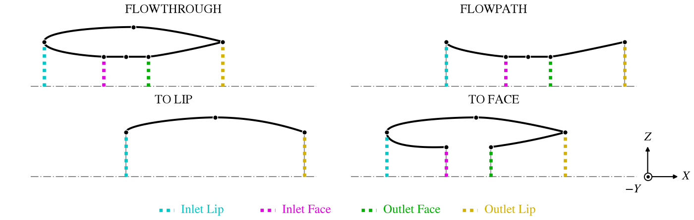
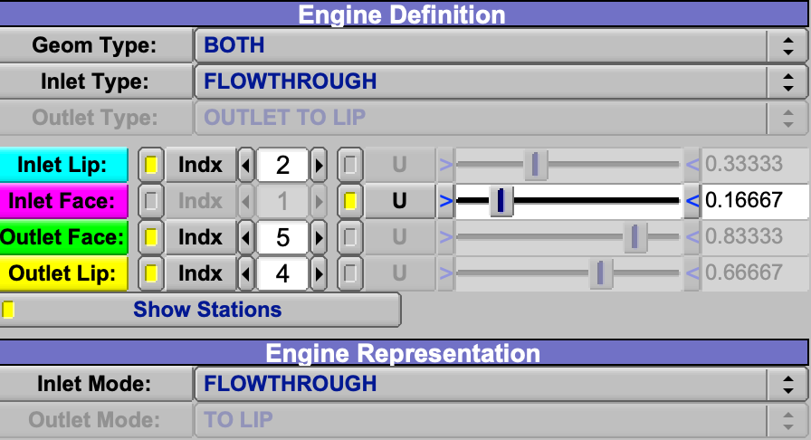
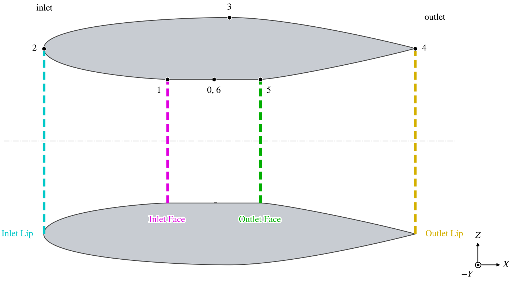
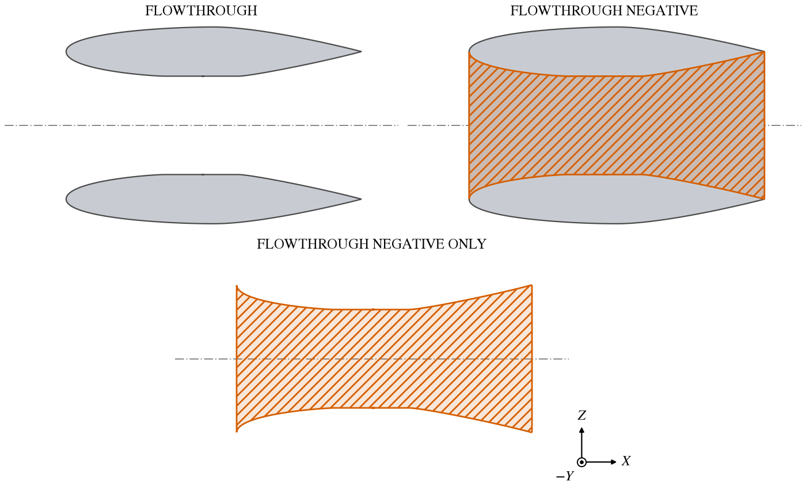
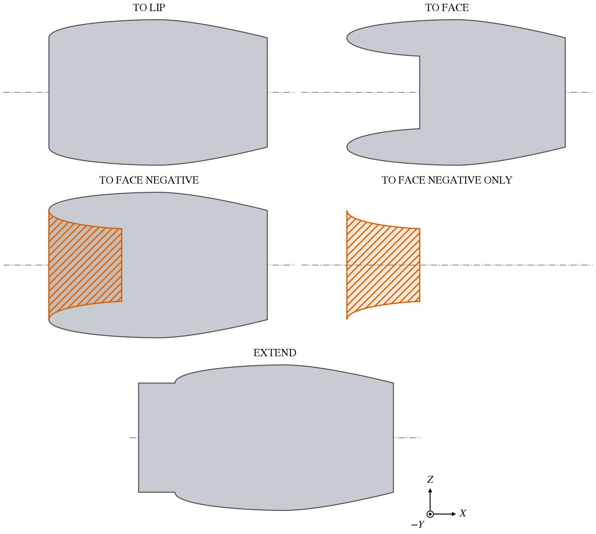

A Fuselage or a Stack can stand for an engine nacelle, an inlet, an exhaust or the flowpath inside them.  The
engine model lets the same sections be handed to analyses in different ways -- as an open flow-through nacelle, as a
solid with the flowpath removed, closed at the lips or at the faces, or stretched upstream and downstream to the
edge of a CFD domain -- without rebuilding them.  It works in two steps.  The *Engine Definition* says what the
sections describe and where the inlet and outlet lips and faces are; the *Engine Representation* says what is built
from them.  Both are groups on the Design tab of the Fuselage and the Stack.

Engine modeling has many choices, and not every combination of them makes a valid or useful model.  The quickest way
to a working one is a Stack preset: each nacelle preset lays out the sections and sets the whole engine model to
match (see [Starting from a Preset](#starting-from-a-preset)).  The [Stack Presets](StackPresets.md) page draws every
one of them.

| Topic                                                   | Tab    |
|:--------------------------------------------------------|:-------|
| [Quick Start](#quick-start)                             |        |
| [Starting from a Preset](#starting-from-a-preset)       | Design |
| [Engine Definition](#engine-definition)                 | Design |
| [Stations](#stations)                                   | Design |
| [Engine Representation](#engine-representation)         | Design |
| [Representing a Flowpath](#representing-a-flowpath)     | Design |
| [Extension](#extension)                                 | Design |
| [Scripting](#scripting)                                 |        |

The rest of the Fuselage and Stack screens is described in [Fuselage and Stack](FuselageStack.md), and the chevrons of
their Modify tab in [Chevrons](Chevron.md).

## Quick Start

1. Add a Stack and set *Stack Preset* to one of the Nacelle Flowthrough presets.  The preset lays out the sections
   and fills in the Engine Definition.
2. Place it with the XForm tab, and size its sections on the XSec tab.
3. The lips and faces are drawn on the nacelle while *Show Stations* is checked, as it is by default.
4. The preset comes with *Inlet Mode* FLOWTHROUGH, an open nacelle.  Choose FLOWTHROUGH NEGATIVE under Engine
   Representation for a solid nacelle and a flowpath that cuts through whatever it meets.

## Starting from a Preset

*Stack Preset* on the Stack's Design tab replaces the Stack's sections with a nacelle and sets its XSec Order, its end
caps, and the parts of its Engine Definition, stations and Engine Representation that the preset's definition uses,
with the simplest representation of it.  The controls it does not use keep their values, and so do the *Extension*
settings.  Pick the preset by what the sections should describe; the representation can then be changed freely.

| Sections describe                                   | Presets                                                                         | Comes as                         |
|:----------------------------------------------------|:--------------------------------------------------------------------------------|:---------------------------------|
| The whole nacelle wall, one loop (FLOWTHROUGH)      | [Nacelle Flowthrough Outlet, Inlet or Mid Origin](StackPresets.md#nacelle-flowthrough-outlet-origin) | An open nacelle        |
| The outside, into both ends to the faces            | [Nacelle Inlet + Outlet to Face](StackPresets.md#nacelle-inlet--outlet-to-face)  | Closed at both faces             |
| The outside, to one lip and one face                | [Nacelle Inlet Lip + Outlet Face](StackPresets.md#nacelle-inlet-lip--outlet-face), [Nacelle Inlet Face + Outlet Lip](StackPresets.md#nacelle-inlet-face--outlet-lip) | Closed at that lip and that face |
| The outside, to both lips                           | [Nacelle Inlet + Outlet to Lip](StackPresets.md#nacelle-inlet--outlet-to-lip)    | Closed at both lips              |
| An outlet only, with a closed nose                  | [Nacelle Outlet to Face](StackPresets.md#nacelle-outlet-to-face), [Nacelle Outlet to Lip](StackPresets.md#nacelle-outlet-to-lip) | Closed at the face or the lip |
| An inlet only, with a closed tail                   | [Nacelle Inlet to Face](StackPresets.md#nacelle-inlet-to-face), [Nacelle Inlet to Lip](StackPresets.md#nacelle-inlet-to-lip) | Closed at the face or the lip |
| Only the duct inside (FLOWPATH)                     | [Nacelle Flowpath Inlet + Outlet, Inlet or Outlet](StackPresets.md#nacelle-flowpath-inlet--outlet) | The duct, positive |

A Fuselage has no presets.  Its engine model is set by hand, with the same controls.

## Engine Definition

*Geom Type* says which parts of an engine the sections describe: NONE (an ordinary body, the default), INLET, BOTH
or OUTLET.  The other controls are used only when it is not NONE.

*Inlet Type* and *Outlet Type* say how the sections describe each end.

| Type                          | The sections describe                                                                                                   |
|:------------------------------|:------------------------------------------------------------------------------------------------------------------------|
| FLOWTHROUGH                   | The whole nacelle wall in one loop: the outside, both lips and the flowpath inside.  An *Inlet Type*, for *Geom Type* BOTH; the menu also offers it with INLET, where it does not give a flow-through nacelle. |
| FLOWPATH                      | Only the duct inside, from the lip to the face.                                                                         |
| INLET TO LIP, OUTLET TO LIP   | The outside only, ending at the lip.                                                                                    |
| INLET TO FACE, OUTLET TO FACE | The outside, around the lip and into the duct, ending at the face.                                                      |

With *Geom Type* BOTH and an *Inlet Type* of FLOWTHROUGH or FLOWPATH, the outlet is described the same way, and
*Outlet Type* is greyed.

The lip is where the outside surface meets the duct; the face is the end of the duct inside the nacelle, where the
compressor face or the turbine exit would be.  Figure 1 shows the curve the sections trace for each type, and where
its lips and faces lie.

*Figure 1. The sections of a Stack preset of each type, with both ends of that type, cut through the axis above it:
Nacelle Flowthrough Mid Origin, Nacelle Flowpath Inlet + Outlet, Nacelle Inlet + Outlet to Lip and Nacelle Inlet +
Outlet to Face.  The inlet is at the left.  Dots are the sections; grey, the flat ends that point sections close;
dotted, the stations the definition uses.*

## Stations

The four stations mark the lips and faces on the sections: *Inlet Lip*, *Inlet Face*, *Outlet Face* and *Outlet Lip*.
Each is set either by the index of a section (*Indx*) or by *U*, a fraction from 0 at the first section to 1 at the
last, chosen by the small toggle before each (Figure 2).  Only the stations the definition needs are active: the lip
of each end described, and its face unless its type is TO LIP.  A FLOWTHROUGH nacelle needs all four.

*Figure 2. The Engine Definition and Engine Representation of the Nacelle Flowthrough Mid Origin preset, with the
Inlet Face given by U.  Outlet Type is greyed because the inlet is FLOWTHROUGH, and Outlet Mode because the Inlet Mode
is.*

*Show Stations* draws the active stations on the component in the 3D view, as heavy dashed lines in the colors of
their labels: the inlet lip cyan, the inlet face magenta, the outlet face green, the outlet lip yellow (Figure 3).
They are drawn only while the component is in the Shown set and its feature lines are shown.

*Figure 3. The stations on the Nacelle Flowthrough Mid Origin preset, cut through its axis, with the section numbers.
The inlet is at the left.*

## Engine Representation

*Inlet Mode* and *Outlet Mode* say what is built from the sections at each end.  The result may be several
surfaces: positive ones, which are solid like any other component, and negative ones, which CompGeom, CFD Mesh and
the other analyses that understand negative volumes subtract from whatever they overlap.  A negative flowpath cut
through a nacelle that is closed at its lips leaves the same hollow nacelle as the flow-through loop, but as closed
volumes, and it cuts through any wing or fuselage the nacelle is buried in.  Each surface is closed where it is cut,
by a cap at the lip or face, flat where the section is flat; where a negative surface ends on a positive one, the
center of its cap is drawn out a hair (1/10000 of the component's size) so that the two do not share a face.

On a FLOWTHROUGH nacelle the *Inlet Mode* chooses between the flow-through modes, which treat both ends at once
(Figure 4), and the modes for each end, of which the *Inlet Mode* sets the inlet and the *Outlet Mode* the outlet
(Figure 5).  *Outlet Mode* is greyed while a flow-through mode is chosen; the Flowthrough presets set it to TO LIP.

| Mode                      | Built                                                                                         |
|:--------------------------|:----------------------------------------------------------------------------------------------|
| FLOWTHROUGH               | The loop as it is: an open nacelle, the flow passing through it.                              |
| FLOWTHROUGH NEGATIVE      | The nacelle closed at both lips, and a negative flowpath from lip to lip.                     |
| FLOWTHROUGH NEGATIVE ONLY | The negative flowpath alone; the nacelle is not built.                                        |
| TO LIP                    | The end closed at the lip.                                                                    |
| TO FACE                   | The end closed at the face, leaving the inlet or outlet open as a recess.                      |
| TO FACE NEGATIVE          | The end closed at the lip, and a negative recess from the lip to the face.                    |
| TO FACE NEGATIVE ONLY     | The negative recess alone: no positive surface is built, at either end.                      |
| EXTEND                    | The end closed at the lip and stretched upstream (inlet) or downstream (outlet); see [Extension](#extension). |

*Figure 4. The flow-through modes on the nacelle of Figure 3, cut through its axis.  Positive surfaces are grey,
negative ones red and hatched.*

*Figure 5. The modes of each end on the same nacelle, each set as the Inlet Mode and shown at the inlet (left), with
the Outlet Mode TO LIP, which closes the outlet at its lip except under TO FACE NEGATIVE ONLY, where only the recess is
built.  EXTEND has a Distance of 1.*

Which modes are offered depends on the definition: the flow-through modes for a FLOWTHROUGH nacelle, and FLOWTHROUGH
NEGATIVE and NEGATIVE ONLY also for a FLOWPATH with both ends; the modes that end at a face only when there is a face,
except that a FLOWPATH, which has no outside to leave open, does not offer TO FACE.  An outside that ends at its lip
(TO LIP) can be closed at the lip or extended; one that goes on to the face (TO FACE) can use every mode but the
flow-through ones.  Each NEGATIVE ONLY mode is offered where its NEGATIVE mode is.

While *Geom Type* is not NONE, the Gen tab's [Negative Volume](GenTab.md#negative-volume) box has no effect,
though it can still be checked; the representation decides which surfaces are negative.

## Representing a Flowpath

A FLOWPATH definition describes the duct itself, and the representation then says whether the duct is solid or is
cut away.  The modes build different surfaces from a duct than from a nacelle wall.

| Definition          | Mode                    | Built                                                                     |
|:--------------------|:------------------------|:--------------------------------------------------------------------------|
| Inlet or outlet     | TO LIP                  | The duct as its sections draw it, positive.                               |
| Inlet or outlet     | TO FACE NEGATIVE        | The duct, negative.                                                       |
| Inlet or outlet     | TO FACE NEGATIVE ONLY   | Nothing.                                                                  |
| Inlet or outlet     | EXTEND                  | The duct, positive, stretched upstream (inlet) or downstream (outlet).    |
| BOTH, *Inlet Mode*  | FLOWTHROUGH NEGATIVE    | The whole duct, negative.  The *Outlet Mode* then closes or extends the outlet end. |
| BOTH, *Inlet Mode*  | FLOWTHROUGH NEGATIVE ONLY | The whole duct, negative, as FLOWTHROUGH NEGATIVE.                      |
| BOTH, *Inlet Mode*  | TO FACE NEGATIVE        | The duct from the inlet lip to the face negative, the rest positive.      |
| BOTH, *Inlet Mode*  | TO FACE NEGATIVE ONLY   | The duct from the inlet lip to the face, negative; no positive part.      |
| BOTH, *Inlet Mode*  | TO LIP                  | The whole duct, positive.                                                 |
| BOTH, *Inlet Mode*  | EXTEND                  | The whole duct, positive, stretched upstream.                             |

With both ends, the *Outlet Mode* treats the outlet end the same way: TO LIP closes it, EXTEND stretches it
downstream, and TO FACE NEGATIVE makes the part from the outlet face to the outlet lip negative.

To cut an inlet duct out of a fuselage it is buried in, use TO FACE NEGATIVE for an inlet or outlet alone, and
FLOWTHROUGH NEGATIVE for a duct with both ends.  The three Nacelle Flowpath presets come set to TO LIP, the duct as
drawn, so choose the negative mode after *Set*.

## Extension

EXTEND stretches the lip section into a straight duct of the same section, so the flow entering an inlet or leaving
an outlet can be carried to the edge of a CFD domain rather than meeting a closed face.

- *Distance* is the length added.
- *Auto* sets the distance to the length in $X$ of the components in the chosen *Set* (Shown by default), so the
  extension grows with the model.  The extensions themselves are left out of that length.
- *Align X* extends along the model's $X$ axis, the usual freestream direction, rather than along the component's own
  $X$ axis.  It matters only for a component that is turned.

The inlet is extended toward $-X$, the outlet toward $+X$.

## Scripting

The engine model's parms are in the *EngineModel* group of the Fuselage or Stack.

| Control                  | Parm                                                                       | Values                                     |
|:-------------------------|:---------------------------------------------------------------------------|:-------------------------------------------|
| Geom Type                | `GeomIOType`                                                               | `ENGINE_GEOM_NONE`, `ENGINE_GEOM_INLET`, `ENGINE_GEOM_INLET_OUTLET`, `ENGINE_GEOM_OUTLET` |
| Inlet Type, Outlet Type  | `GeomInType`, `GeomOutType`                                                | `ENGINE_GEOM_FLOWTHROUGH`, `ENGINE_GEOM_FLOWPATH`, `ENGINE_GEOM_TO_LIP`, `ENGINE_GEOM_TO_FACE` |
| Station by index or U    | `InletLipMode`, `InletFaceMode`, `OutletFaceMode`, `OutletLipMode`         | `ENGINE_LOC_INDEX`, `ENGINE_LOC_U`         |
| Station index            | `InletLipIndex`, `InletFaceIndex`, `OutletFaceIndex`, `OutletLipIndex`     |                                            |
| Station U                | `InletLipU`, `InletFaceU`, `OutletFaceU`, `OutletLipU`                     | 0 to 1                                     |
| Show Stations            | `EngineShowStationsFlag`                                                   | 0 or 1                                     |
| Inlet Mode, Outlet Mode  | `InletModeType`, `OutletModeType`                                          | `ENGINE_MODE_FLOWTHROUGH` ... `ENGINE_MODE_EXTEND` |
| Align X                  | `RotExtensionFlag`                                                         | 0 or 1                                     |
| Auto, Set                | `AutoExtensionFlag`, `AutoExtensionSet`                                    |                                            |
| Distance                 | `ExtensionDistance`                                                        |                                            |
