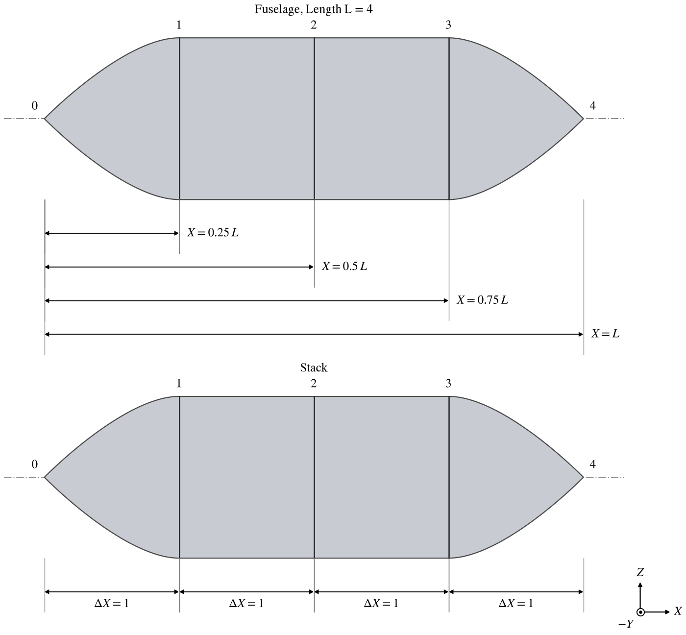
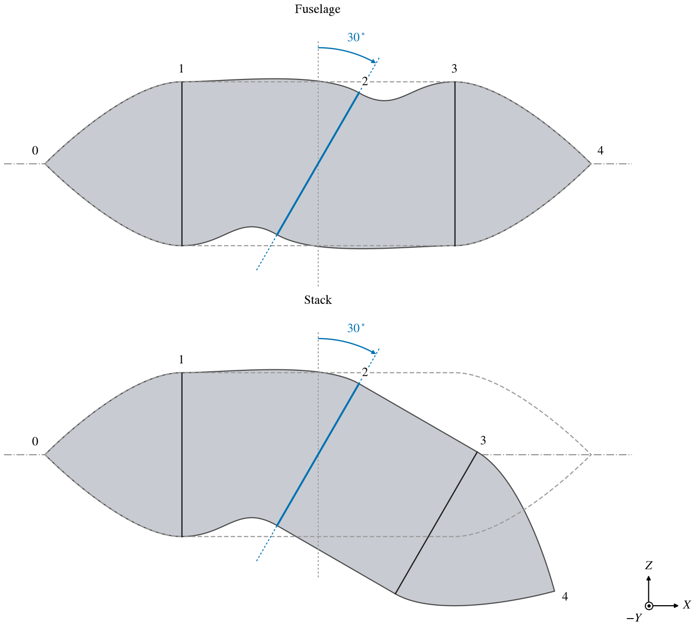
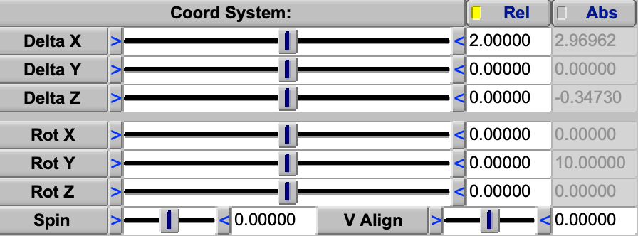
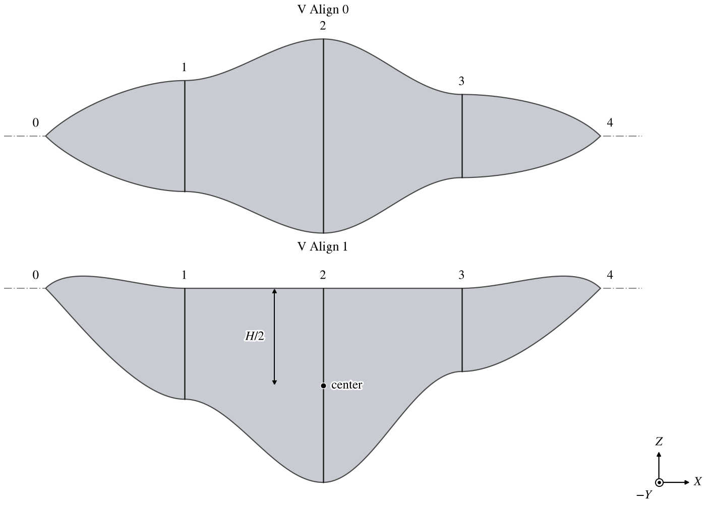
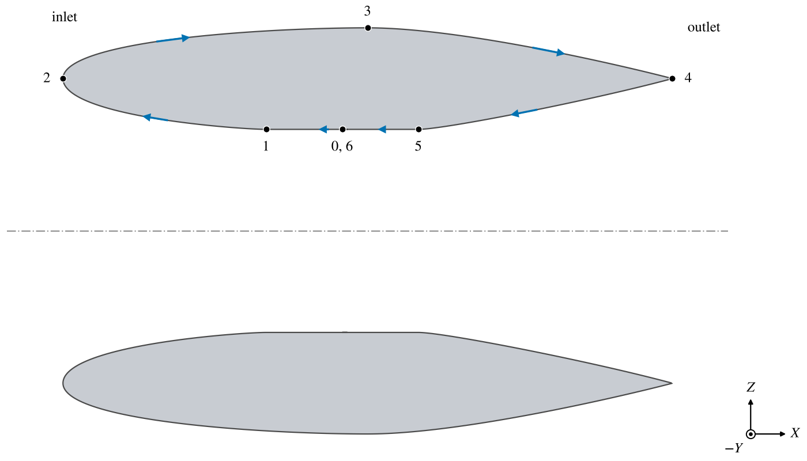
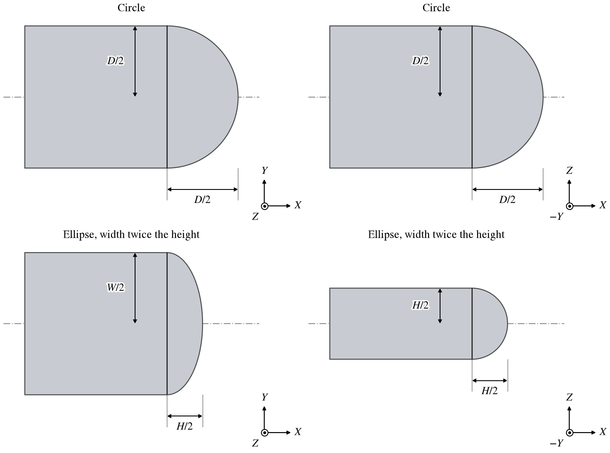

The Fuselage and the Stack build a body by skinning a surface through a series of cross sections.  They share almost
everything: the cross section shapes, the skinning controls, the end caps, the engine model and the chevrons.  They
differ in how the sections are placed.  A Fuselage places each section on its own, at a fraction of the Fuselage's
length.  A Stack places each section relative to the one before it, so moving or turning one section carries every
later section with it.  Use a Fuselage for a body laid out along a straight axis with a known length; use a Stack for
nacelles, ducts, inlets and bodies that bend, where each section is most easily given as a step from the last.

| Topic                                                         | Tab           |
|:--------------------------------------------------------------|:--------------|
| [Quick Start](#quick-start)                                   |               |
| [What Differs](#what-differs)                                 |               |
| [Building a Body](#building-a-body)                           | XSec, Skinning |
| [Placing a Fuselage's Sections](#placing-a-fuselages-sections) | XSec, Design  |
| [Placing a Stack's Sections](#placing-a-stacks-sections)      | XSec          |
| [Section Order](#section-order)                               | Design        |
| [Inserting and Cutting Sections](#inserting-and-cutting-sections) | XSec      |
| [Tessellation Along the Body](#tessellation-along-the-body)   | XSec, Design  |
| [End Caps](#end-caps)                                         | Design        |
| [Stack Presets](#stack-presets)                               | Design        |
| [Converting a Fuselage to a Stack](#converting-a-fuselage-to-a-stack) | Design |
| [Scripting](#scripting)                                       |               |

The other tabs are shared with other components.  The [Gen](GenTab.md), [XForm](XFormTab.md), [Mass](MassTab.md) and
[Sub](SubTab.md) tabs are described on their own pages.  The shape of each section is chosen on the XSec tab; the shapes
and their parameters are described in [Cross Section Curves](XSecCurves.md), and the tab's common controls (choosing the
active section, copying, pasting, converting a section to an editable curve) and the Skinning tab in
[Cross Section Skinning](XSecSkinning.md).  The Engine Definition, Engine Representation and Extension groups of the
Design tab are described in [Engine Model](EngineModel.md), and the Chevron controls of the Modify tab in
[Chevrons](Chevron.md).

## Quick Start

### A fuselage

1. Add a Fuselage.  A new one has a point nose, three elliptical sections and a point tail, 30 units long.
2. Place it with the XForm tab.
3. Set *Length* on the Design tab.
4. On the XSec tab choose each section, give it a shape and size, and set *X* as a fraction of the length.  Shape
   the surface between sections on the Skinning tab.

### A nacelle

1. Add a Stack, choose a nacelle under *Stack Preset* on the Design tab and click *Set* (see
   [Stack Presets](StackPresets.md)).
2. Place it with the XForm tab.
3. On the XSec tab choose each section, give it a size, and set its *Delta X* from the section before.
4. Choose how analyses see it under *Engine Representation* (see [Engine Model](EngineModel.md)).

## What Differs

| Feature                  | Fuselage                                                    | Stack                                                               |
|:-------------------------|:------------------------------------------------------------|:--------------------------------------------------------------------|
| Section location         | *X*, *Y*, *Z* as fractions of *Length*                      | *Delta X*, *Delta Y*, *Delta Z* from the section before, or absolute |
| Section rotation         | Turns that section alone                                    | Turns that section and every later one                              |
| Overall length           | *Length* on the Design tab                                  | No parameter; the sum of the steps                                  |
| XSec Order policies      | MONOTONIC (default), LOOP, FREE                             | FREE (default), LOOP                                                |
| Vertical alignment       | None                                                        | *V Align*                                                           |
| Presets                  | None                                                        | *Stack Preset*                                                      |
| Conversion               | *Convert to Stack*                                          | None                                                                |
| Insert                   | Halfway to the next section; nothing else moves             | One step on from the active section; later sections move on        |
| Cut                      | Nothing else moves                                          | Later sections close up                                             |
| Rotation origin (XForm)  | *Rot Origin* is a fraction of *Length*                      | *Rot Origin* has no effect (see [XForm](XFormTab.md#location-and-rotation)) |
| New component            | 30 long; ellipses 2.5 wide and 3 tall at 0.25, 0.5, 0.75    | 4.5 long; ellipses 3 wide and 2.5 tall, steps 1, 2, 1 and 0.5       |

Everything else is the same: the section shapes, skinning, per-section tessellation, end caps, the engine model and
chevrons.

## Building a Body

A Fuselage or Stack can model almost any body, but it is not always the quickest choice.  A store, a tank or a
placeholder of a standard streamlined shape is a [Pod](Pod.md); a round duct or nacelle wall made from one airfoil is
a [Body of Revolution](BOR.md).  Use a Fuselage or a Stack when the body is not round, when its sections change shape
along it, or when a nacelle needs the [Engine Model](EngineModel.md).

Build the body in stages.  First set its length and the width and height of a few sections, so that its size and
proportions are right; then give the sections their shapes; and shape the surface between them on the Skinning tab
last.

Use as few sections as the shape needs.  Put a section where the shape changes character -- at a corner or a break in
the profile, at an inflection, where a constant section begins or ends, where the section's shape changes -- and let
the skinning carry the surface between them.  Every extra section is one more to keep in step with its neighbors when
the body is changed, and each adds a span of *Num U* points along the body, so the tessellation grows with the count.

Positions along the body given by U count sections, not length: each span between two sections takes the same share
of U however long it is (see [Attachment Coordinates](XFormTab.md#attachment-coordinates)).  A child attached by UW
or RST, a sub-surface placed by U and an engine station set by U all keep their U when a section is inserted or cut,
and so move along the body.  On the default Fuselage, a child attached at U 0.6 moves from $X = 18$ to $X = 15$ when
a section is inserted after section 1.  Attach by LMN, a fraction of the length, what must stay in place while
sections are added or removed.

## Placing a Fuselage's Sections

Each Fuselage section has a location *X*, *Y*, *Z*, each a fraction of the Fuselage's *Length*, and a rotation
*Rot X*, *Rot Y*, *Rot Z* about its own center (Figure 1).  *X* runs from 0 at the nose to 1 at the tail; *Y* and
*Z* may be from -1 to 1.  Each slider shows the fraction and, beside it, the distance it gives; typing a distance
sets the fraction.  Because all three are fractions, changing *Length* moves every section, sideways and vertically
as well as along the body, but does not change the size of any section.

The section's rotation turns it about its center, right-handed about the body's axes: positive *Rot X* raises its
right side ($+Y$), positive *Rot Y* tilts its top aft, positive *Rot Z* moves its right side forward.  It turns that
section only (Figure 2); the sections before and after keep their places and orientations.

*Figure 1. One body built both ways.  Above, a Fuselage of Length 4: each section's X is its own
fraction of the length.  Below, a Stack: each section is a step Delta X from the one before.*

## Placing a Stack's Sections

Each Stack section is placed by a step *Delta X*, *Delta Y*, *Delta Z* and a turn *Rot X*, *Rot Y*, *Rot Z* from the
section before it, in that section's own axes.  The steps are lengths, not fractions.  A turn therefore turns the
direction in which every later section is stepped: a Stack is built like a path, each section a step and a turn
from the last (Figure 2).  Positive *Rot Y* turns the following sections down ($-Z$), positive *Rot Z* turns them
toward $+Y$.  The first section is placed and turned the same way from the Stack's origin, so moving it moves the
whole Stack.

*Figure 2. Rot Y 30 on section 2 of the body of Figure 1.  In the Fuselage (above) only section 2 tilts.  In the
Stack (below) the sections after it follow the turn.  Dashed, the body without the turn.*

*Coord System* chooses, for each section, which set of values drives it (Figure 3).

- *Rel* (the default): the steps and turns drive the section, and the absolute values are shown greyed.
- *Abs*: the section's location and orientation in the Stack's own axes drive it, and the steps and turns are shown
  greyed.  The section then stays where it is when earlier sections change, and its steps are worked out from the
  section before.  Later sections are still placed from it.

Use *Abs* to pin a section that must stay put, such as a lip or a face that another component is placed against,
while the sections ahead of it are reshaped.

*Figure 3. Section 2 of a new Stack with Rot Y 10 on section 1, in Rel.  The steps and turns drive it; the greyed
column is its location and orientation in the Stack's axes, which the turn on section 1 has changed.*

*V Align* moves a section up or down, before it is placed, by its value times half the section's height: at 1 its top
lies on the Stack's line through the section centers, at -1 its bottom does.  It lets sections of different heights
share a flat top or bottom without working out their offsets (Figure 4).  The move is the section's alone: the next
section is placed from where the section would be at V Align 0.

*Figure 4. A Stack of three ellipses of heights 0.8, 1.4 and 0.6 between point ends, every section at V Align 0
(above) and at V Align 1 (below).  At 1 each section's center lies half its height H below the Stack's line, and the
tops of sections 1 to 3 lie on it.*

*Spin*, in both components, slides the start of the section's curve around the section by a fraction of the curve's
parameter, from -1 to 1.  It changes no shape; it changes which points of neighboring sections the skinning joins, which
matters when sections of different types meet.

## Section Order

*XSec Order* on the Design tab chooses what order the sections may come in.

| Policy    | Fuselage                                                                         | Stack                                                                 |
|:----------|:---------------------------------------------------------------------------------|:----------------------------------------------------------------------|
| MONOTONIC | First section at *X* 0, last at 1; each other between its neighbors              | Not available                                                         |
| FREE      | Every *X* anywhere from 0 to 1, in any order                                     | Every section placed freely                                           |
| LOOP      | First and last sections at *X* 1; the last is a copy of the first                | The last section is a copy of the first, placed on it                 |

MONOTONIC is the Fuselage's default and suits a body that runs nose to tail.  Its limits hold as the sections are
edited, and switching to it from another policy pulls any section that is out of order onto its neighbor, losing its
*X*.

LOOP closes the sections on themselves, for a component whose sections run around a closed path, such as a nacelle
whose sections run forward through the flowpath to the inlet lip and back along the outside (Figure 5).
The last section is no longer edited: it takes the first section's shape and size, and its place.  In a Fuselage it
takes the first section's location, rotation and *Spin*, and both ends lie at *X* 1, the aft end.  In a Stack it is
placed exactly on the first section, whatever the steps to it, and takes its *Spin* and *V Align*.  Its skinning is
not copied, so set it to match if the join must be smooth.  The Stack's nacelle presets are loops.

*Figure 5. The Nacelle Flowthrough Mid Origin preset, cut through its axis.  Its sections run in a loop: from section
0 in the middle of the flowpath forward through the inlet to the lip, aft along the outside to the outlet lip, and
forward through the outlet back to section 6, which lies on section 0.*

## Inserting and Cutting Sections

*Insert* adds a copy of the active section after it and makes the copy active.

- In a Fuselage the copy goes halfway, in *X*, between the active section and the next one.  Nothing else moves.  A
  section cannot be inserted after the last one.
- In a Stack the copy takes the active section's steps and turns, so it lies one more step on, and every later section
  moves on by that step.  A step of zero *Delta X* becomes 1.  In LOOP order a section cannot be inserted after the
  last one.  In FREE order it can, and the Stack grows by the last section's step.

*Cut* removes the active section and keeps it for pasting; it does nothing when only two sections are left.  In a
Fuselage nothing else moves.  In a Stack the sections
after it close up, since each is placed from the one before.

## Tessellation Along the Body

The number of points along the body is set section by section.  On the XSec tab, *Num U* of a section is the number
of points from the section before it to this one, and *Fwd. Cluster* and *Aft Cluster* bunch those points toward the
forward and aft ends of that span (values below 1 bunch them).  The first section has no span before it, so its
controls are greyed, and the Gen tab's *Num U* is greyed too.  *Cap Tess* on the Design tab sets the points across
both end caps.

## End Caps

The *Tip Treatment* group of the Design tab closes an open end of the body: the *Nose* cap at the first section, the
*Tail* cap at the last.  An end whose section is a point needs no cap; an end whose section has area is left open with
*None*.

The caps are the Wing's None, Flat, Round, Edge and Sharp tip caps, with the same *Length*, *Offset*, *Strength* and
*Sweep Stretch*; see [Tip Treatment](Wing.md#tip-treatment).  The extended round caps are the Wing's alone.  A cap is
built across the section as if it were an airfoil whose chord runs from the section's right side ($+Y$) to its left, so
at each point across the section the cap reaches out by half the section's height there (at Length 1).  Where the body
ends straight, a Round cap on a circular section is therefore a hemisphere, and on an ellipse it reaches out by half the
height, whatever the width (Figure 6): a wide, flat section gets a short, blunt cap, and a tall, narrow one a long cap.
Where the body narrows toward its end, the cap continues the surface's direction and reaches out less.

*Figure 6. A Round tail cap of Length 1 on a straight body, from above (left) and from the side (right).  On a circle
of diameter D it is a hemisphere.  On an ellipse of width W twice its height H it reaches out by H/2 in both views, a
half circle from the side and a half ellipse from above.*

## Stack Presets

*Stack Preset* and *Set* replace every section of a Stack with a ready-made layout: a cylinder, or one of many
nacelles, each with its XSec Order and its engine definition and representation already set.  *Set* asks first,
since the existing sections are lost.  The presets are described in [Stack Presets](StackPresets.md).

## Converting a Fuselage to a Stack

*Convert to Stack* on the Fuselage's Design tab replaces the Fuselage with a Stack of the same shape, in the same
place in the model, under the same name, with its children, subsurfaces, structures, mesh sources and attributes.
Each section is placed where the Fuselage put it, as steps and turns from the section before, so the surface does not
change.  The Stack keeps the Fuselage's ID and the IDs of its parameters, so links and design variables still find
them, but some now mean something else.  A section's *X*, *Y* and *Z*, fractions of the length, become its *Delta X*,
*Delta Y* and *Delta Z*, lengths from the section before, and its rotations become turns from the section before; check
any link or design variable on them after converting.  The Fuselage's *Length* has no counterpart in a Stack.  It
cannot be undone.

Convert a Fuselage when it must be reshaped section by section, for example to turn its aft body, which a Stack does
by turning one section.

## Scripting

A script reaches a section's parameters through the XSec it belongs to (`GetXSecSurf`, `GetXSec`, `GetXSecParm`).

| Control        | Fuselage parm                               | Stack parm                                     |
|:---------------|:--------------------------------------------|:-----------------------------------------------|
| Length         | `Length` (Design)                           | none                                           |
| XSec Order     | `OrderPolicy` (Design): `FUSE_MONOTONIC`, `FUSE_LOOP`, `FUSE_FREE` | `OrderPolicy` (Design): `STACK_FREE`, `STACK_LOOP` |
| Location       | `XLocPercent`, `YLocPercent`, `ZLocPercent` | `XDelta`, `YDelta`, `ZDelta`                   |
| Rotation       | `XRotate`, `YRotate`, `ZRotate`             | `XRotate`, `YRotate`, `ZRotate`                |
| Absolute       | none                                        | `XAbs`, `YAbs`, `ZAbs`, `XRotateAbs`, `YRotateAbs`, `ZRotateAbs` |
| Coord System   | none                                        | `XSAbsRelFlag`: `ABS` or `REL`                 |
| V Align        | none                                        | `VAlign`                                       |
| Spin           | `Spin`                                      | `Spin`                                         |
| Num U, clusters | `SectTess_U`, `FwdCluster`, `AftCluster`   | `SectTess_U`, `FwdCluster`, `AftCluster`       |

The two `OrderPolicy` enums differ: 0 is `FUSE_MONOTONIC` in a Fuselage but `STACK_FREE` in a Stack.

| Call                     | Purpose                                                                          |
|:-------------------------|:---------------------------------------------------------------------------------|
| `InsertXSec`, `CutXSec`  | Insert a section of a given type after an index, or cut one, as *Insert* and *Cut* do. |
| `InitStackPreset`        | Replace a Stack's sections with a preset, `STACK_PRESET_DEFAULT` and the others. |
| `ConvertFuselageToStack` | Replace a Fuselage with a Stack of the same shape; returns the same ID.          |
