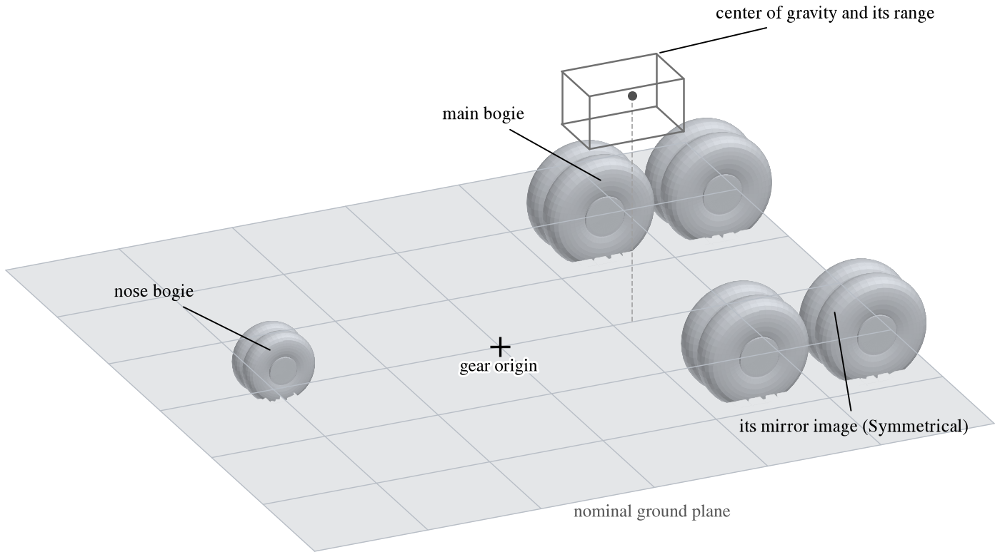
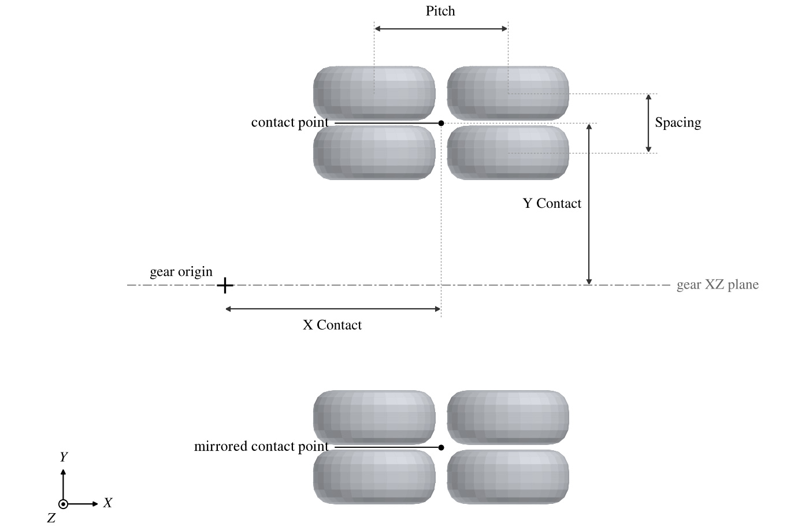
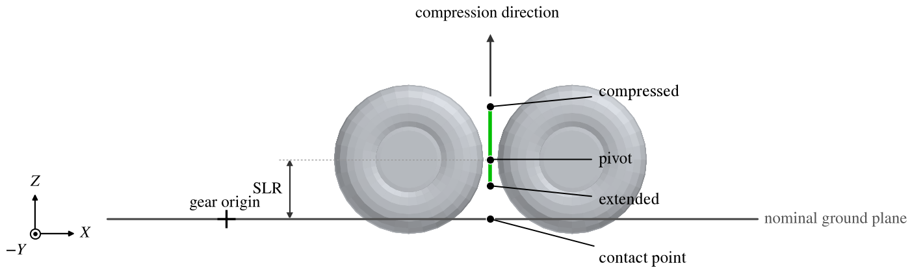
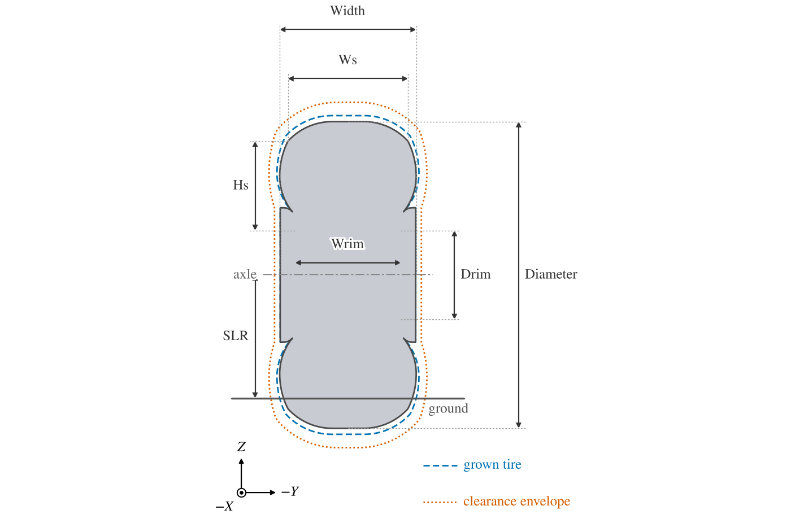
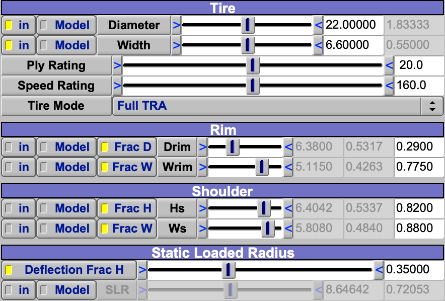
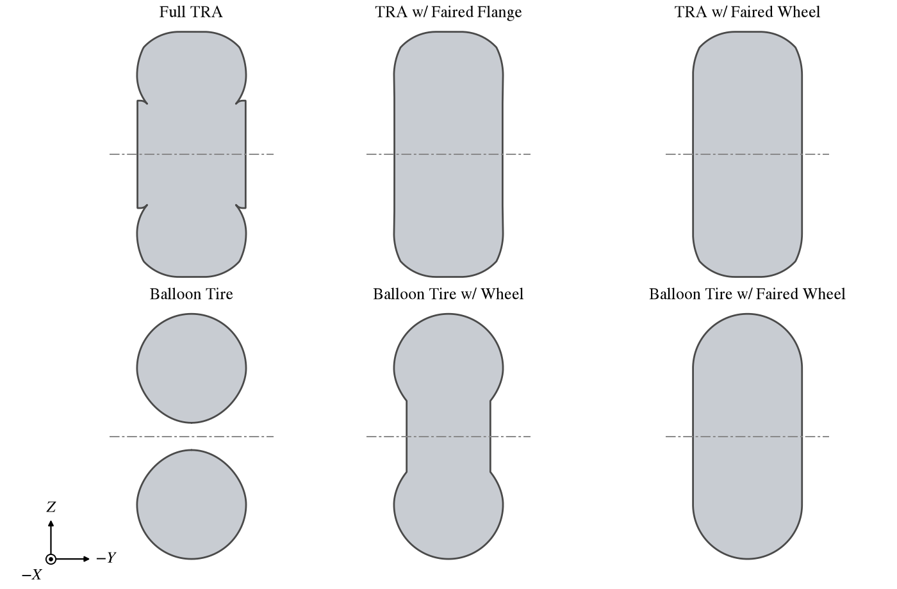
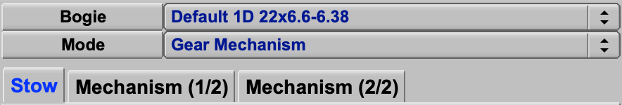
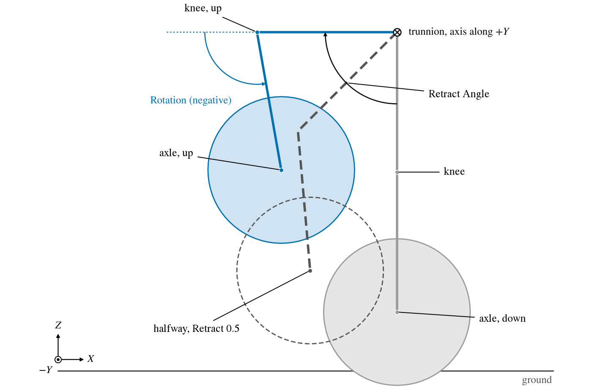
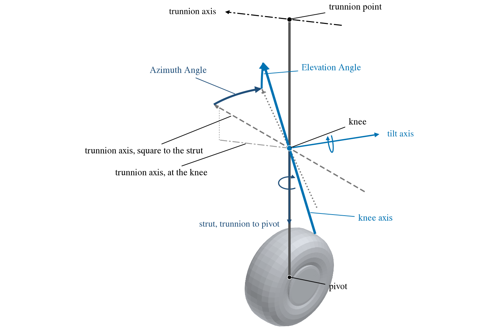

The Gear component models an aircraft's landing gear, and above all the ground the aircraft stands on.  Its own origin
and $XY$ plane are the nominal ground plane, and its bogies, each a group of identical wheels, are placed on or above
that plane (Figure 1).  One Gear holds all of an aircraft's gear: nose, main, tail and outriggers share its ground
plane.

The ground handling analyses need to know more than the gear's shape, so the Gear also holds how the gear behaves.  Each
bogie has a contact point and a pivot it rotates about, a steering limit, suspension travel that compresses and extends
the strut, and tires built to Tire and Rim Association (TRA) dimensions [1, 2], whose static loaded, unloaded, grown and
flat radii differ.  The Gear holds the aircraft's center of gravity range too.  From these, [Auxiliary](Auxiliary.md)
components hung from the Gear build off-nominal ground planes: the ground with chosen bogies in a chosen state, turned
about their contact points or axles as the tail strike, tipback and roll analyses require (see
[Ground Analyses](#ground-analyses)).  Each bogie also has a retracted position, given either directly or by a
retraction mechanism, so that the stowed gear can be checked against the aircraft.

| Topic                                                     | Tab          |
|:----------------------------------------------------------|:-------------|
| [Quick Start](#quick-start)                               |              |
| [The Gear's Frame and Ground Plane](#the-gears-frame-and-ground-plane) | Design, XForm |
| [Center of Gravity](#center-of-gravity)                   | Design       |
| [Bogies](#bogies)                                         | Bogie        |
| [Contact Point and Suspension](#contact-point-and-suspension) | Bogie    |
| [Tires](#tires)                                           | Tire         |
| [Retraction](#retraction)                                 | Retract      |
| [Drawing the Gear Up and Down](#drawing-the-gear-up-and-down) | Design   |
| [Ground Analyses](#ground-analyses)                       |              |
| [Shared Tabs](#shared-tabs)                               | Gen, XForm, Mass, Sub |
| [Scripting](#scripting)                                   |              |
| [References](#references)                                 |              |

## Quick Start

1. Add a Gear.  Set *Model Units* on the Design tab to the model's length unit.  Place the Gear with the XForm tab so
   that its origin lies on the ground under the aircraft, in the attitude the aircraft stands in.
2. On the Bogie tab, *Add* a bogie for the nose gear and set its *X Contact*.  Add another for the main gear, set
   its *X Contact* and *Y Contact*, and check *Symmetrical*.  Set *Across* and *Tandem* for each.
3. On the Tire tab, choose each bogie and give its tire's *Diameter* and *Width*, in inches from the tire maker's data,
   and its rim.
4. On the Design tab, give the center of gravity and its range.
5. On the Retract tab, give each bogie's stowed position, or its retraction mechanism, and check it with *Draw Gear* Up
   and Down.

A new Gear has no bogies; until one is added it is only its ground plane.

## The Gear's Frame and Ground Plane

Everything on the Gear's tabs is given in the Gear's own axes, which the XForm tab places in the model.  With no
rotation they are the model's axes: $X$ aft, $Y$ to the right, $Z$ up.  The origin and the $XY$ plane are the nominal
ground plane, the ground with the gear in its nominal state.  To set the aircraft in a pitched attitude on the ground,
pitch the Gear.

*Figure 1. A Gear with a nose bogie and a symmetrical main bogie on its nominal ground plane, and the center of gravity
with its range.*

With *Include Nominal Ground Plane* checked, the Gear shows the ground plane as a square surface centered on its origin,
extending *Plane Size* each way.  *Auto* sets Plane Size to the length of the diagonal of the model's bounding box, so
that the plane reaches past the whole aircraft.  The plane is transparent to CFD meshing.

*Model Units* is the unit of the model's lengths.  Tire sizes are given in inches, as tire makers give them, and
converted to model units with it, so a Gear with the wrong Model Units has tires of the wrong size.  It changes no other
length, except that an [Auxiliary](Auxiliary.md) clearance envelope read from a file is converted with it too.

## Center of Gravity

The *Center of Gravity* group gives the nominal center of gravity and a range of it, a box from *Min* to *Max* in each
direction, with Min $\le$ Nominal $\le$ Max.  *Local* gives them in the Gear's axes, *Global* in the model's; the other
set follows.  The 3D view draws the nominal center of gravity as a grey point and the range as a grey box.  The tipback
and tipover analyses evaluate the nominal point and every corner of the box.

## Bogies

A bogie is a group of identical wheels on one strut.  The list on the Bogie tab shows each bogie's name, its
configuration and its tire.  The configuration is the FAA's designation [3]: the number of wheels in tandem, then the
number across as S, D, T or Q for one to four (2D is two pairs of wheels, one behind the other).  The tire is designated
by diameter, width and rim diameter in inches, as `13.5x6-3.915`.  Choose a bogie in the list to edit it; the Tire and
Retract tabs have their own bogie choice.

*Across* wheels are spaced side by side along $Y$ and *Tandem* wheels one behind the other along $X$, centered on the
bogie's contact point (Figure 2).  The distance between wheels across is set by one of:

| Mode                     | Value                                                        |
|:-------------------------|:-------------------------------------------------------------|
| Center Distance (Model)  | *Spacing*: tire center to tire center, in model units.       |
| Center Distance Fraction | Spacing as a multiple of the tire width.                     |
| Gap (Model)              | *Spacing Gap*: between the tires, in model units.            |
| Gap Fraction             | The gap as a fraction of the tire width; the default, 0.1.   |

*Pitch* between wheels in tandem has the same four modes, measured with the tire diameter.  Whichever mode is chosen,
the other values follow, so the tires can be spaced by the gap they need and the center distances read off.

*Symmetrical* adds a mirror image of the bogie in the Gear's $XZ$ plane, for main gear.  Everything about the bogie, its
stowed position included, is mirrored.

*Figure 2. A symmetrical bogie, two across and two in tandem, from above.  The contact point is the center of the bogie
on the ground.*

## Contact Point and Suspension

*X Contact*, *Y Contact* and *Z Above Ground* place the bogie's contact point, the center of its footprint on the
ground, in the Gear's axes.  Z Above Ground is normally zero; a bogie that does not touch the ground in the nominal
state, such as a tail bumper, is raised by it.

The bogie's pivot, the center of its axles, lies one static loaded radius (SLR, see [Tires](#tires)) above the contact
point (Figure 3).  The tires are drawn at their full, unloaded size about the pivot, so they reach below the ground by
the tire's static deflection, as a loaded tire is flattened.

*Figure 3. The bogie of Figure 2 from the side, with Compression Travel 0.4 and Extension Travel 0.2.  The green line is
the suspension travel the 3D view draws.*

*Suspension Travel* gives the direction the pivot moves as the strut compresses, as a vector in the Gear's axes ($+Z$,
straight up, by default), and how far it moves from the nominal state when fully compressed and fully extended.  The
ground analyses can use each bogie nominal, compressed or extended.

*Bogie Rotation Limits* are how far a bogie with wheels in tandem can pitch about its pivot, in degrees.  The [Plane 2pt
Angle Contact](GeometryAnalysis.md#plane-2pt-angle-contact) analysis turns the bogies up to these limits.

*Steering Angle* is the most the bogie can steer, in degrees.  The [Ground
Maneuverability](GeometryAnalysis.md#ground-maneuverability) analysis steers the bogie with the largest steering angle.

## Tires

The Tire tab shapes each bogie's tires (Figure 4).  *Diameter* and *Width* are the unloaded tire's outer diameter and
section width.  Each is given in inches (*in*) or in model units (*Model*); the other follows (Figure 5).  Use inches
for a tire from a maker's catalog: they do not scale when the model is scaled, while sizes in model units do.

*Figure 4. The default tire, Full TRA, cut through its axle and seen from ahead, with the grown tire and the clearance
envelope.*

*Figure 5. The Tire tab for the nose bogie of Figure 1, a 22 x 6.6 tire given in inches, in a model in feet: the model
unit values beside them follow.  The rim and shoulder are given as fractions of the tire, and the static loaded radius
follows from the deflection.*

| Control    | Meaning                                                                                                   |
|:-----------|:----------------------------------------------------------------------------------------------------------|
| Diameter   | Outer diameter of the unloaded tire, $D$.                                                                  |
| Width      | Section width, $W$.                                                                                        |
| Drim       | Rim diameter, where the tire sits on the wheel; in, Model, or a fraction of $D$ (0.29 by default).         |
| Wrim       | Rim width between the flanges; in, Model, or a fraction of $W$ (0.775 by default).                         |
| Hs         | Shoulder height above the rim, where the tread meets the sidewall; in, Model, or a fraction of the section height $H$ (0.82 by default). |
| Ws         | Shoulder width; in, Model, or a fraction of $W$ (0.88 by default).                                        |
| Ply Rating | Sets the height of the wheel's flanges, by the TRA's flange height relation [1], without its rounding up to 1/8 in. |
| Speed Rating | In mph; sets the clearance envelope.                                                                     |
| SLR        | Static loaded radius, axle to ground under load.                                                          |

The section height is $H = (D - D_\mathrm{rim})/2$.  The static loaded radius is given directly, in inches or model
units, or by the deflection (*Deflection Frac H*), the fraction of the tire's height above the wheel's flanges that the
load flattens:

$$
\mathrm{SLR} = \frac{D}{2} - \delta\,\frac{D - D_\mathrm{flange}}{2}
$$

where $\delta$ is the deflection fraction (0.35 by default) and $D_\mathrm{flange}$ the diameter over the flanges.

The grown tire is the tire spinning at speed, grown by the TRA allowances: 4% in width, and in section height by the
factor $1.115 - 0.075\,H/W$ [2].  The clearance envelope adds the TRA clearances for a bias-ply tire around the
grown tire [2], in the TRA's envelope shape [1]; they grow with the tire's width and its speed rating.  The
[Auxiliary](Auxiliary.md) Single Gear shows either one in place of the tire, to check that a wheel well clears them.

*Tire Mode* chooses the shape (Figure 6).  The three TRA modes build the tire and wheel from all the dimensions above:
*Full TRA* shows the wheel flanges, *TRA w/ Faired Flange* smooths the tire into the flanges, and *TRA w/ Faired Wheel*
closes the wheel's face flat across the tire's width.  The *Balloon Tire* modes are a tire of round section, of diameter
equal to the width, for small aircraft: alone, on a wheel, or with a faired wheel.  The balloon modes have no grown tire
or clearance envelope of their own; the tire stands in for both.

Full TRA's wheel flanges follow the TRA's relations, which cover the sizes of tire the TRA standardizes.  Where the
flange meets the tire it leaves a narrow concave sliver, detail that external-flow CFD and many meshes are better
without; the two faired TRA modes leave it out.  The balloon modes suit bush planes, small UAS and radio-controlled
models, whose tires are outside the TRA's range.

*Figure 6. The default tire in each Tire Mode, cut through its axle, at one scale.  The axle is dash-dotted.*

## Retraction

The Retract tab gives each bogie's retracted position, by one of two modes (Figure 7).  *Stowed Position* places the
retracted bogie directly.  *Gear Mechanism* moves it there by a trunnion, a knee and a wrist, and so gives every
position in between.  Each mode's parameters are computed from the other's, so switching modes keeps the retracted
position: in Stowed Position mode the mechanism is set to a single hinge that carries the tires to the stowed position,
and in Gear Mechanism mode the stowed position is set to where the mechanism puts them.

*Figure 7. The top of the Retract tab: the bogie, its Mode, here Gear Mechanism, and the tabs that hold each mode's
controls.*

The retracted position is a volume claim: it shows that the stowed gear fits inside the aircraft where it is meant to
go, and clears the structure and the other systems there.  Check it with the interference analyses, against the grown
tire or the TRA clearance envelope of a [Single Gear](Auxiliary.md#single-gear) Auxiliary component.

### Stowed Position

The *Stow* tab places the retracted bogie's pivot frame, the frame at the center of its axles with the Gear's axes, by a
location and a rotation.  *Rel* gives them in the frame chosen under *Attach To Parent*; *Abs* gives them in the Gear's
axes.

Attach To Parent works like the XForm tab's [Attach to Parent](XFormTab.md#attach-to-parent), except that the frame can
be attached to any component in the model, not only the Gear's parent: choose a component, one of its surfaces, and how
the frame is attached to it, by its component axes or a point given by UW, RST, LMN or $\eta$MN coordinates.  A bogie
stowed in a wheel well of a fuselage or a nacelle should be attached to it, so that it follows when that component moves
or changes shape.  A bogie attached to a [Hinge](Hinge.md) rides on the Hinge's joint.  With *Contact*, the default, the
frame is the bogie's own pivot frame with the gear down, so Rel is the move from the down position.

### Gear Mechanism

The mechanism swings the strut about a trunnion, folds it at a knee, and turns the bogie at its end, the wrist
(Figure 10).  The strut runs from the trunnion point to the pivot with the gear down.  The controls are on the two
Mechanism tabs (Figures 8-9).

 tab")

*Figure 8. The Mechanism (1/2) tab for the gear of Figure 10: the strut swings 90 degrees about a trunnion axis along
$+Y$, through a trunnion point given in the Gear's axes (Abs).*

 tab")

*Figure 9. The Mechanism (2/2) tab for the same gear: a straight strut with its knee halfway up, folding by $-100$
degrees, and no turn at the wrist.*

| Group             | Control         | Meaning                                                                                         |
|:------------------|:----------------|:------------------------------------------------------------------------------------------------|
| Primary Motion    | Retract Angle   | The turn of the strut about the trunnion axis, degrees, right-handed.                          |
| Trunnion Point    | XLoc, YLoc, ZLoc | The point the strut turns about: Rel to the attachment, or Abs in the Gear's axes.            |
| Trunnion Axis     | XDir, YDir, ZDir | The axis it turns about, in the Gear's axes; it need not be of unit length.                   |
| Knee              | Position        | Where the knee is on the strut, as a fraction from the pivot (0) to the trunnion (1).           |
| Knee              | Rotation        | The turn of the lower strut about the knee axis as the gear retracts, degrees, right-handed.    |
| Knee              | Bend Angle      | The angle at the knee between the two parts of the strut with the gear down; 180 is straight.  |
| Knee              | Azimuth Angle, Elevation Angle | Azimuth Angle turns the knee axis right-handed about the strut, taken from the trunnion down to the pivot; a positive Elevation Angle tilts it up the strut, toward the trunnion. |
| Wrist             | Twist Angle, Roll Angle, Bogie Angle | Turns of the bogie about its $Z$, $X$ and $Y$ axes; a positive Bogie Angle tips the front of the bogie down. |
| Wrist             | Strut Extension | How much the strut lengthens as it retracts, along the line of the suspension travel.           |
| Intermediate Position | Retract     | How far the gear is retracted, 0 down to 1 up.                                                 |

The knee axis starts as the part of the trunnion axis square to the straight strut, turned by Azimuth Angle and
Elevation Angle (Figure 11), and is fixed to the upper strut, so the Bend Angle turns it with the upper strut.  With
both angles at zero the strut folds in the plane it swings in.  Before OpenVSP 3.56 the lower strut turned about the
knee axis as it was before the Bend Angle turned it, not the axis drawn.  A gear saved by an earlier version, with a
Bend Angle other than 180 and a knee axis not along the trunnion axis, now retracts differently; set its Azimuth Angle
and Elevation Angle again to keep the earlier motion.  The Trunnion Point's *Attach To Parent* places it like the stowed
position's, by translation only.

*Figure 10. A gear retracting forward by a mechanism, from the side: down (grey), at Retract 0.5 (dashed) and up (blue).
Retract Angle 90 about $+Y$ swings the strut forward; a Knee Rotation of $-100$ folds the lower strut back.*

*Figure 11. The knee axis of a straight strut, Azimuth Angle 30 and Elevation Angle 20, with the trunnion axis tilted
out of the plane square to the strut.  The part of the trunnion axis square to the strut (dashed) turns about the strut
by Azimuth Angle (dotted), then tilts toward the trunnion by Elevation Angle, about the tilt axis square to the strut
and the turned axis.*

At an intermediate position $k$, every angle of the mechanism and the strut extension are taken at $k$ times their full
value.  A right-handed turn about the trunnion axis by Retract Angle comes first; the lower strut then turns about the
knee, and the bogie about the wrist.

The 3D view draws the mechanism of each bogie: the trunnion axis dashed with an arrow for the positive sense, the strut
from the trunnion through the knee to the pivot, and the knee axis, for each position drawn.

The mechanism is a simple model of the main strut, not a general linkage: it has the three joints above and no braces,
side stays, drag struts, actuators, locks or doors, and its joints all move together, in proportion to Retract, with no
sequencing.  A gear whose motion it cannot follow is given by its Stowed Position instead.  Use only the joints the gear
needs; each one added is another part the real gear must carry.

## Drawing the Gear Up and Down

*Draw Gear* on the Design tab chooses which positions the Gear shows: *Down*, *Up*, *Up and Down*, *Intermediate*, or
*All*.  The intermediate position, at each bogie's *Retract* value, exists only for bogies in Gear Mechanism mode.  Each
position drawn is a set of surfaces of the Gear, so it is also what CompGeom, interference checks and export see.

## Ground Analyses

The Gear's nominal ground plane is the ground with every bogie in its nominal state.  The ground handling analyses of
the [Geometry Analysis](GeometryAnalysis.md) manager also need the ground in other states: under a flat tire or a
compressed strut, or with the aircraft rotated onto its tail, its nose or a wing tip.  An [Auxiliary](Auxiliary.md)
component hung from the Gear builds such an off-nominal ground plane.  For each bogie it uses, it chooses one of the
states the Gear defines, and the plane passes through those bogies' contact points in that state (see
[Ground Planes](Auxiliary.md#ground-planes)).

| State of a bogie            | Defined on the Gear by                                         | Chosen on the Auxiliary by |
|:----------------------------|:---------------------------------------------------------------|:---------------------------|
| Strut: Nominal, Compressed or Extended | The Suspension Travel direction, Compression Travel and Extension Travel | Suspension Mode |
| Tire: Static Load, Unloaded, Grown or Flat | SLR, Diameter, the grown tire, and the flange diameter, which a flat tire rolls on | Tire Mode |

The 3pt Ground Plane rests on three bogies, for ground and ceiling clearance, weight distribution and ground
maneuverability.  The 2pt Ground Plane rests on two and turns about their front or rear axles, for the tail strike,
tipback and tipover angles.  The 1pt Ground Plane rests on one and rolls about its outer tire's contact point, for roll
clearance.  The analyses read the Gear's center of gravity range through these planes.  The
[Plane Min/Max Distance](GeometryAnalysis.md#plane-minmax-distance) analysis can also use the Gear's nominal ground
plane directly.

## Shared Tabs

The Gen, XForm, Mass and Sub tabs are common to every component; see [Gen](GenTab.md),
[XForm](XFormTab.md), [Mass](MassTab.md) and [Sub-Surfaces](SubTab.md).

## Scripting

The OpenVSP API manages bogies with these functions:

| Call                                                | Purpose                                                          |
|:----------------------------------------------------|:-----------------------------------------------------------------|
| `CreateAndAddBogie`                                 | Add a bogie to a Gear; returns its ID.                           |
| `GetNumBogies`, `GetAllBogies`                      | The Gear's bogies.                                               |
| `DelBogie`, `DelAllBogies`                          | Delete bogies.                                                   |
| `SetBogieStowParentID`, `GetBogieStowParentID`      | The component the stowed position is attached to.                |
| `SetBogieMechParentID`, `GetBogieMechParentID`      | The component the trunnion point is attached to.                 |

A bogie's parms are found with `FindParm( bogie_id, name, group )`.  The groups are `Bogie` (layout, contact point,
suspension, steering), `Tire`, `Retract` (mode, stowed position and mechanism), `StowAttach` and `MechAttach`.  The
modes are `SpacingType` and `PitchType` (`BOGIE_SPACING_TYPE`), `TireMode` (`TIRE_MODES`), the `...Mode` parms of the
tire dimensions (`TIRE_DIM_MODES`) and `RetMode` (`GEAR_RETRACT_MODES`).  The Gear's own parms are in the groups `Gear`
(`m_ModelLenUnits`, `GearConfigMode`) and `GroundPlane` (the plane and the center of gravity).

## References

1. The Tire and Rim Association, Inc., "Engineering Design Information: Aircraft Tires and Rim Contours," Akron, OH,
   index of October 30, 2024.  Page AC-12, Clearance Envelope Geometry Definition, Radial and Bias; page AC-30-B,
   Aircraft Rim Flange Height Formula.
2. The Tire and Rim Association, Inc., "2025 Aircraft Year Book," 2025.  General Notes for Use of Aircraft Tire
   Data, note 13, Bias (Diagonal) Ply Aircraft Tire Standard Growth and Minimum Clearance Allowance, pp. 8-9.
3. Federal Aviation Administration, "Standard Naming Convention for Aircraft Landing Gear Configurations," Order
   5300.7, U.S. Department of Transportation, 2005.
