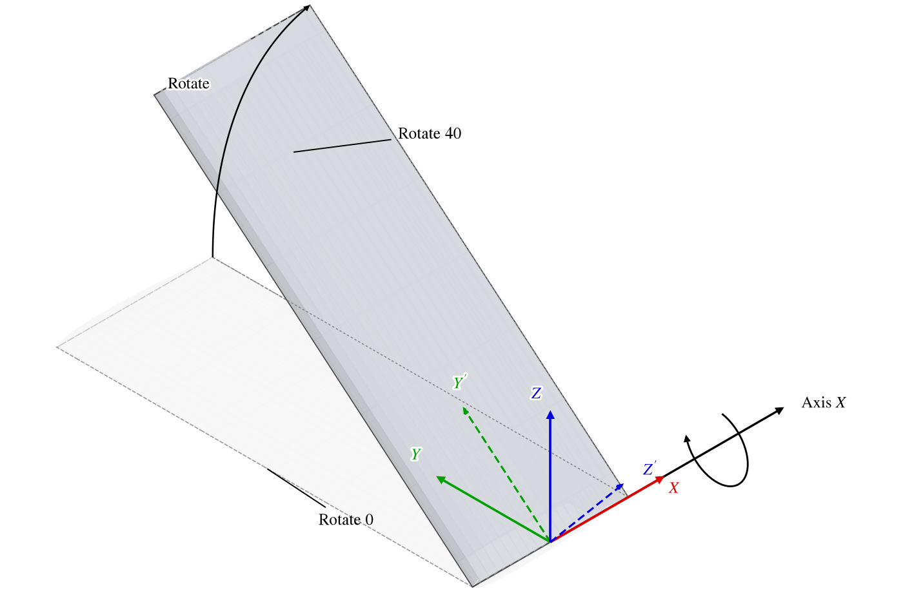
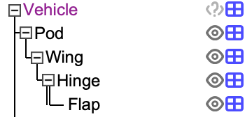
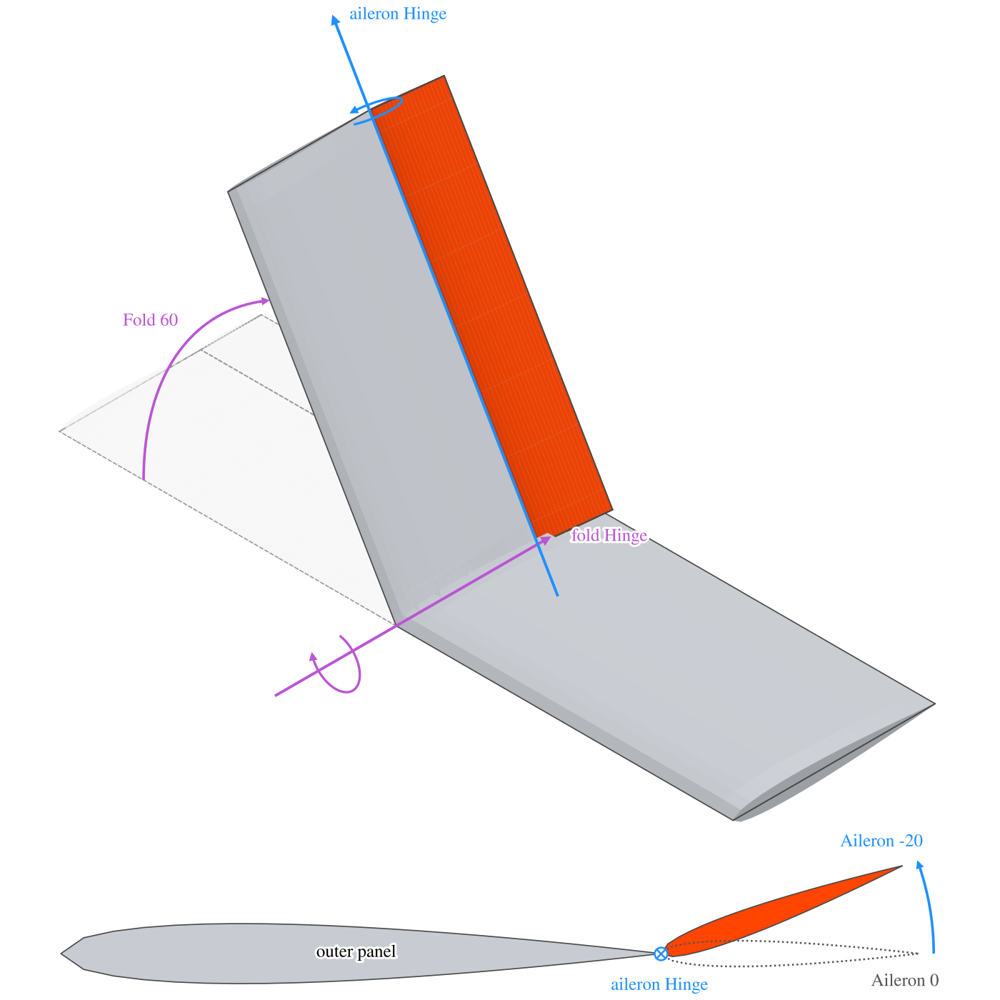
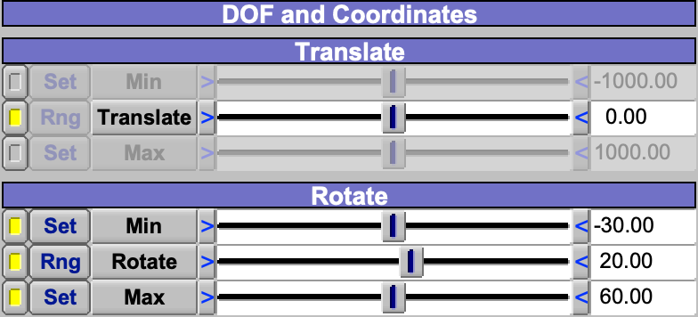
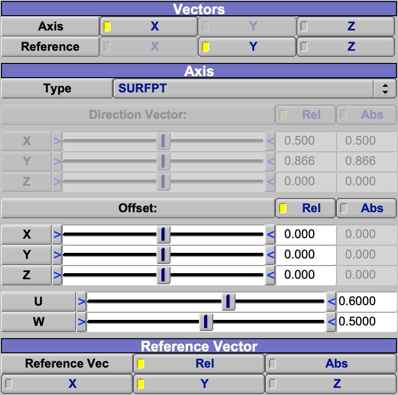
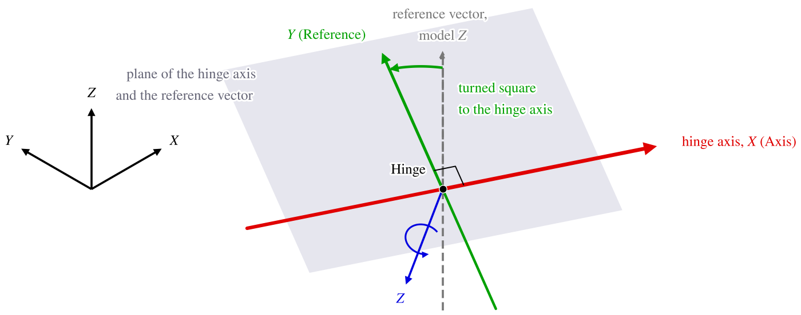

The Hinge component is a joint.  It has no shape of its own; it is a frame that turns about, and slides along, one of
its own axes, and it carries every component attached to it.  Control surfaces, doors, folding wing tips, tilting
nacelles and canopies are modeled by hanging the moving part off a Hinge and setting the Hinge's deflection.

| Topic                                                   | Tab          |
|:--------------------------------------------------------|:-------------|
| [Quick Start](#quick-start)                             |              |
| [How a Hinge Moves Its Children](#how-a-hinge-moves-its-children) | Motion |
| [Motion and Limits](#motion-and-limits)                 | Motion       |
| [Orienting the Hinge](#orienting-the-hinge)             | Orient, XForm |
| [Flip](#flip)                                           | XForm        |
| [Other Uses of a Hinge](#other-uses-of-a-hinge)         |              |
| [When Not to Use Hinge](#when-not-to-use-hinge)         |              |
| [Shared Tabs](#shared-tabs)                             | Gen, XForm   |
| [Scripting](#scripting)                                 |              |

## Quick Start

### A folding wing tip

1. Add a Hinge.  Place it on the fold line with the XForm tab, attached to the wing if it should follow the wing.
2. Turn it so that its $X$ axis lies along the fold line: with the XForm rotations, or on the Orient tab (see [Orienting
   the Hinge](#orienting-the-hinge)).
3. Select the Hinge and add the outer wing panel, so that the panel is the Hinge's child.
4. Set *Rotate* on the Motion tab.

### A sliding canopy

1. Add a Hinge.  Place it at the canopy with the XForm tab, attached to the fuselage.
2. Turn it so that its $X$ axis lies along the direction the canopy slides.
3. Select the Hinge and add the canopy, so that the canopy is the Hinge's child.
4. On the Motion tab, allow *Translate*, disallow *Rotate*, and set *Translate*.

## How a Hinge Moves Its Children

A Hinge has two frames, both drawn in the 3D view at its origin: its own frame, placed by the XForm tab and drawn with
solid axes, and the joint frame, drawn dashed, which is its own frame moved by the deflection.  The joint frame is its
own frame slid by *Translate* along the hinge axis and turned by *Rotate* about it, right-handed: a positive Rotate
about $X$ turns $+Y$ toward $+Z$ (Figure 1).  The hinge axis is the Hinge's own $X$ unless the Orient tab chooses $Y$ or
$Z$.

*Figure 1. A wing panel hung off a Hinge whose axis is its $X$, at Rotate 0 (dashed outline) and Rotate 40.  The Hinge's
own axes are solid; the joint frame, which carries the panel, is dashed.*

Every child of a Hinge is attached rigidly to the joint frame.  The child's [Attach To
Parent](XFormTab.md#attach-to-parent) choices are greyed, and its relative location and rotation on the XForm tab are
measured in the joint frame, so the child keeps its place on the moving part as the Hinge deflects.  Its own children
follow it as usual, so a whole assembly can ride one Hinge, and a Hinge can hang off another Hinge to make a chain of
joints.  In the Geom Browser, the lines from a Hinge to its children are drawn double, to show that they are carried by
the joint (Figure 2).

*Figure 2. A Hinge on a wing in the Geom Browser, carrying a flap: the line from the Hinge to its child is double.*

In a chain, each Hinge's deflection is measured on the part that carries it, so the joints compose the way the real
mechanism does.  An aileron on a folding wing tip is a Hinge, attached to the outer panel along its
trailing edge, that carries the aileron; the fold Hinge carries the outer panel, and with it the aileron Hinge.
Folding the tip then carries the aileron and its hinge line with it, and the aileron deflects about its folded hinge
line.  Build a mechanism this way, one Hinge per real joint, each a child of the part it is mounted on; the parts then
stay together at any combination of deflections (Figure 3).

*Figure 3. A folding wing tip whose fold Hinge, along $X$, carries the outer panel, and an aileron Hinge, along the
outer panel's trailing edge, that carries the aileron.  Dashed: Fold 0 and Aileron 0.  Solid: Fold 60 and Aileron
-20, which raises the aileron's trailing edge.  Below, enlarged: a section of the folded tip seen outboard along the
aileron's folded hinge line, with the aileron at 0 dotted.*

Place the child where it should turn about the hinge axis: the axis passes through the Hinge's origin, so a child built
with its own hinge line at its origin is placed at the Hinge's origin with zero relative location.

## Motion and Limits

A motion acts only while the check box beside its slider allows it; a motion that is not allowed is held at zero
(Figure 4).  Rotate is allowed and Translate is not, by default.  A *Min* or *Max* whose check box is checked is a
limit the deflection cannot pass.  To put a limit at a stop, pose the part there and click that limit's *Set*, which
copies the current deflection into it.  *Rng* narrows or expands the slider to the checked limits, for easier control
between them.

*Figure 4. The Motion tab with Translate allowed and Rotate limited to $-30^\circ$ and $60^\circ$, at Rotate
$20^\circ$.  The Translate limits are not checked, so their sliders and Set buttons are greyed, and so is Translate's
Rng.*

Translate is a length in model units, along the hinge axis.  Rotate is in degrees, between $-360$ and $360$.

The 3D view shows which motions are allowed: a circular arrow about the axis for Rotate, an arrowhead on the axis for
Translate.

## Orienting the Hinge

The Orient tab chooses how the Hinge's axes are set.

- *Rotations (Use XForm Tab)*, the default, takes them from the XForm rotations, like any other component.
- *Vectors* builds them from directions.  The XForm rotations are then computed from those directions and greyed.

*Axis* chooses which of the Hinge's own axes, $X$, $Y$ or $Z$, is the hinge axis, in either mode; the joint turns about
and slides along it.  With Vectors (Figure 5), *Type* sets the direction of that axis:

| Type     | The hinge axis points                                                                                   |
|:---------|:--------------------------------------------------------------------------------------------------------|
| VECTOR3D | Along the *Direction Vector*.                                                                           |
| POINT3D  | From the Hinge's origin toward the point *Offset*.                                                      |
| SURFPT   | From the Hinge's origin toward the point of the parent's surface at *U*, *W*, moved by *Offset*.        |
| UDIR     | Along the parent's surface in its $u$ direction at *U*, *W*.                                            |
| WDIR     | Along the parent's surface in its $w$ direction at *U*, *W*.                                            |
| NDIR     | Along the parent's surface normal at *U*, *W*.                                                          |

*Rel* gives a vector or an offset in the axes the Hinge is attached to (the parent's, when the Hinge is attached to its
parent), except SURFPT's offset, which is always in the parent's axes; *Abs* gives it in the model's axes.  The surface
types need the Hinge to have a parent with a surface.  UDIR on a wing, at the station of a control surface, gives a
hinge axis that follows the wing's span there.

*Figure 5. The Orient tab of a Hinge on a wing, oriented by Vectors with Type SURFPT at U 0.6, W 0.5.  The Offset and
U, W are live; the Direction Vector is greyed and shows the hinge axis that results.  Axis and Reference cannot be the
same axis, so Y is greyed under Axis and X under Reference.*

An axis alone allows a Hinge to rotate, but does not specify where zero rotation is.  The *Reference Vector*, along
the model's or the attachment's $X$, $Y$ or $Z$, fixes that roll: the Hinge's axis chosen as *Reference* is set in
the plane of the hinge axis and the reference vector, square to the hinge axis (Figure 6).  The reference vector is
used with every Type.  Its *Rel* and *Abs* choose the attachment's axes and the model's, as for the direction vector;
the default is *Rel*.

*Figure 6. A Hinge on the swept hinge line of a left wing, oriented by Vectors: Type VECTOR3D along the hinge line, Axis
$X$, Reference $Y$ and the reference vector along the model's $Z$.  The reference vector is turned about the Hinge's
$Z$ until it is square to the hinge axis, and becomes the Hinge's $Y$.  The model's axes are drawn at its origin; the
axes at the Hinge show directions only.*

## Flip

[Flip](XFormTab.md#flip) on the XForm tab makes the Hinge move as the mirror image of its unflipped self, through each
plane chosen.  The Hinge's frame itself is not reflected, nor are its children: a plane that contains the hinge axis
reverses the sense of Rotate, and a plane square to the axis reverses the direction of Translate.  To mirror a hinged
part, flip the part as well as its Hinge.

A Hinge has no symmetry of its own; the symmetry controls are greyed.  A pair of mirrored control surfaces is two
Hinges, or a Hinge and a [Clone](Clone.md) of it.

## Other Uses of a Hinge

- A [Clone](Clone.md) of a Hinge is a joint too.  Its own children ride on it, and it can take the original's deflection
  or have its own.
- The [Swept Volume](GeometryAnalysis.md#swept-volume) analysis can take a Hinge whose Translate is allowed as its
  secondary geometry.  It then sweeps everything attached to the Hinge along the hinge axis, over the range the
  analysis chooses: from *Min* to *Max*, from *Min* to the current Translate, from the current Translate to *Max*, or
  out past the model forward or back.  The Min and Max values are used whether or not their check boxes are on.

## When Not to Use Hinge

- A [Gear](Gear.md) bogie has its own retraction mechanism; describe landing gear retraction there, not with a Hinge.
- A [Propeller](Propeller.md) has its own mechanism for articulation and folding.  Describe the rotation of a
  propeller, and movement within it (feather, flap, lag and folding), there, not with a Hinge.

## Shared Tabs

The Gen and XForm tabs are common to every component; see [Gen](GenTab.md) and [XForm](XFormTab.md).  A
Hinge has neither a Mass tab nor a Sub tab, since it has no mass or surface.

## Scripting

A script adds a Hinge with `AddGeom( "HINGE" )`.  Its parms are in the group `Hinge`:

| Parm                                     | Meaning                                                                    |
|:-----------------------------------------|:---------------------------------------------------------------------------|
| `JointRotate`, `JointTranslate`          | The deflection: degrees, and model units along the axis.                   |
| `JointRotateFlag`, `JointTranslateFlag`  | Whether each motion is allowed.                                            |
| `JointRotMin`, `JointRotMax`, `JointTransMin`, `JointTransMax` | The limits.                                          |
| `JointRotMinFlag`, `JointRotMaxFlag`, `JointTransMinFlag`, `JointTransMaxFlag` | Whether each limit is used.          |
| `OrientRotFlag`                          | `HINGE_ORIENT_ROT` (Rotations) or `HINGE_ORIENT_VEC` (Vectors).            |
| `PrimaryDir`, `SecondaryDir`             | *Axis* and *Reference*: `X_DIR`, `Y_DIR` or `Z_DIR`.                       |
| `PrimType`                               | `HINGE_PRIM_VECTOR3D`, `_POINT3D`, `_SURFPT`, `_UDIR`, `_WDIR`, `_NDIR`.   |
| `PrimXVec`, `PrimYVec`, `PrimZVec`, and `...Rel` | The direction vector, Abs and Rel.                                 |
| `PrimXOff`, `PrimYOff`, `PrimZOff`, and `...Rel` | The offset, Abs and Rel.                                           |
| `PrimVecAbsRelFlag`, `PrimOffAbsRelFlag`, `SecVecAbsRelFlag` | `ABS` or `REL`.                                        |
| `PrimULoc`, `PrimWLoc`                   | *U* and *W* on the parent's surface.                                       |
| `SecondaryVecDir`                        | The reference vector: `X_DIR`, `Y_DIR` or `Z_DIR`.                         |
