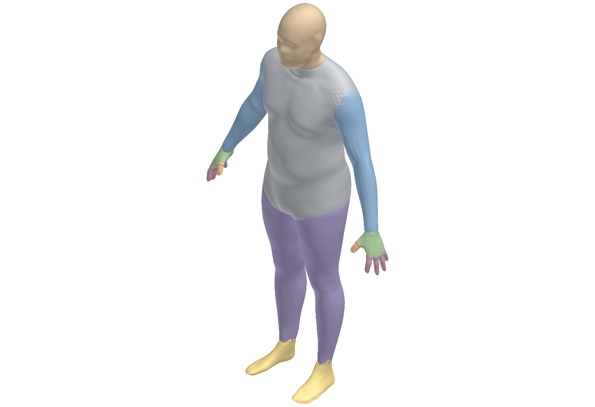
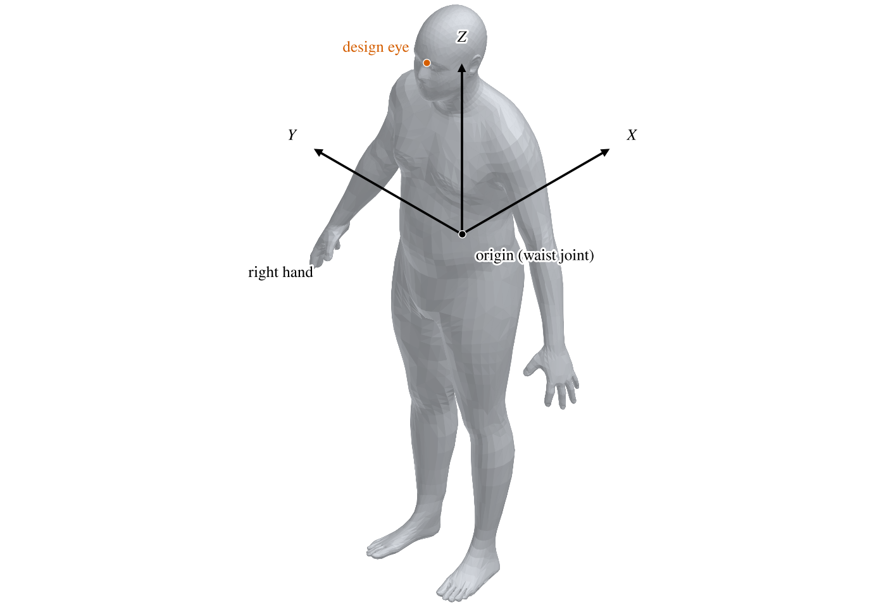
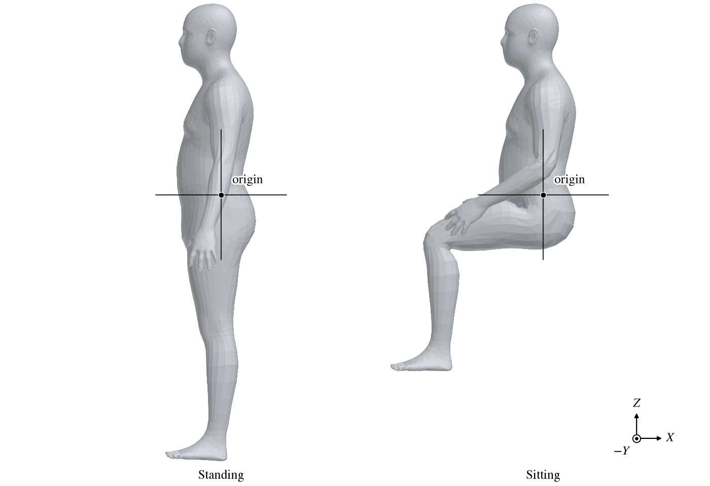
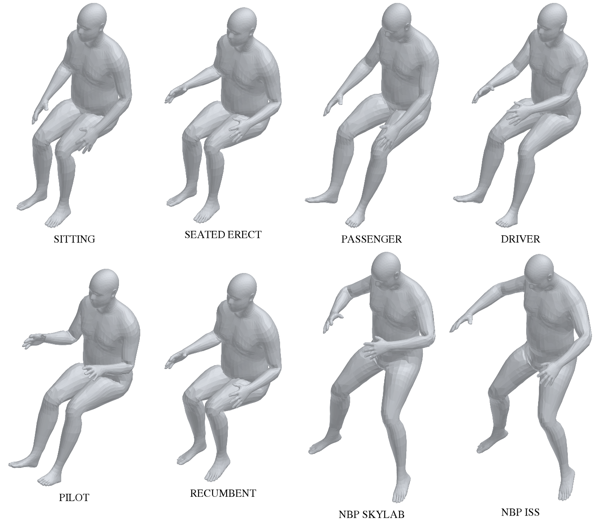
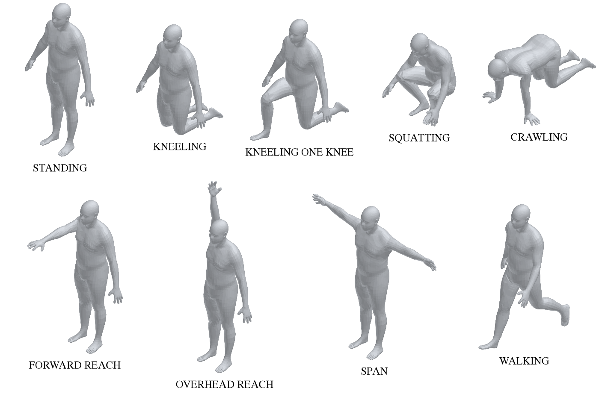
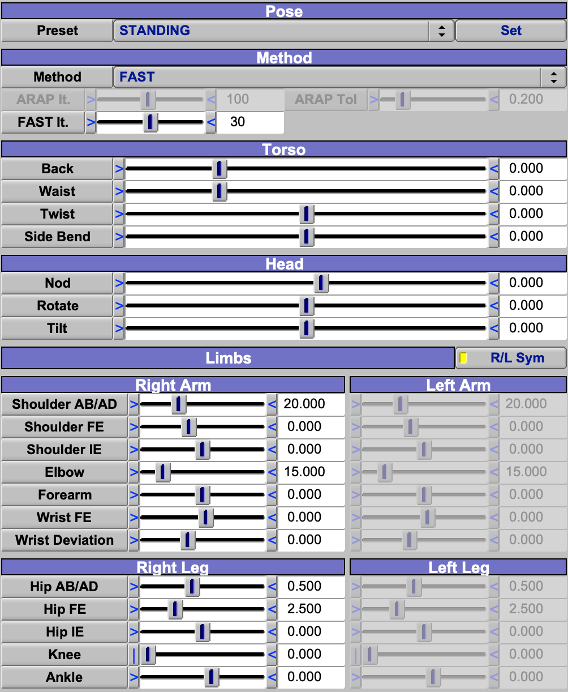
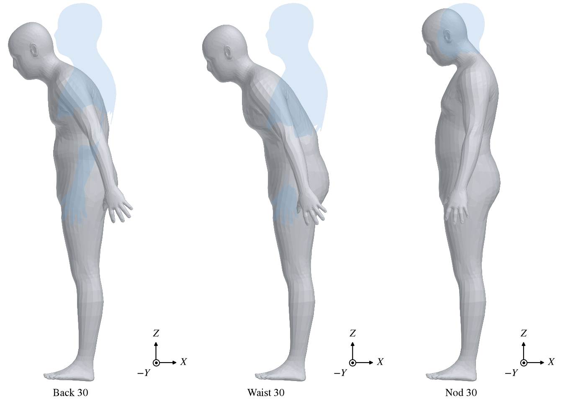
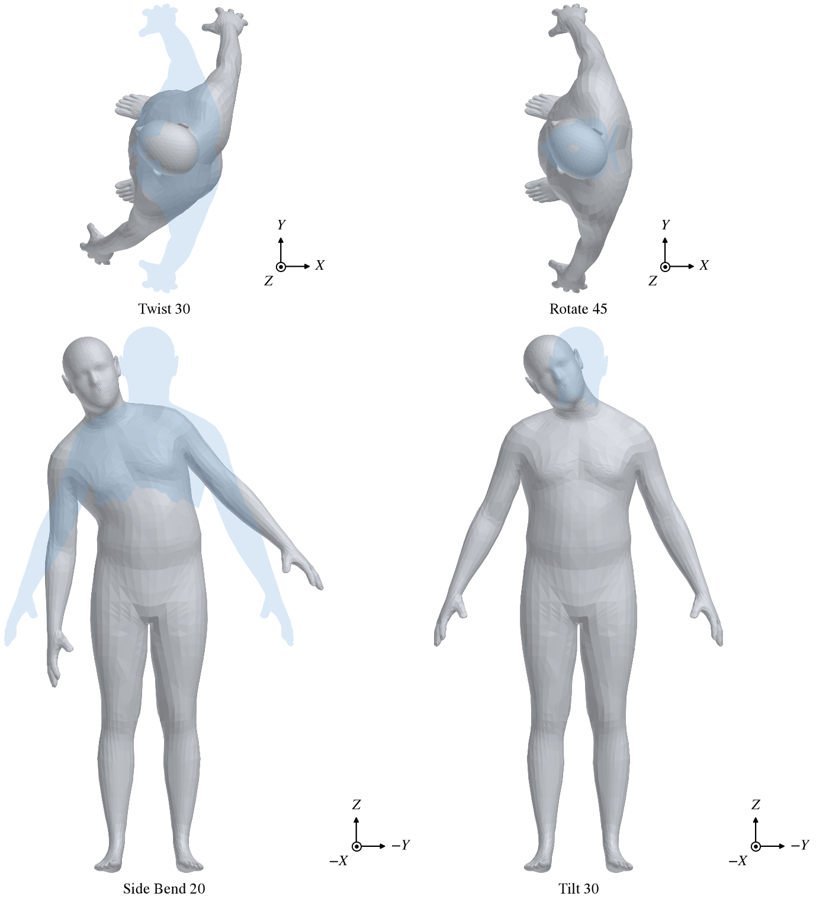
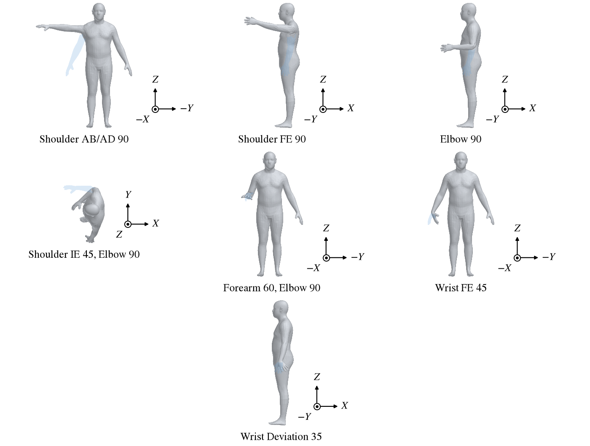
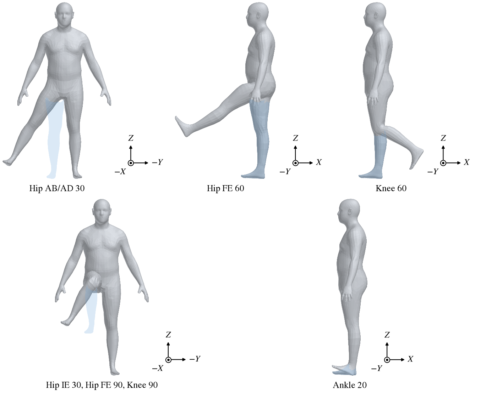

The Human component models a person: a pilot, a passenger or a ground crew member, sized from population
statistics and posed joint by joint.  Its shape comes from a statistical model of adult body scans, so a few
numbers -- sex, stature, body mass index, age and sitting height -- give a complete, realistic body.  A skeleton
inside the body then bends it into any pose from standing to seated, and seventeen preset postures, most of them
from published measurements, give a start.  The result is a closed triangle mesh, or a set of closed surfaces, with a
mass, a volume and a design eye point, for checking fit, reach, visibility and mass properties.

| Topic                                           | Tab            |
|:------------------------------------------------|:---------------|
| [Quick Start](#quick-start)                     |                |
| [Representation](#representation)               | Anthropometric |
| [Units](#units)                                 | Anthropometric |
| [Body Size](#body-size)                         | Anthropometric |
| [Origin and Axes](#origin-and-axes)             |                |
| [Presets](#presets)                             | Pose           |
| [Joint Angles](#joint-angles)                   | Pose           |
| [How the Body Follows](#how-the-body-follows)   | Pose           |
| [Design Eye](#design-eye)                       |                |
| [The Human in Analyses](#the-human-in-analyses) |                |
| [Scripting](#scripting)                         |                |
| [References](#references)                       |                |

The Gen, XForm and Mass tabs are the ones every component has; see [Gen](GenTab.md),
[XForm](XFormTab.md) and [Mass](MassTab.md).  A Human has no Sub tab.

## Quick Start

### A standing person

1. On the Anthropometric tab choose *Gender*, then set *Length Unit* and *Mass Unit* to the units of the model.
2. Set *% Stature* and *% BMI*, or type the *Stature* and *Mass* directly.
3. Leave the pose as it is: a new human stands.
4. Place it with the XForm tab.  The origin is the waist joint, so set the location of the waist, not the feet.

### A seated occupant

1. Choose *Gender*, then set *Length Unit* and *Mass Unit* to the units of the model.
2. Set the size, as for a standing person.
3. On the Pose tab choose a seated *Preset* (SEATED ERECT, PASSENGER, DRIVER, PILOT, ...) and click *Set*, then
   adjust the joints to fit the seat.
4. Place it with the XForm tab, by the waist joint (Figure 3), and pitch it with *YRot* for a reclined seat.  Attach
   a Super Cone Auxiliary to it to show the field of view (see [Design Eye](#design-eye)).

## Representation

*Shape* chooses what the human is made of.

- MESH, the default, is the triangle mesh of the body model itself.
- SURFACE is twenty overlapping closed surfaces: trunk, head and neck, and on each side an arm, a palm, a thumb,
  four fingers, a leg and a foot (Figure 1).  Each part runs on inside its neighbour, so their union is the closed
  body; CompGeom and CFD Mesh find where they cross, as they do for a wing on a fuselage.  The surfaces are smooth
  everywhere but at the closed ends of each part.  They follow the mesh to within about half a millimeter typically
  and a few millimeters nearly everywhere; the largest differences are where the posed body presses into itself, as
  at the groin when seated.  The toes are joined, so the foot's surface bridges the gaps between them.  The eyes are
  fixed points of the head's surface.



*Figure 1. A human as SURFACE, each part in its own color: the trunk, the head and neck, and on each side an arm, a
palm, a thumb, four fingers, a leg and a foot.*

Both are built from the same body size and the same skeleton, and pose together, through the same tetrahedral mesh
(see [How the Body Follows](#how-the-body-follows)).  The Volume and the density from Auto Density are the mesh's in
either case; the union of the surfaces holds the same volume to within a fraction of a percent (0.2% for the default
human).  Use SURFACE where a surface is needed (see [The Human in Analyses](#the-human-in-analyses)) or for smooth
exports such as STEP and IGES; use MESH otherwise.

In SURFACE, *Num_U* and *Num_W* on the Gen tab are the number of points along and around each patch of the
surfaces, 3 by default.

## Units

*Length Unit* and *Mass Unit* say what units the human is built in.  They are not display units: the body is built at
its stature in the length unit, so a 1.756 m man is 1.756 model units tall with Length Unit M and 5.76 with Length
Unit FT.  Set them to the units the rest of the model uses.  The default is FT and LBM.

Changing the length unit keeps the person the same size in the real world: the stature percentile stays, and the
stature is restated in the new unit.  Changing the mass unit restates the mass.

The XForm tab's *Scale* has no effect on a human; its size is set by the stature and the length unit alone.

## Body Size

The body shape is the statistical body shape model of Human Shapes (humanshape.org), by Matthew P. Reed of the
University of Michigan Transportation Research Institute (UMTRI), used with permission [1, 2].  The
model was fitted to laser scans of several hundred adults by principal component analysis, as UMTRI's body shape models
are [3], and predicts
the whole body, skin and joint centers, from a few anthropometric inputs: stature, body mass index, the ratio of
sitting height to stature, and age.  Every point of the body is a linear function of those inputs and of the product
of BMI and age, so a change in any of them moves the body smoothly.  Between them, the controls on the
Anthropometric tab describe most of the variation in body shape among adults.

| Control       | Parm          | Default   | Range       | Meaning                                              |
|:--------------|:--------------|:----------|:------------|:-----------------------------------------------------|
| Gender        | `GenderFlag`  | MALE      |             | Which body model, and which population statistics.   |
| Stature       | `Stature`     | 50th pct. | 5th to 95th | Standing height, in the length unit.                 |
| % Stature     | `Stature_pct` | 0.5       | 0.05 - 0.95 | Stature percentile, as a fraction.                   |
| BMI           | `BMI`         | 50th pct. | 16 - 55     | Body mass index, kg/m^2.                             |
| % BMI         | `BMI_pct`     | 0.5       | 0.05 - 0.95 | BMI percentile, as a fraction.                       |
| Mass          | `Mass`        |           |             | Body mass, in the mass unit.                         |
| Age           | `Age`         | 30        | 18 - 80     | Age in years.                                        |
| Sitting H / H | `SitFrac`     | 0.51      | 0.4 - 0.6   | Sitting height divided by stature.                   |
| Volume        | `Volume`      |           |             | Output: the volume of the posed body.                |
| Auto Density  | `AutoDensity` | on        |             | Set the Mass tab's density to Mass / Volume.         |

### Stature and BMI

Stature and BMI each have a value and a percentile; set either and the other follows.  The percentiles come from
the United States National Health and Nutrition Examination Survey (NHANES) of adults aged 20 and over, 2011-2014,
separately for men and women [4]:

| Percentile | Male stature, mm | Female stature, mm | Male BMI | Female BMI |
|:-----------|:-----------------|:-------------------|:---------|:-----------|
| 5th        | 1634             | 1498               | 20.7     | 19.6       |
| 50th       | 1756             | 1619               | 27.7     | 27.7       |
| 95th       | 1881             | 1735               | 39.8     | 43.3       |

Between the tabulated percentiles (5, 10, 15, 25, 50, 75, 85, 90 and 95) the value is interpolated smoothly.
Switching *Gender* keeps the percentiles, so a 95th percentile man becomes a 95th percentile woman, and shorter.
The limits on *Stature* are the 5th and 95th percentile of the chosen sex.

These are percentiles of the general adult population.  A population chosen for an occupation differs: military
aircrew, for example, are selected for size and are leaner.  For such a population set *Stature* and *Mass* (or
*BMI*) from its own survey, such as ANSUR II for the U.S. Army [5]; the percentile controls then report where
that person falls among the general population.

Mass, BMI and stature are tied together by

$$
\mathrm{BMI} = \frac{m}{h^2}
$$

with the mass $m$ in kilograms and the stature $h$ in meters.  Setting *Mass* sets BMI; setting *BMI* or *% BMI*
sets the mass.  Changing the stature keeps the BMI and changes the mass, so a taller person of the same build is
heavier.

### Age and sitting height

*Age* and *Sitting H / H* change the shape without changing the stature.  A larger sitting height ratio gives a
longer trunk and shorter legs.  Age changes the build, by an amount that depends on the BMI.  Leave both at their
defaults unless the person in question is known to differ.

### Volume and density

*Volume* is the volume of the closed body as posed, in the length unit cubed.  With *Auto Density* on, the human's
density on the Mass tab is set to *Mass* / *Volume*, so the mass properties of the model carry the person's mass
at the right place, whatever the pose.  Turn it off to set a density by hand.

The volume changes with the pose, because the flesh at a deeply bent joint is compressed: seated, the default human's
volume is 6-7% less than standing, and squatting up to 11% less (see [How the Body Follows](#how-the-body-follows)).
With *Auto Density* on the mass stays the person's and the density rises to match.

## Origin and Axes

The human faces $-X$, with $Z$ up and the person's right side toward $+Y$, the way a pilot sits in an aircraft
whose nose points along $-X$ (Figure 2).  The origin is the waist joint, and it stays there whatever the pose: the
legs hang from it standing and fold in front of it seated (Figure 3).  Place a seated occupant by the waist joint,
not by the seat or the feet.



*Figure 2. A new human, its origin at the waist joint, and its axes.  The person faces $-X$; the right hand is
toward $+Y$.*



*Figure 3. The default human standing, as it is made, and in the Sitting preset.  The origin is the same point of
the body in both.*

## Presets

The pose bends the body at the joints of its skeleton.  *Preset* and *Set* at the top of the Pose tab put the human
into a standard posture (Figures 4-5): Set replaces every joint angle and turns *R/L Sym* on or off as the
posture needs.  Choose the preset first and then adjust.  In a script, `SetHumanPresetPose` does the same, with the
enum in the table below (see [Scripting](#scripting)).  A new human stands, in the Standing preset.

The postures are taken from published measurements where there are any; the others are drawn to match a named
posture and are marked illustrative.  A preset sets the joints only.  Lying, crawling or reclined postures are made
by pitching the whole body on the XForm tab: *YRot* -90 pitches the body face down, as for crawling, and a positive
*YRot* reclines it.

| Preset            | Enum                             | Posture                                                              | Source             |
|:------------------|:---------------------------------|:---------------------------------------------------------------------|:-------------------|
| STANDING          | `HUMAN_PRESET_STANDING`          | Standing relaxed, arms hanging; the default pose                     |                    |
| SITTING           | `HUMAN_PRESET_SITTING`           | Seated, hands resting on the thighs                                  | illustrative       |
| SEATED ERECT      | `HUMAN_PRESET_SEATED_ERECT`      | The anthropometric seated posture: thighs level, forearms level      | [5]                |
| PASSENGER         | `HUMAN_PRESET_PASSENGER`         | Relaxed car passenger                                                | [6]                |
| DRIVER            | `HUMAN_PRESET_DRIVER`            | Car driver, hands on the wheel                                       | [7]                |
| PILOT             | `HUMAN_PRESET_PILOT`             | Pilot, right hand on a center stick, left on a throttle; R/L Sym off | illustrative       |
| RECUMBENT         | `HUMAN_PRESET_RECUMBENT`         | Recumbent crew seat, as for the Orion capsule                        | [8]                |
| NBP SKYLAB        | `HUMAN_PRESET_NBP_SKYLAB`        | Neutral body posture in weightlessness, measured on Skylab           | [9, 10]            |
| NBP ISS           | `HUMAN_PRESET_NBP_ISS`           | Neutral body posture measured on the International Space Station     | [11]               |
| KNEELING          | `HUMAN_PRESET_KNEELING`          | Upright on both knees                                                | [12], illustrative |
| KNEELING ONE KNEE | `HUMAN_PRESET_KNEELING_ONE_KNEE` | On the left knee, right foot forward; R/L Sym off                    | [13], illustrative |
| SQUATTING         | `HUMAN_PRESET_SQUATTING`         | Squatting, heels down                                                | [12], illustrative |
| CRAWLING          | `HUMAN_PRESET_CRAWLING`          | Hands and knees, for a body pitched forward 90 degrees               | [12], illustrative |
| FORWARD REACH     | `HUMAN_PRESET_FORWARD_REACH`     | Right arm stretched forward, palm down; R/L Sym off                  | [5]                |
| OVERHEAD REACH    | `HUMAN_PRESET_OVERHEAD_REACH`    | Right arm straight up; R/L Sym off                                   | [5]                |
| SPAN              | `HUMAN_PRESET_SPAN`              | Both arms stretched out to the sides, palms forward                  | [5]                |
| WALKING           | `HUMAN_PRESET_WALKING`           | Right heel strike; R/L Sym off                                       | illustrative       |

The two neutral body postures take the published joint angles, but for the rotation of the upper arms (Shoulder IE
30), which is set to match the published figure of the posture.  A neutral body posture is the posture the body
relaxes into in weightlessness; it is the reference for workstation heights and reach on a spacecraft.



*Figure 4. The seated and weightless presets, as Set leaves them.  RECUMBENT is meant to be reclined on the XForm
tab with the seat.*



*Figure 5. The standing, kneeling, squatting, crawling and reaching presets, as Set leaves them; CRAWLING is pitched
forward 90 degrees on the XForm tab.*

## Joint Angles

Every angle is in degrees.  The names are the anatomical ones: AB/AD is abduction (away from the body's centerline)
and adduction, FE is flexion and extension, IE is internal and external rotation.  The Pose tab holds them in groups:
Torso and Head, then Limbs, where each arm and leg joint is there twice, in a Right Arm and Left Arm column and a
Right Leg and Left Leg column, Parms ending in `Rt` and `Lt`; the labels of the right column name each row for both
(Figure 6).



*Figure 6. The Pose tab of a new human: the preset, the method, the torso and head, and the limbs.  ARAP's settings
are greyed while the method is FAST, and the left side while R/L Sym is on.*

The left angles mean the same motions as the right: a positive Shoulder AB/AD raises either arm out to its own side,
and the left side posed as the right is the mirror image of it.  With *R/L Sym* on, the toggle on the Limbs divider
and the default, the left side copies the right and its controls are greyed; turn it off to pose the sides apart.

The ranges broadly follow the normal ranges of motion of adults measured clinically [14], widened where a
preset posture needs it.  A pose inside the ranges can still put one part of the body through another (see
[Collisions](#collisions)).

### Torso and Head

| Control   | Parm         | Default | Range      | A positive angle                                                   |
|:----------|:-------------|:--------|:-----------|:-------------------------------------------------------------------|
| Back      | `Back`       | 0       | -15 - 45   | bends the upper body forward at the middle of the back.            |
| Waist     | `Waist`      | 0       | -15 - 45   | bends the upper body forward at the waist.                         |
| Twist     | `TorsoTwist` | 0       | -45 - 45   | turns the chest toward the person's right, the pelvis held.        |
| Side Bend | `TorsoBend`  | 0       | -30 - 30   | bends the upper body toward the person's right.                    |
| Nod       | `Nod`        | 0       | -60 - 50   | tips the head forward, chin down.                                  |
| Rotate    | `RotateHead` | 0       | -80 - 80   | turns the head toward the person's right.                          |
| Tilt      | `HeadTilt`   | 0       | -40 - 40   | tilts the head toward the person's right shoulder.                 |

Back and Waist both bend the upper body forward; Back bends it higher, at the middle of the back, and Waist at the
waist joint (Figure 7).  Side Bend is shared equally between the same two places.  Twist turns the chest about the
spine, spread along its length so the trunk twists smoothly rather than at one joint (Figure 8).  In all of them the
legs and the origin stay where they are.  The head turns at the base of the neck, and the neck bends smoothly with
it.



*Figure 7. Back, Waist and Nod at 30.  The tint shows the part that moved, as it was standing.*



*Figure 8. Twist and Rotate seen from above; Side Bend and Tilt seen from in front of the person.*

### Arms

| Control         | Parm             | Default | Range      | A positive angle                                                  |
|:----------------|:-----------------|:--------|:-----------|:------------------------------------------------------------------|
| Shoulder AB/AD  | `ShoulderABADRt` | 20      | -20 - 180  | raises the arm out to the side (abduction).                       |
| Shoulder FE     | `ShoulderFERt`   | 0       | -60 - 180  | swings the arm forward and up (flexion).                          |
| Shoulder IE     | `ShoulderIERt`   | 0       | -90 - 90   | turns the upper arm inward about its length (internal rotation).  |
| Elbow           | `ElbowRt`        | 15      | 0 - 150    | bends the elbow (flexion).                                        |
| Forearm         | `ForearmRt`      | 0       | -90 - 90   | turns the palm toward the body and back (pronation).              |
| Wrist FE        | `WristRt`        | 0       | -90 - 80   | bends the hand toward the palm (flexion).                         |
| Wrist Deviation | `WristDevRt`     | 0       | -20 - 35   | bends the hand toward the little finger (ulnar deviation).        |

The shoulder angles are measured from the arm hanging straight down, so with every other angle zero, Shoulder
AB/AD 90 holds the arm straight out to the side and Shoulder FE 90 straight forward, whatever the body's size
(Figure 9).  The default arm hangs 20 degrees out from the body, as the body model's arms do.  Shoulder AB/AD and FE
together swing the arm by one rotation, along the shortest arc from hanging, toward a direction between the side and
the front: AB/AD 45 with FE 45 raises the arm about 64 degrees, midway between the two planes.  So neither angle
loses its meaning anywhere in its range, including with the arm straight forward or straight up.  Shoulder IE then
turns the upper arm about its own length, and the forearm and hand with it.  It is easiest to see with the elbow
bent: internal rotation swings the forearm in across the body, as in Figure 9.

Raising an arm also moves the shoulder, as a real shoulder girdle does.  The clavicle and shoulder blade turn in
proportion to the arm's elevation from hanging, following the shoulder rhythm of the upper extremity model of
Holzbaur, Murray and Delp [15], which they took from the measurements of de Groot and Brand [16].  The
shoulder joint rises and moves back and in toward the neck as the arm goes up, and the top of the shoulder rises with
it.  The rhythm follows the arm's elevation only, so lowering the arm returns the shoulder to its place.

*Elbow* is the angle between the upper arm and the forearm, zero for a straight arm.  The elbow bends the forearm
forward in the plane of the upper arm, keeping the slight outward angle of the rest forearm (the carrying angle).
*Forearm* turns the forearm and hand about the forearm's length; at zero the palm faces the thigh.  It turns the palm
down when the elbow is bent 90 degrees, and toward the back when the arm hangs.  *Wrist FE* bends the hand at the
wrist toward the palm (flexion) or toward its back (extension).  *Wrist Deviation* then swings it sideways in the plane of
the palm, toward the little finger (ulnar deviation) or the thumb (radial deviation): with the palm against the thigh,
a positive angle swings the fingertips back.  The signs follow the joint coordinate system recommended by the
International Society of Biomechanics (ISB) [17]: flexion, ulnar deviation and pronation are positive.



*Figure 9. Positive shoulder, elbow, forearm and wrist angles.  Shoulder AB/AD, Forearm and Wrist FE are seen from
in front of the person and move the right arm; Shoulder FE, Elbow and Wrist Deviation are seen from the person's left and
move the left arm; Shoulder IE is seen from above and moves the right arm, its elbow at 90.  The tint shows the arm as
it was.*

### Legs

| Control   | Parm        | Default | Range      | A positive angle                                                  |
|:----------|:------------|:--------|:-----------|:------------------------------------------------------------------|
| Hip AB/AD | `HipABADRt` | 0.5     | -30 - 45   | swings the leg out to the side (abduction).                       |
| Hip FE    | `HipFERt`   | 2.5     | -30 - 130  | swings the leg forward (flexion).                                 |
| Hip IE    | `HipIERt`   | 0       | -45 - 45   | turns the thigh inward about its length (internal rotation).      |
| Knee      | `KneeRt`    | 0       | 0 - 140    | bends the knee, the foot moving back (flexion).                   |
| Ankle     | `AnkleRt`   | 0       | -50 - 35   | raises the toes (dorsiflexion).                                   |

The hip follows the order of the ISB joint coordinate system for the hip [18]: the leg first swings forward by Hip
FE, then out by Hip AB/AD from wherever Hip FE left it, and then turns about its length by Hip IE.  So in a seated
pose Hip AB/AD spreads the knees by its own angle, and Hip IE swings the lower legs: internal rotation of the thigh
swings the foot outward (Figure 10).



*Figure 10. Positive hip, knee and ankle angles.  Hip AB/AD and Hip IE are seen from in front of the person and move
the right leg; Hip FE, Knee and Ankle are seen from the person's left and move the left leg.*

### Collisions

The skeleton does not check for collisions, so a pose can put an arm through the body or a leg through the other;
check a demanding pose by eye.  Where body parts press together, as the belly on the thighs when seated or the calf on
the thigh when squatting, the skin of the two overlaps rather than flattening against each other.

Files saved by earlier versions of OpenVSP keep their joint angles, which now mean the motions described here: the
shoulder and hip angles are measured from the vertical and combined as above, and wrist flexion is positive.  A pose
saved by an earlier version may need adjusting.

## How the Body Follows

The skin follows the bones smoothly, so a bent elbow or hip deforms the flesh around it rather than hinging a rigid
part.  To do so the body is filled with a tetrahedral mesh: about 37,000 tetrahedra on a 40 mm lattice inside the
skin, with the skin's vertices and points along each bone among their corners.  The mesh is built once, for every
body of both sexes, and is mirror symmetric, so a symmetric pose gives a symmetric body.  Its corners move with the
body size, as the skin does.

To pose the body the points along each bone are moved with their bone, and the rest of the tetrahedral mesh is
deformed to follow them.  A bone that twists, such as the upper arm, the forearm, the thigh, the spine and the neck,
spreads its twist along its length.  The skin and, in SURFACE, the surfaces' control points ride in the tetrahedra
that hold them, so the mesh and the surfaces are posed alike.

*Method* chooses how the tetrahedral mesh is deformed; the settings of the other method are greyed.

- FAST, the default, is Fast Automatic Skinning Transformations [19].  Each point of the mesh blends the
  movements of the bones with weights that fall off smoothly through the body, bounded biharmonic weights
  [20], and with extra weights whose movements FAST solves for so the deformation stays as close to rigid as it can.
  *FAST It.* is the number of iterations, 30 by default.  It is fast enough to pose while dragging a slider: a few
  milliseconds per pose for the default human.
- ARAP is volumetric as-rigid-as-possible deformation [21, 22].  The points on the bones are held where their
  bones put them, and every other point of the mesh moves freely, so that each tetrahedron turns as nearly rigidly as
  it can.  It iterates until no point of the skin moves more than *ARAP Tol* (in millimeters, 0.2 by default) over
  ten iterations, or until *ARAP It.* iterations (100 by default).  It takes about a tenth of a second per pose for the
  default human, some thirty times FAST's time.

The two agree in moderate poses.  ARAP keeps the body's volume better in deep flexion: squatting, the default human
loses about 4% of its volume with ARAP and 11% with FAST; reaching overhead, under 1% with ARAP and nearly 4% with
FAST.  Use FAST while posing, and ARAP for a final pose that is deeply bent, or where the volume and mass distribution
matter.

Both methods are iterative, and their result is an approximation that depends on how many iterations they run.
ARAP's tolerance measures how far the skin moves over ten iterations, not how far it is from the shape ARAP would
settle on, so in an extreme pose ARAP can stop while still changing slowly.  At the default settings the seated
human stops within about 5 mm of the shape ARAP settles on, but the crawling one stops more than 150 mm from it
across the belly, and one with both arms overhead about 90 mm from it at the upper back.  Raising *ARAP It.* or
lowering *ARAP Tol* brings ARAP closer to its settled shape, at a cost in time, and in some poses it does not settle
at all.  Neither method keeps the skin from passing through itself where the body folds deeply (the groin when
seated, the armpit with the arms raised), and with both arms overhead the base of the neck narrows somewhat.  The
results are repeatable: the same body, pose and settings give the same shape, whatever pose came before.

Both are computed with libigl [23].

## Design Eye

The human carries a *design eye* point between the eyes (Figure 2), which moves and turns with the head.  Two
things use it:

- A Super Cone [Auxiliary](Auxiliary.md) component whose parent is a human is placed at the design eye and turned
  with the head, so it shows the field of view from the person's eyes.
- [From Point Visibility](GeometryAnalysis.md#from-point-visibility) in Geometry Analysis can take a human as its
  viewpoint, and looks from the design eye.

With symmetry, each copy of the human has its own design eye.  An attached Super Cone follows the eye as the human
is posed or resized.

## The Human in Analyses

As a MESH, a human is a closed triangle mesh, the same in every analysis.  CompGeom, Mass Properties, the slicing
analyses, interference checks and the mesh exports all use it, and VSPAERO takes it as one component.  Its mesh is
fixed by the model: the Gen tab's tessellation controls do not apply.  It is not a surface, so it has no
sub-surfaces, its degenerate geometry is empty, and it takes no part where a surface is needed: CFD Mesh, FEA Mesh,
Fit Model, or as the boundary or direction of a projection.

As a SURFACE, a human is like any component made of surfaces: CompGeom, Mass Properties and CFD Mesh work on the
union of its parts, the exports include STEP and IGES, its degenerate geometry has one entry per part, and VSPAERO
takes each part as a component.  The screens that choose a component for a projection, Fit Model or an FEA fixed
point still leave humans out.

Symmetry and Flip on the XForm tab work as for any component; see [Symmetry](XFormTab.md#symmetry) and
[Flip](XFormTab.md#flip).

## Scripting

A human is built and posed through its Parms, in the groups `Anthropometric` and `Pose`, with the names in the tables
above; one function, `SetHumanPresetPose`, puts it in a preset.  *Shape* is `Representation` in the `Design` group,
`HUMAN_REP_MESH` or `HUMAN_REP_SURF`; the surfaces are in the order torso, head, then each right part followed by its
left one (arm, palm, thumb, the fingers from the index, leg, foot).  *Method* is `PoseMethod` in the `Pose` group,
`HUMAN_POSE_ARAP` or `HUMAN_POSE_FAST`, with `FASTIter`, `ARAPMaxIter` and `ARAPTol`.  *R/L Sym* is `RLSym`.

`SetHumanPresetPose` poses a human in a preset, as *Set* does: it sets `RLSym` and every pose angle, and keeps the
method, its settings and the body's size.  The preset is one of the enums in the preset table above
(`HUMAN_PRESET_POSE`).  Call `Update` afterward.  Each angle can then be adjusted with `SetParmVal`, as on the Pose
tab.  `ShowSkelFlag` in the `Anthropometric` group draws the skeleton with the feature lines, unposed in black and
posed in blue; it has no control on the screen.

```python
import openvsp as vsp

h = vsp.AddGeom( "HUMAN" )
vsp.SetParmVal( h, "LenUnit", "Anthropometric", vsp.LEN_M )
vsp.SetParmVal( h, "Stature_pct", "Anthropometric", 0.95 )

# Seated as a driver, the head turned 20 degrees to the left
vsp.SetHumanPresetPose( h, vsp.HUMAN_PRESET_DRIVER )
vsp.SetParmVal( h, "RotateHead", "Pose", -20.0 )

vsp.Update()
```

The same in AngelScript:

```cpp
string h = AddGeom( "HUMAN" );
SetParmVal( h, "LenUnit", "Anthropometric", LEN_M );
SetParmVal( h, "Stature_pct", "Anthropometric", 0.95 );

// Seated as a driver, the head turned 20 degrees to the left
SetHumanPresetPose( h, HUMAN_PRESET_DRIVER );
SetParmVal( h, "RotateHead", "Pose", -20.0 );

Update();
```

## References

1. Reed, M. P., "Human Shapes," University of Michigan Transportation Research Institute.  <http://humanshape.org/>
2. Reed, M. P., Raschke, U., Tirumali, R. and Parkinson, M. B., "Developing and Implementing Parametric Human Body Shape
   Models in Ergonomics Software," Digital Human Modeling Symposium, 2014.
3. Park, B.-K. and Reed, M. P., "Parametric Body Shape Model of Standing Children Aged 3-11 Years," Ergonomics, Vol. 58,
   No. 10, 2015, pp. 1714-1725.  doi:10.1080/00140139.2015.1033480
4. Fryar, C. D., Gu, Q., Ogden, C. L. and Flegal, K. M., "Anthropometric Reference Data for Children and Adults: United
   States, 2011-2014," Vital and Health Statistics, Series 3, No. 39, National Center for Health Statistics, DHHS
   Publication No. 2016-1604, 2016.  Tables 9 and 11 (stature) and 14 and 15 (body mass index).
5. Gordon, C. C., Blackwell, C. L., Bradtmiller, B., Parham, J. L., Barrientos, P., Paquette, S. P., Corner, B. D.,
   Carson, J. M., Venezia, J. C., Rockwell, B. M., Mucher, M. and Kristensen, S., "2012 Anthropometric Survey of U.S.
   Army Personnel: Methods and Summary Statistics," Technical Report NATICK/TR-15/007, U.S. Army Natick Soldier
   Research, Development and Engineering Center, 2014.  DTIC ADA611869.
6. Reed, M. P., "Survey of Auto Seat Design Recommendations for Improved Comfort," University of Michigan Transportation
   Research Institute, 2000.  Table 12.
7. Reed, M. P., Manary, M. A., Flannagan, C. A. C. and Schneider, L. W., "Comparison of Methods for Predicting
   Automobile Driver Posture," SAE Technical Paper 2000-01-2180, 2000.  Table 2.  doi:10.4271/2000-01-2180
8. Blackledge, C., Margerum, S., Ferrer, M., Morency, R. and Rajulu, S., "Modeling the Impact of Space Suit Components
   and Anthropometry on the Center of Mass of a Seated Crewmember," International Conference on Applied Human Factors
   and Ergonomics (AHFE), Miami, 2010.  NASA NTRS 20100008465.  Table 1.
9. NASA, "Man-Systems Integration Standards," NASA-STD-3000, Volume I, Revision B, 1995.  Figure 3.3.4.3-1.
10. Mount, F. E., Whitmore, M. and Stealey, S. L., "Evaluation of Neutral Body Posture on Shuttle Mission STS-57
    (SPACEHAB-1)," NASA/TM-2003-104805, NASA Johnson Space Center, 2003.  Table 1.
11. Kim, K. H., Young, K. S. and Rajulu, S. L., "Neutral Body Posture in Spaceflight," Proceedings of the Human Factors
    and Ergonomics Society Annual Meeting, Vol. 63, No. 1, 2019, pp. 992-996.  doi:10.1177/1071181319631129
12. U.S. Department of Defense, "Department of Defense Design Criteria Standard: Human Engineering," MIL-STD-1472H,
    2020.
13. Moore, S. M., Pollard, J. P., Porter, W. L., Gallagher, S. and Mayton, A. G., "Demands on the Knee During Kneeling
    and Squatting Activities Common to Low-Seam Mining," Report of Investigations 9681, DHHS (NIOSH) Publication No.
    2011-176, National Institute for Occupational Safety and Health, 2011.
14. Soucie, J. M., Wang, C., Forsyth, A., Funk, S., Denny, M., Roach, K. E., Boone, D. and the Hemophilia Treatment
    Center Network, "Range of Motion Measurements: Reference Values and a Database for Comparison Studies," Haemophilia,
    Vol. 17, No. 3, 2011, pp. 500-507.  doi:10.1111/j.1365-2516.2010.02399.x
15. Holzbaur, K. R. S., Murray, W. M. and Delp, S. L., "A Model of the Upper Extremity for Simulating Musculoskeletal
    Surgery and Analyzing Neuromuscular Control," Annals of Biomedical Engineering, Vol. 33, No. 6, 2005, pp. 829-840.
    doi:10.1007/s10439-005-3320-7
16. de Groot, J. H. and Brand, R., "A Three-Dimensional Regression Model of the Shoulder Rhythm," Clinical Biomechanics,
    Vol. 16, No. 9, 2001, pp. 735-743.  doi:10.1016/S0268-0033(01)00065-1
17. Wu, G., van der Helm, F. C. T., Veeger, H. E. J., Makhsous, M., Van Roy, P., Anglin, C., Nagels, J., Karduna, A. R.,
    McQuade, K., Wang, X., Werner, F. W. and Buchholz, B., "ISB Recommendation on Definitions of Joint Coordinate
    Systems of Various Joints for the Reporting of Human Joint Motion -- Part II: Shoulder, Elbow, Wrist and Hand,"
    Journal of Biomechanics, Vol. 38, No. 5, 2005, pp. 981-992.  doi:10.1016/j.jbiomech.2004.05.042
18. Wu, G., Siegler, S., Allard, P., Kirtley, C., Leardini, A., Rosenbaum, D., Whittle, M., D'Lima, D. D., Cristofolini,
    L., Witte, H., Schmid, O. and Stokes, I., "ISB Recommendation on Definitions of Joint Coordinate System of Various
    Joints for the Reporting of Human Joint Motion -- Part I: Ankle, Hip, and Spine," Journal of Biomechanics, Vol. 35,
    No. 4, 2002, pp. 543-548.  doi:10.1016/S0021-9290(01)00222-6
19. Jacobson, A., Baran, I., Kavan, L., Popovic, J. and Sorkine, O., "Fast Automatic Skinning Transformations," ACM
    Transactions on Graphics, Vol. 31, No. 4 (SIGGRAPH 2012), Article 77, 2012.  doi:10.1145/2185520.2185573
20. Jacobson, A., Baran, I., Popovic, J. and Sorkine, O., "Bounded Biharmonic Weights for Real-Time Deformation," ACM
    Transactions on Graphics, Vol. 30, No. 4 (SIGGRAPH 2011), Article 78, 2011.  doi:10.1145/2010324.1964973
21. Sorkine, O. and Alexa, M., "As-Rigid-As-Possible Surface Modeling," Proceedings of the Eurographics Symposium on
    Geometry Processing, 2007, pp. 109-116.  doi:10.2312/SGP/SGP07/109-116
22. Chao, I., Pinkall, U., Sanan, P. and Schroeder, P., "A Simple Geometric Model for Elastic Deformations," ACM
    Transactions on Graphics, Vol. 29, No. 4 (SIGGRAPH 2010), Article 38, 2010.  doi:10.1145/1778765.1778775
23. Jacobson, A., Panozzo, D., et al., "libigl: A Simple C++ Geometry Processing Library," 2018.
    <https://libigl.github.io/>
