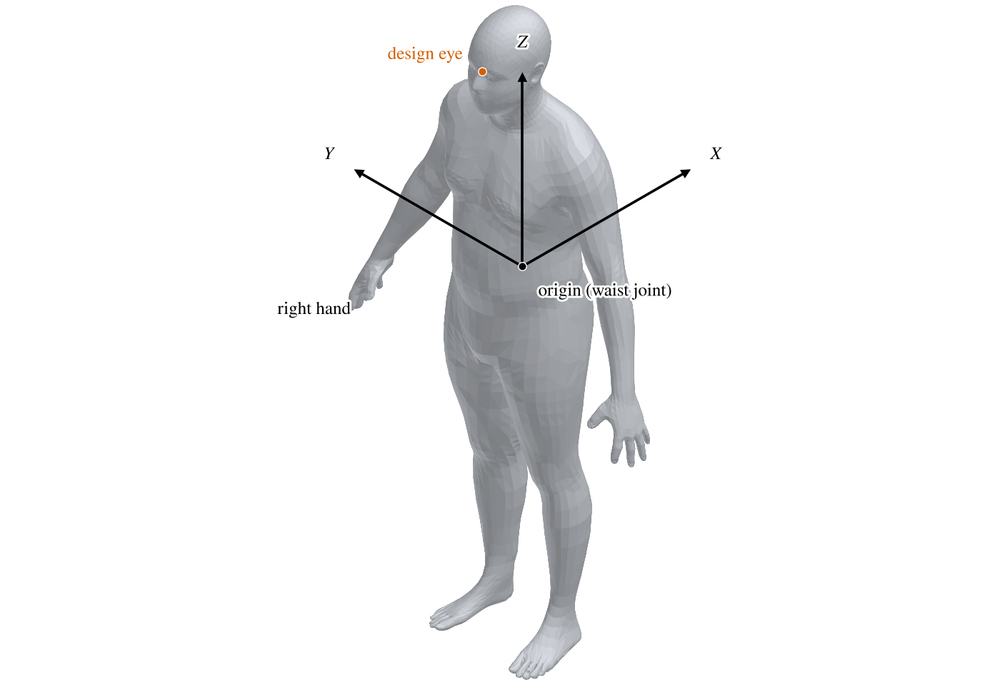
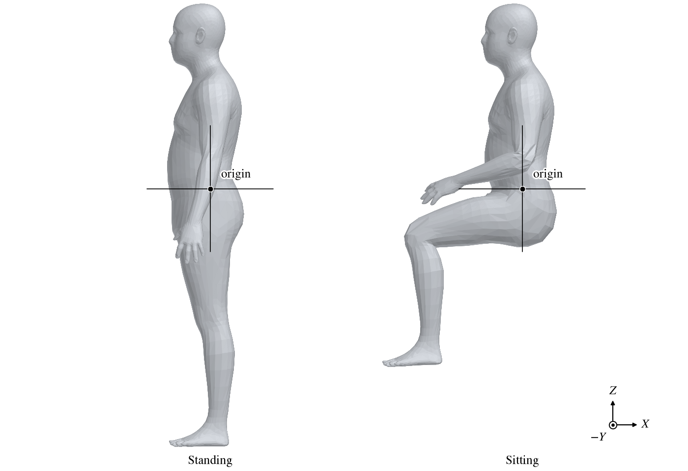
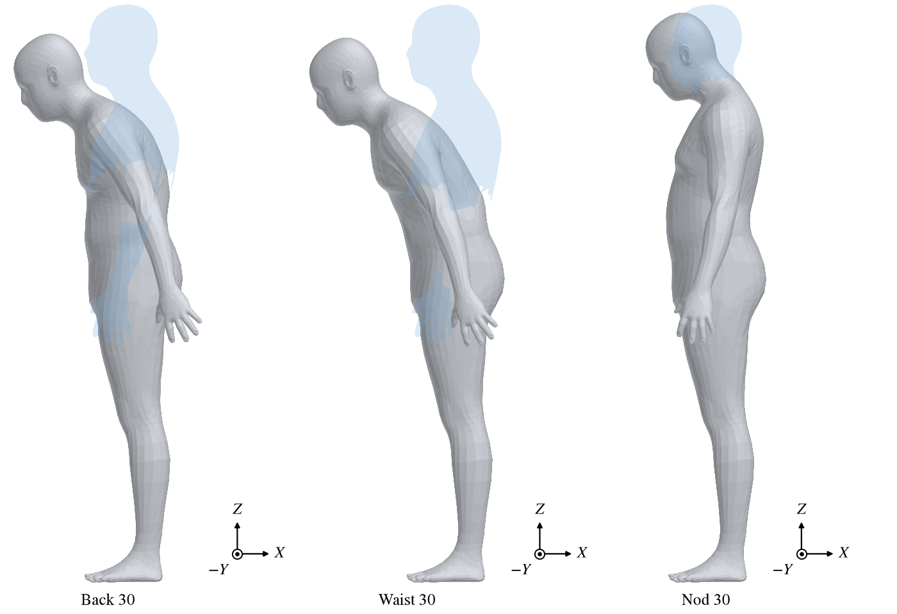
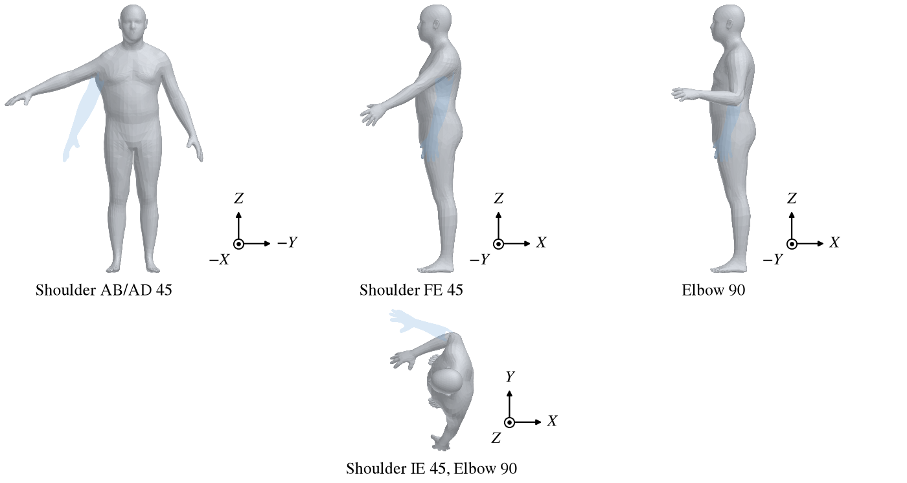
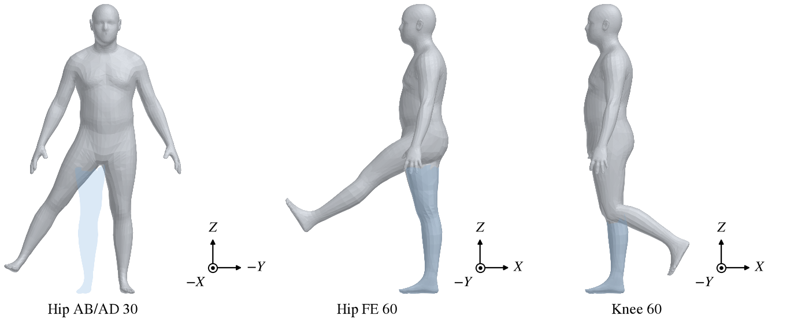

The Human component models a person: a pilot, a passenger or a ground crew member, sized from population
statistics and posed joint by joint.  Its shape comes from a statistical model of adult body scans, so a few
numbers -- sex, stature, body mass index, age and sitting height -- give a complete, realistic body.  A skeleton
inside the body then bends it into any pose from standing to seated.  The result is a closed triangle mesh with a
mass, a volume and a design eye point, for checking fit, reach, visibility and mass properties.

| Topic                                         | Tab            |
|:----------------------------------------------|:---------------|
| [Quick Start](#quick-start)                   |                |
| [Units](#units)                               | Anthropometric |
| [Body Size](#body-size)                       | Anthropometric |
| [Origin and Axes](#origin-and-axes)           |                |
| [Pose](#pose)                                 | Pose           |
| [Design Eye](#design-eye)                     |                |
| [The Human in Analyses](#the-human-in-analyses) |              |
| [Scripting](#scripting)                       |                |
| [References](#references)                     |                |

The Gen, XForm and Mass tabs are the ones every component has; see [Gen](GenTab.md),
[XForm](XFormTab.md) and [Mass](MassTab.md).  A Human has no Sub tab.

## Quick Start

### A standing person

1. On the Anthropometric tab choose *Gender*, then set *Length Unit* and *Mass Unit* to the units of the model.
2. Set *% Stature* and *% BMI*, or type the *Stature* and *Mass* directly.
3. Leave the pose as it is: a new human stands.
4. Place it with the XForm tab.  The origin is the waist joint, so set the location of the waist, not the feet.

### A seated occupant

1. Choose *Gender*, then set *Length Unit* and *Mass Unit* to the units of the model.
2. Set the size, as for a standing person.
3. On the Pose tab choose *Preset* SITTING and click *Set*, then adjust the joints to fit the seat.
4. Place it with the XForm tab, by the waist joint (Figure 2).  Attach a Super Cone Auxiliary to it to show the field
   of view (see [Design Eye](#design-eye)).

## Units

*Length Unit* and *Mass Unit* say what units the human is built in.  They are not display units: the body is built at
its stature in the length unit, so a 1.76 m man is 1.76 model units tall with Length Unit M and 5.76 with Length
Unit FT.  Set them to the units the rest of the model uses.  The default is FT and LBM.

Changing the length unit keeps the person the same size in the real world: the stature percentile stays, and the
stature is restated in the new unit.  Changing the mass unit restates the mass.

The XForm tab's *Scale* has no effect on a human; its size is set by the stature and the length unit alone.

## Body Size

The body shape is the statistical model from Human Shapes (humanshape.org, by Prof. Matthew P. Reed of the
University of Michigan Transportation Research Institute), used with permission [1].  Its inputs are stature, body
mass index, sitting height ratio and age; every point of the body follows from them.  Between them, the controls on
the Anthropometric tab describe most of the variation among adults.

| Control       | Parm          | Default   | Range       | Meaning                                              |
|:--------------|:--------------|:----------|:------------|:-----------------------------------------------------|
| Gender        | `GenderFlag`  | MALE      |             | Which body model, and which population statistics.   |
| Stature       | `Stature`     | 50th pct. | 5th to 95th | Standing height, in the length unit.                 |
| % Stature     | `Stature_pct` | 0.5       | 0.05 - 0.95 | Stature percentile, as a fraction.                   |
| BMI           | `BMI`         | 50th pct. | 16 - 55     | Body mass index, kg/m^2.                             |
| % BMI         | `BMI_pct`     | 0.5       | 0.05 - 0.95 | BMI percentile, as a fraction.                       |
| Mass          | `Mass`        |           |             | Body mass, in the mass unit.                         |
| Age           | `Age`         | 30        | 18 - 80     | Age in years.                                        |
| Sitting H / H | `SitFrac`     | 0.51      | 0.4 - 0.6   | Sitting height divided by stature.                   |
| Volume        | `Volume`      |           |             | Output: the volume of the posed body.                |
| Auto Density  | `AutoDensity` | on        |             | Set the Mass tab's density to Mass / Volume.         |

### Stature and BMI

Stature and BMI each have a value and a percentile; set either and the other follows.  The percentiles come from
the United States NHANES survey of adults aged 20 and over, 2011-2014, separately for men and women [2]:

| Percentile | Male stature, mm | Female stature, mm | Male BMI | Female BMI |
|:-----------|:-----------------|:-------------------|:---------|:-----------|
| 5th        | 1634             | 1498               | 20.7     | 19.6       |
| 50th       | 1756             | 1619               | 27.7     | 27.7       |
| 95th       | 1881             | 1735               | 39.8     | 43.3       |

Switching *Gender* keeps the percentiles, so a 95th percentile man becomes a 95th percentile woman, and shorter.
The limits on *Stature* are the 5th and 95th percentile of the chosen sex.

Mass, BMI and stature are tied together by

$$
\mathrm{BMI} = \frac{m}{h^2}
$$

with the mass $m$ in kilograms and the stature $h$ in meters.  Setting *Mass* sets BMI; setting *BMI* or *% BMI*
sets the mass.  Changing the stature keeps the BMI and changes the mass, so a taller person of the same build is
heavier.

### Age and sitting height

*Age* and *Sitting H / H* change the shape without changing the stature.  A larger sitting height ratio gives a
longer trunk and shorter legs.  Age changes the build, by an amount that depends on the BMI.  Leave both at their
defaults unless the person in question is known to differ.

### Volume and density

*Volume* is the volume of the closed body as posed, in the length unit cubed.  With *Auto Density* on, the human's
density on the Mass tab is set to *Mass* / *Volume*, so the mass properties of the model carry the person's mass
at the right place.  Turn it off to set a density by hand.

## Origin and Axes

The human faces $-X$, with $Z$ up and the person's right side toward $+Y$, the way a pilot sits in an aircraft
whose nose points along $-X$ (Figure 1).  The origin is the waist joint, and it stays there whatever the pose: the
legs hang from it standing and fold in front of it seated (Figure 2).  Place a seated occupant by the waist joint,
not by the seat or the feet.



*Figure 1. A new human, its origin at the waist joint, and its axes.  The person faces $-X$; the right hand is
toward $+Y$.*



*Figure 2. The default human standing, as it is made, and in the Sitting preset.  The origin is the same point of
the body in both.*

## Pose

The pose bends the body at the joints of its skeleton.  The skin follows the bones smoothly, so a bent elbow or
hip deforms the flesh around it rather than hinging a rigid part.  The skin is bound to the skeleton by the
Pinocchio automatic rigging method [3].

### Presets

*Preset* and *Set* at the top of the Pose tab put the human into a standard pose.  Set replaces every joint angle
and turns *R/L Sym* on; choose the preset first and then adjust.

| Joint            | Standing | Sitting |
|:-----------------|:---------|:--------|
| Elbow            | 15       | 80      |
| Shoulder IE      | 0        | 45      |
| Hip AB/AD        | 0.5      | 0.5     |
| Hip FE           | 2.5      | 80      |
| Knee             | 0        | 80      |
| All other joints | 0        | 0       |

A new human stands, in the Standing preset.

### Joint angles

Every angle is in degrees.  The names are the anatomical ones: AB/AD is abduction (away from the body's
centerline) and adduction, FE is flexion and extension, IE is internal and external rotation.  *Elbow* is the angle
between the upper arm and the forearm, zero for a straight arm; the other angles are zero in a natural standing
posture.  Figures 3-5 show positive angles on the larger joints.

| Control        | Parm             | Default | Range      | A positive angle                                                      |
|:---------------|:-----------------|:--------|:-----------|:----------------------------------------------------------------------|
| Back           | `Back`           | 0       | -15 - 45   | bends the upper body forward at the middle of the back.               |
| Waist          | `Waist`          | 0       | -15 - 45   | bends the upper body forward at the waist.                            |
| Nod            | `Nod`            | 0       | -40 - 50   | tips the head forward, chin down.                                     |
| Rotate         | `RotateHead`     | 0       | -80 - 80   | turns the head toward the person's right.                             |
| Shoulder AB/AD | `ShoulderABADRt` | 0       | -40 - 170  | raises the arm out to the side (abduction).                           |
| Shoulder FE    | `ShoulderFERt`   | 0       | -30 - 180  | swings the arm forward and up (flexion).                              |
| Shoulder IE    | `ShoulderIERt`   | 0       | -30 - 100  | turns the arm inward about its length (internal rotation).            |
| Elbow          | `ElbowRt`        | 15      | 0 - 150    | bends the elbow (flexion).                                            |
| Forearm        | `ForearmRt`      | 0       | -90 - 90   | turns the thumb in toward the body (pronation).                       |
| Wrist          | `WristRt`        | 0       | -90 - 90   | bends the hand toward its back (extension).                           |
| Hip AB/AD      | `HipABADRt`      | 0.5     | -45 - 45   | swings the leg out to the side (abduction).                           |
| Hip FE         | `HipFERt`        | 2.5     | -15 - 130  | swings the leg forward (flexion).                                     |
| Knee           | `KneeRt`         | 0       | 0 - 140    | bends the knee, the foot moving back (flexion).                       |
| Ankle          | `AnkleRt`        | 0       | -15 - 15   | raises the toes (dorsiflexion).                                       |

The limb joints are on the Pose tab twice, under Right Side and Left Side (Parms ending in `Rt` and `Lt`).  The
left angles mean the same motions as the right: a positive Shoulder AB/AD raises either arm out to its own side.
With *R/L Sym* on, the default, the left side copies the right and its controls are greyed; turn it off to pose
the sides apart.

Back and Waist both bend the upper body forward; Back bends it higher, at the middle of the back, and Waist at the
waist joint (Figure 3).  In both the legs and the origin stay where they are.



*Figure 3. Back, Waist and Nod at 30, seen from the person's left.  The tint shows the part that moved, as it was
standing.*



*Figure 4. Positive shoulder and elbow angles.  Shoulder AB/AD is seen from in front of the person and moves the
right arm; Shoulder FE and Elbow are seen from the left and move the left arm; Shoulder IE is seen from above and
moves the right arm, its elbow at 90.  The tint shows the arm as it was.*

Shoulder IE is easiest to see with the elbow bent: internal rotation swings the forearm in across the body, as in
Figure 4.  With the arm hanging straight it only turns the arm about its own length.  Likewise Forearm turns the
palm down when the elbow is bent 90 degrees, and toward the back when the arm hangs; the palm faces the thigh at
zero.



*Figure 5. Positive hip and knee angles.  Hip AB/AD is seen from in front of the person and moves the right leg;
Hip FE and Knee are seen from the left and move the left leg.*

The skeleton does not check for collisions, so a pose can put an arm through the body or a leg through the other;
check a demanding pose by eye.

## Design Eye

The human carries a *design eye* point between the eyes (Figure 1), which moves and turns with the head.  Two
things use it:

- A Super Cone [Auxiliary](Auxiliary.md) component whose parent is a human is placed at the design eye and turned
  with the head, so it shows the field of view from the person's eyes.
- [From Point Visibility](GeometryAnalysis.md#from-point-visibility) in Geometry Analysis can take a human as its
  viewpoint, and looks from the design eye.

With symmetry, each copy of the human has its own design eye.  An attached Super Cone follows the eye as the human
is posed or resized.

## The Human in Analyses

A human is a closed triangle mesh, the same in every analysis.  CompGeom, Mass Properties, the slicing analyses,
interference checks and the mesh exports all use it, and VSPAERO takes it as one component.  Its mesh is fixed by the
model: the Gen tab's tessellation controls do not apply.

It is not a surface, so it has no sub-surfaces, its degenerate geometry is empty, and it takes no part where a
surface is needed: CFD Mesh, FEA Mesh, Fit Model, or as the boundary or direction of a projection.  Symmetry and Flip on
the XForm tab work as for any component; see [Symmetry](XFormTab.md#symmetry) and [Flip](XFormTab.md#flip).

## Scripting

A human has no functions of its own in the API: it is built and posed through its Parms, in the groups
`Anthropometric` and `Pose`, with the names in the tables above.  The *Set* button is not in the API; to pose a
human as a preset, set the joint angles from the preset table.  `ShowSkelFlag` in the `Anthropometric` group draws
the skeleton with the feature lines, unposed in black and posed in blue; it has no control on the screen.

```python
import openvsp as vsp

h = vsp.AddGeom( "HUMAN" )
vsp.SetParmVal( h, "LenUnit", "Anthropometric", vsp.LEN_M )
vsp.SetParmVal( h, "Stature_pct", "Anthropometric", 0.95 )

# Seated, as the Sitting preset
for name, val in ( ( "ElbowRt", 80 ), ( "ShoulderIERt", 45 ), ( "HipFERt", 80 ), ( "KneeRt", 80 ) ):
    vsp.SetParmVal( h, name, "Pose", val )

vsp.Update()
```

## References

1. Reed, M. P., Human Shapes, University of Michigan Transportation Research Institute.  <http://humanshape.org/>
2. Fryar, C. D., Gu, Q., Ogden, C. L. and Flegal, K. M., "Anthropometric Reference Data for Children and Adults:
   United States, 2011-2014," Vital and Health Statistics, Series 3, Number 39, National Center for Health
   Statistics, 2016.  Tables 9 and 11 (stature) and 14 and 15 (body mass index).
3. Baran, I. and Popovic, J., "Automatic Rigging and Animation of 3D Characters," ACM Transactions on Graphics,
   Vol. 26, No. 3 (SIGGRAPH 2007), 2007.  The Pinocchio library: <https://github.com/elrond79/Pinocchio>
