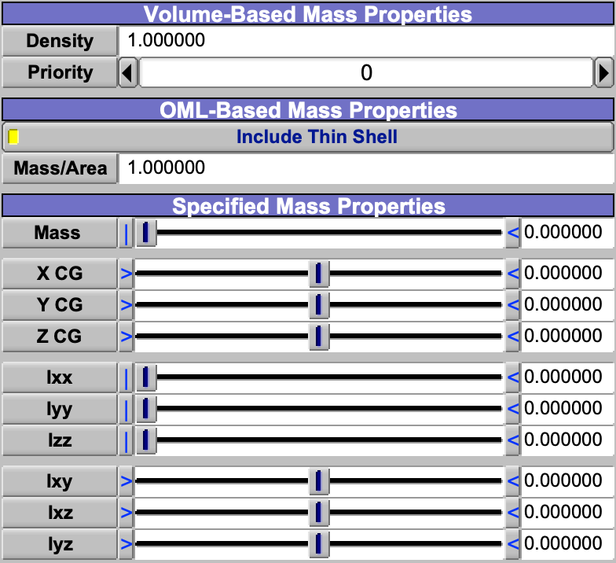
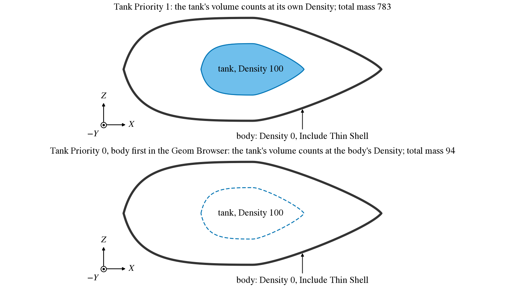

Every component (Geom) in OpenVSP is edited in a window whose first tabs are the same for all of them:
[Gen](GenTab.md), [XForm](XFormTab.md), Mass and [Sub](SubTab.md).  Hinge, Point Cloud and Wireframe have no Mass
tab.

The Mass tab feeds the [Mass Properties](GeometryAnalysis.md#mass-properties) analysis, which finds the model's mass,
center of gravity and inertia by adding up what each Geom contributes.  It is a bottom-up estimate, made the way a CAD
system weighs a part: every number comes from the model's shapes and the values on this tab, not from statistical
weight equations, so the result is only as good as the densities and masses given.

Each Geom can make three contributions, one for each box of the tab (Figure 1), and they add: a volume mass, a thin
shell mass over its wetted area, and a specified mass.  Use any of them, all of them or none.  All three use the model's
units consistently: a density in mass per length cubed gives mass in that mass unit.

*Figure 1. The three groups of the Mass tab of a Pod, Volume-Based, OML-Based and Specified, with Include Thin Shell
on.*

| Topic                                     |
|:------------------------------------------|
| [Volume](#volume)                         |
| [Thin Shell](#thin-shell)                 |
| [Specified Mass](#specified-mass)         |
| [Routes, Humans and Clones](#routes-humans-and-clones) |
| [Scripting](#scripting)                   |

## Volume

*Density* $\rho$ gives the Geom's volume $V$ a mass $m = \rho\,V$.  It suits a part that is solid through, such as a
foam model or a casting, and the contents of a volume, such as fuel in a tank or cargo in a hold.  Set *Density* to 0
for a Geom that should carry no volume mass.

Where Geoms overlap, the shared volume is counted once, at the density of the Geom with the highest *Priority*; at
equal priorities the Geom earlier in the Geom Browser wins.  The winner takes the volume whatever its density, and a
Density of 0 does not hand it on.  A fuselage whose mass is all in its skin (Density 0, with a thin shell) that comes
before a fuel tank in the Geom Browser at the same Priority counts the tank's volume at Density 0, and the fuel weighs
nothing (Figure 2).  Give the contents of a volume a higher Priority than the Geom that holds them.

*Figure 2. A section through a body whose only mass is its skin and a fuel tank inside it.  With the higher Priority
(top) the tank's volume is counted at the tank's Density; at equal Priority the body, first in the Geom Browser, takes
the shared volume at its own Density of 0 (bottom).*

## Thin Shell

*Include Thin Shell* adds a mass $m = \rho_A\,S_{wet}$: *Mass/Area* $\rho_A$ times the Geom's wetted area.  Only the
area exposed outside the other Geoms counts, so a wing root buried in a fuselage adds nothing, and a Geom wholly inside
another, such as a tank inside a fuselage, has no thin shell mass at all; give such a Geom's walls a specified mass
instead.  The thin shell suits structure that is mostly skin, such as a molded shell, alone (with *Density* 0) or with
a volume mass.  To make a skin weigh a known amount, divide that weight by the Geom's wetted area as CompGeom reports
it, which is the same exposed area.

## Specified Mass

The *Specified Mass Properties* add a concentrated mass: *Mass* at the point *X CG*, *Y CG*, *Z CG*, with moments of
inertia *Ixx*, *Iyy*, *Izz* and products of inertia *Ixy*, *Ixz*, *Iyz* about that point.  All are given in the Geom's
own axes, so the mass moves and turns with the Geom.  The products are entered as $I_{xy} = \int x\,y\,dm$, positive
for mass concentrated where $x$ and $y$ have the same sign; a data sheet that defines them with a minus sign needs its
signs changed.  Each symmetric copy carries its own: a mirrored wing with *Mass* 10 adds 20 to the model, centered on
the plane of symmetry.  The 3D view marks each such mass.

The specified mass is the place for an item bought rather than designed, such as an engine, whose maker's data sheet
gives its weight, center of gravity and inertia.  Put a Geom at the item's datum with its axes along the item's, and
the numbers go in as the sheet gives them, converted to the model's units.  A [Blank](Blank.md), which has no volume
or area of its own, is the usual Geom for an engine, a battery or a payload.

## Routes, Humans and Clones

A [Routing](Routing.md) component has a fourth box, *Length-Based Mass Properties*: the route weighs its length times
*Mass/Len*, as a line of mass along it.  A [Human](Human.md) with *Auto Density* on sets its own *Density* to its mass
divided by its volume, so the person weighs what the Human's *Mass* says.  On a [Clone](Clone.md) that copies its
original's mass properties, which it does by default, the controls are greyed and follow the original.

## Scripting

Every control on this tab is a Parm, set and read with `SetParmVal` and `GetParmVal` by name and group;
`GetParmActiveFlag` tells whether a control is active or greyed, as of the last Update.

| Control                       | Parm                                                       | Group        |
|:------------------------------|:-----------------------------------------------------------|:-------------|
| Density, Priority             | `Density`, `Mass_Prior`                                    | Mass_Props   |
| Include Thin Shell, Mass/Area | `Shell_Flag`, `Mass_Area`                                  | Mass_Props   |
| Mass, X CG, Y CG, Z CG        | `PointMass`, `CGx`, `CGy`, `CGz`                           | Mass_Props   |
| Ixx ... Iyz                   | `Ixx`, `Iyy`, `Izz`, `Ixy`, `Ixz`, `Iyz`                   | Mass_Props   |
| Mass/Len (Routing)            | `LinearDensity`                                            | Mass_Props   |
