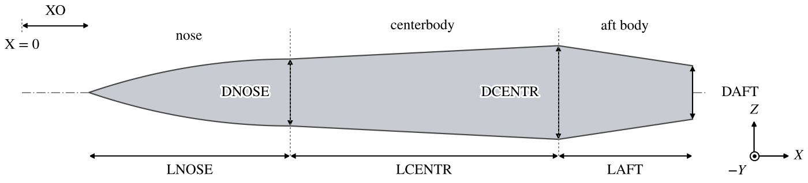
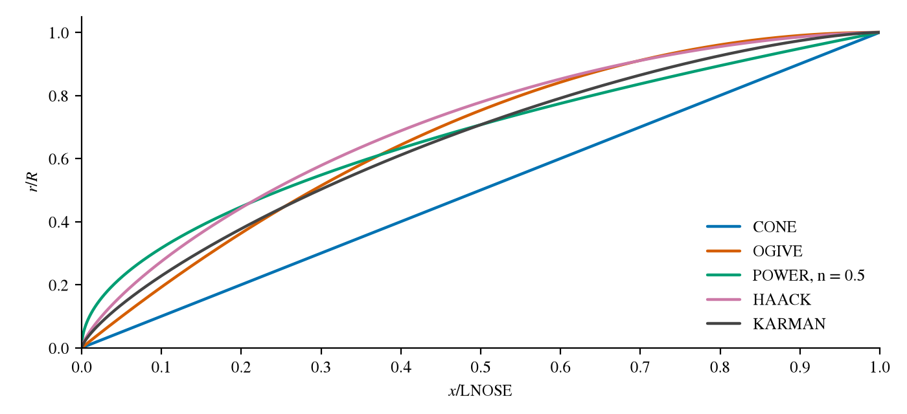
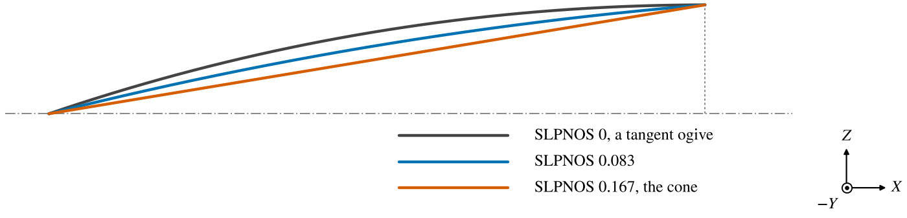
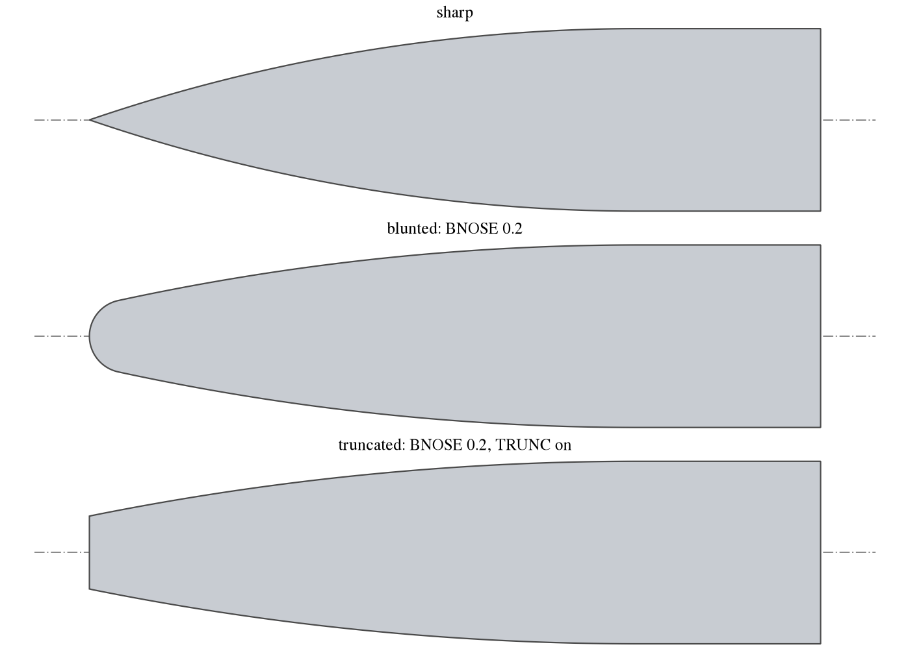
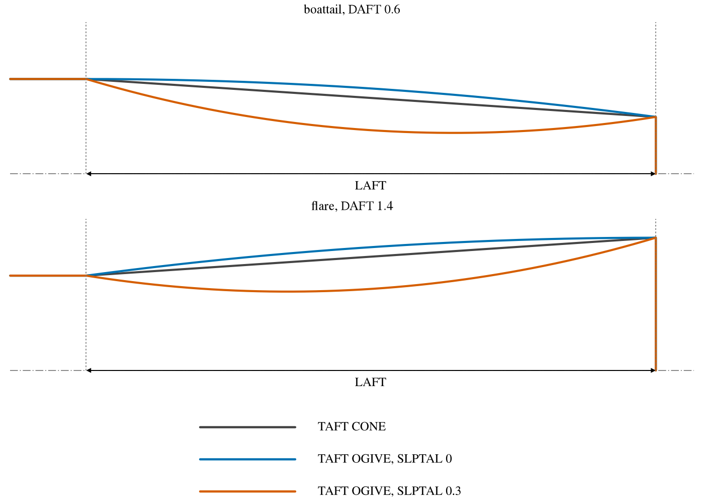
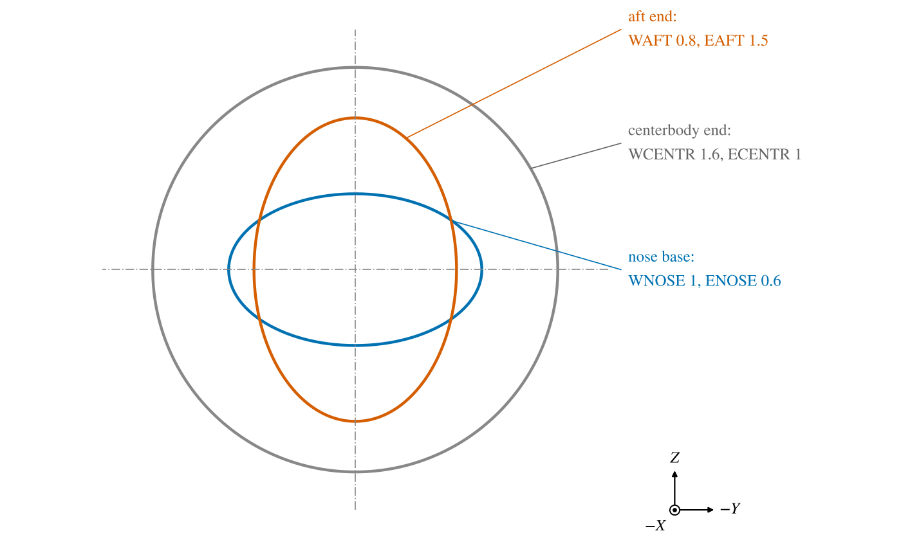
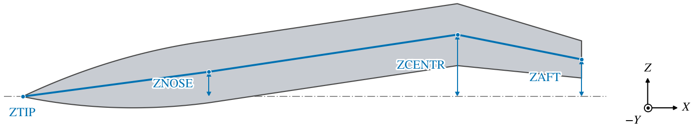

The MDC_BOD is a body laid out the way DATCOM lays one out: a nose, a centerbody and an aft body, each given
by its shape, its length and its size at its aft end, and closed by a flat base.  The controls carry the names and
meanings of the inputs of DATCOM's AXIBOD and ELLBOD namelists, so a DATCOM body can be entered as it is written, and
a body described by few numbers can be changed quickly.  Choose the AXIBOD form for a body of circular sections, and
the ELLBOD form for elliptical ones.  Only DATCOM's first way of describing a body, by nose, centerbody and aft body,
is available; a body given by stations is a [Fuselage or Stack](FuselageStack.md), and the MDC_BOD can be converted to
a Stack (see Convert to Stack).  The script `datcom2vsp.py`, in the examples, reads a DATCOM input file and
builds a model from its body, protuberances, fin sets and inlets, using this component and the
[MDC_PROTUB](MdcProtub.md), [MDC_FIN](MdcFin.md) and [MDC_INLET](MdcInlet.md) components.

The MDC_BOD has one tab of its own, Design.  The [Gen](GenTab.md), [XForm](XFormTab.md), [Mass](MassTab.md) and
[Sub](SubTab.md) tabs are described on their own pages.  The Design tab sets

- the [layout](#layout) of the three parts;
- a [preset](#presets) shape to start from;
- the [nose](#nose), its shape, [bluntness](#bluntness-and-truncation) and [ogive slope](#secant-ogives);
- the [centerbody and aft body](#centerbody-and-aft-body);
- [elliptical bodies](#elliptical-bodies) and [camber](#camber);
- the [tessellation](#tessellation) of each part;
- [conversion to a Stack](#convert-to-stack).

## Quick Start

1. Add an MDC_BOD.  A new one is 10 long: an ogive nose 3 long and 1 in diameter, on a cylinder 7 long, closed by a
   flat base.  Its nose tip is at its origin and its axis is along $X$.
   To start from a rocket instead, choose Generic Rocket as the Preset and press Set.
2. Place it with the XForm tab.
3. Choose *NAMELIST*: AXIBOD for circular sections, ELLBOD for elliptical ones.
4. Shape the nose with *TNOSE*, *LNOSE* and *DNOSE* (*WNOSE* and *ENOSE* for ELLBOD).
5. Set the centerbody's *LCENTR* and *DCENTR*, and give the aft body a *LAFT* and *DAFT*.

## Layout

The nose runs from its tip, at the component's origin, a *LNOSE* aft to the nose base.  The centerbody runs a further
*LCENTR*, and the aft body a further *LAFT*, ending at the base (Figure 1).  Each part has one size, its diameter
(AXIBOD) or width and ellipticity (ELLBOD), given at its aft end by *DNOSE*, *DCENTR* and *DAFT*, or by the widths
and ellipticities of ELLBOD.  The body runs straight between these
stations, so a centerbody whose *DCENTR* differs from *DNOSE* is a cone frustum, and one that keeps the nose's size is
a cylinder.  The aft body is a boattail where *DAFT* is smaller than *DCENTR*, and a flare where it is larger.  The
base is flat.

*Figure 1. A body with an ogive nose, a tapering centerbody and a boattail, with the lengths and diameters that set
them.*

A part with no length is left out.  A *LCENTR* of zero joins the aft body to the nose base, and a *LAFT* of zero, its
default, leaves the body with no aft body, ending at the centerbody.  With both zero the body is the nose alone,
closed by a flat face at its base.  The inputs of a part that is left out are greyed in the Design tab, as are the
inputs of the namelist not chosen and the inputs that shape nothing in the nose.

*XO* is where the nose tip is along $X$: it is the X location of the XForm tab, shown again on the Design tab, so it
moves the whole body without changing its shape.  The XForm tab moves and rotates the body as it does any component,
turning it about the point along its length that the XForm tab's Origin gives as a fraction of the body's length from
the nose tip.

### Presets

The Preset choice and its Set button give the body a whole shape: every input of the Design tab is set, and the body
keeps its place.  Choosing a preset changes nothing until Set is pressed.  Default is the body as new.  Generic Rocket
is a body 175 long and 10 across: a Von Karman nose 30 long, a cylinder 142 long and a conical boattail 3 long to 9
across.
The API call `SetMdcPreset` does the same.

In DATCOM the centerbody's size defaults to the nose's.  With *Nose's size* on, the default, *DCENTR* is *DNOSE* and
*WCENTR* is *WNOSE*, and they follow the nose when it changes.  Turn it off to give the centerbody a size of its own.

## Nose

The nose is one of five shapes, chosen by *TNOSE* (Figure 2).

- CONE: a cone, straight from the tip to the nose base.
- OGIVE: an ogive, a circular arc in profile.  It is tangent to the centerbody where *SLPNOS* is zero, its default.
- POWER: a power law, in which the radius $r$ at distance $x$ from the tip is
  $$
  \frac{r}{R} = \left(\frac{x}{L}\right)^n
  $$
  where $R$ is the radius of the nose base, $L$ is *LNOSE* and $n$ is *POWER*.  The default exponent of 1 is a cone,
  one-half is a parabola, and a smaller exponent is blunter at the tip.
- HAACK: the Haack nose of least drag for a given length and volume, the L-V Haack.
- KARMAN: the Haack nose of least drag for a given length and diameter, the Von Karman.

*Figure 2. The five nose shapes of one length and diameter; the power law nose has exponent one-half.*

The power law exponent, *POWER*, matters only to a power law nose, and is greyed otherwise.  For an elliptical body,
the nose's shape is that of the circular nose of the same width, stretched to ENOSE times as high.

### Secant ogives

An ogive is the arc of a circle.  *SLPNOS* is the slope of the arc, the rise of its radius per unit of length, where
it meets the nose base.  Zero, the default, is the tangent ogive: the arc meets the base moving along the axis, as the
centerbody continues.  A positive slope is a secant ogive, whose arc meets the base at an angle; it is flatter than
the tangent ogive, and the cone, whose slope is that of the line from the tip to the base, is its limit (0.167 for the
noses of Figure 3).  A slope larger than the cone's makes a
nose that curves in toward the axis, and one larger than about twice it makes a nose whose arc crosses the axis near
the tip.  A negative slope makes a nose fuller than the tangent ogive, wider than its base.  *SLPNOS* matters only to
an ogive nose, and is greyed otherwise.

*Figure 3. Ogive noses of one length and diameter with three slopes at the base, the last being the cone.*

### Bluntness and truncation

*BNOSE* blunts or truncates the nose (Figure 4).  Without *TRUNC*, it blunts the nose with a sphere of radius *BNOSE*
whose front is the tip, so the tip is rounded and the nose keeps its length *LNOSE* and its base.  A cone or ogive is
drawn from the base to touch the sphere.  A power law, Haack or Von Karman profile is drawn from a virtual tip, ahead
of the tip or just behind it, placed so that the profile touches the sphere.  A power law nose of exponent one-half
is already as round at its tip as a sphere of radius $R^2 / (2 L)$, so no profile of it touches a smaller sphere,
and such a nose stays sharp.  A smaller exponent is blunter still and stays sharp under larger spheres: with exponent
0.3 a sphere needs a radius of about 0.45 of the base radius.  A sphere as large as the nose base is met by the
straight line from the base that touches it, as on a cone.  With *TRUNC* on, *BNOSE* instead cuts the nose off flat,
at a face of radius *BNOSE* at the tip, and this is so for every shape of nose.  For an elliptical body *BNOSE* is
measured across the width, and the sphere or face is *ENOSE* times as high.

*Figure 4. An ogive nose sharp, blunted by a BNOSE of 0.2, and truncated by a BNOSE of 0.2.*

## Centerbody and Aft Body

The centerbody is a cone frustum from the nose base to its aft end, of length *LCENTR* and size *DCENTR* there.  The
aft body, *LAFT* long and *DAFT* across at the base, is a cone, or with *TAFT* set to OGIVE, an ogive (Figure 5). Its
ogive is the arc of a circle through both ends, and *SLPTAL* is its slope where it meets its larger end, positive
toward the axis: the forward end of a boattail, and the base of a flare.  Zero, the default, is tangent to the larger
end there, and a positive slope is a secant ogive.  On a flare, a slope at the base more than twice the straight
flare's makes an aft body that first narrows below the centerbody.  *SLPTAL* matters only to an ogive aft body.
DATCOM requires *DAFT* to differ from *DCENTR*; here it need not.

*Figure 5. A boattail and a flare, each a cone and two ogives.  Both bodies have the same nose and centerbody.*

The base is flat.  *DEXIT*, the diameter of a nozzle's exit, which DATCOM takes for the base drag, is drawn in it as
DATCOM draws it: the base is flat from its edge in to a circle *DEXIT* across, and from there a cone goes in to a point
a quarter of *DEXIT* inside the base.  An exit as large as the base leaves no flat ring, and one larger is taken to be
the base's size.  Zero, the default, is a flat base.  A nose alone has no base to cut, and its *DEXIT* is greyed.

## Elliptical Bodies

With *NAMELIST* ELLBOD every section is an ellipse.  Its width is *WNOSE*, *WCENTR* or *WAFT*, and its height is the
ellipticity, *ENOSE*, *ECENTR* or *EAFT*, times the width (Figure 6).  An ellipticity under 1 is wider than tall and
over 1 is taller than wide, and the sections may be mixed along the body.  The ellipticity is the same for the whole
nose, whatever its shape.  It does not carry from one part to the next: *ECENTR* and *EAFT* are 1 by default, so a
body that is wider than tall throughout needs each of the three set.  The inputs of the other namelist are greyed:
*DNOSE*, *DCENTR* and *DAFT* for ELLBOD, and the widths and ellipticities for AXIBOD.  The diameters and the widths
are kept equal, each following the namelist chosen, so changing the namelist changes the body as little as it can: an
AXIBOD becomes an ELLBOD as wide as it was, and the ellipticities, kept while AXIBOD is chosen, make it elliptical
again.

*Figure 6. Sections of an elliptical body at the nose base, the end of the centerbody and the aft end.*

## Camber

*ZTIP*, *ZNOSE*, *ZCENTR* and *ZAFT* bend the body upward, as DATCOM does, by shearing: each section is moved up
without turning, by a distance that is linear between the stations where it is given (Figure 7).  They are given at
the nose tip, the nose base, the end of the centerbody and the aft end, all zero by default.  The body is made
uncambered, from the other inputs, and then moved, so camber does not change any section.  Where the centerbody or aft
body is absent its camber is greyed.

*Figure 7. A cambered body: the centerline passes through the heights ZTIP, ZNOSE, ZCENTR and ZAFT.*

## Tessellation

The rows along the body are set part by part, by the Num_U slider at the end of the Nose, Centerbody and Aft Body
sections; the Gen tab's Num_U is greyed, and its Num_W sets the rows around the body as for any component.  The nose's
Num_U also sets the rows across a flat base, and the aft body's those across a nozzle exit.  A part that is absent
has its Num_U greyed.

Put the rows where the body curves.  A curved nose needs the most, and more still where it is blunted.  The
centerbody and a cone aft body are straight along their length, so their two end rows give their shape exactly, and
more rows only make a finer mesh for an analysis that wants one.

## Convert to Stack

The Convert to Stack button at the top of the Design tab makes the equivalent [Stack](FuselageStack.md), a Stack of
the same body.  It asks whether to replace the MDC_BOD or add a Stack
beside it.  Replace swaps the MDC_BOD for the Stack, which takes its place in the model, and cannot be undone; Add
leaves the MDC_BOD as it is and adds the Stack.  A Stack has the controls of a general body, so convert when the body
needs sections an MDC_BOD does not have.  Where the body is cambered across an ogive aft body, the Stack is a small
distance from it that grows with the camber, about 0.005 of the diameter for camber of a fifth of it.  Each of the
Stack's sections takes the rows of the part it is in, and its cap tessellation, which a Stack uses at both ends, is
the nose's, so the Stack is tessellated as the MDC_BOD is.  The API call `ConvertMdcBodToStack` does the same.

## Parameters

The parms are in the *Design* group but for *XO*, which is the XForm tab's X location, and the three Num_U, which are
in the *Shape* group.  The first column gives the Design tab's section.

| Section    | Control     | Parm                     | Default | Meaning                                                        |
|:-----------|:------------|:-------------------------|:--------|:---------------------------------------------------------------|
| Body       | Preset      | `Preset`                 | Default | The shape Set gives: Default or Generic Rocket.                |
| Body       | NAMELIST    | `NAMELIST`               | AXIBOD  | AXIBOD, circular sections, or ELLBOD, elliptical sections.     |
| Body       | XO          | `X_Rel_Location` (XForm) | 0       | Position of the nose tip along $X$.                            |
| Nose       | TNOSE       | `TNOSE`                  | OGIVE   | CONE, OGIVE, POWER, HAACK or KARMAN.                           |
| Nose       | POWER       | `POWER`                  | 1       | Exponent of a power law nose.                                  |
| Nose       | LNOSE       | `LNOSE`                  | 3       | Length of the nose.                                            |
| Nose       | DNOSE       | `DNOSE`                  | 1       | Diameter at the nose base (AXIBOD).                            |
| Nose       | WNOSE       | `WNOSE`                  | 1       | Width at the nose base (ELLBOD).                               |
| Nose       | ENOSE       | `ENOSE`                  | 1       | Height over width at the nose base (ELLBOD).                   |
| Nose       | BNOSE       | `BNOSE`                  | 0       | Radius of the blunting sphere or of the truncated face.        |
| Nose       | TRUNC       | `TRUNC`                  | off     | Truncate the nose rather than blunt it.                        |
| Nose       | SLPNOS      | `SLPNOS`                 | 0       | Slope of an ogive nose at its base; zero is tangent.           |
| Nose       | ZTIP        | `ZTIP`                   | 0       | Camber at the nose tip.                                        |
| Nose       | ZNOSE       | `ZNOSE`                  | 0       | Camber at the nose base.                                       |
| Nose       | Num_U       | `NoseTess_U` (Shape)     | 9       | Rows along the nose, and across a flat base.                   |
| Centerbody | LCENTR      | `LCENTR`                 | 7       | Length of the centerbody.                                      |
| Centerbody | Nose's size | `CENTRDefault`           | on      | The centerbody's size at its aft end is the nose's.            |
| Centerbody | DCENTR      | `DCENTR`                 | 1       | Diameter at its aft end (AXIBOD).                              |
| Centerbody | WCENTR      | `WCENTR`                 | 1       | Width at its aft end (ELLBOD).                                 |
| Centerbody | ECENTR      | `ECENTR`                 | 1       | Height over width at its aft end (ELLBOD).                     |
| Centerbody | ZCENTR      | `ZCENTR`                 | 0       | Camber at its aft end.                                         |
| Centerbody | Num_U       | `CentrTess_U` (Shape)    | 9       | Rows along the centerbody.                                     |
| Aft Body   | TAFT        | `TAFT`                   | CONE    | CONE or OGIVE.                                                 |
| Aft Body   | LAFT        | `LAFT`                   | 0       | Length of the aft body.                                        |
| Aft Body   | DAFT        | `DAFT`                   | 0.8     | Diameter at the base (AXIBOD).                                 |
| Aft Body   | WAFT        | `WAFT`                   | 0.8     | Width at the base (ELLBOD).                                    |
| Aft Body   | EAFT        | `EAFT`                   | 1       | Height over width at the base (ELLBOD).                        |
| Aft Body   | ZAFT        | `ZAFT`                   | 0       | Camber at the base.                                            |
| Aft Body   | SLPTAL      | `SLPTAL`                 | 0       | Slope of an ogive aft body at its larger end; zero is tangent. |
| Aft Body   | Num_U       | `AftTess_U` (Shape)      | 9       | Rows along the aft body, and across a nozzle exit.             |
| Base       | DEXIT       | `DEXIT`                  | 0       | Diameter of the nozzle exit, drawn as a cone into the base.    |

## References

1. Fay, J. F. and Jarvis, C. H., "Missile DATCOM User's Manual, 2026 Revision," Air Force Research Laboratory,
   Munitions Directorate, Eglin AFB, FL, March 2026.