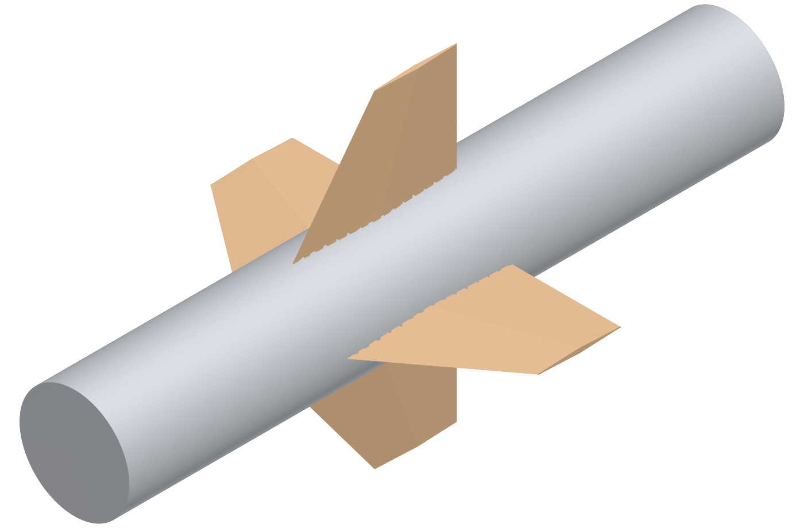
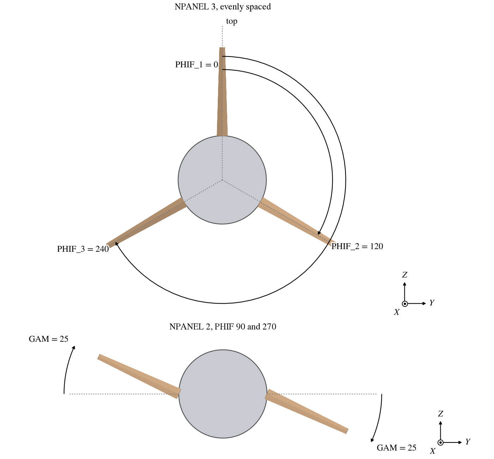
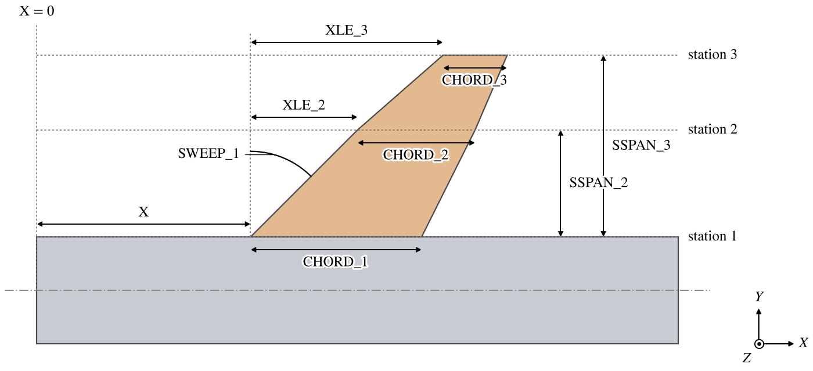
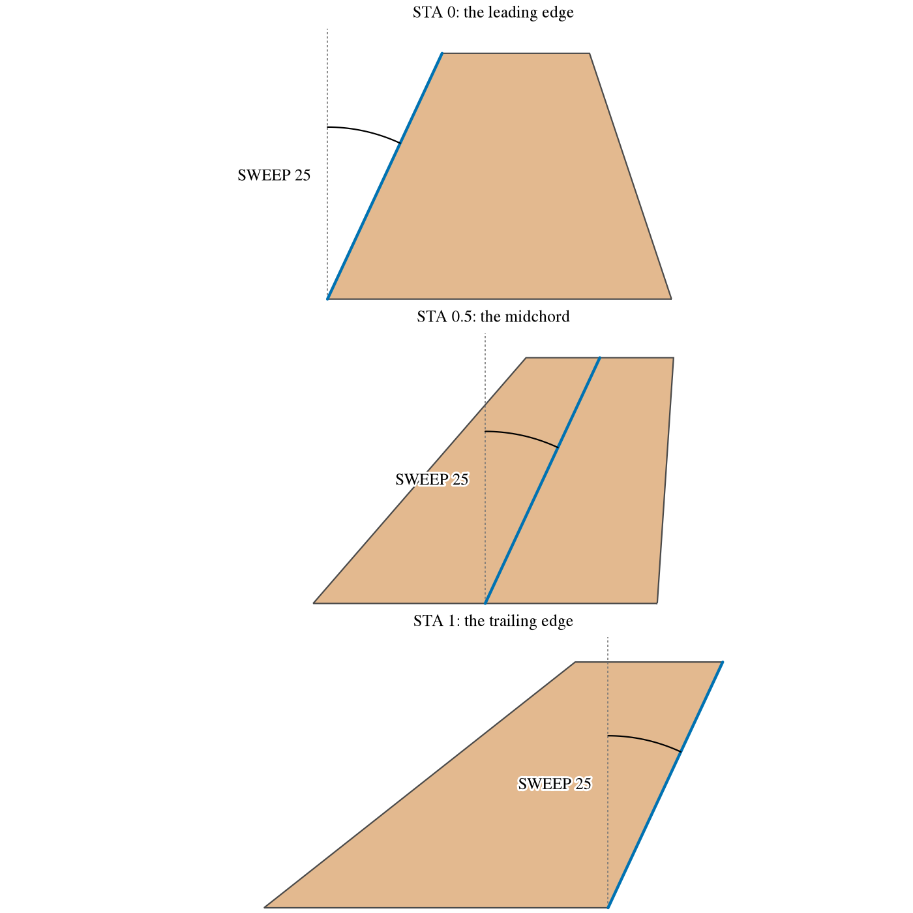
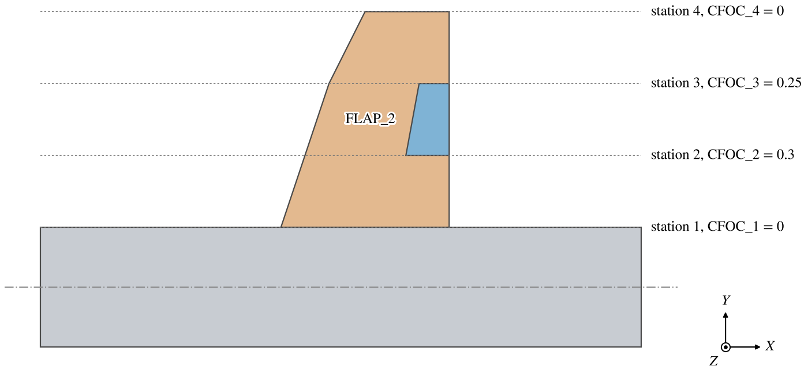
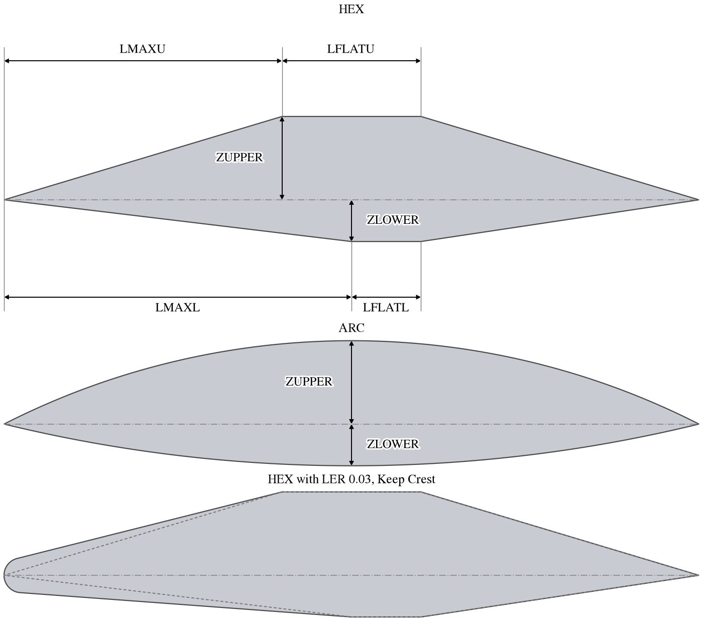
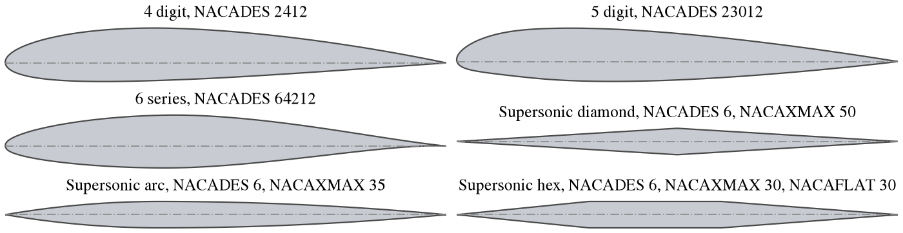

The MDC_FIN is a set of fin panels on a body, laid out the way DATCOM lays out a fin set with its FINSETn
namelist: one planform given at up to ten span stations, one type of section, and up to eight identical panels rolled
around the body.  It suits fins, canards and tails, and any other set of identical panels set around a body.  A fin
set is one component; the fin sets FINSET1 to FINSET9 of a DATCOM input are separate components, so a body with
canards and tail fins has two.

The controls carry the names and meanings of the namelist's inputs, so a fin set can be entered as DATCOM has it.  The
panels stand on a body: an MDC_FIN that is a child of an [MDC_BOD](MdcBod.md) takes the distance from the axis where
its panels begin from the body, and any other is told it (see [Panels](#panels)).  The `datcom2vsp.py` script, in the
examples, reads a DATCOM input file and builds a model with an MDC_FIN for each fin set.  An MDC_FIN can be converted
to [Wings](Wing.md), when the fins need the controls of a wing (see [Convert to Wing](#convert-to-wing)).

The MDC_FIN has three tabs of its own: Fin Set, Planform and Section.  The [Gen](GenTab.md), [XForm](XFormTab.md),
[Mass](MassTab.md) and [Sub](SubTab.md) tabs are described on their own pages.

- The Fin Set tab sets the [panels](#panels), their number, roll angles and dihedral, and the section type.
- The Fin Set tab's [preset](#presets) gives a shape to start from.
- The Planform tab sets the [planform](#planform) at its span stations, and the [flaps](#flaps).
- The Section tab sets the [sections](#sections): [HEX and ARC](#hex-and-arc-sections), [NACA](#naca-sections) and
  [USER](#user-sections).
- [Convert to Wing](#convert-to-wing) is a button at the top of the Fin Set tab.

## Quick Start

1. Add the body, an [MDC_BOD](MdcBod.md), and an MDC_FIN as its child.  A new MDC_FIN is four tapered panels, 1.5
   chord at the root and 0.75 at the tip, 1 span, 5 percent thick diamonds, rolled to the top, right, bottom and left
   of the body at X = 8 to 9.5, on the default MDC_BOD.
   To start from a rocket's fins or strakes instead, choose them as the Preset and press Set.
2. On the Fin Set tab, set *NPANEL*, the number of panels.
3. On the Planform tab, set *NSPAN*, the number of span stations, and at each station its *SSPAN*, *CHORD* and *XLE*,
   or its *SWEEP*.
4. On the Fin Set tab, choose the section type *SECTYP*, and on the Section tab give its dimensions.
5. If the panels are not evenly spaced around the body, turn on *PHIF given* and give each its roll angle.

*Figure 1. The default MDC_FIN on a body.*

## Presets

The Preset choice and its Set button, on the Fin Set tab, give the fin set a whole shape, and it keeps its place along
the body.  Choosing a preset changes nothing until Set is pressed.  Default is the fin set as new.  Generic Rocket Fins
are a rocket's four tail fins, 12 chord at the root and 8 in span, and Generic Rocket Strakes its pair of long, low
strakes at the sides, 90 chord at the root and 2 in span.  Each is sized to the largest radius of the MDC_BOD it stands
on as the rocket's are to a body of radius 5; with no MDC_BOD under it, it takes the rocket's size.
The API call `SetMdcPreset` does the same.

## Panels

*NPANEL* is the number of panels in the set, from 1 to 8, all the same.  A panel stands out from the body from its
root, with its root chord parallel to the body's axis and the middle of the root chord on the body (Figure 1).  DATCOM
takes the body's radius there from the body, and so does an MDC_FIN that is a child of an MDC_BOD: each panel's root
is at the distance from the body's axis to its mold line under the middle of the root chord, in the direction of the
panel's own roll angle, so on an elliptical body the panels' roots are at different distances.  *RBODY* then shows the
first panel's and is greyed.  Any other MDC_FIN puts every root *RBODY* from the axis; *RBODY* is not an input of
DATCOM's namelist.  If *SSPAN_1*, the span station of the root, is not zero, it is the root's distance from the axis
and the body is not used (see [Planform](#planform)).

A root on the body is flat, as DATCOM draws it: it touches the body under the middle of its chord, and on a round body
its sides stand a little clear of it.  With *Bury Root* on, the root is carried into the body, a section like the
root's, so the panel crosses the body all around.  *Extension* says how.  *Straight* carries the root section straight
in, unswept, with the root's chord.  *Extrapolate* carries on the first segment's planform: its leading and trailing
edges go on in straight lines, so the section is wider in the body where the panel tapers and further forward where it
is swept.  Either way the section is the root's, scaled to its chord.

The buried section goes in along the panel, turned with its dihedral, as far as the body falls below the root where it
passes under the section's sides at the section's leading and trailing edges, and a hundredth of the root's distance
from the axis further.  The deepest panel decides, and every panel goes in as far.  On a nose or a boattail the end over
the narrower body decides it, and on an elliptical body the body is followed round to the section's sides.  An MDC_FIN
that is not a child of an MDC_BOD takes the body to be round, *RBODY* in radius.  The section goes no further in than
the root's distance from the axis, so a panel with dihedral extrapolated forward on a nose can come out through the
side of the body; use *Straight* there.  The part inside the body is not seen once the model is joined.  Leave *Bury
Root* off to match DATCOM's geometry; turn it on for a model to be joined, meshed or analyzed in OpenVSP.  A root off
the body, at *SSPAN_1*, or of zero chord is not buried.  *Bury Root* is greyed for a root off the body, and *Extension*
unless *Bury Root* is on.

Each panel is rolled around the body to its angle *PHIF*, measured clockwise from the top looking forward, so 90
degrees is to the right (Figure 2).  Unless *PHIF given* is on, the panels are evenly spaced around the body, the first
at the top, and the angles are set from *NPANEL*; four panels are the cross of top, right, bottom and left.  The PHIF
slider shows them but is greyed.  With *PHIF given* on, each angle is set by hand.  The Panel selector chooses which
panel's angle and dihedral the sliders show.

A panel's dihedral, *GAM*, turns it further about its root, positive in the direction in which PHIF increases, so
the tip of a panel on the right goes down.  A panel with no dihedral is in a plane through the axis.  On a body that is
not round, such a panel is not perpendicular to the body's surface.

*Figure 2. Three evenly spaced panels, and two panels given a dihedral, seen from behind the body.*

A section that is not symmetric top to bottom, such as a cambered NACA section or a HEX whose ZLOWER differs from its
ZUPPER, is reflected, not rotated, to the panels on the left of the body, those at a PHIF between 180 and 360 degrees,
and to a panel at the top.  A pair of cambered panels on the left and right then both lift the same way: the camber is
toward $+Z$ for panels at the sides, and toward $+Y$ at the top and bottom.  This is as DATCOM has it.

## Planform

The planform is given at up to ten span stations, *NSPAN* of them, and is straight between them (Figure 3).  The Station
selector chooses the station the sliders show; it is the same selector on the Planform and Section tabs.

- *SSPAN* is the position of the station across the span, in the plane of the panel.  Where *SSPAN_1* is zero, the
  stations are measured from the root, which is on the body.  Where it is not, they are measured from the
  axis, and *SSPAN_1* is the position of the root.  Station spans must increase.
- *CHORD* is the chord there.  A chord of zero makes a point, so a zero chord at the last station is a pointed tip.
- *XLE* is the position of the chord's leading edge along the body.  The root's is the station of the fin set, along
  $X$ from the origin as DATCOM measures it: it is the X location of the XForm tab, shown again as station 1's
  *XLE*.  A later station's is measured from the root's leading edge, so the planform moves with the fin set.
- *SWEEP* is the sweepback angle of the segment from a station to the next, measured from a line across the span, at
  the chord station *STA* of the segment: *STA* of 0 is at the leading edge, 1 is at the trailing edge, and *STA* of
  0.5 is at the midchord (Figure 4).  It sets where the next station's leading edge is.  The last station has no
  segment after it, so it has no *SWEEP* or *STA*.
- *Num_U* is the number of rows along the span of the segment from the station to the next.  It takes the place of
  the Gen tab's Num_U, which is greyed; Num_W, the rows around the sections, stays there.  A segment is straight
  across its span, so its two end rows give its shape exactly, and more rows only make a finer mesh, for an analysis
  that takes its panels from it.  A buried root's segment has its two end rows.

*Figure 3. A panel of three stations.  The leading edge of station 2 is set by SWEEP_1 and station 3's is given.*

Each segment's leading edge is set one of two ways, by its sweep or by the position of its outboard station.  By
default it is the sweep, and the next station's *XLE* follows it: the sliders show what it works out to.  Turn on *XLE
of next given* at a station, and the next station's *XLE* is the input instead, and the *SWEEP* follows from it.  The
input that follows is greyed.  The default *STA* of 1 and *SWEEP* of 0 make a panel with an unswept trailing edge,
whatever its taper, as the default fin has.

*Figure 4. The same sweep, 25 degrees, measured at three chord stations of the same root and tip chords.  The line the
sweep is measured on is blue.*

Give the sweep of the edge whose sweep is known exactly: for a panel with an unswept trailing edge, *SWEEP* 0 and *STA*
1, and the leading edge follows from the chords.  The planform of a small fin is sensitive to its sweep angle.

*LER* is the radius of the leading edge at each station, for HEX and ARC sections, and is zero by default: a sharp
leading edge.  It is described under [Sections](#hex-and-arc-sections).

### Flaps

*CFOC* is the ratio of flap chord to fin chord at each station, and makes plain trailing edge flaps (Figure 5).  A flap
is made on each segment whose two stations both have a nonzero *CFOC*.  It runs from the segment's inboard to its
outboard station, as deep as the *CFOC* at the station times the fin's chord there, and linearly between, on every
panel of the set.  A flap's deflection is not set here; the flaps are control surfaces, listed on the [Sub](SubTab.md)
tab, first named `FLAP_1`, `FLAP_2` and so on, for the segment each is on.  The component adds, sizes and deletes them
as *CFOC* changes.  A flap may be renamed; the component keeps track of it all the same.

A *CFOC* of zero at a station leaves it out of any flap.  If *CFOC_1* is 1 or more, the whole panel moves: there is no
flap, and the later values are not used.  This is the default, with *CFOC* of 1 at every station, so a new MDC_FIN has
no flaps.

*Figure 5. A fin of four stations whose CFOC of 0, 0.3, 0.25 and 0 makes one flap, on its middle segment.*

## Sections

*SECTYP* chooses one type of section for the whole fin set: HEX, ARC, NACA or USER.  A HEX or ARC section is given at
each station, so it may change across the span; a NACA or USER section is the same at every station, scaled by the
chord.  The Section tab has a block of inputs for each type, and greys those of the types not chosen.

### HEX and ARC sections

A HEX section is a hexagon, OpenVSP's wedge airfoil (Figure 6).  Its upper surface rises from the leading edge to a
maximum thickness *ZUPPER* at the chord fraction *LMAXU*, stays at that thickness for a fraction of the chord *LFLATU*,
and falls to the trailing edge, and the lower surface is the same with *ZLOWER*, *LMAXL* and *LFLATL*.  *ZUPPER* and
*ZLOWER* are heights above and below the chord line, as fractions of the chord.  A *LFLATU* of zero, the default, makes
a diamond.  An ARC section is OpenVSP's biconvex airfoil: circular arcs above and below the chord line, *ZUPPER* and
*ZLOWER* high at midchord.  It has no *LMAX* or *LFLAT*.  The defaults are a symmetric diamond, *ZUPPER* of 0.025 with
its maximum at midchord.

*ZLOWER*, *LMAXL* and *LFLATL* each have a Rel/Abs switch.  In Rel, the default, the value is its ratio to the upper
surface's, so the section is symmetric and follows the upper surface when it changes.  In Abs the value is the number
entered, and the ratio follows it.  Each switch is for the whole fin set.  A *ZLOWER* that differs from *ZUPPER* makes a
section that is not symmetric top to bottom.

*Figure 6. A HEX section, an ARC section, and the HEX section with LER 0.03 and LER Type Keep Crest, each of chord 1.
The sharp HEX is dashed on the last.*

*LER*, the leading edge radius, is a DATCOM input whatever OpenVSP draws, and *LER Type* chooses what that is.
*Sharp*, the default, keeps the leading edge sharp, as DATCOM's own drawing of the geometry does.  *Keep Crest* and
*Keep Angle* round it to a circle of radius *LER*: the airfoil's [rounded leading edge](Airfoils.md#rounded-leading-edge),
with *LER* over the chord as its radius.  Either way the section keeps its chord, and its leading edge stays at *XLE*.
Keep Crest keeps every input of the section exact, *ZUPPER*, *LMAXU*, *LFLATU* and the lower surface's, and refits the
forward surfaces to meet the circle; Keep Angle keeps the forward surfaces' slope and moves the thickest points forward
instead.  Keep Crest suits a fin given as DATCOM gives it.  The radius is held to about the smaller of *ZUPPER* and
*ZLOWER* times the chord.  *LER* and *LER Type* are greyed for a NACA or USER section.

### NACA sections

The NACA section is chosen by *NACASER*, the series, and described by *NACADES*, the designation of the section as a
number, as in DATCOM's NACA control card.  The thickness is always the last two digits of the designation, in percent
of chord, and may have decimals (Figure 7).

| NACASER            | NACADES                                                 | Example   |
|:-------------------|:--------------------------------------------------------|:----------|
| 4 Digit            | Camber in percent, its position in tenths, thickness.   | 2412      |
| Modified 4 Digit   | As the 4 digit, and *NACAMOD* for the section's nose.   | 2412, 63  |
| 5 Digit            | Design lift, position of camber, thickness.             | 23012     |
| Modified 5 Digit   | As the 5 digit, and *NACAMOD*.                          | 23012, 63 |
| 1 Series           | 16, design lift coefficient in tenths, thickness.       | 16212     |
| 6 Series           | 6, position of minimum pressure in tenths, design lift coefficient in tenths, thickness. | 64212 |
| Supersonic Diamond | Thickness in percent of chord.                          | 6         |
| Supersonic Arc     | Thickness in percent of chord.                          | 6         |
| Supersonic Hex     | Thickness in percent of chord.                          | 6         |

The sections are OpenVSP's airfoils of those series.  The 1 series is the 16 series, and the 6 series are those from 63
to 67.  *NACAMOD* is the two digits of a modified series: the first is the leading edge radius, 0 for sharp and 6 for
normal, and the second is the position of maximum thickness in tenths; it matters only to the modified
series.  *NACASEA* makes a 6 series section an "A" section, straight from 80 percent chord to the trailing edge, and
*NACAMEAN* is the 6 series' mean line parameter, from 0.1 to 1.  The supersonic sections are a diamond and a hexagon,
OpenVSP's wedge airfoil, and an arc, OpenVSP's biconvex airfoil, with their thickness in *NACADES*, the position of
maximum thickness in percent of chord *NACAXMAX*, and for the hexagon the length of its flat in percent of chord,
*NACAFLAT*.  Each input is greyed unless it applies to the series chosen.

*Figure 7. Sections of several series, each of chord 1.*

### USER sections

A USER section is an airfoil read from a file, the same at every station and scaled by the chord.  The Read Airfoil
button on the Section tab reads an airfoil file, *.af* or *.dat*, as the file airfoil of a Wing does, and its points
are saved with the component.  Until a file is read the section is a 5 percent thick biconvex section.  A DATCOM user
section, given by points as *XCORD*, *MEAN* and *THICK*, or *XCORD*, *YUPPER* and *YLOWER*, must be written as an
airfoil file first.

## Convert to Wing

The Convert to Wing button at the top of the Fin Set tab makes the equivalent [Wing](Wing.md): the first panel is a
Wing, and each other panel, and each copy of a panel that the fin set's symmetry makes, is a Clone of it, placed
where that panel lies.  They have the same chords, spans, sweeps and sections, and the flaps are the Wing's control
surfaces.  It asks whether to replace the MDC_FIN or add them beside it.  Replace swaps the MDC_FIN for the Wing and
its Clones, which take its place in the model, and cannot be undone; Add leaves the MDC_FIN as it is.  Convert when
the fins need what a Wing has, such as a different section at each station.  A Wing's sweep stops at 89 degrees
and a zero root chord is not a Wing's, so a fin set with either is a little off.  Each of the Wing's segments takes
the rows of the fin set's segment, so the Wing is tessellated as the fin set is.  The API call `ConvertMdcFinToWing`
does the same.

A buried root becomes the Wing's first segment, from the buried section to the root, swept along the line through
their leading edges.  Its depth is the one at the time of conversion; the Wing does not follow later changes to the
body.

## Parameters

A fin set has one of each station input for each of its *NSPAN* stations, numbered from 1, as `SSPAN_1` to `SSPAN_n`; a
segment's, `SWEEP_1` to `SWEEP_n-1`, are numbered by the station it starts from.  A panel's, `PHIF_1` to `PHIF_n` for
*NPANEL* panels, are numbered by the panel.  They are made and deleted as *NSPAN* and *NPANEL* change, at the next
update.  *XLE* is from station 2 on, `XLE_2` to `XLE_n`: the root's leading edge is the XForm tab's X location.  Num_U
is in the *Shape* group.  All the other parms are in the *Design* group.

| Tab      | Control           | Parm                         | Default              | Meaning                                                     |
|:---------|:------------------|:-----------------------------|:---------------------|:------------------------------------------------------------|
| Fin Set  | SECTYP            | `SECTYP`                     | HEX                  | HEX, NACA, ARC or USER.                                     |
| Fin Set  | NPANEL            | `NPANEL`                     | 4                    | Number of panels, 1 to 8.                                   |
| Fin Set  | RBODY             | `RBODY`                      | 0.5                  | Distance of the middle of the root chord from the axis, where SSPAN_1 is zero: a parent MDC_BOD's radius, else an input.  Not an input of DATCOM's namelist. |
| Fin Set  | Bury Root         | `BuryRoot`                   | off                  | Carry a root on the body into it, rather than leave it flat on the body as DATCOM draws it.  Not an input of DATCOM's namelist. |
| Fin Set  | Extension         | `BuryRootType`               | Straight             | How a buried root goes into the body: Straight, the root section unswept, or Extrapolate, the first segment's planform carried on.  Not an input of DATCOM's namelist. |
| Fin Set  | PHIF given        | `PHIFFlag`                   | off                  | Give the roll angles, rather than space the panels evenly from the top. |
| Fin Set  | Panel             | `PANEL`                      | 1                    | Which panel the PHIF and GAM sliders show.                  |
| Fin Set  | PHIF              | `PHIF_1` to `PHIF_n`         | 0, 90, 180, 270, ... | Roll angle of a panel, clockwise from the top looking forward. |
| Fin Set  | GAM               | `GAM_1` to `GAM_n`           | 0                    | Dihedral of a panel, positive in the direction of increasing PHIF. |
| Planform | NSPAN             | `NSPAN`                      | 2                    | Number of span stations, 2 to 10.                           |
| Planform | Station           | `STATION`                    | 1                    | Which station the Planform and Section sliders show.        |
| Planform | SSPAN             | `SSPAN_1` to `SSPAN_n`       | 0, 1, 2, ...         | Position across the span, from the root where SSPAN_1 is zero. |
| Planform | CHORD             | `CHORD_1` to `CHORD_n`       | 1.5, 0.75, 0.5, ...  | Chord.                                                      |
| Planform | XLE               | `X_Rel_Location` (XForm)     | 8                    | Root's leading edge position along the body, at station 1.  |
| Planform | XLE               | `XLE_2` to `XLE_n`           | 0.75, 1.5, ...       | Leading edge position from the root's leading edge.         |
| Planform | XLE of next given | `XLEFlag_1` to `XLEFlag_n-1` | off                  | The next station's XLE is the input, and SWEEP follows.     |
| Planform | SWEEP             | `SWEEP_1` to `SWEEP_n-1`     | 0                    | Sweepback angle of the segment.                             |
| Planform | STA               | `STA_1` to `STA_n-1`         | 1                    | Chord station of the segment where the sweep is measured, 0 to 1. |
| Planform | Num_U             | `SectTess_U_1` to `SectTess_U_n-1` (Shape) | 5      | Rows along the span of the segment.                         |
| Planform | LER               | `LER_1` to `LER_n`           | 0                    | Leading edge radius of a HEX or ARC section.                |
| Planform | LER Type          | `LERType`                    | Sharp                | Sharp, Keep Crest or Keep Angle: what is drawn for LER (not a FINSET input). |
| Planform | CFOC              | `CFOC_1` to `CFOC_n`         | 1                    | Flap chord to fin chord ratio; 1 at the first station is an all moving fin. |
| Section  | ZUPPER            | `ZUPPER_1` to `ZUPPER_n`     | 0.025                | Height of the upper surface above the chord line, over the chord. |
| Section  | ZLOWER            | `ZLOWER_1` to `ZLOWER_n`     | ZUPPER               | Height of the lower surface below the chord line.           |
| Section  | LMAXU             | `LMAXU_1` to `LMAXU_n`       | 0.5                  | Chord fraction to the upper surface's maximum thickness.    |
| Section  | LMAXL             | `LMAXL_1` to `LMAXL_n`       | LMAXU                | Chord fraction to the lower surface's maximum thickness.    |
| Section  | LFLATU            | `LFLATU_1` to `LFLATU_n`     | 0                    | Chord fraction of the upper surface's flat.                 |
| Section  | LFLATL            | `LFLATL_1` to `LFLATL_n`     | LFLATU               | Chord fraction of the lower surface's flat.                 |
| Section  | NACASER           | `NACASER`                    | 4 Digit              | The NACA series.                                            |
| Section  | NACADES           | `NACADES`                    | 12                   | The designation as a number, or the thickness of a supersonic section. |
| Section  | NACAMOD           | `NACAMOD`                    | 63                   | The modified series' two digits.                            |
| Section  | NACASEA           | `NACASEA`                    | off                  | A 6 series "A" section.                                     |
| Section  | NACAMEAN          | `NACAMEAN`                   | 1                    | The 6 series' mean line parameter.                          |
| Section  | NACAXMAX          | `NACAXMAX`                   | 50                   | Position of maximum thickness of a supersonic section, percent of chord. |
| Section  | NACAFLAT          | `NACAFLAT`                   | 0                    | Length of the flat of a supersonic hex section, percent of chord. |

The Rel/Abs switches of the lower surface's inputs are `ZLOWERRelFlag`, `LMAXLRelFlag` and `LFLATLRelFlag`, on by
default, and their ratios are `ZLOWERRatio_1` to `ZLOWERRatio_n` and so on.

## References

1. Fay, J. F. and Jarvis, C. H., "Missile DATCOM User's Manual, 2026 Revision," Air Force Research Laboratory,
   Munitions Directorate, Eglin AFB, FL, March 2026.