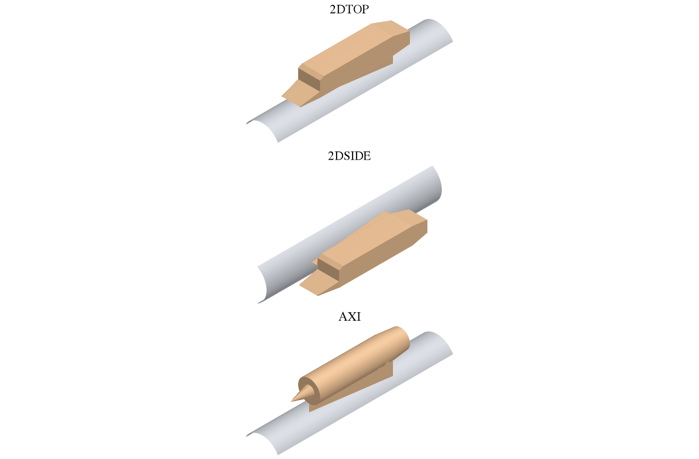
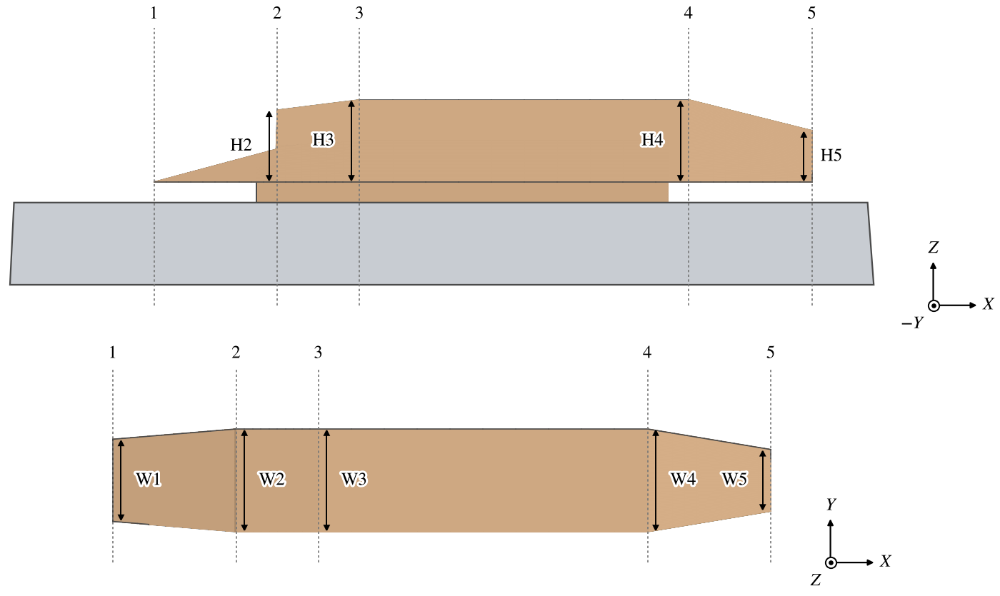
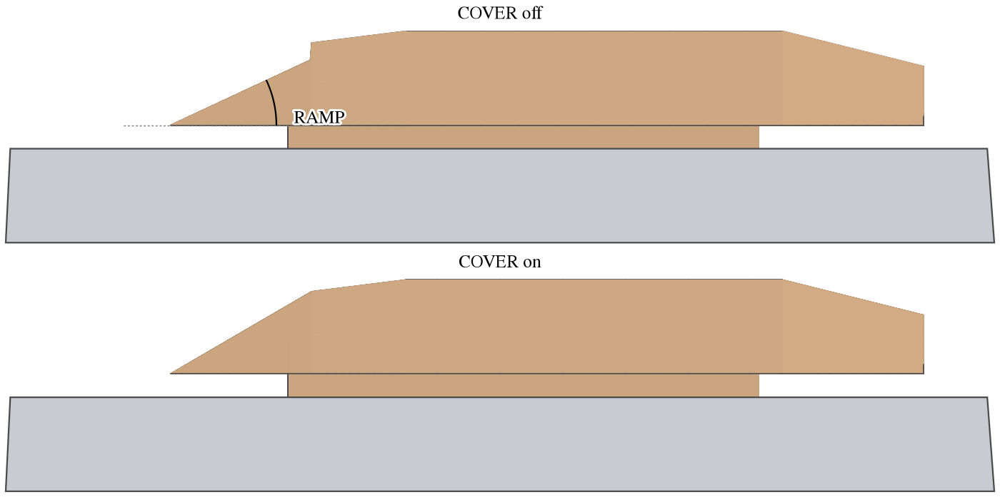
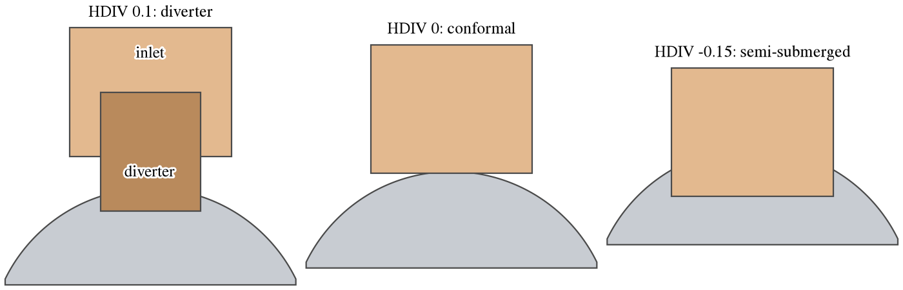
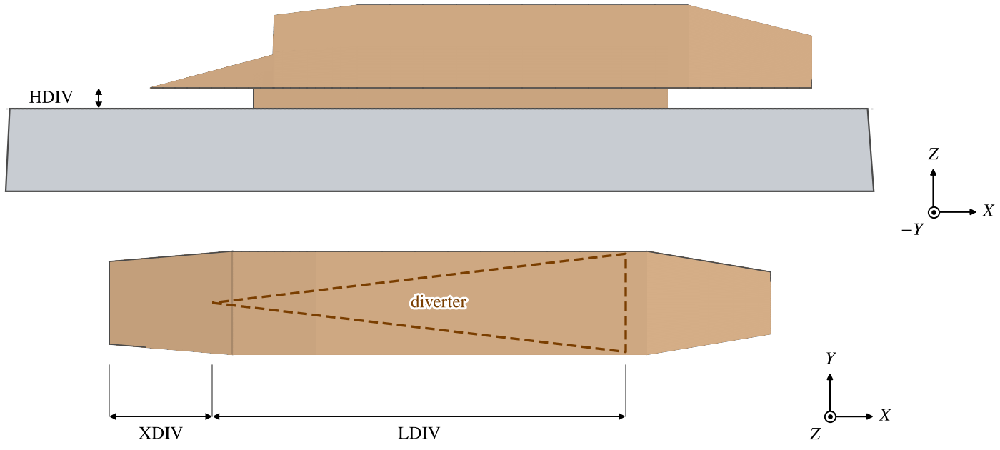
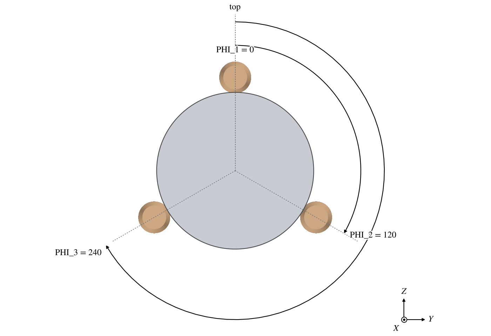

The MDC_INLET is a set of identical inlets on a body, laid out the way DATCOM lays them out with its INLET
namelist: a top-mounted or side-mounted two-dimensional inlet, or an axisymmetric one, with a ramp or a cover, and a
diverter that lifts it off the body.  It models the outside of an inlet: its ramp, its cowl and the way it fairs
into the body behind it.  No duct is modeled.  DATCOM estimates an inlet's normal force, side force, moments and
axial force from these inputs.

The controls carry the names and meanings of the namelist's inputs, so an inlet can be entered as DATCOM has it.  The
inlets stand on a body: an MDC_INLET that is a child of an [MDC_BOD](MdcBod.md) takes the body's radius from it, and
any other is told the radius (see [Placing an Inlet](#placing-an-inlet)).  The `datcom2vsp.py`
script, in the examples, reads a DATCOM input file and builds a model with an MDC_INLET from its INLET namelist.

The MDC_INLET has one tab of its own, Design.  The [Gen](GenTab.md), [XForm](XFormTab.md), [Mass](MassTab.md) and
[Sub](SubTab.md) tabs are described on their own pages.  The Design tab sets

- the [type](#types-of-inlet) and where the inlet [stands](#placing-an-inlet);
- the [stations](#stations) that give its size and shape;
- the [ramp and cover](#ramp-and-cover);
- the [diverter](#diverter), or the lack of one;
- the [number and roll angles](#locations) of the inlets.

## Quick Start

1. Add the body, an [MDC_BOD](MdcBod.md), and an MDC_INLET as its child.  A new MDC_INLET is a top-mounted
   two-dimensional inlet, 3 long, at X = 4, on the default MDC_BOD.
2. Choose *INTYPE*, and set *XINLT* to the inlet's leading edge.  The inlet stands on the body there.
3. Set the five stations' positions *X*, heights *H* and widths *W*.
4. Choose whether the inlet is open or covered with *COVER*, and give an open inlet its *RAMP* angle.
5. Set the diverter's *HDIV*, *XDIV* and *LDIV*, or set *HDIV* to zero for no diverter.
6. Set *NIN*, the number of inlets, and, if they are not evenly spaced, turn on *PHI given* and give each its roll
   angle.

## Types of Inlet

*INTYPE* is one of three types (Figure 1).

- 2DTOP: a top-mounted two-dimensional inlet, a box whose height *H* is out from the body and whose width *W* is
  across it.
- 2DSIDE: a side-mounted two-dimensional inlet, the same box turned so that its height is across the body and its
  width out from it.  The heights of the stations share one side, so the inlet is flush with that side where it is
  shorter than the tallest.
- AXI: an axisymmetric inlet, a body of revolution whose diameters are the widths *W*, with its axis straight, above
  the body.  Its heights are not used.

*Figure 1. The three types, each with the default stations, except that the axisymmetric inlet comes to a point at its
leading edge, W(1) of zero.  The side-mounted inlet is rolled to the side of the body, PHI 270.*

All three are solids: the ramp, the cowl and the body behind it, and a diverter where there is one.

## Placing an Inlet

An inlet stands on the mold line, the surface of the body.  DATCOM takes the body's radius there from the body, and so
does an MDC_INLET that is a child of an MDC_BOD: each inlet stands at the distance from the body's axis to its mold line
under the inlet's leading edge, in the direction of its own roll angle, so a body that is elliptical or cambered is
followed.  The inlet keeps that radius along its length.  *RBODY* then shows the first inlet's radius and is greyed.
Any other MDC_INLET takes the mold line to be a cylinder of radius *RBODY* about the X axis; *RBODY* is not an input of
DATCOM's namelist.

*XINLT* is the station of the inlet's leading edge, along $X$ from the origin, as DATCOM measures it.  It is the X
location of the XForm tab, shown again on the Design tab.

The inner face of the inlet is *HDIV* out from the mold line: the plane of $H = 0$ for a two-dimensional inlet, and the
lowest line of the cowl for an axisymmetric one, whose axis is half of *W(3)* above it.  The heights *H* are measured
from the inner face.

## Stations

The inlet's shape is given at five stations along it (Figure 2), and runs straight between them: the leading edge or
tip, the cowl lip, the start of the midbody, the start of the boattail and the end of the boattail.  The position of
station $i$ along the inlet is *X(i)*, measured from the leading edge, which is at $X = 0$, so *X(1)* is not an input.
The height *H(i)* and the width *W(i)* are the section's size there; the leading edge has no height, so *H(1)* is not
an input either, and an axisymmetric inlet has no *H* at all.  An axisymmetric inlet's *W(i)* is its diameter, and its
*W(1)* is its tip, a point where it is zero.  The Design tab has a block of inputs for each station.

*Figure 2. The five stations of a top-mounted two-dimensional inlet, from the side and from above.*

The inlet is closed at its aft end, after station 5, by a flat face.  DATCOM requires the inlet to be boattailed, its
section at station 5 smaller than at station 4; that is not required here.  A station that is not aft of the one before
it is moved to just aft of it.

## Ramp and Cover

An open inlet has a ramp in front of the cowl lip: a wedge, or for an axisymmetric inlet a cone, from the leading edge
to station 2, at the angle *RAMP* above the inner face (Figure 3).  Across the lip, a flat face runs from the end of
the ramp up to the cowl, where the flow enters.  A covered inlet, with *COVER* on, is plugged flush with the inlet
face: a plane, or for an axisymmetric inlet a cone, from the leading edge to the cowl lip, with no ramp and no
opening.  *RAMP* is then greyed.  A ramp steeper than that plane or cone would reach the cowl before the lip, and is
the plug as well.  An axisymmetric inlet whose tip is wide, as the default is, is this way: its ramp is the plug
unless *W(1)* is small.

*Figure 3. An inlet with a ramp of 25 degrees, and the same inlet covered.*

## Diverter

*HDIV* is the height of the inner face above the mold line, and sets how the inlet meets the body (Figure 4).

- With *HDIV* above zero, the inlet stands off the body, and a diverter fills the gap between them.
- With *HDIV* zero, the inlet is conformal.  It is sunk a hundredth of *RBODY* into the body, so that it crosses the
  body rather than touching it along a line.  There is no diverter.
- With *HDIV* below zero, the inlet is semi-submerged, its inner face that far below the mold line.  There is no
  diverter.

*Figure 4. Sections of an inlet in its midbody, with a diverter, conformal, and semi-submerged.*

A diverter is a plate, standing from just below the mold line up to halfway up the inlet.  It begins *XDIV* behind the
leading edge, as a point, and its width grows linearly to its aft end, *LDIV* further, where it is 95 percent of the
inlet's width across the body.  It is nowhere wider than that, so it is a little narrower than the inlet, and it ends
no further aft than the inlet does (Figure 5).  Its *XDIV* and *LDIV* are greyed where there is no diverter.

*Figure 5. The diverter of the inlet of Figure 2, from the side and from above.*

## Locations

*NIN* is the number of inlets in the set, from 1 to 20, all the same.  They are rolled around the body at the station
*XINLT*, each at its angle *PHI*.  An angle is measured clockwise from the top looking forward, so 90 degrees is to the
right, as the roll angles of the [MDC_PROTUB](MdcProtub.md) and [MDC_FIN](MdcFin.md) components are (Figure 6).  Unless
*PHI given* is on, the inlets are evenly spaced around the body, the first at the top, and the angles are set from
*NIN*; the PHI slider shows them but is greyed.  With *PHI given* on, each angle is set by hand.  The Inlet selector
chooses which one the slider shows.  An angle that has not been set is zero.  *INTYPE* only orients the inlet; the angle
puts it on the body, so a side-mounted inlet is at a *PHI* of 90 or 270 degrees, and a top-mounted one at 0.

*Figure 6. Three axisymmetric inlets of a set evenly spaced, from behind the body.*

## Parameters

The parms are in the *Design* group but for *XINLT*, which is the XForm tab's X location.  Each station has a block of
inputs in the Design tab, the position, height and width of the station.  There is a *PHI* for each of the *NIN*
inlets, made and deleted as *NIN* changes, at the next update.

| Control   | Parm                     | Default                 | Meaning                                                                |
|:----------|:-------------------------|:------------------------|:-----------------------------------------------------------------------|
| INTYPE    | `INTYPE`                 | 2DTOP                   | 2DTOP, 2DSIDE or AXI.                                                  |
| XINLT     | `X_Rel_Location` (XForm) | 4                       | Station of the inlet's leading edge along $X$.                         |
| RBODY     | `RBODY`                  | 0.5                     | The body's radius under the inlet: a parent MDC_BOD's, else an input.  Not an input of DATCOM's namelist. |
| COVER     | `COVER`                  | off                     | Plug the inlet flush with its face.                                    |
| RAMP      | `RAMP`                   | 15                      | Angle of the ramp, degrees, 0.1 to 89.                                 |
| HDIV      | `HDIV`                   | 0.1                     | Height of the inner face above the mold line; zero for conformal, negative for semi-submerged. |
| XDIV      | `XDIV`                   | 0.5                     | Distance from the leading edge to the start of the diverter.           |
| LDIV      | `LDIV`                   | 2                       | Length of the diverter.                                                |
| NIN       | `NIN`                    | 1                       | Number of inlets, 1 to 20.                                             |
| PHI given | `PHIFlag`                | off                     | Give the angles, rather than space them evenly from the top.           |
| Inlet     | `INLET`                  | 1                       | Which inlet the PHI slider shows.                                      |
| PHI       | `PHI_1` to `PHI_n`       | 0                       | Roll angle of an inlet, clockwise from the top looking forward.        |
| X(i)      | `X2` to `X5`             | 0.5, 0.6, 2.5, 3        | Position of station $i$ from the leading edge.                         |
| H(i)      | `H2` to `H5`             | 0.4, 0.45, 0.45, 0.3    | Height of the inlet at station $i$.                                    |
| W(i)      | `W1` to `W5`             | 0.5, 0.6, 0.6, 0.6, 0.5 | Width, or diameter, of the inlet at station $i$.                       |

## References

1. Fay, J. F. and Jarvis, C. H., "Missile DATCOM User's Manual, 2026 Revision," Air Force Research Laboratory,
   Munitions Directorate, Eglin AFB, FL, March 2026.