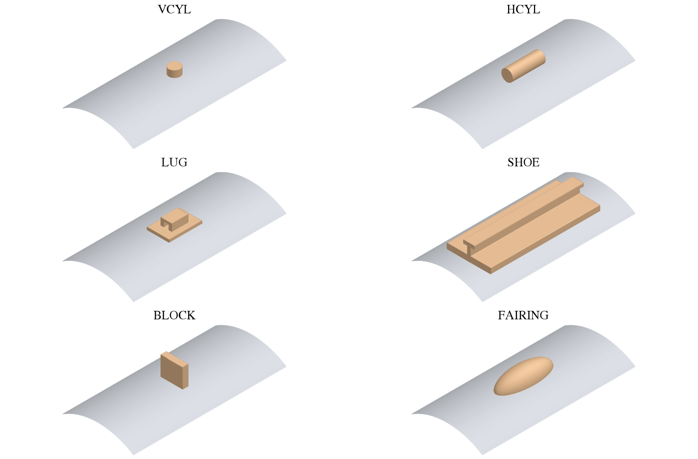
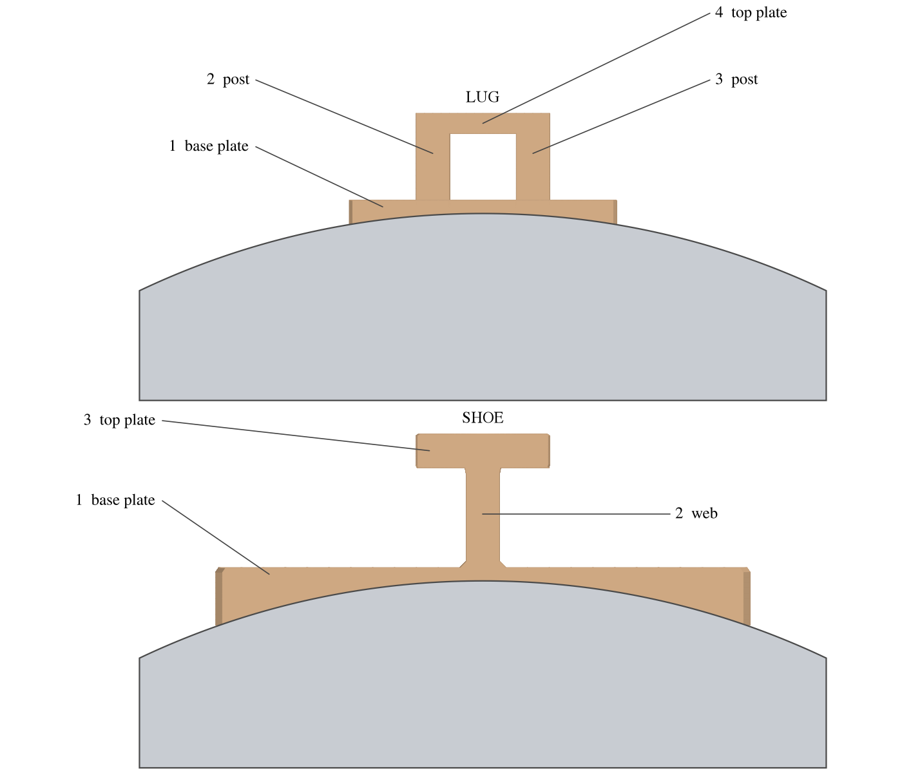
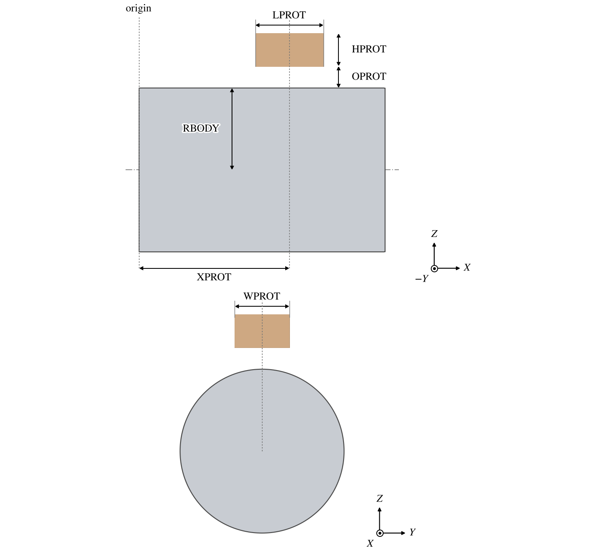
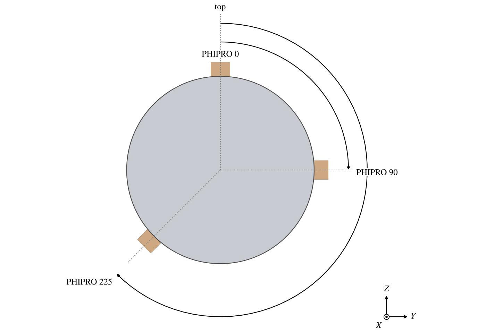

The MDC_PROTUB is a set of identical protuberances on a body, laid out the way DATCOM lays them out with its
PROTUB namelist: bumps, fairings, lugs and shoes of one type, at one station along the body, rolled to angles around
it.  It models things that stand off a body's surface, such as launch lugs and shoes, antennas, sensor blisters and
fairings.  A set is one type of protuberance at one axial station.  A body with several kinds of protuberance, or
protuberances at several stations, has an MDC_PROTUB for each, where DATCOM has one namelist for them all.

The controls carry the names and meanings of the namelist's inputs, so a set of protuberances can be entered as
DATCOM has them.  They stand on a body of circular cross section, which is an [MDC_BOD](MdcBod.md) with *NAMELIST*
AXIBOD, or any body of that shape.  The MDC_PROTUB does not read the body: it is told the body's radius where it stands.
The `datcom2vsp.py` script, in the examples, reads a DATCOM input file and builds a model with an MDC_PROTUB for
each protuberance set.

The MDC_PROTUB has one tab of its own, Design.  The [Gen](GenTab.md), [XForm](XFormTab.md), [Mass](MassTab.md) and
[Sub](SubTab.md) tabs are described on their own pages.  The Design tab sets

- the [type](#types-of-protuberance) and [where it stands](#placing-a-protuberance);
- the [size](#placing-a-protuberance) of each of its members;
- the [number and roll angles](#locations) of the protuberances in the set.

## Quick Start

1. Add the body, an [MDC_BOD](MdcBod.md), and an MDC_PROTUB as its child.  A new MDC_PROTUB is a small cylinder at
   X = 5, on the default MDC_BOD.
2. Set *XPROT* to the station of the protuberance's center.  The protuberance stands on the body there.
3. Choose *PTYPE*, then press Set Default to size it, in proportion to the body, as a protuberance of that type.
4. Change the size of each member as needed: *LPROT*, *WPROT*, *HPROT* and *OPROT*.
5. Set *NLOC*, the number of protuberances, and, if they are not evenly spaced, turn on *PHIPRO given* and give each
   its roll angle.

## Types of Protuberance

*PTYPE* is one of six types (Figure 1).

- VCYL: a vertical cylinder, standing on the body, its axis out from the body.  Its footprint is an ellipse *LPROT*
  along the body and *WPROT* across it.
- HCYL: a horizontal cylinder, lying along the body, flat at its ends.  Its section is an ellipse *WPROT* wide and
  *HPROT* high.
- BLOCK: a box.
- FAIRING: the streamlined half body of DATCOM, the top half of an ellipsoid *LPROT* long and *WPROT* wide at its
  flat base, and *HPROT* high above it, as the DATCOM manual defines it.  DATCOM's own drawing of the geometry makes
  it half as high.
- LUG: a launch lug, of four members: a base plate, two posts under the ends of a top plate, and the top plate.
- SHOE: a launch shoe, of three members: a base plate, a web and a top plate, centered across the body.

*Figure 1. The six types, each as the Set Default button sizes it, on a body of radius 6.*

A LUG or SHOE is built of members, each a box.  Member 1 is the base plate of both.  Member 2 is a SHOE's web or a
LUG's first post, member 3 is a SHOE's top plate or the LUG's second post, and member 4 is a LUG's top plate.  The
posts of a LUG stand at the ends of the top plate, across the body, so the top plate's *WPROT* sets how far apart they
are (Figure 2).  The other types have one member.  The Design tab has a block of sizes for each member, and greys those
the type does not have.

*Figure 2. The members of a LUG and of a SHOE, from behind the body.*

### Set Default

Choosing a *PTYPE* leaves the members' sizes as they are.  The Set Default button sets the sizes of every member the
type has to those of a protuberance of that type, in proportion to the body: the sizes of the protuberances of DATCOM's
sample body, which has a radius of 6, scaled by *RBODY* over 6.  Use it as a starting point after choosing a type,
and change the sizes from there.

The sizes in the table are for a body of radius 6.

| Type    | Member | LPROT | WPROT | HPROT | OPROT |
|:--------|:-------|------:|------:|------:|------:|
| VCYL    | 1      | 1     | 1     | 0.5   | 0     |
| HCYL    | 1      | 3     | 1     | 1     | 0     |
| LUG     | 1      | 3     | 2     | 0.1   | 0     |
| LUG     | 2      | 1.5   | 0.25  | 0.5   | 0.1   |
| LUG     | 3      | 1.5   | 0.25  | 0.5   | 0.1   |
| LUG     | 4      | 1.5   | 1     | 0.15  | 0.6   |
| SHOE    | 1      | 10    | 4     | 0.1   | 0     |
| SHOE    | 2      | 10    | 0.25  | 0.75  | 0.1   |
| SHOE    | 3      | 10    | 1     | 0.25  | 0.85  |
| BLOCK   | 1      | 0.5   | 2     | 1.5   | 0     |
| FAIRING | 1      | 5     | 2     | 1     | 0     |

## Placing a Protuberance

A protuberance stands on the mold line, the surface of the body.  DATCOM takes the body's radius there from the body,
and so does an MDC_PROTUB that is a child of an MDC_BOD: each protuberance stands at the distance from the body's axis
to its mold line under the protuberance's center, in the direction of its own roll angle, so a body that tapers, is
elliptical or is cambered is followed.  *RBODY* then shows the first protuberance's radius and is greyed.  Any other
MDC_PROTUB takes the mold line to be a cylinder of radius *RBODY* about the X axis; *RBODY* is not an input of DATCOM's
namelist.

*XPROT* is the station of the protuberance's center, along $X$ from the origin, as DATCOM measures it.  It is the X
location of the XForm tab, shown again on the Design tab.

Each member is centered along the body at *XPROT*.  It is *LPROT* long, along the body, *WPROT* wide, across it, and
*HPROT* high, out from the body (Figure 3).  *OPROT* is the height of the member's bottom above the mold line, zero by
default, so a member with no offset sits on the body.  A raised member, such as a LUG's top plate, floats above it.
Set Default stacks the members of a LUG or a SHOE: it gives each the height of the members under it as its offset.

*Figure 3. A BLOCK of length LPROT, width WPROT and height HPROT, raised by OPROT, on a body of radius RBODY, at the
station XPROT.*

A member with no offset reaches down into the body, below the mold line, so that it meets the body all around its
footprint rather than touching it along a line.  It goes as far as the mold line passes under its sides, and a tenth of
its height further.  A FAIRING's flat base is on the body's top line, the body's radius above its axis, so on a
round body the edges of its base stand clear of the body at its sides, by more the wider it is.  Its offset is zero,
as DATCOM takes it, and its *OPROT* is greyed.

The members of a LUG or SHOE meet one another the same way.  Members of one length that meet are made one surface.
Where members of different lengths meet exactly, one is buried in the other by half the other's height.  No two
surfaces touch exactly, so the surfaces intersect cleanly where the model is meshed or analyzed.

## Locations

*NLOC* is the number of protuberances in the set, from 1 to 20, all the same.  They are rolled around the body at the
station *XPROT*, each at its angle *PHIPRO*.  An angle is measured clockwise from the top looking forward, so 90
degrees is to the right (Figure 4).  Unless *PHIPRO given* is on, the protuberances are evenly spaced around the body,
the first at the top, and the angles are set from *NLOC*; the PHIPRO slider shows them but is greyed.  With *PHIPRO
given* on, each angle is set by hand.  The Protuberance counter chooses which one the slider shows.  An angle that has
not been set is zero, so that a protuberance added by raising *NLOC* is at the top until it is moved.

*Figure 4. Three protuberances of a set, at PHIPRO 0, 90 and 225, from behind the body.*

The protuberances of a set are all the same, so a change to a member applies to all of them.  The angle rolls the
whole protuberance, so a SHOE's base plate, web and top plate turn together.

## Parameters

The parms are in the *Design* group but for *XPROT*, which is the XForm tab's X location.  There is a *PHIPRO* for
each of the *NLOC* protuberances, `PHIPRO_1` to `PHIPRO_n`, and an *LPROT*, *WPROT*, *HPROT* and *OPROT* for each
member the type has, `LPROT_1` to `LPROT_m`: one member, or four for a LUG and three for a SHOE.  They are made and
deleted as *NLOC* and *PTYPE* change, at the next update.

| Control      | Parm                     | Default | Meaning                                                  |
|:-------------|:-------------------------|:--------|:---------------------------------------------------------|
| PTYPE        | `PTYPE`                  | VCYL    | VCYL, HCYL, LUG, SHOE, BLOCK or FAIRING.                 |
| XPROT        | `X_Rel_Location` (XForm) | 5       | Station of the center of the protuberance along $X$.     |
| RBODY        | `RBODY`                  | 0.5     | The body's radius under the protuberance: a parent MDC_BOD's, else an input.  Not an input of DATCOM's namelist. |
| NLOC         | `NLOC`                   | 1       | Number of protuberances, 1 to 20.                        |
| PHIPRO given | `PHIPROFlag`             | off     | Give the angles, rather than space them evenly from the top. |
| Protuberance | `LocIndex`               | 1       | Which protuberance the PHIPRO slider shows.              |
| PHIPRO       | `PHIPRO_1` to `PHIPRO_n` | 0       | Roll angle of a protuberance, clockwise from the top looking forward. |
| LPROT        | `LPROT_1` to `LPROT_m`   | 0.5     | Length of the member, along the body.                    |
| WPROT        | `WPROT_1` to `WPROT_m`   | 0.25    | Width of the member, across the body.                    |
| HPROT        | `HPROT_1` to `HPROT_m`   | 0.1     | Height of the member, out from the body.                 |
| OPROT        | `OPROT_1` to `OPROT_m`   | 0       | Height of the member's bottom above the mold line.       |

## References

1. Fay, J. F. and Jarvis, C. H., "Missile DATCOM User's Manual, 2026 Revision," Air Force Research Laboratory,
   Munitions Directorate, Eglin AFB, FL, March 2026.