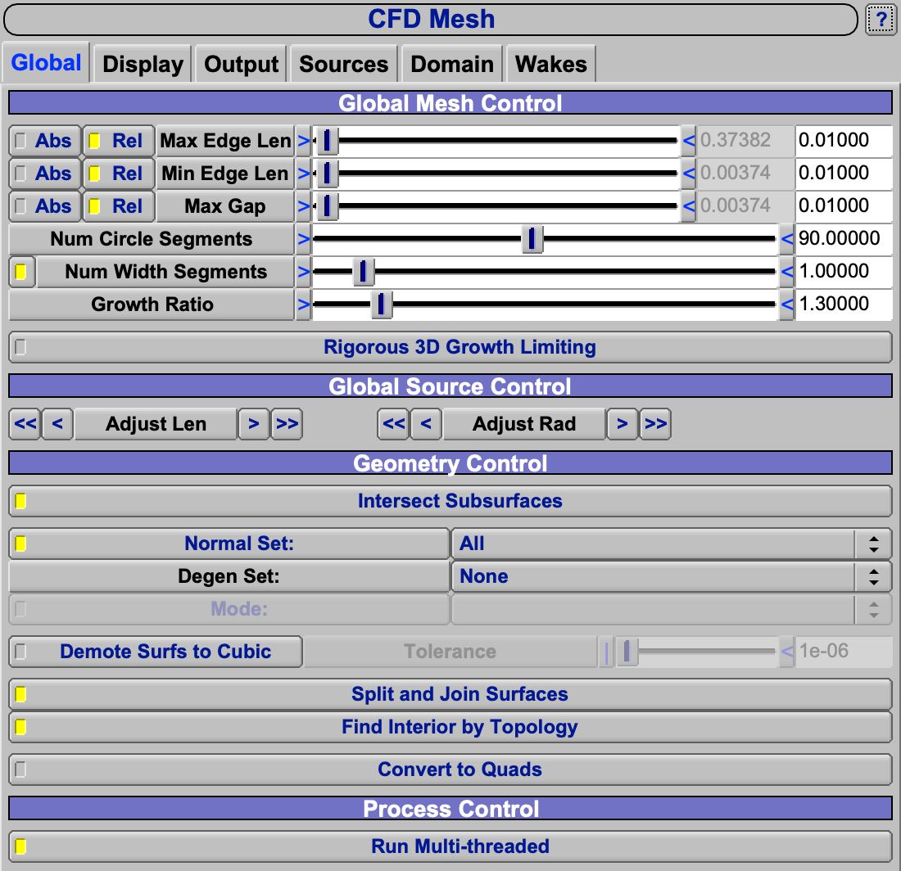
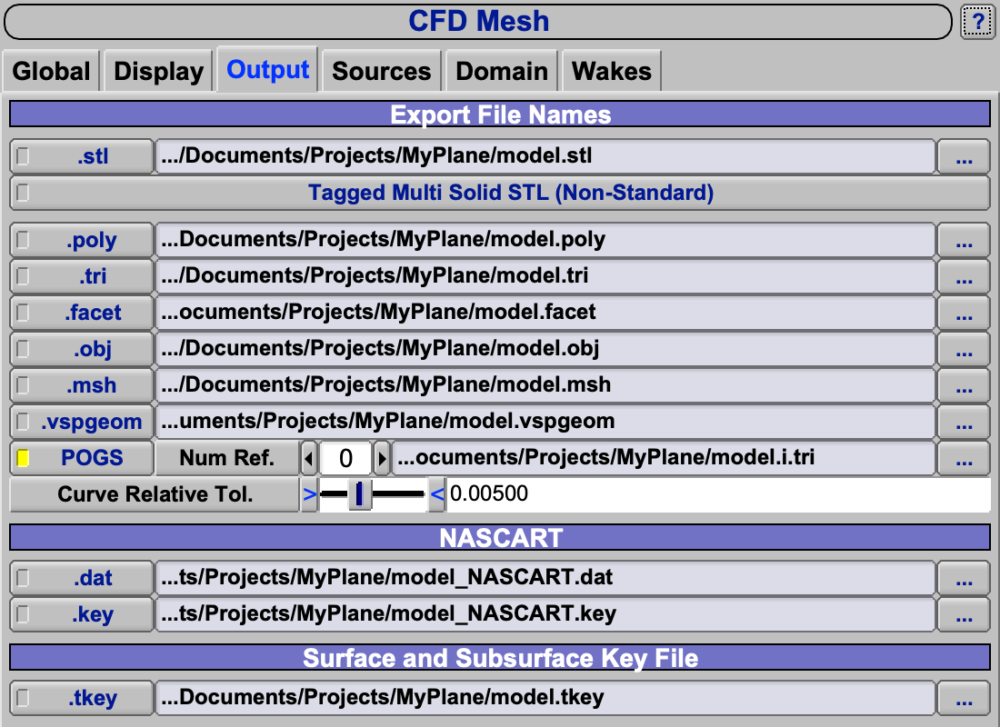
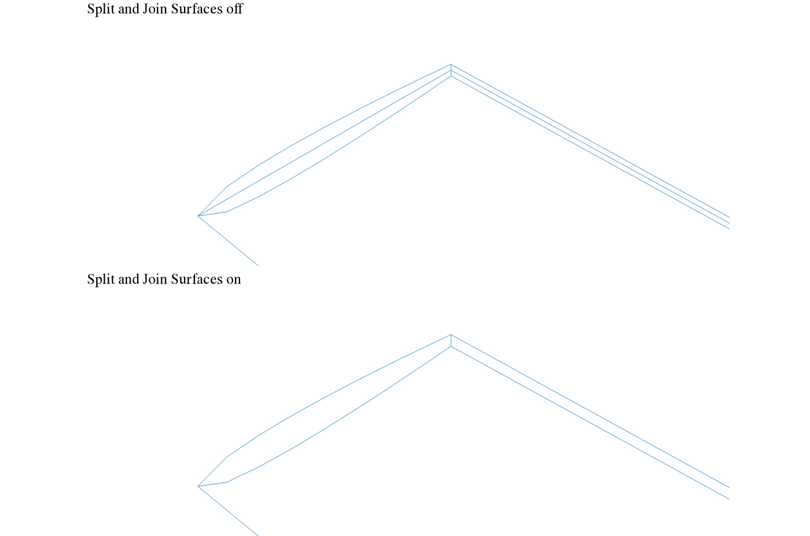
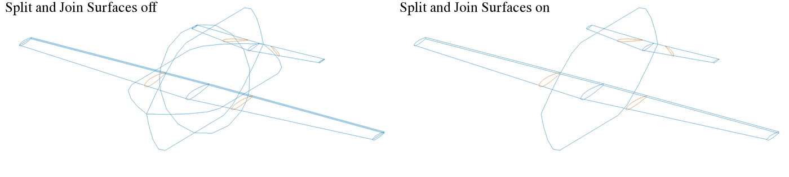
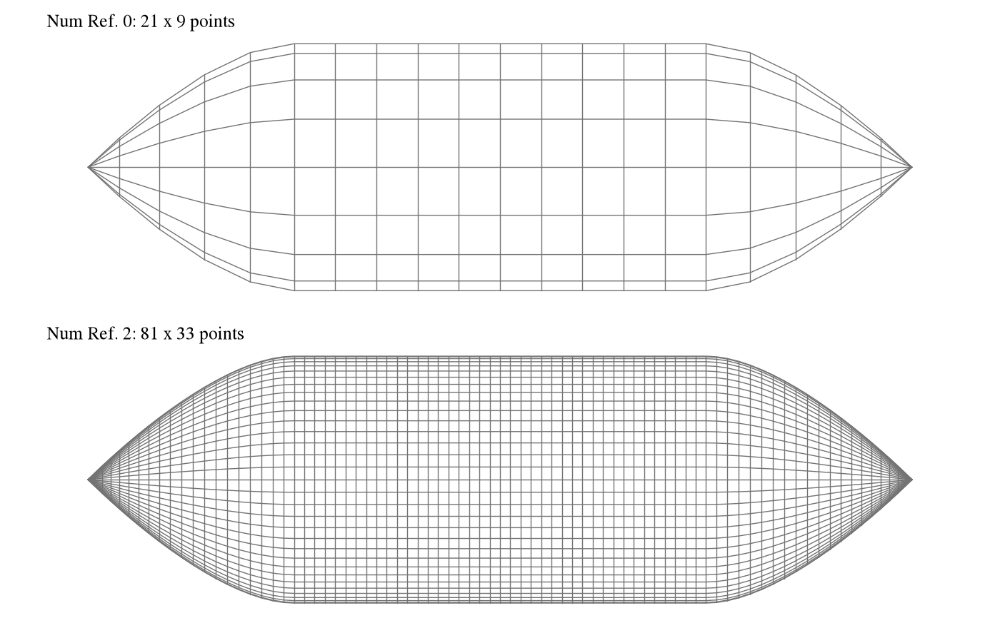
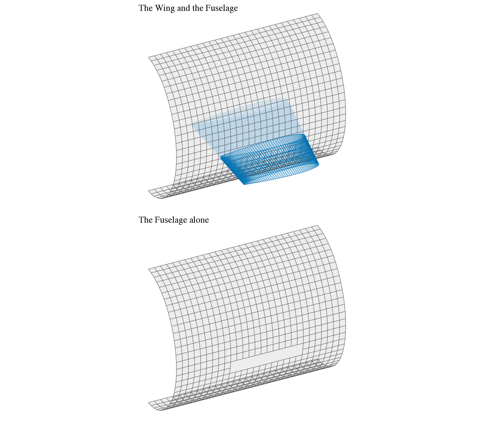

POGS, the Pre-processor for Overset Grid Simulations, is part of the Chimera Grid Tools (CGT) developed by William
Chan and others at NASA Ames Research Center.  Together with its companion EGADS2SRF it builds an overset structured
grid system with little manual work: surface grids over every face, edge and corner of the geometry, near-body and
off-body volume grids, the connectivity between them, and input files for the Overflow and LAVA flow solvers
(Reference 1).  EGADS2SRF usually makes POGS's input from a CAD solid.  OpenVSP's CFD Mesh writes the same set of
files straight from an OpenVSP model, so POGS can start from it, including the file of geometric components that
would otherwise be made by hand.

This page is the short path from an OpenVSP model to the input of POGS.  The [CFD Mesh](CFDMesh.md) page covers each
setting in full.

| Topic                                                   | Tab            |
|:--------------------------------------------------------|:---------------|
| [Getting Started](#getting-started)                     | Global, Output |
| [The Files](#the-files)                                 | Output         |
| [Split and Join Surfaces](#split-and-join-surfaces)     | Global         |
| [Num Ref.](#num-ref)                                    | Output         |
| [Blanking](#blanking)                                   |                |
| [Curve Relative Tol.](#curve-relative-tol)              | Output         |
| [Half Models, Far Fields and Wakes](#half-models-far-fields-and-wakes) | Domain, Wakes |
| [Tips](#tips)                                           |                |
| [Scripting](#scripting)                                 |                |

## Getting Started

1. Open *Analysis > CFD Mesh...*.
2. On the Global tab (Figure 1), set the global mesh controls.  Choose *Rel* for *Max Edge Len*, *Min Edge Len* and
   *Max Gap*, and set each to 0.01 as a starting point: *Max Edge Len* is then 1% of the diagonal of the model's
   bounding box, and *Min Edge Len* and *Max Gap* 1% of *Max Edge Len*.  Set *Num Circle Segments* to 90, for the
   maximum dihedral angle of $4^\circ$ that POGS is usually run with.  These controls size the triangulation and also
   start the POGS parameters (see [The Files](#the-files)); the CFD Mesh page's
   [Choosing Settings](CFDMesh.md#choosing-settings) tells how to adjust them.
3. Choose a Set of the components to mesh as the *Normal Set*, and leave *Degen Set* at *None*.  Make Sets with the
   [Set Editor](SetEdit.md).  Do not use *Shown* with *Rel*: a run leaves the components hidden, so *Shown* is then
   empty, the relative lengths are taken from the bounding box of nothing, whose diagonal is about
   $3.5 \times 10^{12}$, and the next run meshes nothing.
4. Turn on *Split and Join Surfaces*.
5. On the Output tab (Figure 2), turn on *POGS* and turn every other file off.  Choose the name of the *.i.tri* file
   with the *...* button beside it; the other POGS files take the same name.  Raise *Num Ref.* until the surface
   grids of the *.uvin* file are fine enough for POGS (see [Num Ref.](#num-ref)).
6. Press *Mesh and Export*.  The console under the tabs ends with "Is Water Tight" when the surface is closed.
7. Set *DSWALL* and *DOBND* in the *.pogs.i* file for the case (see [The Files](#the-files)), and run POGS on it.



*Figure 1. The Global tab set up for POGS: Max Edge Len, Min Edge Len and Max Gap relative, each at 0.01, Num Circle
Segments 90, the Set All as the Normal Set, and Split and Join Surfaces on.*



*Figure 2. The Output tab with the POGS files the only output.*

## The Files

The POGS output is the set of files POGS reads, the ones EGADS2SRF writes (Reference 1).  Each is named after the
*.i.tri* file chosen on the Output tab:

| File     | Contents                                                                                        |
|:---------|:------------------------------------------------------------------------------------------------|
| .i.tri   | The trimmed surface triangulation, each triangle tagged with its face                           |
| .uvin    | Each face's untrimmed surface on its own U and W lines (Plot3D), iblanks marking trimmed points |
| .cur     | The edges, the curves where faces meet, as Plot3D curve grids                                   |
| .topo    | The topology: the face on each side of each edge, and the sense of each face's normal           |
| .gcomp   | The geometric components: the faces that make up each surface of each component                 |
| .pogs.i  | The POGS input parameters                                                                       |

A face is one patch of the CFD Mesh (see [Split and Join Surfaces](#split-and-join-surfaces)).  The *.gcomp* file
has a component for each surface of each OpenVSP component, a symmetric copy apart from its original, named for the
component's name, the surface's number and the component's ID, such as `WingGeom_1_FTBNWVYMMQ`.  POGS uses the
components to scale its grid spacing to each component's size and to set up the component loads (Reference 1).

The *.pogs.i* file names the case on its first line and holds the grid control parameters on the next three.  Three
come from the Global tab and one from the Domain tab; the rest are starting values to edit for the case:

| Parameter | Meaning                                     | Written as                                    |
|:----------|:--------------------------------------------|:----------------------------------------------|
| DSM       | Maximum grid spacing                        | *Max Edge Len*                                |
| SRMAX     | Maximum stretching ratio                    | *Growth Ratio*                                |
| MAXA      | Maximum dihedral angle, degrees             | $360^\circ$ divided by *Num Circle Segments*  |
| ISYM      | Symmetry of the geometry                    | 0 for a whole model, 2 for a half mesh        |
| DSWALL    | Wall normal grid spacing of the volume grids | $10^{-4}$, to set for the case               |
| DOBND     | Outer boundary marching distance            | $-10$, to set for the case                    |
| NPMIN, NFRINGE, STENQUAL, SHARP, TURNTMAX, TOLSP, TOLONSE | | The defaults of EGADS2SRF                |

POGS is usually run with *MAXA* at $4^\circ$, which 90 *Num Circle Segments* gives.  Set *DSWALL* and *DOBND* for the
case before running POGS.  OpenVSP does not know the flow: the wall spacing depends on its Reynolds number
(Reference 1).

## Split and Join Surfaces

CFD Mesh cuts every surface into patches along all of its feature lines, the black lines OpenVSP draws on a component,
and each patch becomes a face for POGS.  POGS covers every face, edge and corner with a grid of its own, so the number
of grids it makes is about the number of faces, edges and corners together, and it works best with as few faces as
the geometry allows (Reference 1).  *Split and Join Surfaces* joins the patches back together where no feature
needs a split: a body comes out as two halves instead of four quarters, a blunt trailing edge is one face instead of
two, and a wing's end caps have fewer faces where they can.  The mesh lines are kept along the joined boundaries, so
the triangulation is much the same either way (see [Split and Join Surfaces](CFDMesh.md#split-and-join-surfaces) on
the CFD Mesh page).

The small aircraft of the CFD Mesh page has 24 faces and 46 edges with it off, and 14 faces and 32 edges with it on;
its Fuselage goes from 8 faces to 2.

The mesh itself looks the same either way, so Figures 3 and 4 draw only the curves that bound the faces: the
intersection curves (orange) and the border curves (blue), with the mesh, the face colors and *Show Patch Join
Curves* turned off on the Display tab, so that a boundary that was joined is not drawn.  The aircraft has a blunt
trailing edge on its wing here; each wing half goes from 6 faces to 4.



*Figure 3. The outer part of the right wing, seen from behind, outboard and above: the tip cap at the left, with its
leading edge at the lower left, and the blunt trailing edge running inboard to the right.  With Split and Join
Surfaces off, the tip cap is two faces, split along its chord, and the trailing edge is two, split along the middle
of its thickness; with it on, each is one face.*



*Figure 4. The aircraft seen from in front, a little to the left and above.  With Split and Join Surfaces off, the
Fuselage is four quarters, split along its top, bottom and sides, and again at its middle cross section, which shows
as the ring; with it on, it is two halves, left and right, which meet along the top and bottom.*

## Num Ref.

The *.uvin* file holds a structured surface grid of each face, on the face's own U and W lines.  Those lines are the
component's wireframe, as OpenVSP draws it in the main window: around a body, its *Tess W* lines, and along it, the
tessellation of its sections.  That wireframe is usually too coarse for POGS.

*Num Ref.* on the Output tab refines all of the grids at once.  Each step puts a line halfway between every two, so a
grid of $n_i \times n_j$ points becomes $(2 n_i - 1) \times (2 n_j - 1)$.  It goes from 0 to 6.  One half of the
Fuselage in Figure 5 has 21 by 9 points at *Num Ref.* 0, 41 by 17 at 1 and 81 by 33 at 2.  *Num Ref.* leaves the
components' own tessellation and the triangle mesh as they are; to refine one component more than the others, raise
its tessellation instead.



*Figure 5. The right half of the Fuselage of Figures 3 and 4 in its .uvin grid, drawn on the X-Z plane, at Num Ref. 0
(top) and 2 (bottom).*

### Blanking

The *.uvin* grids are not trimmed.  Each point carries an iblank instead: 1 where the point is on the face as trimmed,
and 0 where the trimming removed it, where it lies inside another component.  OpenVSP sets it from each face's
trimming loops, the curves that bound the face in its own U and W; a face whose loops do not close is classified by
casting rays instead, and the console says so.

Figure 6 shows the blanking where the right Wing meets the Fuselage, at *Num Ref.* 2.  Each skin of the Wing has 325
of its 1365 points blanked, the five spanwise stations from the root out to $Y = 1$ that lie inside the Fuselage.
The Fuselage half has 17 of its 2673 points blanked: 11 inside the Wing's root and 6 inside the tail.  The finer the
grid, the closer the blanked points follow the junction; at *Num Ref.* 0 no point of this Fuselage half falls inside
the Wing or the tail, so its grid does not record the trimming there.



*Figure 6. The right half of the Fuselage (grey) and the upper and lower skins of the right Wing (blue) at Num Ref. 2,
seen from outboard, a little behind and above.  Each surface is shaded lightly and seen through, and on it only the
grid edges whose two ends are both kept are drawn; an edge with a blanked end is left out.  Top: the Wing's grid stops
at the Fuselage's side, and its root inside the Fuselage is bare.  Bottom: the same view without the Wing, which lies
over the Fuselage's notch in any view from outside.  The Fuselage's grid stops around the Wing's root in a slot two
cells tall, where one row of its points, from X 3.88 to 5.12, is blanked.*

## Curve Relative Tol.

*Curve Relative Tol.*, on the Output tab under the POGS files, is how closely the edges in the *.cur* file follow the
curves where the surfaces meet, as a fraction of each segment's length.  A smaller value puts more points on each edge.
It is used for the POGS files only.

## Half Models, Far Fields and Wakes

With *Generate Half Mesh* on the Domain tab, the model is cut at $Y = 0$ and the $+Y$ half kept; the *.pogs.i* and
*.topo* files then give *ISYM* 2, a half body on the $+Y$ side, and the symmetry plane is not a face.  POGS takes such
a model as a half body bounded by the $Y = 0$ plane (Reference 1).

POGS builds its own off-body grids out to the far field (Reference 1), so a far field from CFD Mesh is not usually
wanted.  If *Generate Far Field Mesh* is on, the far field box becomes a component of its own, *FarField*, and with a
half mesh the symmetry plane inside it becomes the component *SymmetryPlane*.

Wakes are left out of the POGS files.

The CFD Mesh page's [Half Mesh and Far Field](CFDMesh.md#half-mesh-and-far-field) and [Wakes](CFDMesh.md#wakes)
describe these settings.

## Tips

- The surface must be closed.  The *.topo* file pairs a face with each side of every edge, so a gap or an overlap
  leaves an edge with one face or more than two.  If the console reports "NOT Water Tight", see
  [Running and Checking the Mesh](CFDMesh.md#running-and-checking-the-mesh).
- POGS works best on clean geometry, without tiny edges or sliver faces (Reference 1).  Where two components touch
  without crossing, or cross at a shallow angle, the intersection makes short edges and thin faces; move one so they
  cross cleanly.
- Put in the Normal Set only the components that make up the solid to be gridded.
- Sources refine the triangulation where it is needed (see [Sources](CFDMesh.md#sources)); they do not change the
  faces, the edges or the *.uvin* samples.

## Scripting

A run is made through the Analysis Manager, as the analysis "CfdMeshAnalysis".  This makes the POGS files alone, with
Split and Join Surfaces on, for a fuselage with a wing through it:

```python
import openvsp as vsp

f = vsp.AddGeom( "FUSELAGE" )
vsp.SetParmVal( f, "Length", "Design", 10.0 )
w = vsp.AddGeom( "WING" )
vsp.SetParmVal( w, "X_Rel_Location", "XForm", 3.5 )
vsp.Update()

vsp.SetAnalysisInputDefaults( "CfdMeshAnalysis" )
vsp.SetIntAnalysisInput( "CfdMeshAnalysis", "SplitJoinSurfs", [ 1 ] )

# The POGS files alone: every other file off.
for ff in [ "STL", "POLY", "TRI", "FACET", "OBJ", "GMSH", "VSPGEOM" ]:
    vsp.SetIntAnalysisInput( "CfdMeshAnalysis", ff + "FileFlag", [ 0 ] )
vsp.SetIntAnalysisInput( "CfdMeshAnalysis", "POGSFileFlag", [ 1 ] )
vsp.SetStringAnalysisInput( "CfdMeshAnalysis", "POGSFileName", [ "plane.i.tri" ] )

settings = vsp.FindContainer( "CFDMeshSettings", 0 )
for ff in [ "DAT", "KEY", "TKEY" ]:
    vsp.SetParmVal( vsp.FindParm( settings, ff + "_Export", "ExportCFD" ), 0.0 )

rid = vsp.ExecAnalysis( "CfdMeshAnalysis" )
print( "Water tight:", vsp.GetIntResults( rid, "Water_Tight" )[ 0 ] )

nface = int( open( "plane.topo" ).readline().split()[ 2 ] )
print( "Faces:", nface )
```

The inputs POGSNRef and RelCurveTol are *Num Ref.* and *Curve Relative Tol.*.  Three of the other files have no
inputs of the analysis, so they are turned off through their Parms.  The CFD Mesh page's
[Scripting](CFDMesh.md#scripting) lists every input.

## References

1. Chan, W. M., Chuen, A. M., Jensen, J. C. and Schauerhamer, D. G., "Overset Structured Mesh Generation on Complex
   Configurations Using the EPOGS Toolset," AIAA Paper 2026-4121, AIAA Aviation Forum, 2026.
