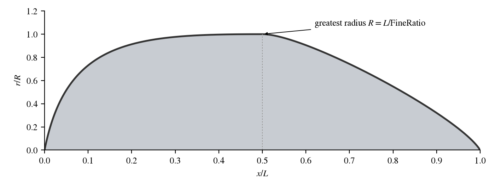

The Pod is the simplest component: a streamlined body of revolution set by two numbers, a length and a fineness
ratio.  Its profile is fixed: a full, rounded nose, its greatest diameter at mid-length, and a tail that tapers to a
point.  It is the quickest way to put a store, a tank, a fairing or a placeholder body into a model.  A body of any
other shape is a [Fuselage or Stack](FuselageStack.md), or a [Body of Revolution](BOR.md).

The Pod has one tab of its own, Design.  The [Gen](GenTab.md), [XForm](XFormTab.md), [Mass](MassTab.md) and
[Sub](SubTab.md) tabs are described on their own pages.

## Quick Start

1. Add a Pod.  A new one is 10 long, with its nose at its origin and its axis along $X$.
2. Place it with the XForm tab.
3. Set *Length*.
4. Set *Fine Ratio* to twice the length-to-diameter ratio wanted (see below).

## Design

| Control    | Parm         | Default | Meaning                                                   |
|:-----------|:-------------|:--------|:----------------------------------------------------------|
| Length     | `Length`     | 10      | Length, $L$, from the nose at $X = 0$ to the tail.        |
| Fine Ratio | `FineRatio`  | 15      | The length divided by the greatest radius, $L / R$.       |

*Fine Ratio* is the length over the greatest radius, not the usual fineness ratio of length over diameter, and it
keeps that definition so that existing models keep their shape.  The length-to-diameter ratio is half of it: the
default Pod, *Fine Ratio* 15, has a diameter of $2L/15$, $L/D = 7.5$.  For a pod of length-to-diameter
ratio $L/D$, set *Fine Ratio* to $2\,L/D$.

The radius is greatest, $R = L / \mathrm{FineRatio}$, at mid-length, and the profile is the same at every size
(Figure 1).  It reaches half of $R$ at $0.05L$ and 90 percent of it at $0.19L$; aft of mid-length it stays above 90
percent to $0.6L$, falls to half at $0.82L$, and closes to a point at the tail.  Changing either value keeps the nose
at the origin; *Rot Origin(X)* on the XForm tab is a fraction of the length.

*Figure 1. The radius of a Pod along its length, as fractions of its greatest radius R and its length L.*
