The Propeller component models propellers and rotors.  It builds one blade from cross sections and a set of
spanwise curves, then places a copy of that blade for each blade of the rotor.  Each copy is placed by a chain of
rigid motions: the blade's spacing, the rotation of the rotor, the precone, and four hinges -- flap, lag, feather and
fold.  The flap, lag and feather can give every blade the same angle, give each blade its own angle, or vary each
blade's angles with its azimuth as a harmonic series, as on a helicopter rotor; the fold takes one angle, or one per
blade.

| Topic                                                             | Tab            |
|:------------------------------------------------------------------|:---------------|
| [Quick Start](#quick-start)                                       |                |
| [Axes and Rotation Direction](#axes-and-rotation-direction)       | Design         |
| [Modeling Mode](#modeling-mode)                                   | Design         |
| [Design Parameters](#design-parameters)                           | Design         |
| [Pitch: Feather and Beta 3/4](#pitch-feather-and-beta-34)         | Design, Motion |
| [Cross Sections](#cross-sections)                                 | XSec, Modify   |
| [Blade Curves](#blade-curves)                                     | Blade          |
| [How a Blade Is Built](#how-a-blade-is-built)                     | Design, Blade  |
| [Rotor Metrics](#rotor-metrics)                                   | Design         |
| [Blade Spacing and Balance](#blade-spacing-and-balance)           | More           |
| [Hinges](#hinges)                                                 | Motion         |
| [Placing the Blades](#placing-the-blades)                         | Design, Motion |
| [Blade Motion Modes](#blade-motion-modes)                         | Motion         |
| [Harmonic Blade Motion](#harmonic-blade-motion)                   | Motion         |
| [Reverse Rotation](#reverse-rotation)                             | Design         |
| [Clones of a Propeller](#clones-of-a-propeller)                   | Clone          |
| [Scripting](#scripting)                                           |                |
| [Older Files](#older-files)                                       |                |
| [BEM Files](#bem-files)                                           |                |

## Quick Start

Both start from a preset at the top of the Design tab: choose it under *Preset* and click *Set*.  A preset replaces
the sections, the blade curves, the pitch, PsiRef and the Y rotation, set in the frame the propeller is placed in.
Everything else keeps its value, so a preset is meant for a new propeller.

### A propeller

1. Choose *Preset* Propeller.  A new propeller already has this blade.  *YRot* is 0: the thrust points along the
   model's $-X$, so a tractor propeller on the nose of an aircraft whose nose points along $-X$ needs no further
   rotation.
2. Place it with the XForm tab.
3. Set *Diameter*, *Num Blades* and the pitch, *Beta 3/4*.  Normal rotation is clockwise seen from behind, looking
   forward; check *Rev* for the opposite direction.
4. Shape the blade with the curves on the Blade tab and the airfoils on the XSec tab.

### A helicopter main rotor

1. Choose *Preset* Helicopter Rotor.  The blade is a NACA 0012 of constant chord $0.06R$, twisted from 0 at the root
   to $-8^\circ$ at the tip; *Feather* drives the pitch, at $8^\circ$.  *YRot* is 90, so the thrust points up,
   along $+Z$, and PsiRef is 270, so $\psi = 0$ lies over the tail ($+X$) and blade 1 advances on the right
   ($\psi = 90^\circ$ at $+Y$); the blades turn counterclockwise seen from above.
2. Place it with the XForm tab.
3. Set *Diameter*, *Num Blades* and the collective pitch, *Feather*.  Feather must drive the pitch for the blades to
   take cyclic or individual pitch (see [Pitch](#pitch-feather-and-beta-34)).
4. Shape the blade as for a propeller.

Coning, flapping and cyclic pitch are set on the Motion tab; see [Harmonic Blade Motion](#harmonic-blade-motion).

## Axes and Rotation Direction

The propeller is built in its own axes, which the XForm tab places in the model (Figure 1).

- $X$ is the shaft, pointing downstream.  The thrust points along $-X$.
- $Y$ is radial.  Blade 1 lies along $+Y$ when Rotate and PsiRef are zero.
- $Z$ completes the right-handed set.  For normal rotation the blades turn from $+Y$ toward $-Z$, so the leading
  edge of blade 1 faces $-Z$ and the rotation vector $\Omega$ points along $-X$, the thrust direction.

The factor $\epsilon$ is $+1$ for normal rotation and $-1$ when *Rev* is checked (see
[Reverse Rotation](#reverse-rotation)).

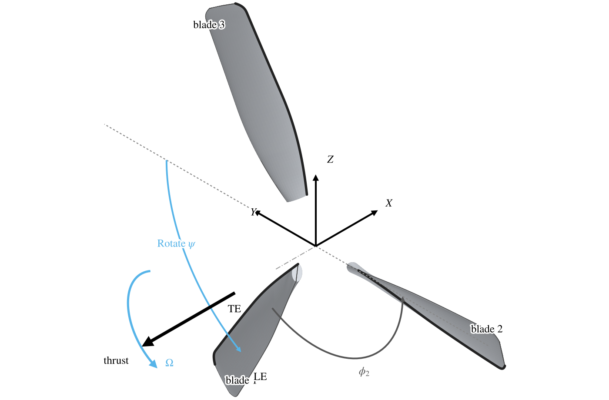

*Figure 1. The propeller axes on the default propeller.  Heavy edges are the trailing edges; Rotate $\psi$ turns blade 1
from $+Y$, and $\phi_2$ places blade 2.*

## Modeling Mode

*Prop Mode* chooses what is built.

| Mode   | Surfaces                                                                           |
|:-------|:-----------------------------------------------------------------------------------|
| Blades | One surface per blade.                                                             |
| Both   | The blades, then one disk surface.                                                 |
| Disk   | Only the disk: a flat circle of the propeller's diameter in the plane of rotation. |

The disk is a transparent surface for analyses that model the rotor as an actuator disk.  DegenGeom gives a disk as
its center, diameter and normal, with no plates or sticks.

*Prop Mode* also decides what analyses receive.  VSPAERO models a disk as an actuator disk, set up on its *Disk*
tab, and blades as lifting surfaces, which its *Propeller* tab turns in an unsteady analysis.  A disk is also much
quicker to update, since no blade is lofted.  Lay out an aircraft with many propellers in Disk mode, and use Blades
where the blades themselves matter.

*Blade Direction Marker* sizes the rotation arrow to *Fraction* of the radius instead of the axis length.

## Design Parameters

| Control           | Parm                      | Default | Meaning                                                                       |
|:------------------|:--------------------------|:--------|:------------------------------------------------------------------------------|
| Diameter          | `Diameter`                | 30      | Tip diameter, $D = 2R$.                                                       |
| Num Blades        | `NumBlade`                | 3       | Number of blades, $N$.                                                        |
| Cylindrical Foils | `CylindricalSectionsFlag` | off     | Wrap each section onto the cylinder of its radius.                            |
| Rev               | `ReverseFlag`             | off     | Reverse the direction of rotation.                                            |
| Rotate            | `Rotate`                  | 0       | Rotation of the rotor $\psi$, degrees, in the direction of rotation.          |
| Beta 3/4          | `Beta34`                  | 20      | Blade pitch at 3/4 radius, degrees.                                           |
| Feather           | `Feather`                 | 0       | Feather (pitch) angle of the blade, degrees.                                  |
| Pre-cone          | `Precone`                 | 0       | Precone angle $\beta_p$, degrees; positive tips the blades toward the thrust. |
| Construct X/C     | `ConstructXoC`            | 0.5     | Chordwise point of every section that lies on the blade's construction line.  |
| Feather Axis      | `FeatherAxisXoC`          | 0.5     | Chordwise point of the root section placed on the feather axis.               |
| Feather Offset    | `FeatherOffsetXoC`        | 0       | Moves the blade and its feather axis off the shaft, in root chords.           |

Construct X/C and Feather Axis X/C do different jobs.

- Construct X/C shapes the blade.  It picks the point of every section that lies on the blade's construction
  line.  Each section is twisted about that point, and Rake, Skew, Sweep, Axial and Tangential move it.  With none
  of those offsets, the construction line is a radial line, and every section's Construct X/C point lies on it.
- Feather Axis X/C places the blade without changing its shape.  The whole blade moves, along the root chord,
  until the root section's Feather Axis X/C point lies on the feather axis.  Feather Offset then moves the blade and
  its feather axis together off the shaft, along $Z$ for normal rotation and $-Z$ for reverse: toward the trailing
  edge of an unpitched root.  The direction does not turn with the root's twist or with Feather.

Both default to 0.5.  With the defaults and no offsets, the construction line is the feather axis, so the sections
twist about it.  With no offsets but different values, the construction line is parallel to the feather axis,
$c_r\,|f_a - f_c|$ from it along the root chord, where $c_r$ is the root chord and $f_a$, $f_c$ are Feather Axis X/C
and Construct X/C.  Both values are usually between 0 (the leading edge) and 1 (the trailing edge).

The figures compare Construct X/C = 0, 0.5 and 1 on the default blade, with Feather Axis X/C at its default 0.5.
Seen from the root toward the tip, the sections stack on their Construct X/C points.  Seen from behind, the planform
changes: at 0 the leading edge is straight, at 1 the trailing edge (Figures 2-3).

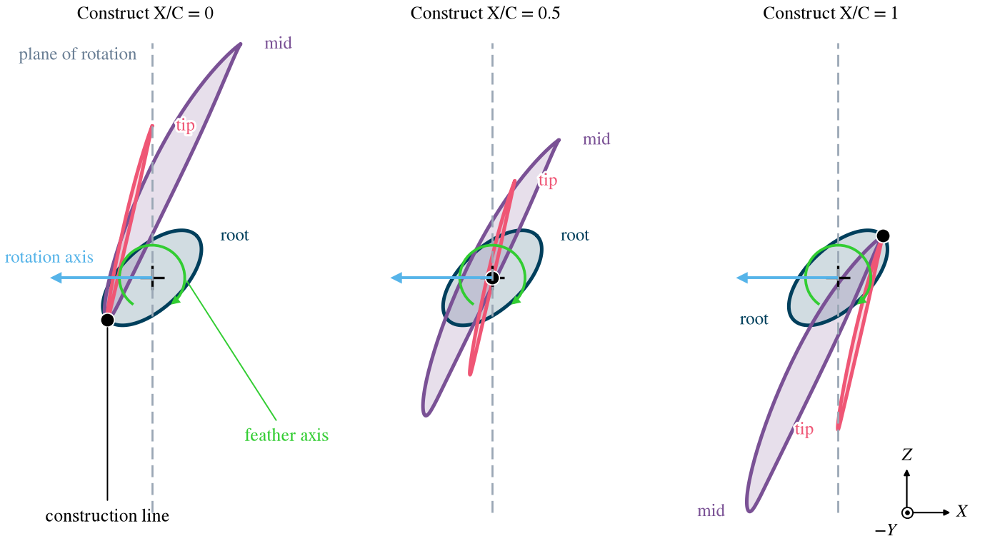

*Figure 2. Root, mid and tip sections, seen from the root toward the tip.  The dot is the construction line, seen end
on.*

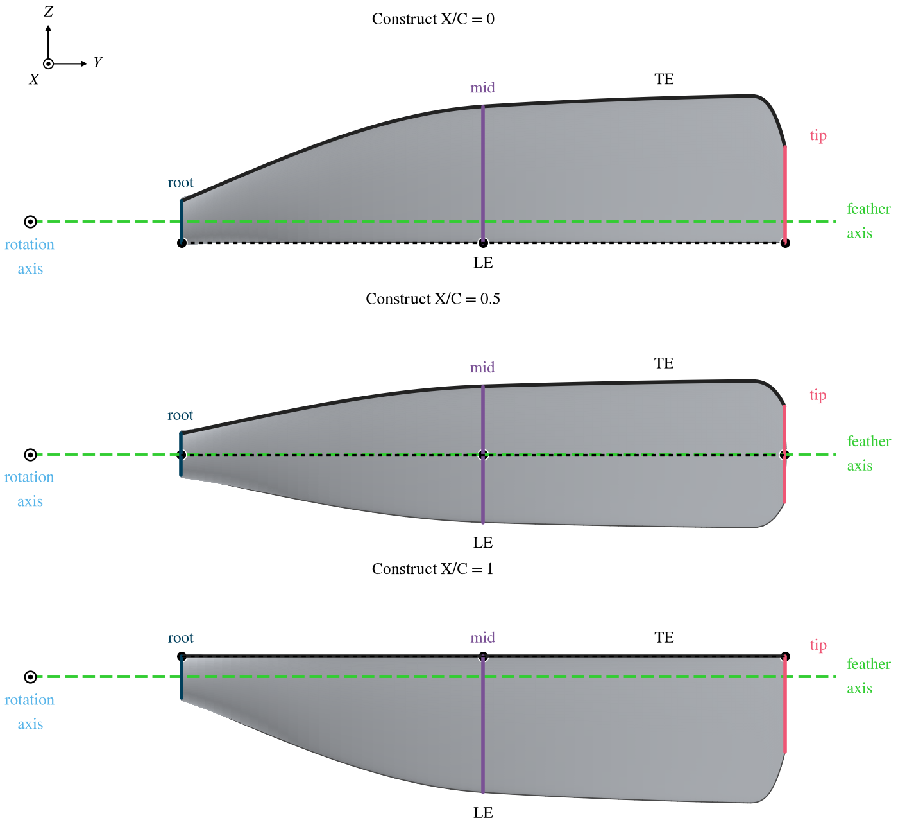

*Figure 3. The same blades seen from behind, with the root, mid and tip chords.  The construction line is dotted.*

## Pitch: Feather and Beta 3/4

The blade's pitch is set either by the Feather angle or by Beta 3/4, the pitch at three quarters of the radius.  The
two are related through the twist at $r/R = 0.75$:

$$
\mathrm{Beta}_{3/4} = \mathrm{Feather} + \mathrm{Twist}(0.75)
$$

where the twist term is zero if the blade starts outboard of $0.75 R$.  The radio buttons (`UseBeta34Flag`) choose
which one is set; the other is shown as an output.  Beta 3/4 drives by default.  While it drives, every blade
takes the same Feather, whatever the blade motion mode; any per-blade and harmonic feathers are kept, greyed, and are
not used.  To give the blades individual or cyclic pitch, select *Feather*: the feather then follows the blade
motion mode like the flap and lag.

## Cross Sections

The XSec tab holds the blade's cross sections.  Each section sits at a *Radius* given as a fraction $r/R$ of the
tip radius; the last section is always at the tip, $r/R = 1$.  The first section's radius is the root of the blade
and sets the hub diameter used by analyses.

A section's type sets its airfoil family, not its proportions.  The Chord, Thick and CLi curves on the Blade tab set
the chord, the thickness and the design lift coefficient at every radius, and the section's own values for these are
greyed.  CLi sets the camber of the families that have one: the NACA 5-digit, 5-digit modified, 16-series and
6-series take it directly, and the NACA 4-digit and 4-digit modified take it as the maximum camber that gives that
design lift coefficient at the section's camber position.  That camber comes from thin airfoil theory, by which the
4-digit mean line's design lift coefficient is proportional to its maximum camber; the relation was derived for
OpenVSP so that a blade could be described by CLi.  Other families, such as the ellipse, biconvex and wedge, take
the thickness but have no camber for CLi to set.

Between two sections, the blade's sections are made in one of two ways.

- When the two sections are of the same family, OpenVSP builds a true airfoil of that family at every radius, from
  its equations, with the thickness and CLi of the curves there.  The family's other parameters, such as the camber
  position, are interpolated between the two sections.
- When the families differ, or the sections are File, CST or Edit Curve sections, OpenVSP can only blend the two shapes.
  The blend is split into a camber line and a thickness distribution, and the thickness is scaled to the Thick curve
  while the camber line is kept, so CLi has no effect there.

So use as few families as you can, and families defined by equations.  A root and a tip section are enough; the
curves on the Blade tab carry the variation of chord, thickness and camber along the span, so more sections are
needed only to change the family.  Two sections suit a blade of one family; three, a blade with a round or
elliptical cuff at the root; four, a blade that changes from one family to another, with a section at each end of
the change.  The default propeller has an ellipse at the root, as many propellers do, and 16-series sections from
$r/R = 0.4$ to the tip.  Between the root and 0.4 its sections are blends; from 0.4 out they
are true 16-series airfoils at each radius's thickness and CLi.  File and CST airfoils can only be scaled and blended,
never regenerated: their thickness follows the Thick curve, but CLi does not change them.

The Modify tab trims, closes, caps and flaps the active section as on a wing; see [The Modify
Tab](Airfoils.md#the-modify-tab).  An *Abs* closure keeps its thickness in model units at every radius as the
chord changes along the blade, while a *Rel* closure stays a fixed fraction of the local chord; a trailing edge of
constant thickness is set as Abs.

## Blade Curves

The Blade tab edits curves of each quantity against $r/R$ (Figure 4).  Each curve can be *Linear*, *Spline (PCHIP)* or
*Cubic Bezier*.  The first and last points are pinned to the root and tip.  *Approximate All* converts every curve to a
cubic Bezier.  *Reset Thick* rebuilds the Thick curve from the thickness of each section.

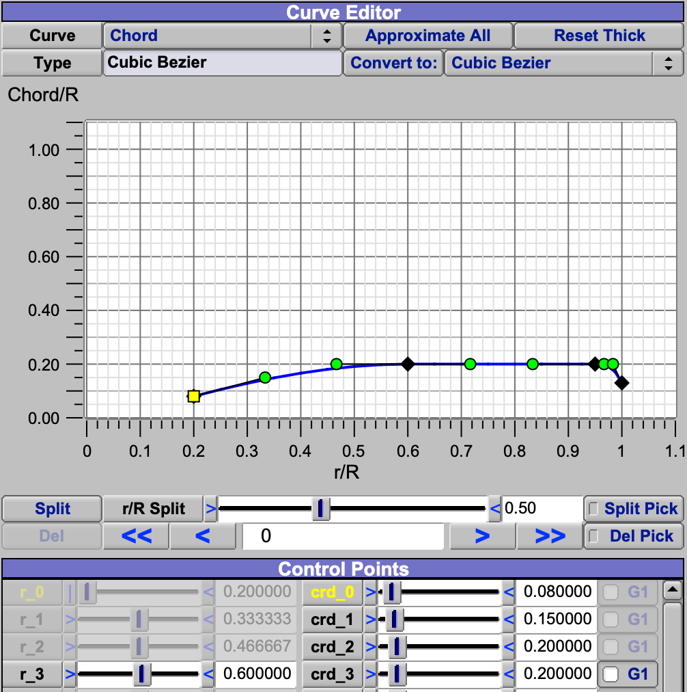

*Figure 4. The Curve Editor of the Blade tab showing the default Chord curve, a Cubic Bezier, with the root point
selected.*

In the plot, the black diamonds are the points the curve passes through, and the green circles are the Bezier handles,
joined to their points by thin lines; a Linear or PCHIP curve has only diamonds.  The selected point is a yellow
square, and its row of the Control Points table is labeled in yellow.  Points can be dragged in the plot.  A handle's
$r/R$ is fixed a third of the way to the neighboring point and is greyed; only its value moves, which sets the slope.
*G1*, on a point between the root and the tip of a Cubic Bezier, keeps the curve smooth there: checking it sets both
handles to the average of their slopes, and afterward moving either handle moves the other to match.  *Split* adds a
point on the curve at *r/R Split*; on a Cubic Bezier the new point comes with two handles and the curve keeps its
shape.  *Del* deletes the selected point, with its handles; the root and tip points cannot be deleted.  *Split Pick*
and *Del Pick* act on the next click in the plot: Split Pick splits the curve at the $r/R$ clicked, and Del Pick
deletes the point clicked.

Linear suits a straight taper or a linear twist.  Cubic Bezier is the easiest type to shape by hand, since its
handles set the slope at each point.  PCHIP passes through every point, but its shape between them is hard to
steer; it is the type a BEM import gives (see [BEM Files](#bem-files)).  *Convert to* Approximate Cubic Bezier refits
a single curve as a cubic Bezier with fewer points.

| Curve      | Units     | Meaning                                                                                     |
|:-----------|:----------|:--------------------------------------------------------------------------------------------|
| Chord      | $c/R$     | Local chord.                                                                                |
| Twist      | degrees   | Twist about the Construct X/C line; positive turns the leading edge toward the thrust.      |
| Rake       | $/R$      | Offset perpendicular to the local chord; positive is downstream.                            |
| Skew       | $/R$      | Offset along the local chord; positive is toward the trailing edge.                         |
| Sweep      | degrees   | Turn of the section about the shaft; positive moves it back, against the rotation.          |
| Axial      | $/R$      | Offset perpendicular to the plane of rotation, along the shaft; positive is downstream.     |
| Tangential | $/R$      | Offset in the plane of rotation, across the radius; positive is against the rotation.       |
| Thick      | $t/c$     | Thickness to chord ratio (see [Cross Sections](#cross-sections)).                           |
| CLi        | $C_{l_i}$ | Design lift coefficient, which sets the camber (see [Cross Sections](#cross-sections)).     |

## How a Blade Is Built

Each section is laid out with its chord in the plane of rotation, scaled to the local chord, with its Construct X/C
point on the radial line at its radius.  It is then twisted, offset, swept and wrapped, as Figures 5-10 show for
normal rotation; in each figure the earlier state is dashed.

Rake and Skew, or Axial and Tangential, can give the same shapes, so use one pair or the other; do not mix them.
Rake and Skew are perpendicular and parallel to the local chord, and so turn with the twist.  Axial and Tangential
are perpendicular and parallel to the plane of rotation.

Skew and Tangential move sections sideways off the radial line, so they change the blade's true diameter: a
tip section whose construction point is offset by $t$ in the plane of rotation lies $\sqrt{R^2 + t^2}$ from the
shaft, beyond the *Diameter*.  Rake and Axial keep each section at its radius, so a blade that leans along a
varying curve grows longer instead.

A blade whose Rake or Axial curve is not constant leans along that curve.  Each section is tilted by an angle
$\kappa$ so that it stays perpendicular to the curve (Figure 7).  $\kappa$ is not a parameter: OpenVSP computes it
from the slope of the Rake and Axial curves.

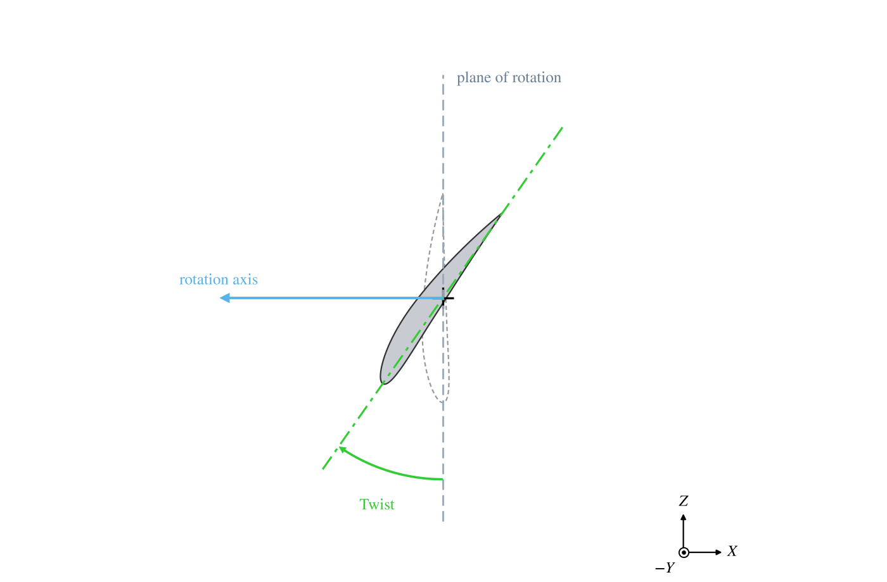

*Figure 5. Twist about the Construct X/C line.*

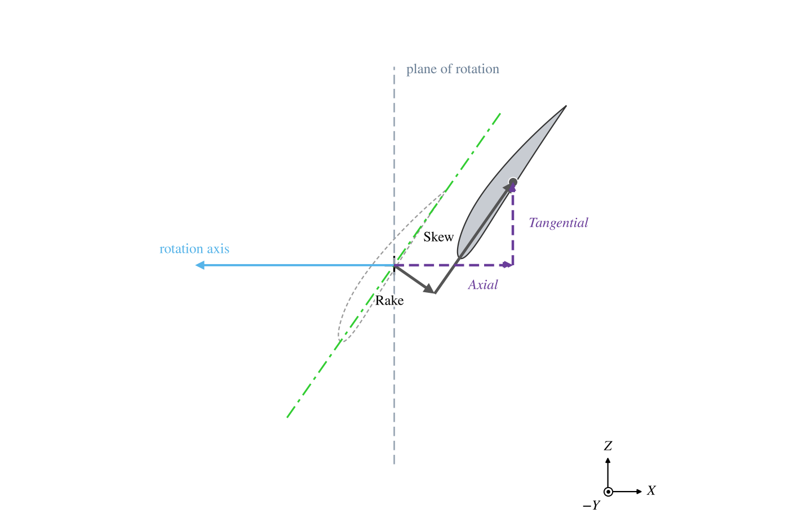

*Figure 6. Rake and Skew move the section perpendicular to and along its chord (dash-dot).  Axial and Tangential, dashed
and in italics, move it perpendicular to and within the plane of rotation; here they reach the same place.  Dashed, the
twisted section with neither.*

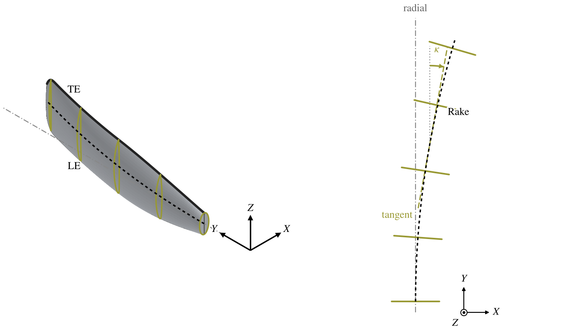

*Figure 7. A blade raked along a curve, in 3D and seen from behind its trailing edge.  $\kappa$, the angle of the
curve's tangent from the radial direction, is computed, not set; it turns each section to lie perpendicular to the
curve.*

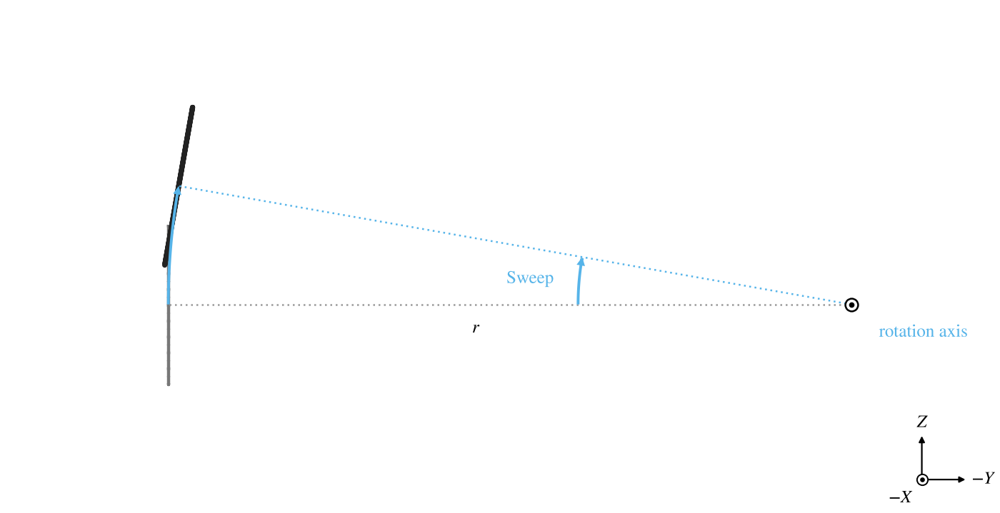

*Figure 8. Seen from upstream: a section (Construct X/C 0.5, no offsets) out at radius $r$, centered on the radial line,
then turned by Sweep about the shaft.  The Sweep angle is marked at the shaft; the arc at the section is the path of its
center.*

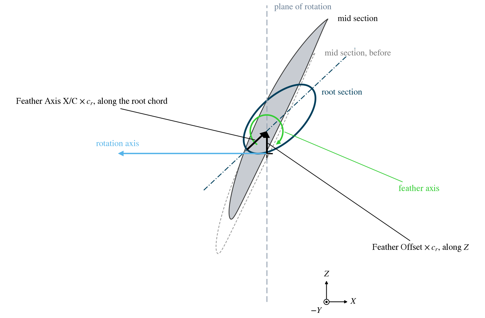

*Figure 9. The default blade from the hub, Feather Axis X/C 0.3 and Feather Offset 0.25.  The root section (outline)
sets the move: Feather Axis X/C along the root chord, Feather Offset along $Z$.  The mid section moves with it from
where it was (dashed).*

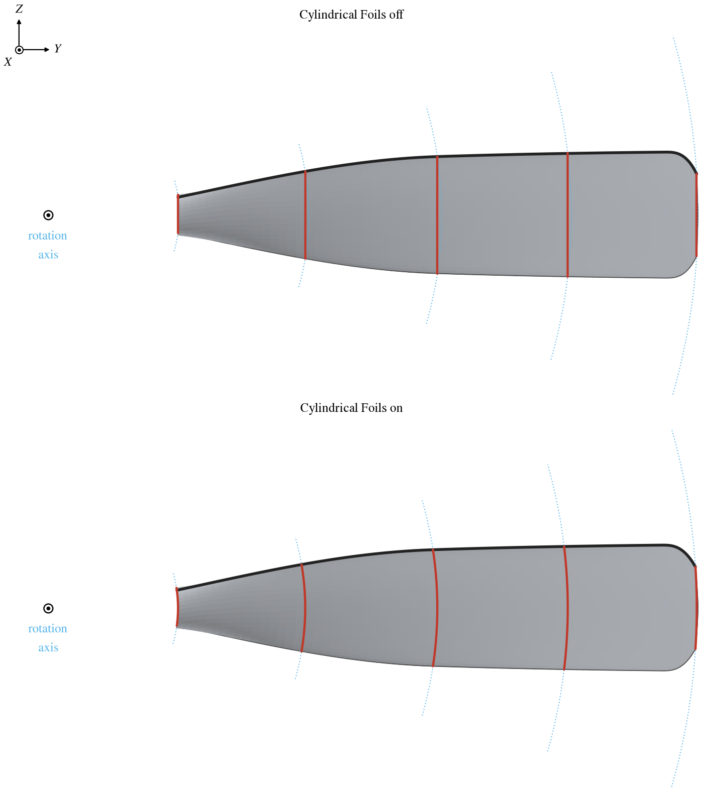

*Figure 10. The default blade from behind, with Cylindrical Foils off and on.  Each red section lies on the circle of
its radius (dotted) when they are on.*

The blade is lofted through the placed sections.  This is the blade "as built", $\mathbf{p}_0$; the motions in
[Placing the Blades](#placing-the-blades) are applied to it afterward (Figure 11).

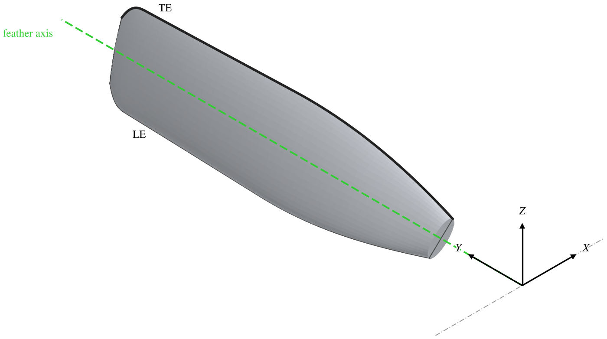

*Figure 11. The blade as built, with its feather axis.*

## Rotor Metrics

The Design tab reports several rotor metrics commonly used to describe propellers and rotors.  The activity factor
and the integrated design lift coefficient are mostly used for propellers; the mean chords and solidities mostly for
rotors.  Each integral is taken over the blade curves themselves, by adaptive quadrature, not over a set of sampled
stations.  Below, $x = r/R$, $c(x)$ is the Chord curve as $c/R$, $x_r$ the root, and $x_0$ the activity factor's
lower limit *r_0* (0.2 by default, and never inboard of the root).

The *Activity Factor* and the integrated design lift coefficient *CLi* are

$$
\mathrm{AF} = \frac{100000}{16}\int_{x_0}^{1}\frac{c}{2}\,x^3\,dx, \qquad C_{L_i} = 4\int_{x_0}^{1} C_{l_i}(x)\,x^3\,dx
$$

The mean chord *C/R*, the thrust-weighted mean chord *C_T/R* and the power-weighted mean chord *C_P/R* are

$$
\frac{C}{R} = \frac{1}{1 - x_r}\int_{x_r}^{1} c\,dx, \qquad \frac{C_T}{R} = \frac{3}{1 - x_r^3}\int_{x_r}^{1} c\,x^2\,dx, \qquad
\frac{C_P}{R} = \frac{4}{1 - x_r^4}\int_{x_r}^{1} c\,x^3\,dx
$$

and the solidities $\sigma$, $\sigma_T$ and $\sigma_P$, blade area over disk area, follow from them:

$$
\sigma = \frac{N}{\pi}\,\frac{C}{R}, \qquad \sigma_T = \frac{N}{\pi}\,\frac{C_T}{R}, \qquad \sigma_P = \frac{N}{\pi}\,\frac{C_P}{R}
$$

## Blade Spacing and Balance

Blade 1 is the reference blade.  Each other blade $i$ sits at a fixed angle $\phi_i$ ahead of blade 1, the Parm
`BladeAz_i`, measured in the direction of rotation ($\phi_1 = 0$).  These are numbered by blade, while the per-blade
angles below are numbered from blade 2 as 1: `BladeAz_2` and `FlapAngle_1` both belong to blade 2.  The More tab sets
the spacing.

| Mode     | Spacing $\phi_i$                                                                                 |
|:---------|:-------------------------------------------------------------------------------------------------|
| Uniform  | $\phi_i = 360^\circ (i-1)/N$.                                                                    |
| Free     | Set each $\phi_i$, or with *Delta* checked, each one's difference `DeltaAz_i` from uniform.      |
| Balanced | As Free, but the last two blades are placed so that the blades balance; with $N \le 3$, uniform. |

*X1 Balance* and *X2 Balance* report the centroid of the blades' unit vectors as a fraction of the radius, along
blade 1 and across it:

$$
X_1 = \frac{1}{N}\sum_{i=1}^{N}\cos\phi_i, \qquad X_2 = -\frac{\epsilon}{N}\sum_{i=1}^{N}\sin\phi_i
$$

Both are zero for a balanced rotor.  $X_2$ is positive toward blade 1's trailing edge ($+Z$ for normal rotation).
They treat the blades as identical, so they depend only on the spacing, not on any blade's chord or mass; the hinge
angles are not considered.

## Hinges

OpenVSP can model a fully articulated rotor, with a flap hinge, a lag hinge and a feather bearing on each blade, and
blades that fold.  Each of these motions is a turn about a hinge.  A hinge at zero angle does nothing, so a rotor
without, say, lag hinges simply leaves the lag angle at zero; OpenVSP does not solve for the blades' motion, so it does
not need to know which hinges a rotor really has.  A hinge may sit at the hub, $r/R = 0$.  A flap hinge there with
first-harmonic flapping (see [Harmonic Blade Motion](#harmonic-blade-motion)) makes a two-bladed rotor teeter as one
rigid body.  With more blades and first-harmonic feathering as well, $\theta_{1c} = \beta_{1s}$ and
$\theta_{1s} = -\beta_{1c}$, it stands in for a gimballed hub to second order in the tilt.

Each hinge $h$ turns the blade, and everything outboard of the hinge, by its angle $\gamma_h$, right-handed about the
line through its point $\mathbf{o}_h$ along its axis $\hat{\mathbf{a}}_h$:

$$
J_h = T(\mathbf{o}_h)\; R(\hat{\mathbf{a}}_h, \gamma_h)\; T(-\mathbf{o}_h)
$$

The hinges are applied hub to tip in order of their radial position, so each hinge carries every hinge outboard of
it.  Hinges at the same radius go flap, lag, fold, feather.  With the default positions (flap 0.05, lag 0.10, feather
0.15, fold 0.20) the order is flap, lag, feather, fold.

Hinges are given in the *blade axes* $B$, whose origin is the rotor center: $x_B$ along the chord from the leading
edge to the trailing edge, $y_B$ radially out along the blade, and $z_B$ toward the thrust (Figure 12).  The blade axes
follow the direction of rotation, so a hinge means the same on a reversed rotor, and they turn with the blade's
precone, spacing and rotation.

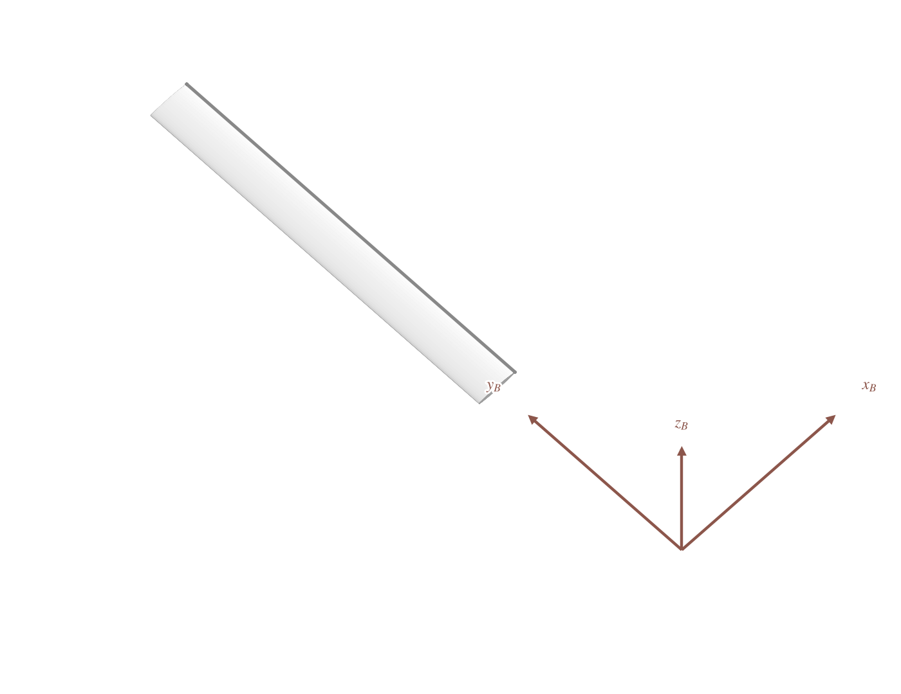

*Figure 12. The blade axes $B$ on blade 1.*

| Hinge   | Parms                                                                                           | Positive angle                 |
|:--------|:------------------------------------------------------------------------------------------------|:-------------------------------|
| Flap    | `RFlapAx`, `OffFlapAx`, `AxFlapAx`, `AzFlapDir` $\theta_F$, `ElFlapDir` $\delta_3$, `FlapAngle` | tip toward the thrust          |
| Lag     | `RLagAx`, `OffLagAx`, `AxLagAx`, `AzLagDir` $\theta_L$, `CantLagDir` $\alpha_1$, `LagAngle`     | tip back, against the rotation |
| Feather | `RFeatherAx`, `Feather`                                                                         | leading edge toward the thrust |
| Fold    | `RFoldAx`, `OffFoldAx`, `AxFoldAx`, `AzFoldDir`, `ElFoldDir`, `FoldAngle`                       | tip downstream                 |

The flap, lag and fold hinges each have a point set by *Radial/R*, *Offset/R* and *Axial/R*: out along the blade,
along the chord toward the trailing edge, and downstream along the shaft, each as a fraction of the radius $R$
(Figure 13):

$$
\mathbf{o}_h = R\,\left(\mathrm{Off},\ \mathrm{Rad},\ -\mathrm{Ax}\right)
$$

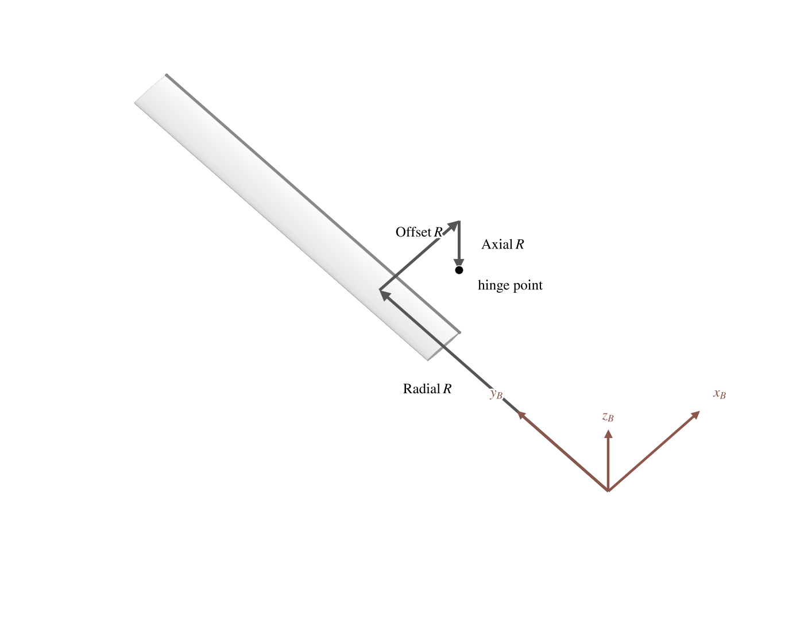

*Figure 13. A hinge's point from the rotor center: Radial along $y_B$, Offset along $x_B$, Axial along $-z_B$, each
times $R$.*

Their axes are turned from a starting direction in two steps:

$$
\hat{\mathbf{a}}_\mathrm{flap} = R_y(\theta_F)\,R_z(-\delta_3)\,\hat{x}_B, \qquad
\hat{\mathbf{a}}_\mathrm{lag} = R_y(\theta_L)\,R_x(-\alpha_1)\,(-\hat{z}_B), \qquad
\hat{\mathbf{a}}_\mathrm{fold} = R_y(\mathrm{Az})\,R_z(-\mathrm{El})\,(-\hat{x}_B)
$$

The feather bearing turns the blade about the radial line through the root's feather axis:

$$
\mathbf{o}_\mathrm{feather} = \left(c_r\,\mathrm{FeatherOffsetXoC},\ R\,\mathrm{RFeatherAx},\ 0\right), \qquad
\hat{\mathbf{a}}_\mathrm{feather} = \hat{y}_B
$$

- The hinge's *Azimuth* ($\theta_F$, $\theta_L$, Az) turns its axis about the radial direction; it is not a pitch
  angle.  *Elevation* ($\delta_3$ for the flap, El for the fold) turns the axis in the plane of rotation; *Cant*
  ($\alpha_1$) turns the lag axis about the chord.
- A skewed flap hinge couples pitch to flap: a turn $\gamma$ about a flap hinge at $\delta_3$ flaps the blade by
  about $\gamma\cos\delta_3$ and changes its pitch by about $-\gamma\sin\delta_3$, so
  $\Delta\theta = -\tan\delta_3\,\Delta\beta$.  A canted lag hinge couples pitch to lag in the same way through
  $\alpha_1$.  The fold axis starts on $-\hat{x}_B$, so a positive fold with a positive El pitches the blade up.
- The feather axis is offset by $c_r\,$FeatherOffsetXoC along $x_B$, where $c_r$ is the root chord.  It passes
  through the root section's Feather Axis X/C point when the root has no Rake, Skew, Sweep, Axial or Tangential
  offset (Figure 9).  Its *Radial/R* only places the feather bearing among the other hinges; sliding a bearing along
  its own axis does not move the blade.

The 3D view draws the active blade's hinges in the colors of their Motion tab groups: flap blue, lag orange red,
feather lime green, fold orchid.

Figures 14-15 show the flap hinge, Figures 16-17 the lag hinge, Figure 18 the feather and Figures 19-20 the fold
hinge.  The first of each pair builds the axis at its hinge point in two turns: from the dashed line, about the first
axis to the dotted line, then about $y_B$ to the final axis in the hinge's color.  The arcs are the path of the
axis's tip for positive angles, and each axis turned about carries a curl for its positive sense.  The blade axes are
drawn at their origin, the rotor center; at the hinge point only their directions are shown.  The second turns the
blade about that hinge alone, with the blade before it dashed.

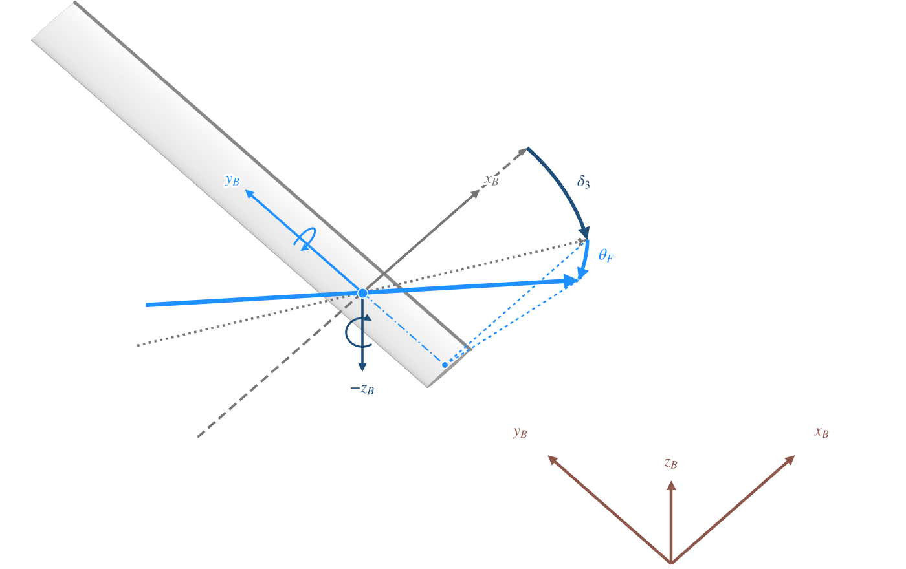

*Figure 14. The flap axis at its hinge point: from $+\hat{x}_B$, turned by $-\delta_3$ about $z_B$, then by $\theta_F$
about $y_B$.*

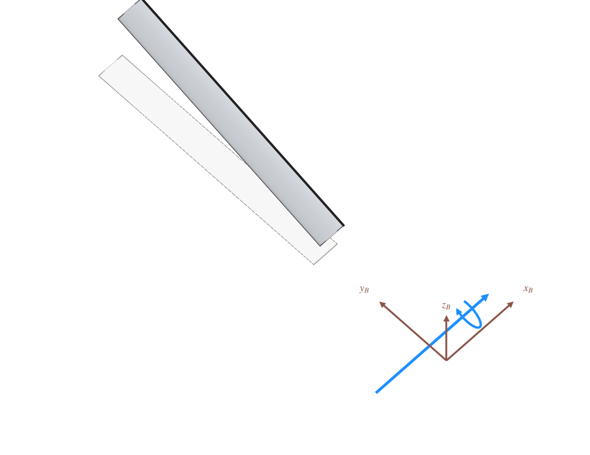

*Figure 15. A positive FlapAngle about an unskewed flap hinge at Radial/R 0.05: the tip toward the thrust.*

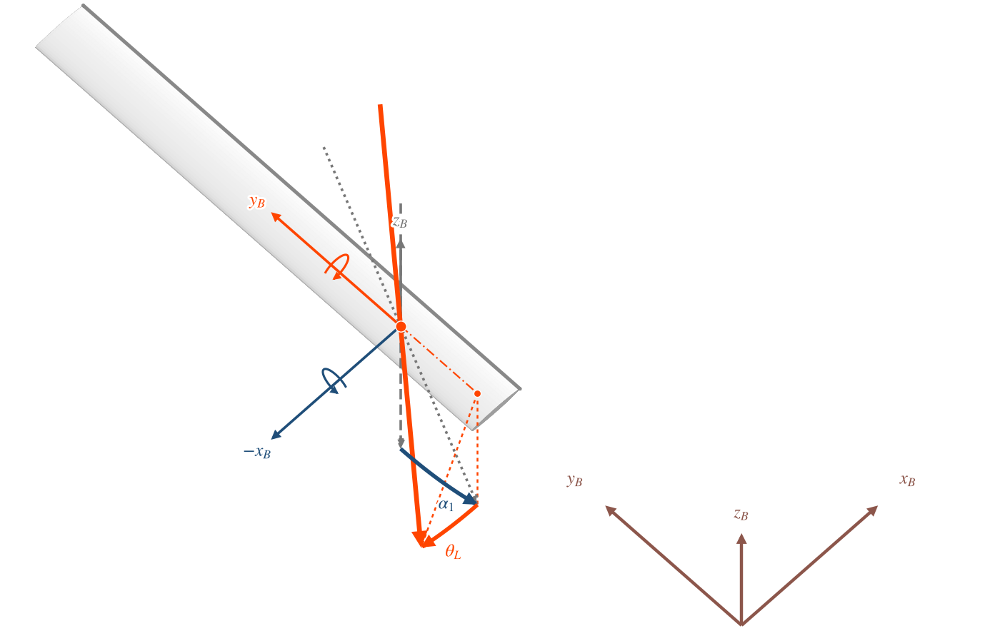

*Figure 16. The lag axis: from $-\hat{z}_B$, turned by $-\alpha_1$ about $x_B$, then by $\theta_L$ about $y_B$.*

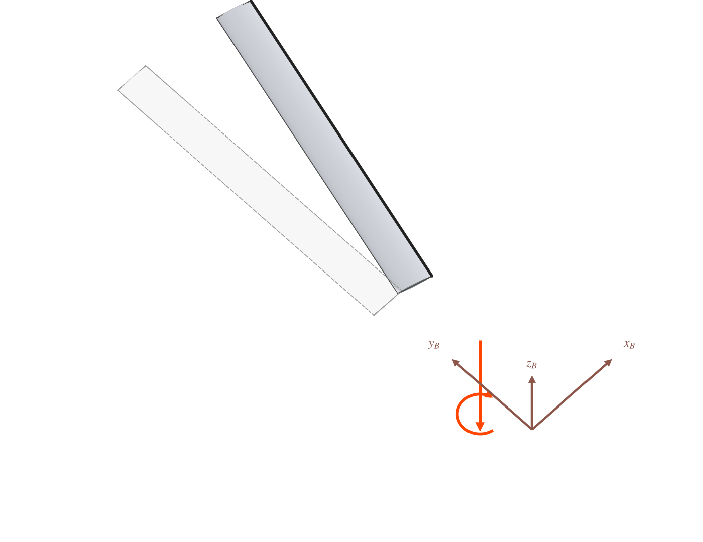

*Figure 17. A positive LagAngle about an uncanted lag hinge at Radial/R 0.13: the tip back, against the rotation.*

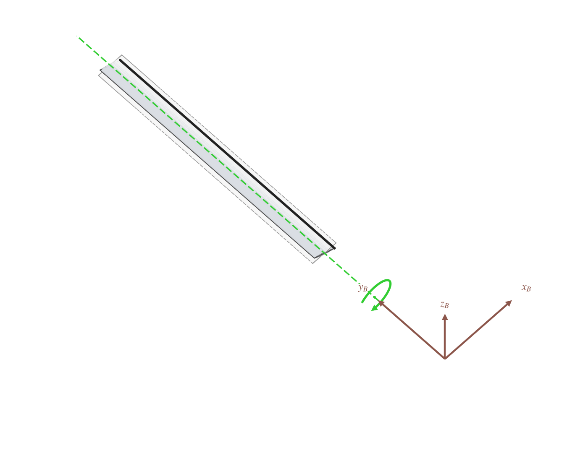

*Figure 18. A positive Feather: the leading edge toward the thrust.*

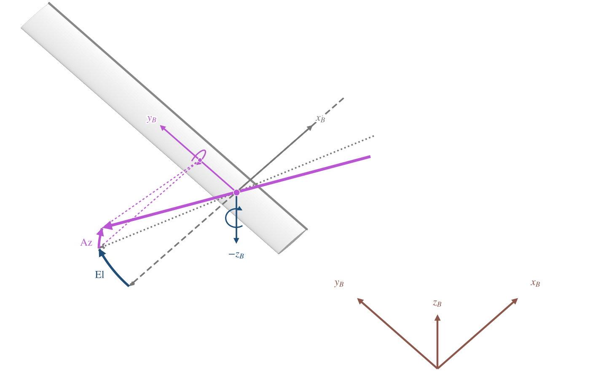

*Figure 19. The fold axis: from $-\hat{x}_B$, turned by $-$El about $z_B$, then by Az about $y_B$.*

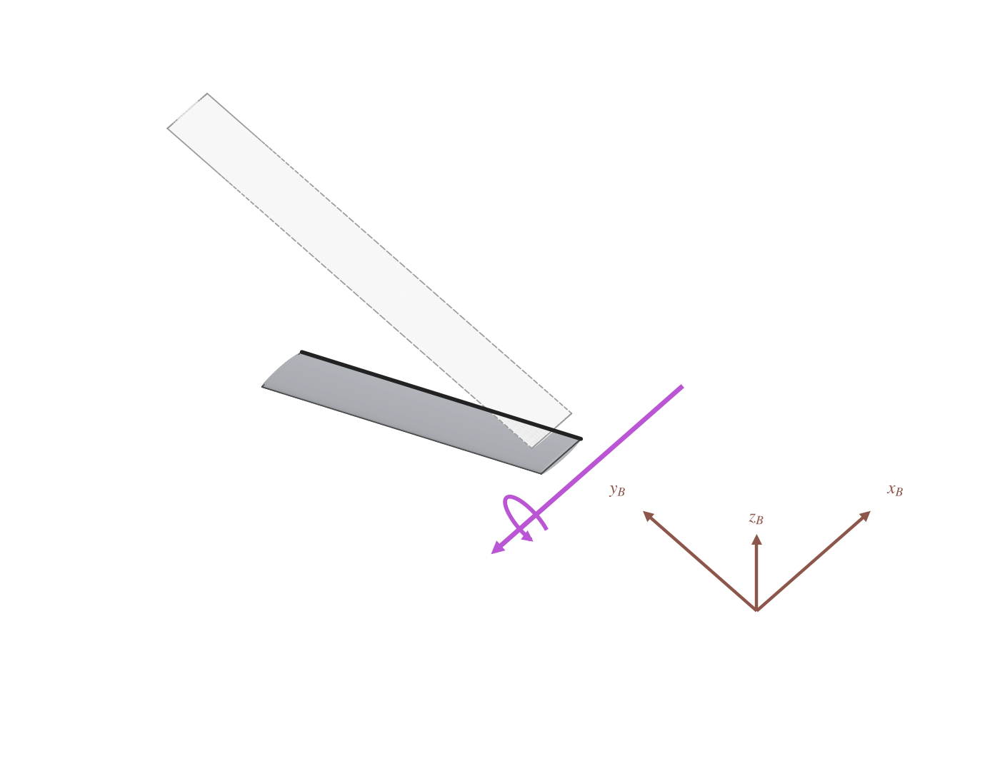

*Figure 20. A positive FoldAngle about an unskewed fold hinge at Radial/R 0.29: the tip downstream.*

## Placing the Blades

Each blade $i$ is the blade as built, $\mathbf{p}_0$, moved by

$$
\mathbf{p} = R_X(-\epsilon\,\phi_i)\; R_X(-\epsilon\,\psi_\mathrm{ref})\; R_X(-\epsilon\,\psi)\; R_Z(\beta_p)\;
J_1\, J_2\, J_3\, J_4\; \mathbf{p}_0
$$

where $R_A(\theta)$ is a right-handed turn by $\theta$ about axis $A$, and

- $J_1 \ldots J_4$ are the four hinges, sorted hub to tip by radial position (see [Hinges](#hinges));
- $\beta_p$ is the Precone, a turn about $Z$ through the hub;
- $\psi$ is Rotate;
- $\psi_\mathrm{ref}$ is PsiRef ($\psi$ *Ref* on the Motion tab);
- $\phi_i$ is the blade's spacing (zero for blade 1).

The turns about $X$ are by minus $\epsilon$ times the angle, so each is a turn in the direction of rotation.  The
product reads two equivalent ways.  Right to left, each factor turns the blade about an axis fixed where it lies
with everything at zero: the tip-most hinge first, the blade's spacing last.  Left to right, each factor carries
every factor to its right with it, so the precone tips the hinges and each hinge carries every hinge outboard of it.
The Geom's placement and any symmetry act after this; see [Scripting](#scripting).  Figures 21-23 show the steps.

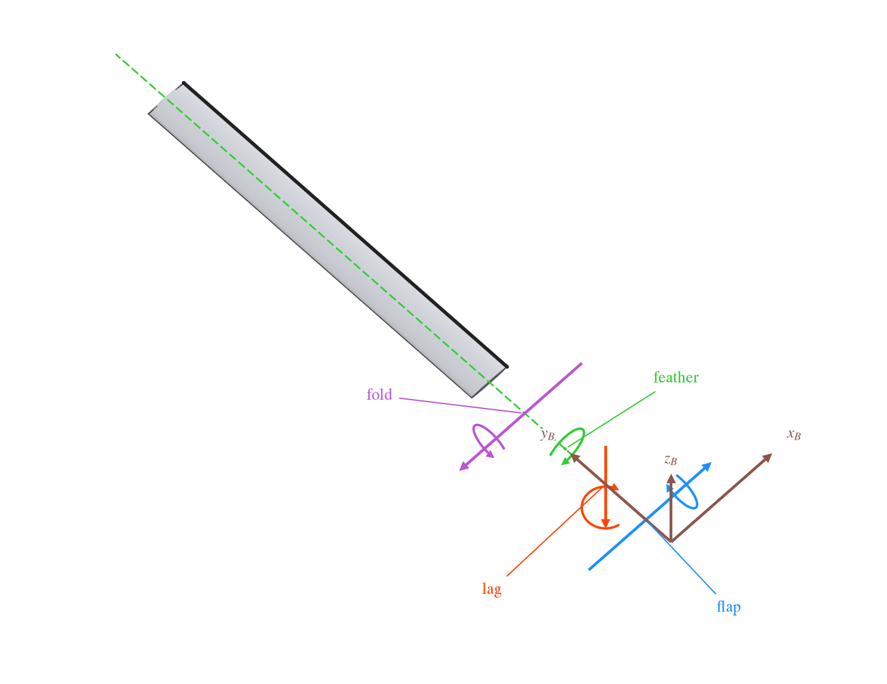

*Figure 21. The four hinges on the blade, each at its own point inboard of the blade root: flap, lag, feather,
fold, hub to tip.*

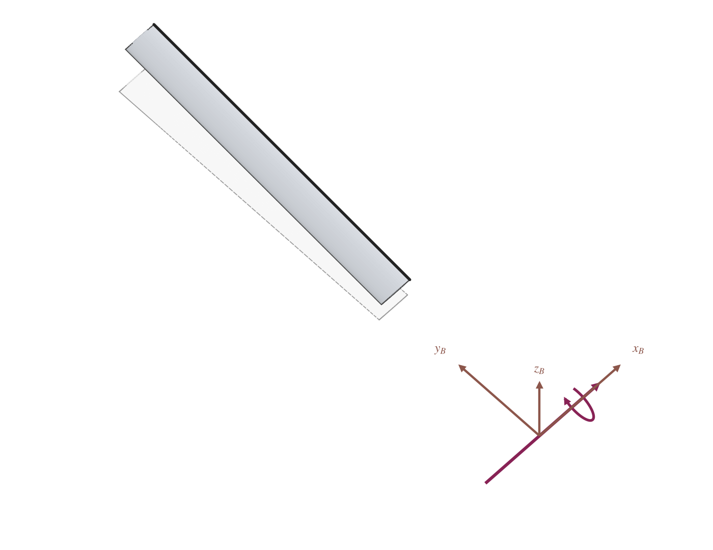

*Figure 22. Precone turns the blade about $Z$ through the hub.*

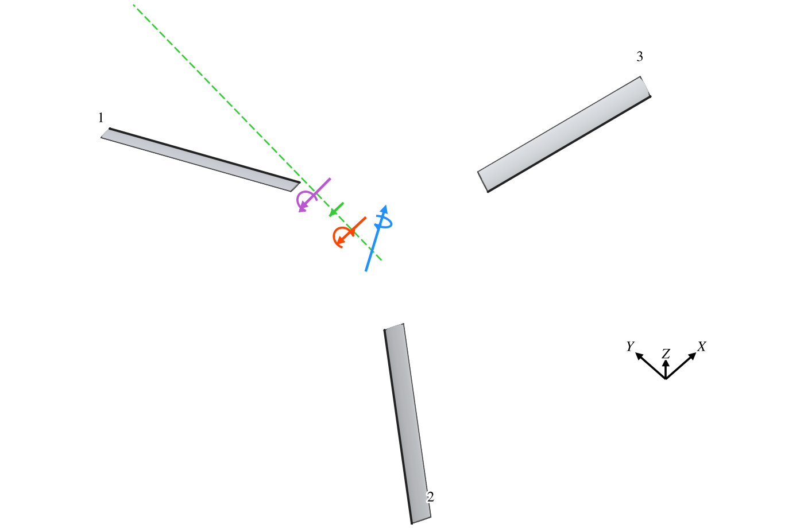

*Figure 23. Every motion: three blades with their hinges turned, precone and Rotate, and blade 1's hinge axes where the
joints inboard of them carry them.*

The blade's *azimuth* $\psi_i$, the angle harmonic motion uses and the usual rotorcraft azimuth, is

$$
\psi_i = \psi + \phi_i
$$

$\psi = 0$ lies along $+Y$ turned by PsiRef in the direction of rotation.  PsiRef is not part of $\psi_i$: changing it
turns the whole rotor, harmonic pattern and all, while changing Rotate moves the blades through the pattern
(Figures 24-25).  In helicopter position, PsiRef 270 puts $\psi = 0$ over the tail.

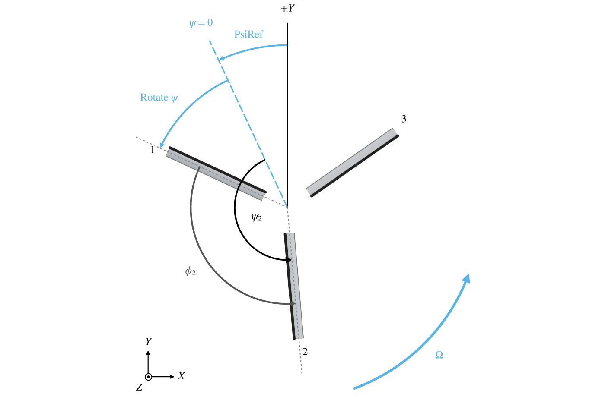

*Figure 24. A rotor in helicopter position, PsiRef 25 and Rotate 40: PsiRef sets where $\psi = 0$ lies, Rotate turns
blade 1 from there, and $\psi_2 = \psi + \phi_2$.  Heavy edges are the trailing edges.*

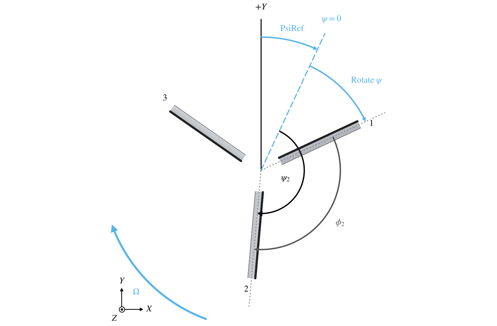

*Figure 25. The same with *Rev* checked: every angle runs the other way, with the rotation.*

## Blade Motion Modes

*Mode* on the Motion tab chooses how the flap, lag and feather angles are given.

| Mode       | Angles                                                                 |
|:-----------|:-----------------------------------------------------------------------|
| Collective | Every blade takes the same angle, one value for each hinge.            |
| Individual | Each blade has its own angle for each hinge.                           |
| Harmonic   | Each blade's angle is a harmonic series in its azimuth (below).        |

In Individual mode, pick the blade to edit with *Blade*; the active blade is outlined in the 3D view.  The fold is
separate: its *Ind.* toggle gives each blade its own fold angle.

## Harmonic Blade Motion

In Harmonic mode each hinge's angle on blade $i$ is a mean plus $N_h$ harmonics of the blade's azimuth $\psi_i$:

$$
\beta(\psi_i) = \beta_0 + \sum_{n=1}^{N_h}\left[\,\beta_{nc}\cos(n\,\psi_i) + \beta_{ns}\sin(n\,\psi_i)\,\right]
$$

and likewise for the lag $\zeta$ and the feather $\theta$.  *Harmonics* sets $N_h$ (0 to 20).

| Hinge   | Mean                      | Cosine, sine coefficients                                    |
|:--------|:--------------------------|:-------------------------------------------------------------|
| Flap    | `FlapMean`, $\beta_0$     | `FlapCos_n`, `FlapSin_n`: $\beta_{nc}$, $\beta_{ns}$         |
| Lag     | `LagMean`, $\zeta_0$      | `LagCos_n`, `LagSin_n`: $\zeta_{nc}$, $\zeta_{ns}$           |
| Feather | `FeatherMean`, $\theta_0$ | `FeatherCos_n`, `FeatherSin_n`: $\theta_{nc}$, $\theta_{ns}$ |

These are the angles about each hinge's own axis, and the signs follow CAMRAD II.  For a flap hinge with no
Elevation or Azimuth ($\delta_3 = 0$, $\theta_F = 0$) the flap angle is the classical flap $\beta$: $\beta_0$ is the
coning, positive $\beta_{1c}$ raises the tip at $\psi = 0$ and positive $\beta_{1s}$ at $\psi = 90^\circ$, tilting
the tip path plane.  A skewed hinge also turns the blade about its chord, so the flap out of the plane is smaller and
the pitch changes too (see [Hinges](#hinges)).

In this mode the angle sliders show, greyed, blade 1's angle at the current Rotate (Figure 26).  Each blade's own angle
is set too, at the current Rotate, so switching to Individual starts from the harmonic shape at that rotation angle.
Because each blade's angles follow its own azimuth, turning the rotor by one blade spacing carries every blade to where
the next one was, with that blade's angles: the tip path stays put while the blades move along it (Figures 27-29).

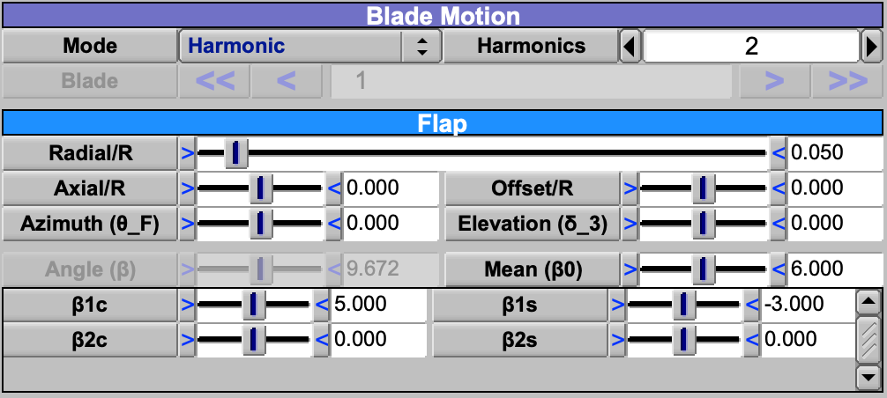

*Figure 26. The Blade Motion and Flap groups of the Motion tab in Harmonic mode with two harmonics: $\beta_0 = 6$,
$\beta_{1c} = 5$, $\beta_{1s} = -3$ and the second harmonic zero, on four blades at Rotate 20.  The greyed Angle is
blade 1's flap, $9.67^\circ$.*

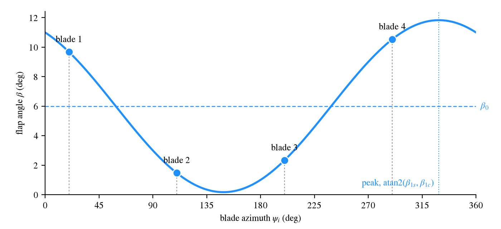

*Figure 27. The flap angle against azimuth for $\beta_0 = 6$, $\beta_{1c} = 5$, $\beta_{1s} = -3$ (PsiRef 0), with the
angle each of four blades takes at Rotate 20.*

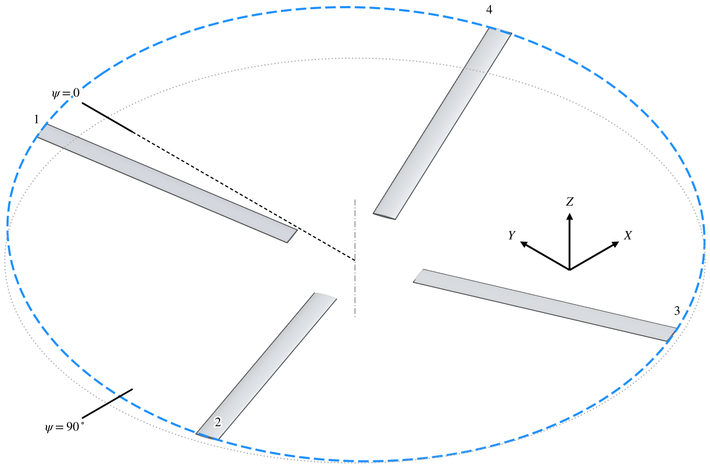

*Figure 28. The same rotor in helicopter position, PsiRef 0, so $\psi = 0$ is not over the tail: its tip path (dashed)
over the plane of rotation (dotted).*

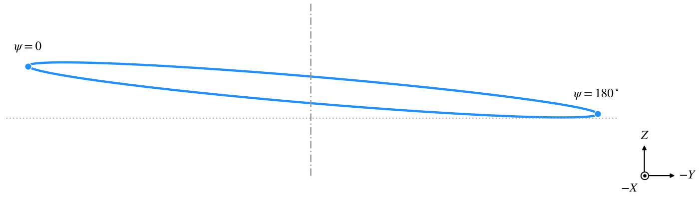

*Figure 29. Seen from the front, looking aft: $\beta_0$ cones the tip path toward the thrust and $\beta_{1c}$ raises it
at $\psi = 0$.*

## Reverse Rotation

Checking *Rev* reverses the direction of rotation and makes the propeller the mirror image of the normal one: the
sections flip chordwise, every tangential quantity changes sign (Skew, Tangential, Sweep, Twist, the Construct and
Feather offsets), the blades turn the other way, and every hinge mirrors with the blade.  In the equations above this
is the factor $\epsilon = -1$.

Two rotors that are mirror images in the plane $Y = 0$ between them differ in two parameters: the second has *Rev*
checked and PsiRef 180 degrees more.  Every other parameter, the hinge and harmonic angles included, keeps its value,
and each blade mirrors the same-numbered blade of the other rotor (Figures 30-31).  The 180 degrees are needed
because the mirror moves $\psi = 0$ to the other side of the shaft; in helicopter position, PsiRef 270 for the normal
rotor and 90 for the reversed one both put $\psi = 0$ over the tail.  With PsiRef unchanged, the reversed rotor is
instead the mirror image in the plane through the shaft and the propeller's $Y$ axis.

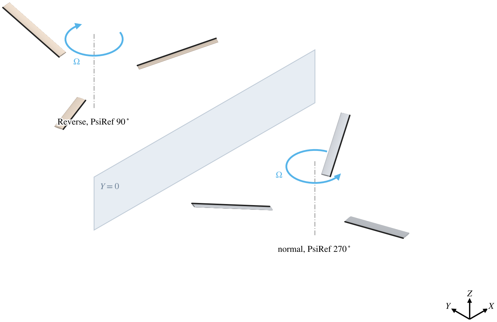

*Figure 30. Side-by-side rotors in helicopter position, normal (grey) and *Rev* with PsiRef 180 degrees more (tan):
mirror images in $Y = 0$, turning opposite ways.*

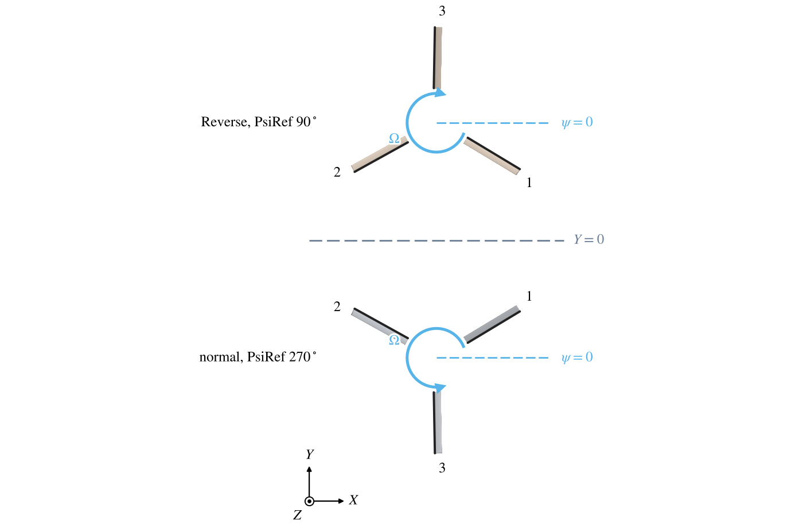

*Figure 31. The same rotors: each blade mirrors the same-numbered blade, and both have $\psi = 0$ over the tail.*

A hinge axis does not simply mirror with its arrow.  A positive turn is right-handed about its axis, and the mirror
turns the curl around, so the reversed rotor's axis points opposite to the mirror image of the normal one's arrow
(Figure 32).

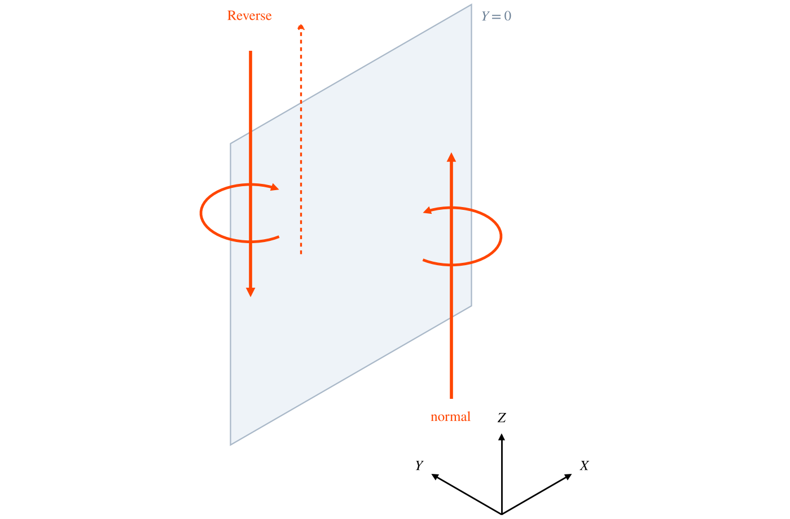

*Figure 32. A lag axis mirrored in $Y = 0$: the curl mirrors, so the reversed axis points opposite to the plain mirror
image of the normal one's arrow (dotted).*


## Clones of a Propeller

A Clone of a propeller has *Rotor Rotation* under *Copy From Original*.  Checked, the default, the Clone's blades
follow the original's Rotate.  Unchecked, the Clone has its own Rotate in the *Rotor* group, and its blades, with
their harmonic angles, are placed at that angle.  Rotors of one design turned apart in phase, such as intermeshing
or tandem rotors, are Clones with their own Rotate.  A counter-rotating rotor also needs the opposite hand.  A Clone
cannot be reversed apart from its original, so flip it instead (XForm tab, Flip) in a plane that contains the shaft.

## Scripting

The OpenVSP API has functions specific to propellers, both for modeling a propeller and for querying how its blades
move.

For modeling, a script sets up a propeller from a preset, edits its blade curves, and reads and writes BEM files:

| Call                                                                                                                 | Purpose                                                                    |
|:---------------------------------------------------------------------------------------------------------------------|:---------------------------------------------------------------------------|
| `InitPropPreset`                                                                                                     | Apply a preset, `PROP_PRESET_PROPELLER` or `PROP_PRESET_HELICOPTER`.       |
| `SetPCurve`, `PCurveConvertTo`, `PCurveGetType`, `PCurveGetTVec`, `PCurveGetValVec`, `PCurveDeletePt`, `PCurveSplit` | Read and edit the blade curves.                                            |
| `ApproximateAllPropellerPCurves`                                                                                     | Refit every curve as a cubic Bezier, as *Approximate All* does.            |
| `ResetPropellerThickness`                                                                                            | Rebuild the Thick curve from the sections.                                 |
| `SetBEMPropID`, `ExportFile` with `EXPORT_BEM`                                                                       | Write a BEM file (see [BEM Files](#bem-files)).                            |
| `ImportFile` with `IMPORT_BEM`                                                                                       | Make a propeller from a BEM file.                                          |

A script finds a parm by name and group.  The propeller's design parms, the fold, *Feather* and the blade spacing are
in the *Design* group; the flap, lag and feather bearing, *PsiRef*, the motion mode, the harmonics and the per-blade
flap, lag and feather angles (`Feather_n` too) are in *Articulation*.  The modes are set by these parms:

| Parm                      | Group        | Values                                                                  |
|:--------------------------|:-------------|:------------------------------------------------------------------------|
| `PropMode`                | Design       | `PROP_BLADES`, `PROP_BOTH`, `PROP_DISK`                                 |
| `UseBeta34Flag`           | Design       | 1: Beta 3/4 drives the pitch; 0: Feather does                           |
| `BladeMotionMode`         | Articulation | `PROP_BLADE_COLLECTIVE`, `PROP_BLADE_INDIVIDUAL`, `PROP_BLADE_HARMONIC` |
| `NumHarmonics`            | Articulation | 0 to 20                                                                 |
| `IndividualBladeFoldFlag` | Design       | 0 or 1                                                                  |
| `BladeAzimuthMode`        | Design       | `PROP_AZI_UNIFORM`, `PROP_AZI_FREE`, `PROP_AZI_BALANCED`                |
| `AFLimit`                 | Design       | *r_0*, the activity factor's lower limit                                |

`SetPCurve` and the other curve calls take the curve as `PROP_CHORD`, `PROP_TWIST`, `PROP_RAKE`, `PROP_SKEW`,
`PROP_SWEEP`, `PROP_THICK`, `PROP_CLI`, `PROP_AXIAL` or `PROP_TANGENTIAL`, and its type as `LINEAR`, `PCHIP` or
`CEDIT`.

For the motion, a script asks where each blade sits at any rotation angle, so another program can move its own
geometry or mesh with the blades:

| Call                      | Purpose                                                                        |
|:--------------------------|:-------------------------------------------------------------------------------|
| `GetPropBladeXForm`       | The matrix from the blade as built to where it sits in the model.              |
| `GetPropBladeMotionXForm` | The matrix from where a blade sits at $\psi = 0$ to where it sits at an angle. |
| `GetGeomDisplayTessPnts`  | The points of the tessellation the 3D view shows.                              |

`GetPropBladeXForm( geom_id, j, k, rotate )` gives the whole chain above for blade $i = j + 1$, followed by the
Geom's flip $F$, its placement $M_\mathrm{XForm}$ and its symmetric copy $S_k$, with `rotate` in place of Rotate:

$$
T_{i,k}(\psi) = S_k\, M_\mathrm{XForm}\, F\; R_X(-\epsilon\,\phi_i)\, R_X(-\epsilon\,\psi_\mathrm{ref})\, R_X(-\epsilon\,\psi)\,
R_Z(\beta_p)\, J_1(\psi_i) \cdots J_4(\psi_i)
$$

Harmonic angles are evaluated at each blade's $\psi_i = \psi + \phi_i$, and `rotate` may be any angle, beyond
Rotate's limits.  `GetPropBladeMotionXForm` gives $T_{i,k}(\psi)\,T_{i,k}(0)^{-1}$, which moves geometry already
built around the blade where it sits at $\psi = 0$ -- a mesh, say -- to where it sits at $\psi$.  A program that runs
an unsteady simulation asks for these at each time step.

The blade index $j$ counts from 0, so blade 1 is $j = 0$.  The symmetric copy $k$ is numbered as DegenGeom's
`sym_copy_index`.  The matrices reflect the last Update; call Update after changing any parameter (Figure 33).

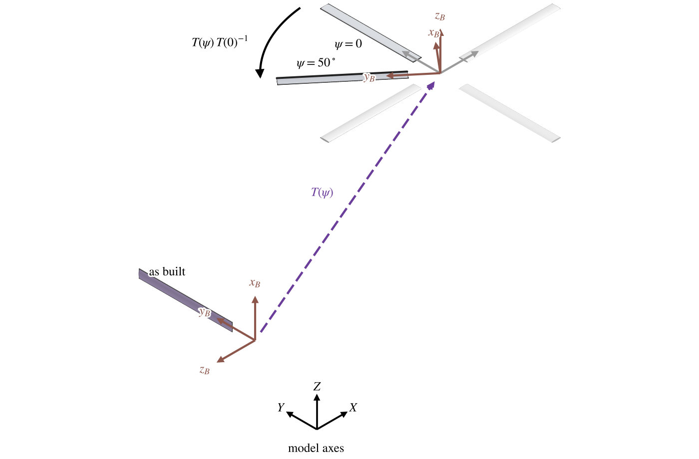

*Figure 33. A rotor placed away from the origin and turned by *YRot* 90.  Blade 1 as built (lilac) sits at the origin in
its blade axes; $T(\psi)$ carries it, and its axes, to where it sits at $\psi = 50^\circ$.  $T(0)$ is the placement
alone, the turn of 90 degrees about $Y$ and the move; $T(\psi)\,T(0)^{-1}$ carries the blade from $\psi = 0$ (grey, with
grey axes; its $z_B$ is the same as at $\psi$) to $\psi$.*

## Older Files

Models saved before OpenVSP 3.56 open as they were saved, and some propellers change shape:

- On a propeller with reverse rotation, *Feather Offset* and the fold axis's *Offset/R*, *Azimuth* and *Elevation*
  now mirror with the rotation, as the rest of the blade does.  Change their signs to keep the earlier blades.
- A blade now feathers at its feather bearing, *Radial/R* 0.15, where it used to feather outboard of every hinge.  A
  propeller with both a fold and a feather angle, folding outboard of the bearing, now folds about a feathered hinge.
  Set the feather bearing's *Radial/R* to 1.0 to keep the earlier blades.

## BEM Files

A BEM (blade element) file holds the generic information a blade element analysis needs: the rotor's diameter, blade
count, pitch, precone, center and axis, the blade curves at a set of stations, and a section shape at each station.
It is not written for any one blade element program; a program that reads it takes what it needs.

Exporting a propeller to a BEM file samples the curves at *Num_U* stations from root to tip, spaced by the root and
tip clustering, and writes each section as *Num_W* points around an untwisted section of unit chord.  The default
propeller gives, shortened:

```
...BEM Propeller...
Num_Sections: 12
Num_Blade: 3
Diameter: 30.00000000
Beta 3/4 (deg): 20.00000000
Feather (deg): 0.00000000
Pre_Cone (deg): 0.00000000
Center: 0.00000000, 0.00000000, 0.00000000
Normal: -1.00000000, 0.00000000, 0.00000000

Radius/R, Chord/R, Twist (deg), Rake/R, Skew/R, Sweep, t/c, CLi, Axial, Tangential
0.20000000, 0.08000000, 46.75000000, 0.00000000, 0.00000000, 0.00000000, 0.50000000, 0.00000000, 0.00000000, 0.00000000
0.27272727, 0.11601803, 42.31743050, 0.00000000, 0.00000000, 0.00000000, 0.23313298, 0.51960932, 0.00000000, 0.00000000
...
1.00000000, 0.13000000, 13.00000000, 0.00000000, 0.00000000, 0.00000000, 0.03000000, 0.20000000, 0.00000000, 0.00000000

Section 0 X, Y
1.00000000, 0.00000000
0.99440629, -0.03748521
...
```

Importing a BEM file makes a new propeller.  It takes the diameter, blade count, Beta 3/4 (Feather then follows from
it and the twist), precone and placement from the file, and every curve, as a PCHIP spline, through the file's
stations.  It keeps only a root and a tip section, both NACA 16-series; the section shapes in the file are not read.

A BEM file often lists many stations, many more than OpenVSP's smooth blade curves need, and each becomes a point on
every curve, which slows every update.  *Approximate All* on the Blade tab (`ApproximateAllPropellerPCurves` in the
API) refits each curve as a cubic Bezier with far fewer points, which is easier to edit: a file with 41 stations gives
a Chord curve of 16 points, a Twist curve of 4, and Thick and CLi curves of 10.