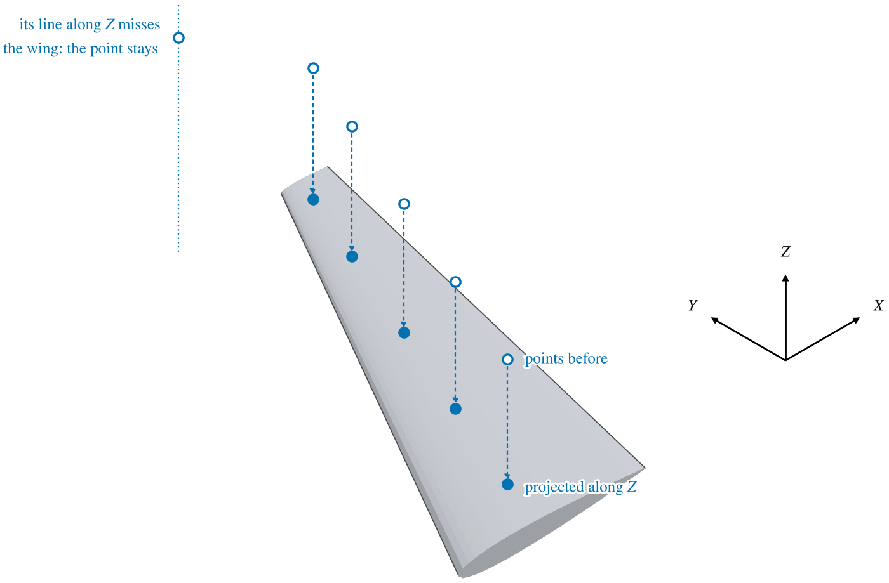

A Point Cloud component holds a set of points in space, usually measured: a scan of an aircraft, or coordinates
digitized from drawings.  The points have no connections between them and no surface.  They are there to be
matched: Fit Model adjusts a parametric component until its surface passes through chosen points, and a cloud
can be projected onto a surface or wrapped in its convex hull.

| Topic                                          | Tab     |
|:-----------------------------------------------|:--------|
| [Quick Start](#quick-start)                    |         |
| [Point Files](#point-files)                    |         |
| [Fitting a Component to Points](#fitting-a-component-to-points) |  |
| [Projecting Points onto a Surface](#projecting-points-onto-a-surface) | Project |
| [Convex Hull](#convex-hull)                    | Project |
| [Scripting](#scripting)                        |         |

The Gen and XForm tabs are the ones every component has; see [Gen](GenTab.md) and
[XForm](XFormTab.md).  A point cloud has no mass, symmetry or sub-surfaces.

## Quick Start

1. Choose *File > Import*, click *Point Cloud (.pts, .csv)* and choose the file.
2. Place it with the XForm tab, and scale it to the model's units with *Scale*.
3. Build a component of roughly the right shape near the points.
4. Open *Model > Fit Model*, pick points on the cloud as targets, choose the Parms to vary, and fit.

## Point Files

A point file is plain text with one point per line: $x$, $y$ and $z$, separated by spaces, tabs, commas or any mix
of them.  The extension may be .pts or .csv.

```
0.0  0.0  0.0
1.0, 0.0, 0.25
2.0,0.0,0.5
```

A line that does not start with three numbers is skipped, so the column names a spreadsheet writes at the top of a
CSV file, comments and blank lines may stay in the file.

Points that coincide, to within $10^{-10}$ of the size of the cloud and never less than $10^{-10}$, are kept once.  The
points come in at the numbers in the file; OpenVSP's model has no units, so scale the cloud to match the model.

A point cloud is also made by *Convert* under Convert to Point Cloud on a [Mesh](Mesh.md)'s Other tab: one point at each
vertex of the mesh.  Either way the points are saved with the model.

## Fitting a Component to Points

Fit Model (*Model > Fit Model*) is where a point cloud is used most.  While its screen is open, the points of every
cloud can be picked in the 3D view; picked points turn blue.  Its Pick Points tab selects them one at a time or by
region, hides the ones in the way, and makes the selected points target points, each matched to a surface of the
component being fitted.  Fit Model then varies the chosen Parms to bring the surface as close as it can to the
targets.  Which points are selected or hidden is not saved with the model.

## Projecting Points onto a Surface

The Project tab moves every point of the cloud onto a surface of another component, along one of the model's axes.
Choose the component, which of its surfaces (*Surface*, `Surf_0` and up, counting its symmetric copies), and the
*Direction*.  Each point moves parallel to that axis only -- its other two coordinates stay -- to the nearest place
where its line along the axis meets the surface, in front of it or behind.

The projection replaces the cloud's points.  Use it to put digitized points exactly on a surface, such as outline
points taken from a drawing in the plan view, projected along $Z$ onto a wing.

A point whose line along the direction misses the surface entirely is left where it was (Figure 1).  The surface
is one surface only: with a symmetric wing, a point over the mirror half misses `Surf_0` and stays.



*Figure 1. Points above the right half of a wing, projected along $Z$ onto its upper surface, the nearest place their
lines cross it.  The point beyond the tip stays where it was.*

## Convex Hull

*Create Convex Hull Mesh* makes a new [Mesh](Mesh.md) component: the smallest convex shape that holds every point
of the cloud.  It is a quick envelope of a scan, for a volume or a bounding size.  The hull is built where the
cloud is, from its points placed by its XForm.  A cloud whose points all lie in one plane has no hull, and nothing is
made.

## Scripting

The API makes, reads, projects and wraps point clouds.

| Function                                    | Use                                                          |
|:--------------------------------------------|:-------------------------------------------------------------|
| `ImportFile( file, IMPORT_PTS, "" )`        | Import a point file; returns the new cloud's ID.             |
| `CreatePtCloudGeomFromPts( pts, name )`     | Make a cloud from a list of points.                          |
| `CreatePtCloudGeom( mesh_id )`              | Make a cloud from a mesh's vertices, as the Convert to Point Cloud button. |
| `GetPtCloudPnts( cloud_id )`                | The cloud's points, as held, before its XForm.               |
| `ProjectPtCloudPts( cloud_id, geom_id, surf, dir )` | Project the points, as the Project tab; `dir` is `X_DIR`, `Y_DIR` or `Z_DIR`. |
| `CreateConvexHull( cloud_id )`              | Make the convex hull mesh; returns its ID.                   |

```python
import openvsp as vsp

cloud = vsp.CreatePtCloudGeomFromPts( [ vsp.vec3d( x, 1.0, 5.0 ) for x in ( 1.0, 2.0, 3.0 ) ], "Outline" )
wing = vsp.AddGeom( "WING" )
vsp.Update()

vsp.ProjectPtCloudPts( cloud, wing, 0, vsp.Z_DIR )
```
