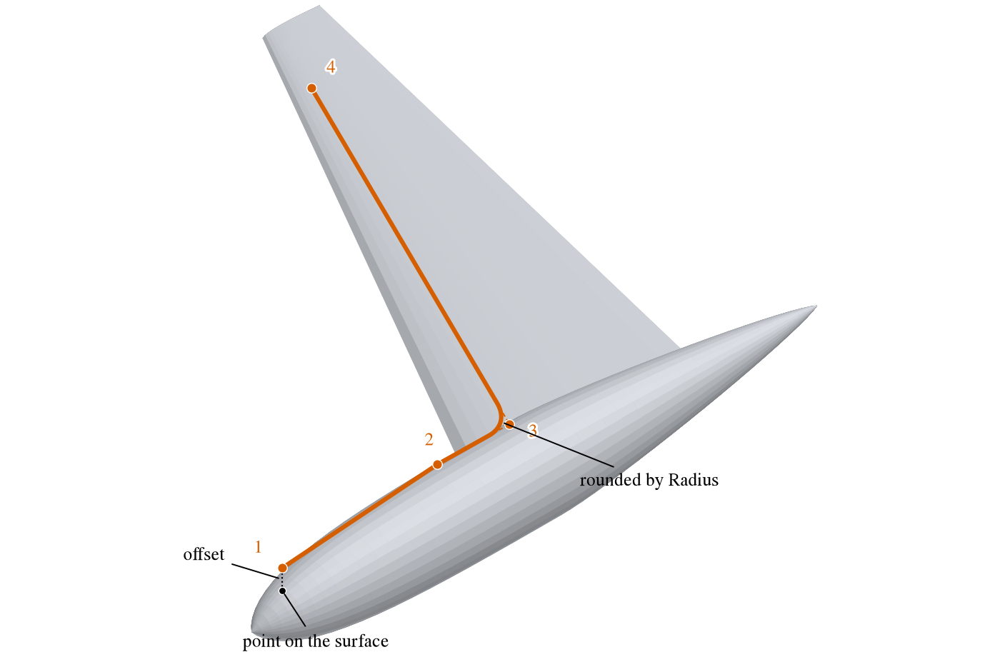
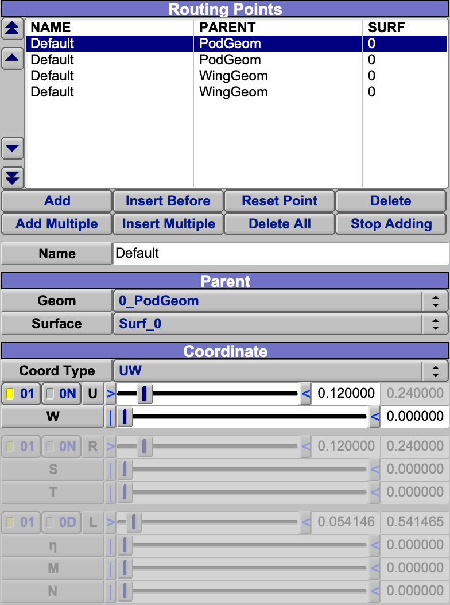

The Routing component is a path through a series of points on other components: the run of a wire harness, a hydraulic,
pneumatic, fuel or oxygen line, an air-conditioning duct, a control cable or pushrod, or a drive shaft.  Each point lies
on a component, so the route follows when that component moves or changes shape.  The route reports its length and,
given a mass per unit length, its mass, which Mass Properties includes.  A route is a curve, not a surface: it is drawn
as a line, and it is not meshed or exported.

| Topic                                         | Tab          |
|:----------------------------------------------|:-------------|
| [Quick Start](#quick-start)                   |              |
| [Routing Points](#routing-points)             | Design       |
| [Placing a Point](#placing-a-point)           | Design       |
| [Offset](#offset)                             | Design       |
| [Rounded Corners](#rounded-corners)           | Design       |
| [Length and Mass](#length-and-mass)           | Design, Mass |
| [Symmetry](#symmetry)                         | XForm        |
| [Shared Tabs](#shared-tabs)                   | Gen, XForm, Mass |
| [Scripting](#scripting)                       |              |

## Quick Start

1. Add a Routing component.
2. On the Design tab, click *Add Multiple*, then click on the components in the 3D view at each point of the route in
   turn.  Click *Stop Adding* when done.
3. Choose a point in the list to adjust it: its *Parent*, its coordinates, an *Offset*, and a *Radius* to round the
   corner there.
4. Give *Mass/Len* on the Mass tab to weigh the route.

## Routing Points

The route runs through its points in the order of the list (Figure 1); the arrows beside the list reorder them.

Most components follow only their parent.  A route follows every component it has a point on, wherever those are in
the model's tree, and its own place in the tree does not matter.  So one route can run from the fuselage, along the
wing, and into a nacelle that tilts on a [Hinge](Hinge.md), and it stretches and bends as the nacelle turns.

*Figure 1. A route over a pod and onto a wing through four points.  Point 1 is set off above the pod; the corner at
point 3 is rounded.*

Points are placed by clicking in the 3D view (Figure 2).  *Add*, *Insert Before* and *Reset Point* act on the next
click: Add puts a new point at the end of the route, Insert Before puts one before the chosen point, and Reset Point
moves the chosen point.  *Add Multiple* and *Insert Multiple* do the same at every click until *Stop Adding*, and the
route is drawn through the points placed so far.

*Figure 2. The Routing Points, Parent and Coordinate groups of the Design tab for the route over the pod and the
wing, with point 1 chosen: it lies on the pod at U 0.12, W 0, given as UW, and its RST and LMN coordinates are
greyed.*

A click picks a point of a shown component's tessellation and sets the routing point at the nearest place on that
component's surface: the component becomes the point's parent, and the point is given by its surface and its *U* and
*W* on it.  A click sets the point's *Coord Type* to UW.  Its RST and LMN coordinates follow from where it now is,
so either can be chosen again afterward without moving the point.

## Placing a Point

*Parent* is the component the point lies on, and *Surface* which of its surfaces, one for each symmetric copy and each
surface of a multi-surface component.  *Coord Type* chooses how the point is given on that surface; the coordinates are
those of the XForm tab's attachment, described in [Attachment Coordinates](XFormTab.md#attachment-coordinates):

| Coord Type | The point is                                                                                 |
|:-----------|:---------------------------------------------------------------------------------------------|
| Comp       | The parent's origin.                                                                         |
| UW         | On the surface at *U*, *W*.                                                                  |
| RST        | Inside the volume at *R*, *S*, *T*.                                                          |
| LMN        | Inside the volume at *L*, *M*, *N*.                                                          |
| $\eta$MN   | On a wing parent only: at the wing's spanwise station $\eta$ and *M*, *N*.                   |

Whichever is chosen, the others are kept up to date and shown greyed; $\eta$MN is `ROUTE_PT_EtaMN` in the API.  A point
on a component with no surface, such as a [Blank](Blank.md), lies at that component's origin, so Blanks can carry a
route through free space.

## Offset

*Offset* moves the point away from where it lies on its parent.  *Rel* gives the offset in the axes the point is
attached by -- the surface's axes at that point for UW, RST and LMN, the parent's axes for Comp -- so the point keeps
its place relative to the surface as the parent turns.  *Abs* gives it in the model's axes.  While the Routing component
is selected, the 3D view draws those axes for the chosen point, at the point it is offset from.  Use an offset to run a
route a set distance above a skin or inside a structure.

## Rounded Corners

A route is a series of straight segments between its points.  *Radius* rounds the corner at a point with a circular arc
of that radius, tangent to both segments, so the route no longer passes through the point itself; zero leaves a sharp
corner.  The ends of the route are never rounded.  Give each corner the bend radius the real line will have, so that the
length is right.

## Length and Mass

*Length* is the length of the route, rounded corners included, and *Mass* is that length times *Mass/Len* from the Mass
tab.  *Symm Length* and *Symm Mass* count every symmetric copy.  The Mass Properties analysis includes a route with a
nonzero Mass/Len as a line of mass along it, with its center of gravity and moments of inertia, one for each symmetric
copy.

## Symmetry

A route has no placement of its own: its points are where its parents put them, so its location, rotation and attachment
are greyed.  Its symmetry still applies, about the planes and axes the symmetry controls choose, so a route on one side
of an aircraft can be mirrored to the other.  A route cannot be flipped.

## Shared Tabs

The Gen, XForm and Mass tabs are common to every component; see [Gen](GenTab.md), [XForm](XFormTab.md)
and [Mass](MassTab.md).  A route has no volume or area, so of the Mass tab only Mass/Len and the specified mass
apply; with no placement of its own, a route's specified center of gravity is in the model's axes.  A route has no Sub
tab.

## Scripting

The OpenVSP API builds and queries routes with these functions:

| Call                                                                        | Purpose                                           |
|:----------------------------------------------------------------------------|:--------------------------------------------------|
| `AddRoutingPt`, `InsertRoutingPt`, `InsertRoutingPtByID`                    | Add a point on a component's surface.             |
| `DelRoutingPt`, `DelRoutingPtByID`, `DelAllRoutingPt`                       | Delete points.                                    |
| `MoveRoutingPt`, `MoveRoutingPtByID`                                        | Reorder the points.                               |
| `GetNumRoutingPts`, `GetRoutingPtID`, `GetAllRoutingPtIds`                  | The points.                                       |
| `GetRoutingPtParentID`, `SetRoutingPtParentID`                              | A point's parent.                                 |
| `GetMainRoutingPtCoord`                                                     | A point's location, before symmetry.              |
| `GetRoutingPtCoord`, `GetRoutingPtCoordByID`, `GetAllRoutingPtCoords`       | Points of one symmetric copy of the route.        |
| `GetRoutingCurve`                                                           | The rounded route of one symmetric copy, as points. |

A point's parms are in the group `RoutePt`: `CoordType` (`ROUTE_PT_COMP`, `ROUTE_PT_UV`, `ROUTE_PT_RST`, `ROUTE_PT_LMN`,
`ROUTE_PT_EtaMN`), `SurfIndx`, `U`, `W`, `R`, `S`, `T`, `L`, `M`, `N`, `Eta`, `DeltaType` (`ABS` or `REL`), `DeltaX`,
`DeltaY`, `DeltaZ` and their `...Rel` forms, and `Radius`.  The route's `LinearDensity` is in the group `Mass_Props`,
and its `Length`, `SymmLength`, `Mass` and `m_SymmMass` in `Results`.
