A Stack preset replaces every section of a Stack with a ready-made layout.  Choose it under *Stack Preset* on the
Stack's Design tab and click *Set*; the existing sections are lost, so *Set* asks first.  Besides the sections and their
skinning, a preset sets the [XSec Order](FuselageStack.md#section-order), the end caps, and for the nacelles the parts
of the [engine model](EngineModel.md) its definition uses: what the sections describe, where the inlet and outlet lips
and faces are, and what is built from them; [Stations](EngineModel.md#stations) shows these controls as a nacelle preset
leaves them.  The engine model controls a preset does not use keep their values, and so do the *Extension* settings.
Two presets are simple bodies and one is the Stack a new component starts with.  The other fourteen are nacelles.
Engine modeling has many choices, and not every combination of them makes a valid or useful model, so a nacelle
preset is the best place to start one.

| Preset                                                                  | XSec Order | Geom Type | Built as it comes                           |
|:------------------------------------------------------------------------|:-----------|:----------|:--------------------------------------------|
| [Default](#default)                                                     | FREE       | NONE      | A closed body                               |
| [Cylinder with EndPoints](#cylinder-with-endpoints)                     | FREE       | NONE      | A cylinder closed by its sections           |
| [Cylinder with EndCaps](#cylinder-with-endcaps)                         | FREE       | NONE      | A cylinder closed by flat caps              |
| [Nacelle Flowthrough Outlet Origin](#nacelle-flowthrough-outlet-origin) | LOOP       | BOTH      | Open nacelle, the flow passing through it   |
| [Nacelle Flowthrough Inlet Origin](#nacelle-flowthrough-inlet-origin)   | LOOP       | BOTH      | Open nacelle, the flow passing through it   |
| [Nacelle Flowthrough Mid Origin](#nacelle-flowthrough-mid-origin)       | LOOP       | BOTH      | Open nacelle, the flow passing through it   |
| [Nacelle Inlet + Outlet to Face](#nacelle-inlet--outlet-to-face)        | FREE       | BOTH      | Nacelle closed at both faces                |
| [Nacelle Inlet Lip + Outlet Face](#nacelle-inlet-lip--outlet-face)      | FREE       | BOTH      | Closed at the inlet lip and the outlet face |
| [Nacelle Inlet Face + Outlet Lip](#nacelle-inlet-face--outlet-lip)      | FREE       | BOTH      | Closed at the inlet face and the outlet lip |
| [Nacelle Inlet + Outlet to Lip](#nacelle-inlet--outlet-to-lip)          | FREE       | BOTH      | Closed at both lips                         |
| [Nacelle Outlet to Face](#nacelle-outlet-to-face)                       | FREE       | OUTLET    | Closed nose, outlet closed at its face      |
| [Nacelle Outlet to Lip](#nacelle-outlet-to-lip)                         | FREE       | OUTLET    | Closed nose, outlet closed at its lip       |
| [Nacelle Inlet to Face](#nacelle-inlet-to-face)                         | FREE       | INLET     | Inlet closed at its face, closed tail       |
| [Nacelle Inlet to Lip](#nacelle-inlet-to-lip)                           | FREE       | INLET     | Inlet closed at its lip, closed tail        |
| [Nacelle Flowpath Inlet + Outlet](#nacelle-flowpath-inlet--outlet)      | FREE       | BOTH      | Duct, lip to lip                            |
| [Nacelle Flowpath Inlet](#nacelle-flowpath-inlet)                       | FREE       | INLET     | Duct, inlet lip to face                     |
| [Nacelle Flowpath Outlet](#nacelle-flowpath-outlet)                     | FREE       | OUTLET    | Duct, outlet face to lip                    |

The figures below show each preset as it comes, cut through its axis, all at one scale.  The
surfaces built are filled, positive ones grey and negative ones red and hatched.  The sections are numbered where
they cross the upper half of the cut, and an arrowhead in each span points from a section to the next.  Each figure
shows one surface normal, the active engine stations in the colors the 3D view draws them, and the Stack's origin.
A [Scripting](#scripting) section at the end lists the presets' names in the API.

## Body Presets

### Default

A new Stack starts with this layout: a point, three ellipses 3 wide and 2.5 high, and a point, at $X$ = 0, 1, 3, 4
and 4.5 (Figure 1).  The points carry tangent angles of 45 degrees, so the nose and the tail are rounded.  Use it to
get back to a new Stack's sections.

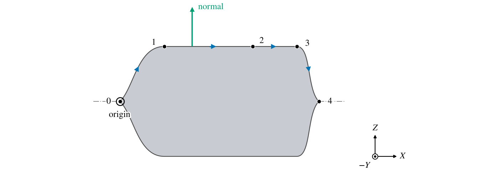

*Figure 1. The Default preset.*

### Cylinder with EndPoints

Four sections: a point, two circles 2.5 across, 3 apart, and a point (Figure 2).  Each point is at its circle's $X$,
so the ends are flat disks that are part of the surface.  No section has any skinning set, so the side is straight.

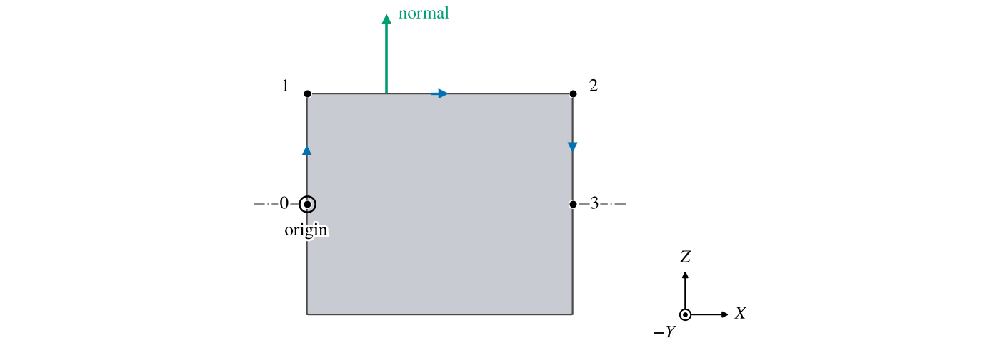

*Figure 2. The Cylinder with EndPoints preset.*

### Cylinder with EndCaps

The same cylinder from its two circles alone, closed by flat [end caps](FuselageStack.md#end-caps) (Figure 3).  Its
sides are straight and its sections carry no skinning.  Choose it over the end points when the ends may later be
rounded: a cap's type can be changed, while an end point gives a flat end until it is reshaped on the Skinning tab.

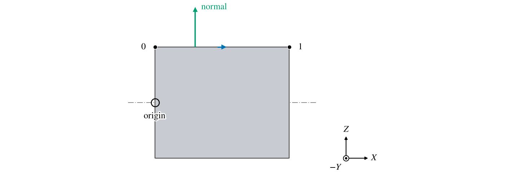

*Figure 3. The Cylinder with EndCaps preset.*

## Nacelle Presets

The nacelle presets all start from one nacelle, 4 across at its widest, with lips 3 across and a duct 2 across, 6
long from inlet lip to outlet lip.  Each describes a different part of it, chosen to suit what the analyses need.

### Engine Definition and Representation

The engine model works in two steps, both on the Stack's Design tab and described in full in
[Engine Model](EngineModel.md).

First, the [Engine Definition](EngineModel.md#engine-definition) says how the sections describe the engine.  The
flowpath may be modeled implicitly, as the inside of a FLOWTHROUGH nacelle wall, or explicitly, as a FLOWPATH: a duct
whose sections are the flowpath itself.  The [stations](EngineModel.md#stations) then mark the inlet lip and face and
the outlet face and lip on the sections; only those the definition needs are active.  The presets place the stations
by section index.  A preset does not change whether a station is given by *Indx* or by *U*: a station already
switched to *U* keeps its old *U*, so switch it back to *Indx* after *Set*.

Second, the [Engine Representation](EngineModel.md#engine-representation) says what is built from those sections
for the analyses.  The nacelle wall can be kept as a positive volume, or dropped by the NEGATIVE ONLY
modes, which keep only the flowpath.  A flowpath can be left open, as an unmodeled volume, or built as a negative
volume, which CompGeom, CFD Mesh and the other analyses that understand negative volumes cut out of whatever it
overlaps.  Each end can also be closed short of its full definition, from the full flowpath back to the face or from
the face back to the lip, or extended to the edge of a CFD domain (EXTEND).  Figures 4 and 5 of
[Engine Model](EngineModel.md#engine-representation) show every representation of the flow-through
nacelle.

### Section Order and Normals

The surface's outward normal follows the order of the sections: with the sections running from front to back along
the outside, the normal points out of the material.  On a flow-through nacelle the sections run back to front along
the inner wall and front to back along the outer wall, around the loop (Figures 4-6), so the normal points into the
duct on the inner wall and away from the axis on the outer one.  Keep that order when adding or moving sections.  To
check it, set *Geom Type* to NONE so the sections' own surface is shown, attach a Blank as a child with UW
translation and rotation (see [Attach to Parent](XFormTab.md#attach-to-parent)) and move it over the surface: its
$Z$ axis is the outward normal.

### Nacelle Flowthrough Outlet Origin

The three Flowthrough presets model the whole nacelle wall in one loop of sections: the outside, both lips and the
flowpath inside.  Their XSec Order is LOOP, so the last section is a copy of the first, placed on it.  They come with
*Inlet Mode* FLOWTHROUGH, which keeps the loop as it is: an open nacelle, the flow passing through it.  FLOWTHROUGH
NEGATIVE closes the nacelle at both lips and adds a negative flowpath from lip to lip, which cuts through any other
component the nacelle is buried in; FLOWTHROUGH NEGATIVE ONLY keeps only the negative flowpath.  The ends can also be
closed at their faces or lips, or extended, each on its own: choose that mode as the *Inlet Mode*, and the outlet then
takes the *Outlet Mode*, which these presets set to TO LIP.

The three differ only in where the loop starts, which is where the Stack's origin is.  This one starts at the outlet
lip (Figure 4), so the nacelle lies ahead of its origin.

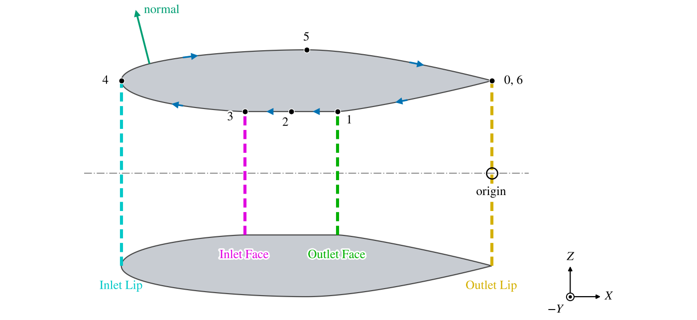

*Figure 4. The Nacelle Flowthrough Outlet Origin preset: an open nacelle.*

### Nacelle Flowthrough Inlet Origin

The flow-through nacelle, starting at the inlet lip (Figure 5), so the nacelle lies behind its origin.

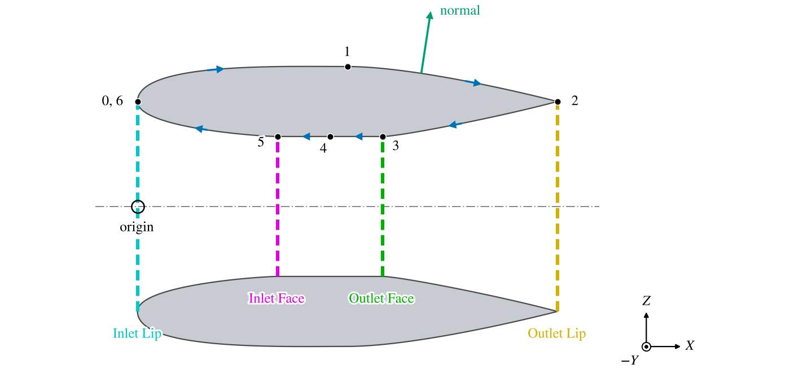

*Figure 5. The Nacelle Flowthrough Inlet Origin preset.*

### Nacelle Flowthrough Mid Origin

The flow-through nacelle, starting in the middle of the flowpath (Figure 6), halfway between the faces, so the
origin is inside the nacelle.

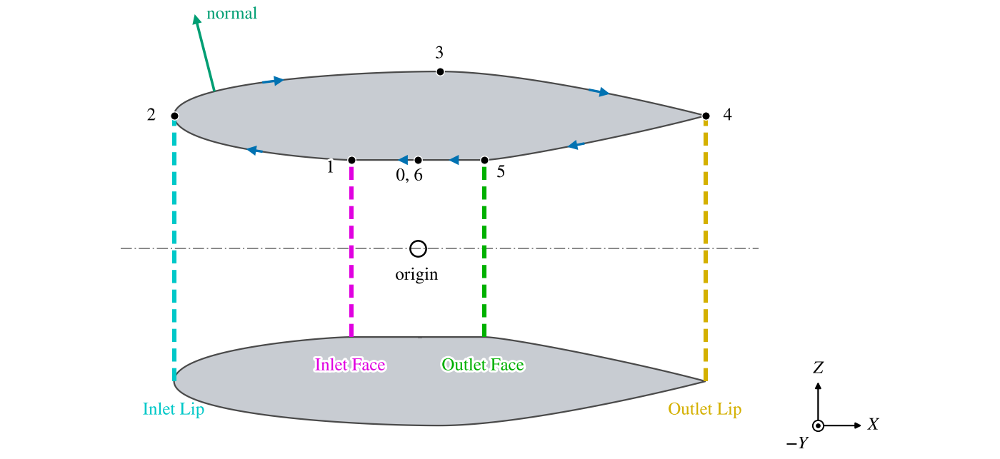

*Figure 6. The Nacelle Flowthrough Mid Origin preset.*

### Nacelle Inlet + Outlet to Face

The next four presets model the outside of the nacelle and stop each end at its lip or its face, closing it with a
point section on the axis.  They do not model the flowpath between the faces.  This one runs from the inlet face,
around the inlet lip and the outside, to the outlet face (Figure 7).  It comes with both ends TO FACE, open as
recesses; TO FACE NEGATIVE closes an end at its lip and makes the recess a negative volume, and EXTEND closes it at
the lip and extends it.

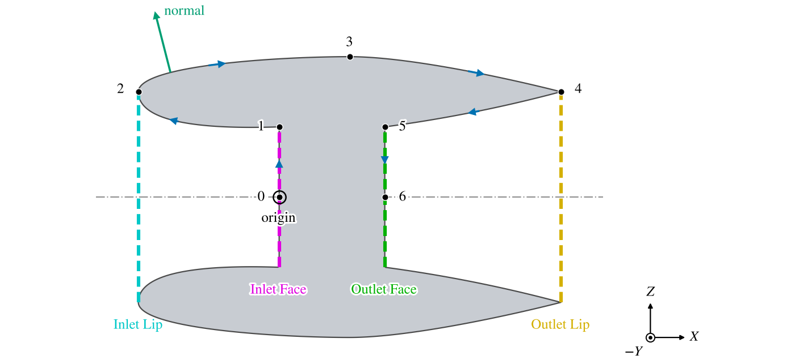

*Figure 7. The Nacelle Inlet + Outlet to Face preset.  The origin is at the center of the inlet face.*

### Nacelle Inlet Lip + Outlet Face

From the inlet lip, closed there, around the outside to the outlet face (Figure 8).  The outlet can be left as a
recess, made a negative volume, or extended; the inlet can be closed at its lip or extended.

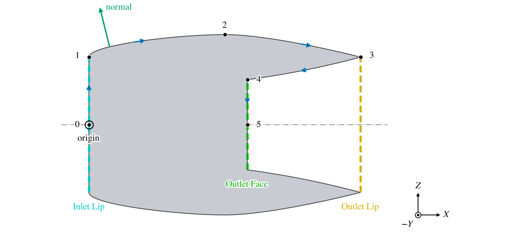

*Figure 8. The Nacelle Inlet Lip + Outlet Face preset.*

### Nacelle Inlet Face + Outlet Lip

From the inlet face around the outside to the outlet lip, closed there (Figure 9).  The inlet can be left as a
recess, made a negative volume, or extended; the outlet can be closed at its lip or extended.

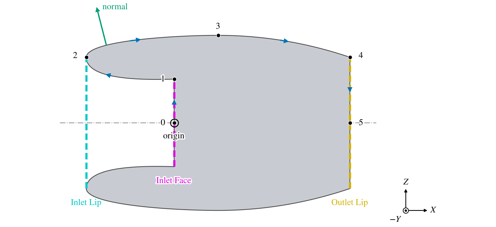

*Figure 9. The Nacelle Inlet Face + Outlet Lip preset.*

### Nacelle Inlet + Outlet to Lip

The outside alone, from the inlet lip to the outlet lip, closed at both (Figure 10).  Either end can be extended.

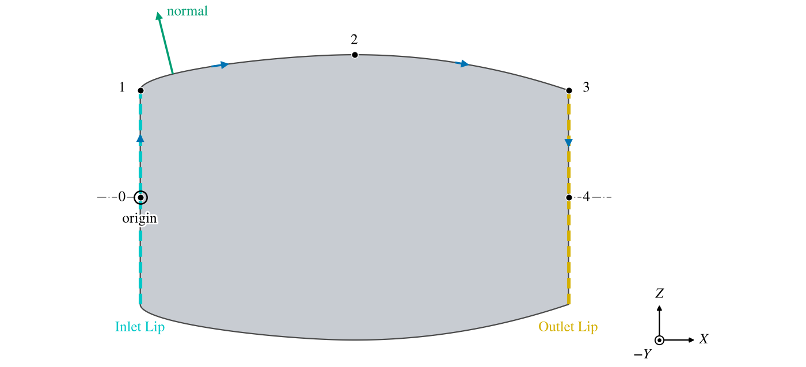

*Figure 10. The Nacelle Inlet + Outlet to Lip preset.*

### Nacelle Outlet to Face

The next four presets describe one end only, for an exhaust or an inlet built into another body.  This one is an
outlet alone: a closed, rounded nose, the outside, and the outlet to its face (Figure 11).  The outlet can be left as
a recess, made a negative volume, or extended.

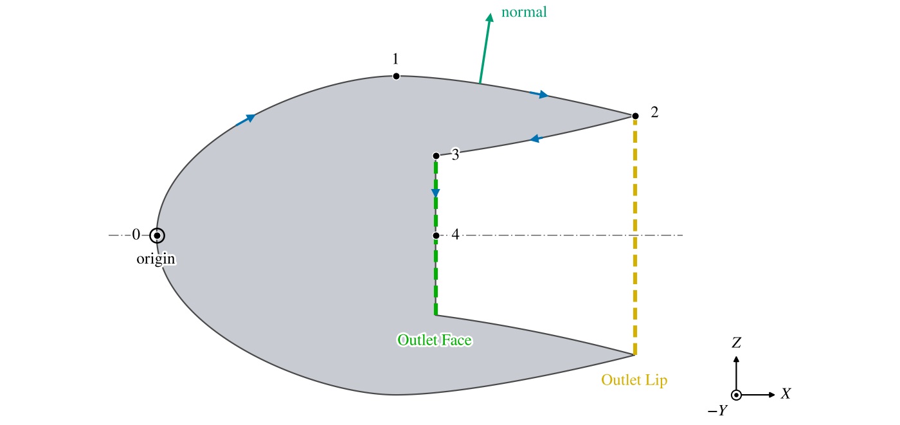

*Figure 11. The Nacelle Outlet to Face preset.  The origin is at the nose.*

### Nacelle Outlet to Lip

An outlet alone, closed at its lip, behind a closed nose (Figure 12).  The outlet can be extended.

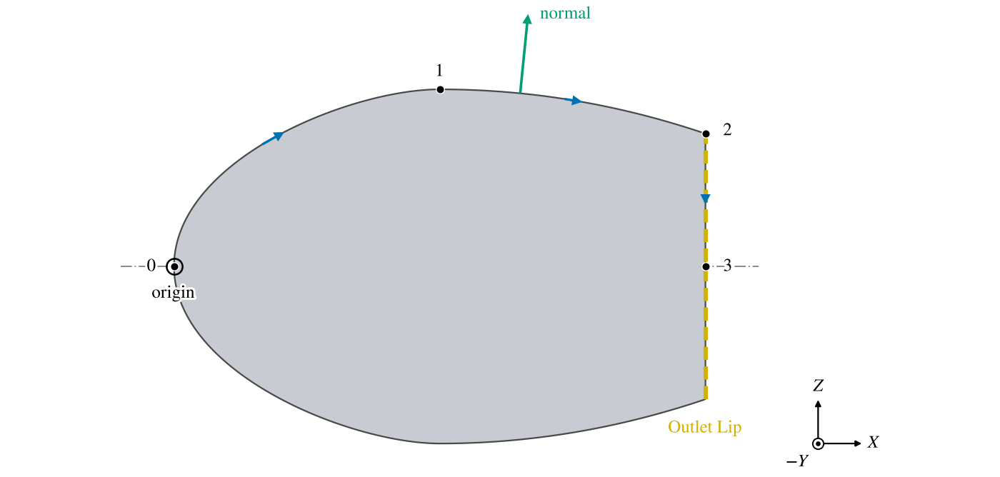

*Figure 12. The Nacelle Outlet to Lip preset.*

### Nacelle Inlet to Face

An inlet alone: the inlet from its face, around the lip, and the outside to a closed, rounded tail (Figure 13).  The
inlet can be left as a recess, made a negative volume, or extended.

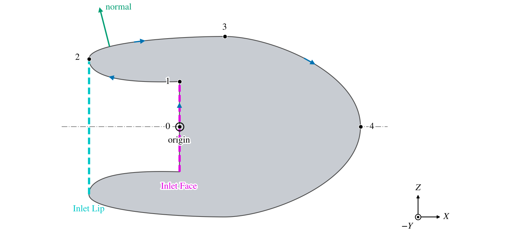

*Figure 13. The Nacelle Inlet to Face preset.  The origin is at the center of the inlet face.*

### Nacelle Inlet to Lip

An inlet alone, closed at its lip, ahead of a closed tail (Figure 14).  The inlet can be extended.

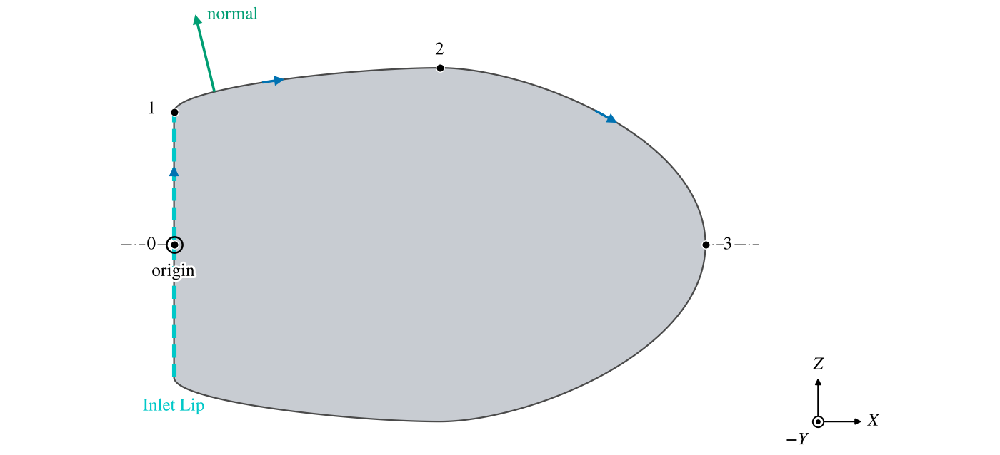

*Figure 14. The Nacelle Inlet to Lip preset.*

### Nacelle Flowpath Inlet + Outlet

The last three presets model the flowpath explicitly, as a duct, with nothing of the nacelle around it.  Their
sections run with the flow, from the inlet to the outlet, the reverse of the order around the inside of a
flow-through nacelle; each end of the duct is closed by a point section at its lip.  Use them to cut a duct out of a
fuselage or a wing it is buried in, or to model the duct itself.

This one is the whole duct (Figure 15): from the inlet lip, through the inlet face and the duct to the outlet face and
the outlet lip.  It comes with both modes TO LIP, which build the duct as its sections draw it, a positive volume.
*Inlet Mode* FLOWTHROUGH NEGATIVE or FLOWTHROUGH NEGATIVE ONLY builds the whole duct as a negative volume, and TO FACE
NEGATIVE makes only the part from the inlet lip to the inlet face negative; the *Outlet Mode* then closes the outlet
at its lip, extends it, or with TO FACE NEGATIVE makes the part from the outlet face to the outlet lip negative.  See
[Representing a Flowpath](EngineModel.md#representing-a-flowpath).

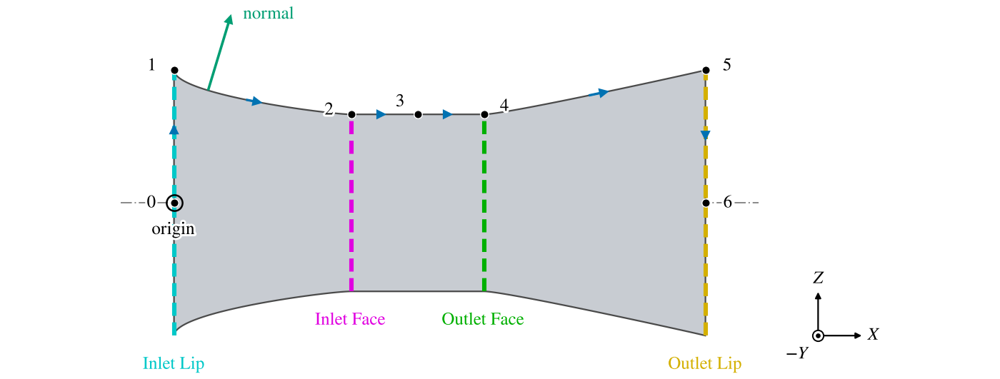

*Figure 15. The Nacelle Flowpath Inlet + Outlet preset: one duct.  The origin is at the center of the inlet
lip.*

### Nacelle Flowpath Inlet

The inlet duct alone, from the inlet lip to the inlet face (Figure 16).  It comes with *Inlet Mode* TO LIP, which
builds the duct as a positive volume.  TO FACE NEGATIVE builds it negative, and EXTEND positive and carried upstream.

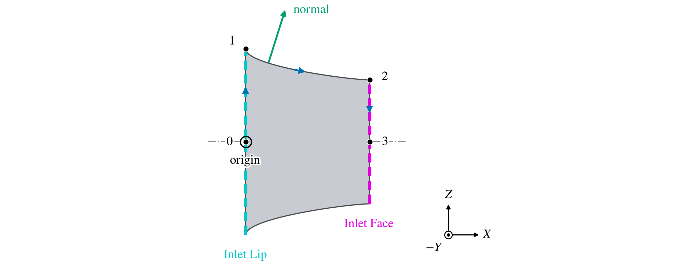

*Figure 16. The Nacelle Flowpath Inlet preset: one duct.*

### Nacelle Flowpath Outlet

The outlet duct alone, from the outlet face to the outlet lip (Figure 17).  It comes with *Outlet Mode* TO LIP, which
builds the duct as a positive volume.  TO FACE NEGATIVE builds it negative, and EXTEND positive and carried downstream.

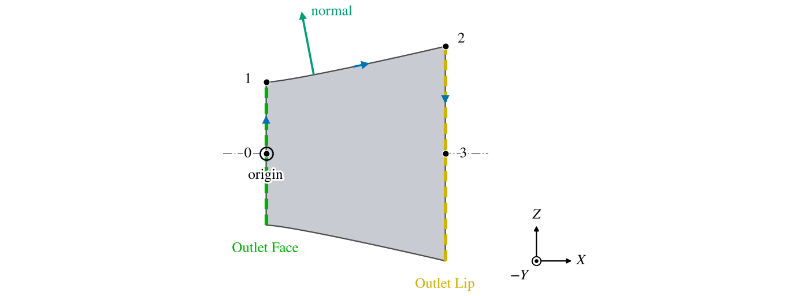

*Figure 17. The Nacelle Flowpath Outlet preset: one duct.  The origin is at the center of the outlet face.*

## Scripting

`InitStackPreset( stack_id, preset )` applies a preset to a Stack, as *Set* does, without asking; call `Update()`
after it.

| Preset                            | `preset`                            |
|:----------------------------------|:------------------------------------|
| Default                           | `STACK_PRESET_DEFAULT`              |
| Cylinder with EndPoints           | `STACK_PRESET_CYLINDER_ENDPTS`      |
| Cylinder with EndCaps             | `STACK_PRESET_CYLINDER_ENDCAPS`     |
| Nacelle Flowthrough Outlet Origin | `STACK_PRESET_FLOWTHRU_OUTLIP_ORIG` |
| Nacelle Flowthrough Inlet Origin  | `STACK_PRESET_FLOWTHRU_INLIP_ORIG`  |
| Nacelle Flowthrough Mid Origin    | `STACK_PRESET_FLOWTHRU_MID_ORIG`    |
| Nacelle Inlet + Outlet to Face    | `STACK_PRESET_BOTHFACEFACE`         |
| Nacelle Inlet Lip + Outlet Face   | `STACK_PRESET_BOTHLIPFACE`          |
| Nacelle Inlet Face + Outlet Lip   | `STACK_PRESET_BOTHFACELIP`          |
| Nacelle Inlet + Outlet to Lip     | `STACK_PRESET_BOTHLIPLIP`           |
| Nacelle Outlet to Face            | `STACK_PRESET_OUTFACE`              |
| Nacelle Outlet to Lip             | `STACK_PRESET_OUTLIP`               |
| Nacelle Inlet to Face             | `STACK_PRESET_INFACE`               |
| Nacelle Inlet to Lip              | `STACK_PRESET_INLIP`                |
| Nacelle Flowpath Inlet + Outlet   | `STACK_PRESET_FLOWPATH_BOTH`        |
| Nacelle Flowpath Inlet            | `STACK_PRESET_FLOWPATH_IN`          |
| Nacelle Flowpath Outlet           | `STACK_PRESET_FLOWPATH_OUT`         |
