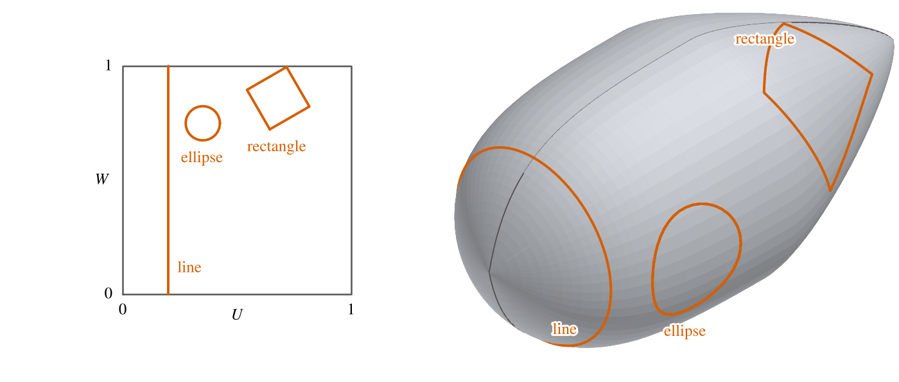
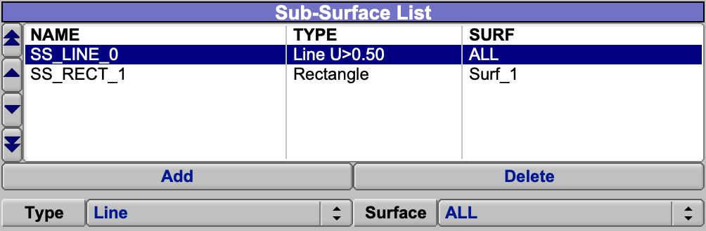
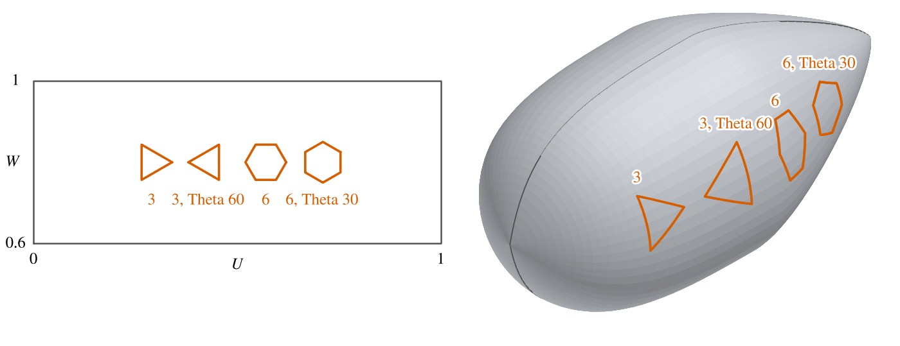
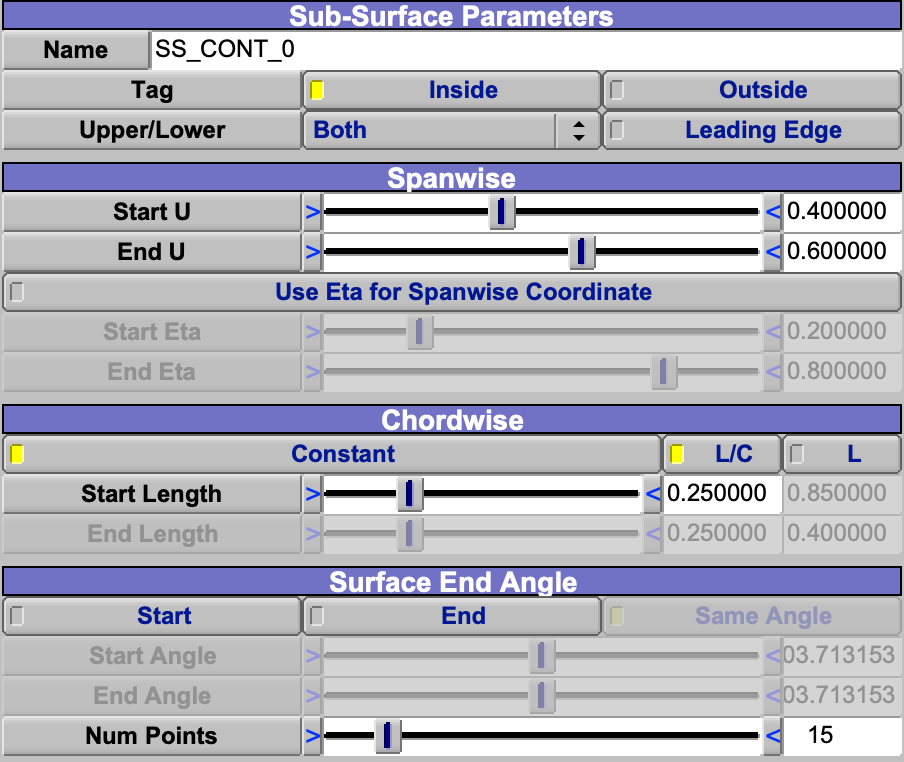
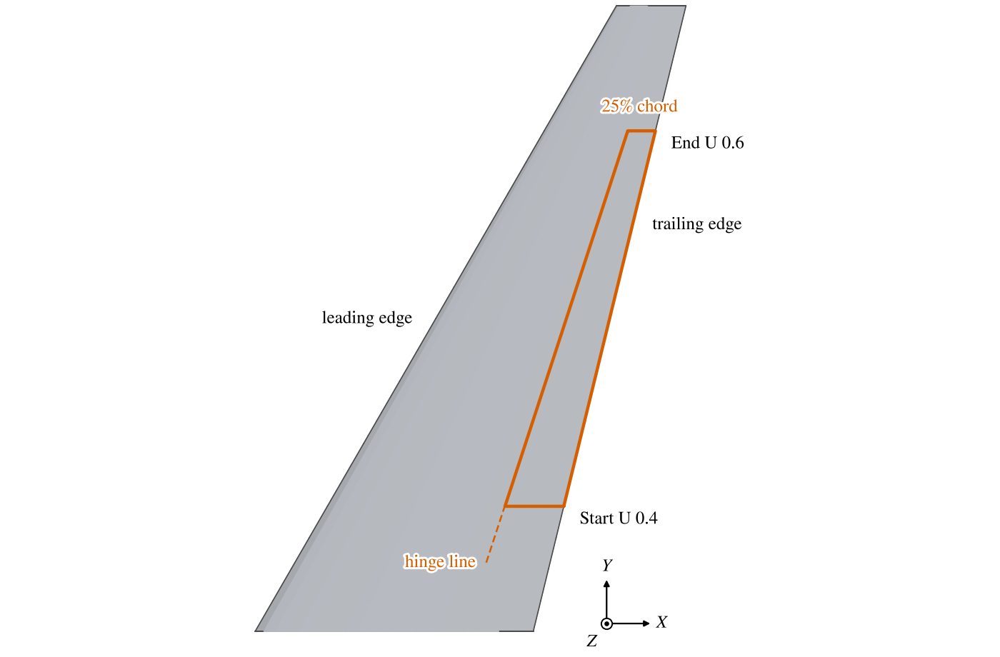
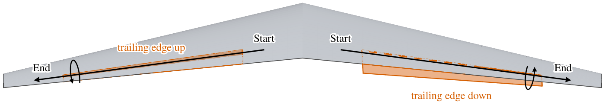

Every component (Geom) in OpenVSP is edited in a window whose first tabs are the same for all of them:
[Gen](GenTab.md), [XForm](XFormTab.md), [Mass](MassTab.md) and Sub.  The Sub tab holds the Geom's sub-surfaces.
Blank, Hinge, Human, Mesh, NGon Mesh, Point Cloud, Routing and Wireframe have no Sub tab.

| Topic                                     |
|:------------------------------------------|
| [Sub-Surfaces](#sub-surfaces)             |
| [Sub-Surface Types](#sub-surface-types)   |
| [Control Surface](#control-surface)       |
| [Hinge Line and Deflection](#hinge-line-and-deflection) |
| [Scripting](#scripting)                   |

## Sub-Surfaces

A sub-surface marks a region, or a line, on a Geom's surface.  It does not change the shape; it labels part of it so
that analyses can treat that part apart:

- CompGeom and the mesh exports tag the triangles in the region, so their area is reported separately and the
  exported mesh carries the tag.
- VSPAERO deflects control surfaces (the Control_Surf type only); each symmetric copy is a separate control surface
  there.
- Parasite Drag can give the region its own treatment, or no drag.
- CFD Mesh and FEA Mesh imprint its boundary into the mesh, when their *Intersect Sub-Surfaces* option is on (the
  default); FEA Structure can turn it into beam elements or remove its shell elements.
- STEP and IGES export can split the surface along it, and DegenGeom reports it.

Sub-surfaces are defined in the surface's own parameters, U along the Geom and W around it, each from 0 to 1 (see
[Attachment Coordinates](XFormTab.md#attachment-coordinates) for where they start).  So a sub-surface stays on the same
part of the surface as the Geom changes shape, and a rectangle in U and W need not look rectangular on the surface
(Figure 1).
Each region tags the side of its boundary chosen by *Tag*, *Inside* or *Outside*; for a Line, *Test* *Greater* tags
the side of larger U (or W) and *Less* the other.

*Figure 1. A Line at U 0.2, a 0.2 by 0.2 Rectangle turned by Theta 30, and an Ellipse 0.15 by 0.15, in U and W (left)
and on a pod (right).*

Choose the *Surface* before clicking *Add*: *ALL* puts the sub-surface on each of the Geom's surfaces (every blade of a
propeller, for example), *Surf_i* on that one only (Figure 2).  The choice applies when the sub-surface is made; the
Sub tab cannot change it afterward.  A sub-surface on a surface is on all of that surface's symmetric copies.

*Figure 2. The top of the Sub tab of the default Propeller, holding a Line added with Surface ALL and a Rectangle
added with Surface Surf_1.  The SURF column shows the surface each sub-surface is on.*

Each sub-surface has its own name, which becomes part of its tag, and its own attributes (see
[Attributes](GenTab.md#attributes)).

## Sub-Surface Types

| Type          | Defined by                                                                                  | Use                                     |
|:--------------|:--------------------------------------------------------------------------------------------|:----------------------------------------|
| Line          | A line of constant U or constant W across the whole surface; tags one side of it.           | Split a body at a station, or lengthwise. |
| Rectangle     | Center, lengths in U and W, and *Theta*, a turn from the U direction toward W.               | A panel or a hatch.                     |
| Ellipse       | Center, lengths (diameters) in U and W, *Theta*, and the number of points on its outline.    | A window or an inlet face.              |
| Finite_Line   | A straight segment in U and W between two points; tags nothing.                             | A line in a mesh, or an FEA beam.       |
| XSec_Curve    | Any cross-section curve shape (circle, super ellipse, edit curve and the rest), centered at U and W, with its width along U and its height along W. | An outline of any shape.              |
| Intersect     | The curve where another Geom meets this one.                                                | The footprint of a part on a body.      |
| Control_Surf  | Spanwise start and end and a chordwise depth from an edge (below); Wing and Propeller only. | Flaps, ailerons, slats.                 |

The Rectangle and Ellipse lengths and *Theta* act in the U-W plane, so on a long body a "square" of 0.2 by 0.2 is much
longer along the body than around it, and *Theta* is not an angle on the surface.

A Line's value is a fraction of the surface's U (or W) range by default, *[0, 1]*.  With *[0, N]* it counts the
surface's sections instead, so a whole number puts the line exactly on a cross section: on a Fuselage, U 2 is its
third cross section; on a Wing the root and tip caps count as sections, so U 1 is the root airfoil and U 2 the end of
the first panel.  W counts the four quarters of each section; on a Wing W 2 is the leading edge, and a Line of
constant W there splits the upper surface from the lower (see
[Attachment Coordinates](XFormTab.md#attachment-coordinates) for where W starts on other Geoms).  Use [0, N]
whenever a line belongs on a section: it stays on that section when sections are added behind it, where a [0, 1]
value moves to a new place among the sections.

An Ellipse is drawn as a polygon of *Num Points* corners, so a small number gives a polygon: 3 a triangle, 6 a
hexagon (Figure 3).  The first corner lies at *Theta* from the U direction, so at Theta 0 a corner points along U.
A Theta of 180/N degrees, for N points, turns the polygon by half a side, so that a side faces along U instead; the
value boxes take arithmetic, so 180/6 can be typed as it is.  Give the U and W lengths equal values for a regular
polygon in U and W; as with the Rectangle, it is regular on the surface only where U and W are scaled alike.

*Figure 3. Ellipse sub-surfaces of Num Points 3 and 6, each at Theta 0 and at Theta 180/N, in U and W (left) and on a
pod (right).*

An XSec_Curve sub-surface starts as a circle of diameter 1, which spans the whole surface; set its size first.  Its
width and height are fractions of the U and W ranges, from 0 to 1.

An Intersect sub-surface is computed when *Intersect* is clicked, from the Geom chosen in *Intersect Geom*, and kept as
an edit curve.  When the two Geoms meet along more than one curve, *Curve Index* chooses which of the *Num Curves* to
use.  It does not follow later changes to either Geom; click *Intersect* again after changing them.  Between clicks
the curve is an ordinary XSec_Curve outline: edit it, or change its type, to tidy or simplify the footprint.

## Control Surface

The Control_Surf type is offered on Wing and Propeller Geoms (Figure 4).  It marks a region bounded by the trailing
edge (or, with *Leading Edge*, the leading edge), two spanwise stations and a hinge line, on the *Upper*, *Lower* or
*Both* surfaces.  Model a flap, aileron, elevator or rudder with it rather than with a Rectangle: a Rectangle can be
made to look like one, but its sides follow U and W rather than a depth from the edge, and VSPAERO deflects only a
Control_Surf.

*Figure 4. The Sub tab's panel for the default control surface on the default wing: Start U 0.4 to End U 0.6, a
constant depth of 0.25 of the chord, on Both surfaces.  Controls that the present choices do not use are greyed.*

- The spanwise stations are *Start U* and *End U*, or, with *Use Eta for Spanwise Coordinate*, *Start Eta* and *End
  Eta*, fractions of the span from root to tip (of the radius, $r/R$, on a propeller; see
  [Spanwise Coordinate Eta](Wing.md#spanwise-coordinate-eta)).  U includes a wing's root and
  tip caps (see [Attachment Coordinates](XFormTab.md#attachment-coordinates)), so the default U of 0.4 to 0.6 on a
  one-panel wing is 20% to 80% of the span (Figure 5).
- The chordwise depth is given at the start and at the end, as a fraction of the local chord (*L/C*) or as a length
  (*L*); *Constant* makes the end equal to the start.  The hinge line passes through the points on the surface that
  lie that straight-line distance from the edge, on each surface.
- The sides follow the wing's sections unless *Surface End Angle* sets the angle each side makes with the edge, in
  degrees; with both angles set, *Same Angle* makes the end angle equal to the start.  With an angle not set, its
  slider shows the angle the section makes with the edge.
- Each edge, the two sides and the hinge line, is a smooth curve through four points: its ends and its thirds.  The
  depth and the end angles are met exactly at those points and blended between them.  *Num Points* is the number of
  points each edge is drawn with, and so how closely the tagged region follows that curve; raise it when the outline
  must be smooth, on a long control surface or with end angles set.

*Figure 5. The default control surface on the default wing: Start U 0.4 to End U 0.6, 25% of the chord deep, on both
surfaces.  The hinge line is dashed.*

### Hinge Line and Deflection

The 3D view draws each control surface's hinge line, from the Start end to the End end, with a curved arrow around it
for a positive deflection.  A positive deflection turns the surface right-handed about that line, from Start toward
End.  On a wing whose Start is at the root, that turns a trailing-edge surface down and a leading-edge surface up.

A symmetric copy is a mirror image, so its hinge line also runs from root to tip, and the same positive deflection
turns its trailing edge up (Figure 6).  VSPAERO deflects each copy by the control group's deflection times that
copy's gain.  Its automatic grouping puts both copies in one group with a gain of 1 each, which deflects them as
ailerons; for a flap or an elevator, which deflect together, set the gain of the copy to -1.

*Figure 6. The default control surface on the default wing and its symmetric copy, each given the same positive
deflection, seen from behind with $+Y$ to the right.  The hinge lines run from Start to End; the curved arrows show
the positive sense; dashed outlines are the surfaces at rest.*

## Scripting

Every control on this tab is a Parm, set and read with `SetParmVal` and `GetParmVal` by name and group;
`GetParmActiveFlag` tells whether a control is active or greyed, as of the last Update.
Sub-surfaces are made with `AddSubSurf( geom_id, type, surfindex )`, whose surface index defaults to 0, the first
surface; pass -1 for all of them, as *ALL* on the Sub tab does.  `GetSubSurfIDVec` lists a Geom's sub-surfaces,
`GetSubSurfParmIDs` gives a sub-surface's Parms, and `IntersectSubSurf` does what the *Intersect* button does, with the
Geom set by `SetIntersectSubSurfGeomID`.

| Control                       | Parm                                                       | Group        |
|:------------------------------|:-----------------------------------------------------------|:-------------|
| Sub-surface Tag               | `Test_Type`: `INSIDE`, `OUTSIDE` or `NONE`                 | SS_Rectangle, SS_Ellipse, SS_XsecCurve or SS_Control, by type |
| Line value, [0, 1] or [0, N]  | `Const_Line_Value`, `Const_Line_Value0N`; `Value_01` 1 for [0, 1], 0 for [0, N] | SubSurface |
| Line sub-surface Test         | `Test_Type`: `SS_LINE_TEST_GREATER`, `SS_LINE_TEST_LESS` or `SS_LINE_TEST_NONE` | SubSurface |
| Control surface sides         | `Surf_Type`: `SS_CONTROL_UPPER_SURF`, `SS_CONTROL_LOWER_SURF` or `SS_CONTROL_BOTH_SURF` | SS_Control |
| Line Type                     | `Const_Line_Type`: `CONST_U` or `CONST_W`                  | SubSurface   |
| Center U, Center W            | `Center_U`, `Center_W`                                     | SS_Rectangle, SS_Ellipse or SS_XsecCurve |
| U Length, W Length, Theta     | `U_Length`, `W_Length`, `Theta`                            | SS_Rectangle or SS_Ellipse |
| Ellipse Num Points            | `Tess_Num`                                                 | SS_Ellipse   |
| Finite_Line ends              | `UStart`, `UEnd`, `WStart`, `WEnd`                         | SS_FiniteLine |
| Start U, End U                | `UStart`, `UEnd`                                           | SS_Control   |
| Use Eta, Start Eta, End Eta   | `EtaFlag`, `EtaStart`, `EtaEnd`                            | SS_Control   |
| Leading Edge                  | `LE_Flag`                                                  | SS_Control   |
| Chordwise L/C or L            | `Abs_Rel_Flag`: `REL` or `ABS`                             | SS_Control   |
| Start and End depth           | `Length_C_Start`, `Length_C_End` (L/C); `Length_Start`, `Length_End` (L) | SS_Control |
| Constant                      | `SE_Const_Flag`                                            | SS_Control   |
| Surface End Angle             | `StartAngleFlag`, `EndAngleFlag`, `SameAngleFlag`, `StartAngle`, `EndAngle` | SS_Control |
| Control surface Num Points    | `Tess_Num`                                                 | SS_Control   |
