The Wing component models wings, tails, canards, fins and any other lifting surface.  It builds the surface from a
row of airfoils, placed one after another from the root to the tip.  The space between two neighboring airfoils is a
wing section, a trapezoid in its own plane with its own span, chords, sweep, dihedral and twist; a wing has as many
sections as it needs, so a cranked or many-paneled wing is one component.  Between the airfoils the surface is
lofted, with straight leading and trailing edges unless they are blended into curves.  The ends can be closed with
several kinds of cap.

| Topic                                                                        | Tab                 |
|:-----------------------------------------------------------------------------|:--------------------|
| [Quick Start](#quick-start)                                                  |                     |
| [Sections and Airfoils](#sections-and-airfoils)                              | Sect, Airfoil       |
| [Section Planform](#section-planform)                                        | Sect                |
| [Sweep](#sweep)                                                              | Sect                |
| [Dihedral](#dihedral)                                                        | Sect, Plan          |
| [Airfoil Orientation at a Dihedral Break](#airfoil-orientation-at-a-dihedral-break) | Plan, Sect     |
| [Twist and Root Incidence](#twist-and-root-incidence)                        | Sect, Plan          |
| [Total Planform](#total-planform)                                            | Plan                |
| [Tip Treatment](#tip-treatment)                                              | Plan                |
| [Blending](#blending)                                                        | Blending            |
| [Airfoils on a Wing](#airfoils-on-a-wing)                                    | Airfoil, Modify     |
| [Tessellation](#tessellation)                                                | Sect, Plan, Gen     |
| [Spanwise Coordinate Eta](#spanwise-coordinate-eta)                          | XForm, Sub          |
| [Scripting](#scripting)                                                      |                     |

The Gen, XForm, Mass and Sub tabs are common to all components; see [Gen](GenTab.md),
[XForm](XFormTab.md), [Mass](MassTab.md), [Sub-Surfaces](SubTab.md) and
[Attributes](GenTab.md#attributes), which are edited on the Gen tab.  A wing's Sub tab also offers the Control
Surface sub-surface, which only wings and propellers have.

## Quick Start

A new wing has one section: a span of 9 per side, a root chord of 4, a tip chord of 1, $30^\circ$ of leading edge
sweep and NACA 0010 airfoils, mirrored across the $XZ$ plane.  Its origin is the leading edge of the root airfoil, and
its span runs along $+Y$.

### A main wing

1. Add a Wing.
2. Place the root leading edge with the XForm tab.
3. Size the section on the Sect tab: pick the three quantities you know (see
   [Section Planform](#section-planform)) and set them, with the sweep.  Add sections with *Split* for a cranked wing.
4. Set the dihedral and twist on the Sect tab, and the airfoils on the Airfoil tab.

### A vertical tail

1. Add a Wing.
2. On the XForm tab, turn off the $XZ$ planar symmetry, place the root leading edge, and set *XRot* to 90 so the span
   runs along $+Z$.
3. Size the section on the Sect tab as for a main wing.
4. Set the airfoils on the Airfoil tab.

A vertical tail on the symmetry plane must not be mirrored: with symmetry on, the turned tail and its mirror image lie
on top of each other, which breaks the analyses that need a closed, non-overlapping surface (CFD Mesh leaves both out of
the mesh, with a warning in its console), and the Plan tab's totals count the span twice.  Keep the symmetry only for a
pair of fins set apart from the plane, as on a twin tail.

Turn a fin up with the XForm rotation rather than with a $90^\circ$ dihedral: with the default settings the root
airfoil stays upright and is thickened for the dihedral by $1/\cos\Gamma$, which grows without bound as $\Gamma$
nears $90^\circ$ (see [Airfoil Orientation at a Dihedral Break](#airfoil-orientation-at-a-dihedral-break)).

### Working order

Build a wing in the order its features depend on each other: the planform first (spans, chords and sweeps), then
thickness, dihedral and twist, then the airfoils and any winglet, and blending last, only where the straight-edged
sections cannot give the shape.  Use as few sections as the shape needs, with an airfoil at each break in the
planform, dihedral or airfoil; every extra airfoil is one more set of values to keep consistent.  A fairing at the
root of a tail, such as a dorsal fin, is often just one more section with a long root chord and a large sweep.

## Sections and Airfoils

The wing's airfoils are numbered from 0 at the root.  Section $i$ lies between airfoil $i-1$ and airfoil $i$, so the
sections are numbered from 1 (Figure 1).  The Sect tab chooses a section; the Airfoil, Blending and Modify tabs choose
an airfoil, and share one index.

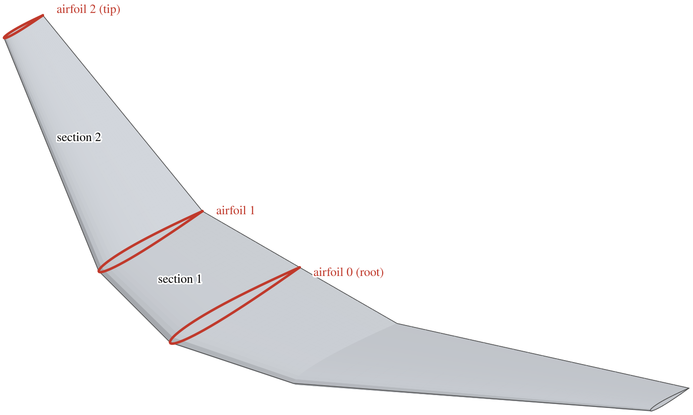

*Figure 1. A wing of two sections, with its mirror image.  Section 1 lies between airfoils 0 and 1, section 2 between
airfoils 1 and 2.*

Neighboring sections share an airfoil, and so share a chord: the Tip C of a section is the Root C of the section
outboard of it.  They are one value, and changing either changes the other.

When a shared chord changes, only the section being edited obeys its drivers (see
[Section Planform](#section-planform)).  The neighbor does not: for that change it is solved as if its drivers were
Span, Root C and Tip C, whatever they are.  It keeps its span and its other chord, and its area, aspect ratio,
taper, average chord and secondary sweep are recomputed, including those it has chosen as drivers.  A neighbor
driven by AR, Area and Taper therefore changes all three (Figure 2).  Its choice of drivers is kept, and from then on
they hold their new values.

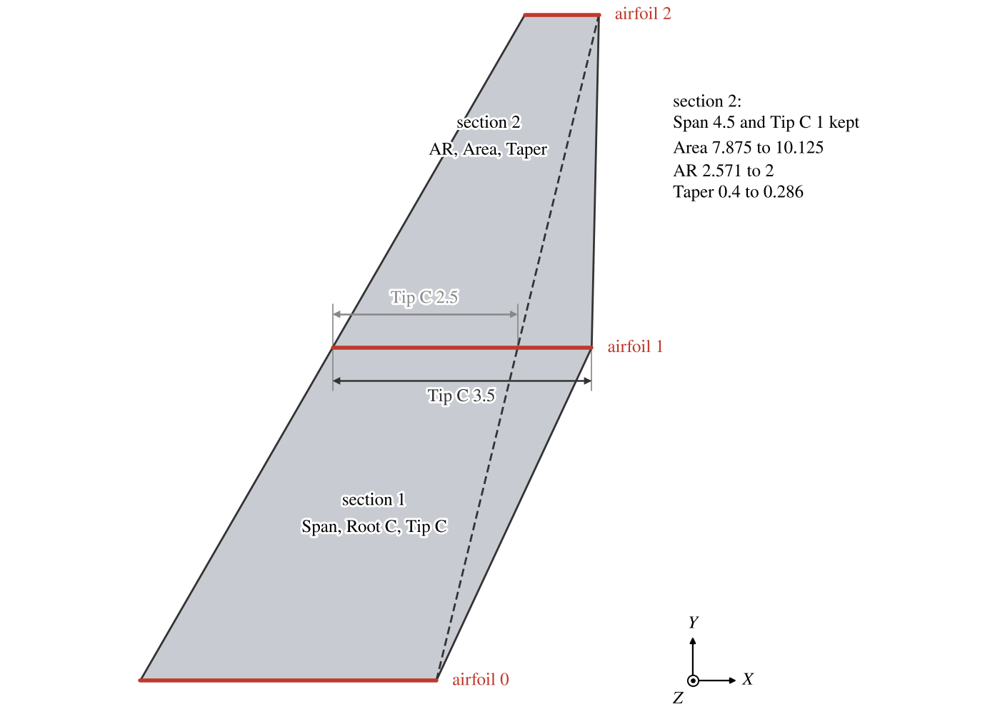

*Figure 2. Section 1's Tip C changed from 2.5 to 3.5, before (dashed) and after.  Section 2, driven by AR, Area and
Taper, keeps its span and its tip chord, and its drivers take new values.*

So to size neighboring sections independently, make the chords they share drivers of both: with Area, Root C and
Tip C, a change to one section's Area moves only its span, and its neighbors are untouched.

The buttons on the Sect tab act on whole sections, planform and airfoil together.

- *Split* divides the section in two at half its span, without changing the wing's shape at the tip.  The new
  airfoil is a copy of the section's tip airfoil with the average of the section's root and tip chords.  With absolute
  twist, the default (see [Twist and Root Incidence](#twist-and-root-incidence)), the new airfoil takes the mean of
  its neighbors' twists and the tip airfoil keeps its own; with relative twist each half takes half of the section's
  Twist.
- *Copy* and *Paste* copy a whole section, planform, dihedral, twist and airfoil, onto another section.  The chords
  it shares with its neighbors then follow the pasted section.
- *Insert* adds a section outboard of the current one and pastes the copied section into it, unlike the Fuselage and
  Stack, whose Insert copies the current section.  With nothing copied, the new section has span 1, both chords 1 and
  no sweep, and the chords its neighbors share with it become 1 too.  On the tip section, Insert adds the new
  section beyond the tip.
- *Cut* removes the section and keeps it for pasting.  The sections outboard of it move in by its span, and the
  section inboard of it takes the next one's root chord as its tip chord.  A wing keeps at least one section.

## Section Planform

A section is a trapezoid, described by eight quantities (Figure 3).

| Driver  | Quantity                                                                                     |
|:--------|:---------------------------------------------------------------------------------------------|
| AR      | Aspect ratio of the section, $A$.                                                            |
| Span    | Span $b$, measured in the section's own plane, along its dihedral.                           |
| Area    | Area $S$ of the trapezoid.                                                                   |
| Taper   | Taper ratio $\lambda$.                                                                       |
| Ave C   | Average chord $\bar c$.                                                                      |
| Root C  | Root chord $c_r$, the chord of the inboard airfoil.                                          |
| Tip C   | Tip chord $c_t$, the chord of the outboard airfoil.                                          |
| Sec SW  | Secondary sweep $\Lambda_2$, the sweep of a second chordwise line (see [Sweep](#sweep)).     |

Three of them, the drivers, are set and the other five follow from

$$
\bar c = \frac{c_r + c_t}{2}, \qquad S = b\,\bar c, \qquad A = \frac{b^2}{S}, \qquad \lambda = \frac{c_t}{c_r},
$$

and the sweep relation in [Sweep](#sweep), which ties Sec SW to the chords and the span.  The default drivers are
Span, Root C and Tip C.

On the Sect tab the eight quantities stand in a column of sliders with three columns of buttons beside them; each
column of buttons picks one driver (Figure 4).  The sliders of the three drivers are active and the other five are
greyed: they show values OpenVSP has computed.  The relations among the eight are nonlinear, but OpenVSP does not
search for the five numerically.  At every update it solves the relations exactly: it finds, in closed form, each
quantity that follows from those already known, and repeats until all eight are known.  So every allowed choice
works the same way: the drivers keep exactly the values you give them, the other five always agree with them, and
neither the order in which you set the drivers nor the values the others had before makes a difference.

Not every choice of three fixes a section.  Three quantities already tied by one of the relations above fix only two
things between them: Root C, Tip C and Taper state the tip chord twice and say nothing about the span or the area.
The buttons offer only choices that fix the section.  A button is active only if putting its quantity in its column,
with the other two columns as they are, gives three independent drivers; so a quantity chosen in one column is greyed
in the others, and so is any quantity that would complete a related set.  The sets never offered are

- any three of AR, Span, Area and Ave C;
- any three of Root C, Tip C, Ave C and Taper;
- Taper together with Sec SW, whatever the third;
- Sec SW with two of Root C, Tip C and Ave C.

That leaves 39 of the 56 possible sets.  To go from one set to another, change one column at a time; when the
quantity you want is greyed in a column, change one of the other columns first.

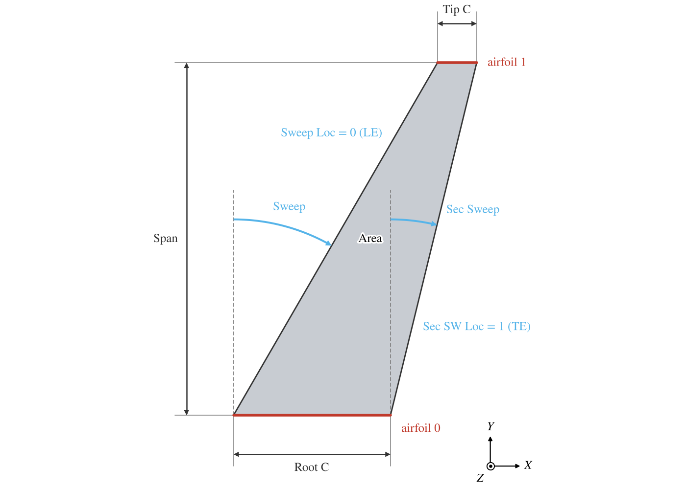

*Figure 3. The default wing's section seen from above, with the quantities that define it.  The sweeps are measured
from the $Y$ direction.*

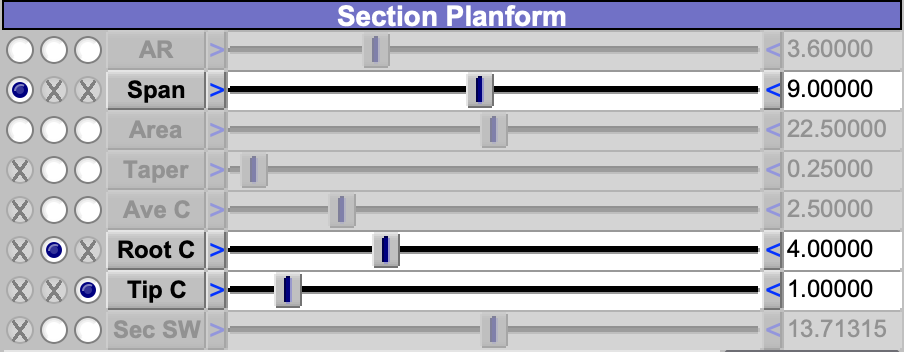

*Figure 4. The Section Planform group of the Sect tab with the default drivers, Span, Root C and Tip C.  A greyed
button, marked with a cross, would make a set that does not fix the section.*

Choose the drivers for what you know and what you want held while you change other things.

- Span, Root C and Tip C reproduce a drawing directly.
- Area, AR and Taper suit sizing: change the aspect ratio and the area stays.
- Span, Root C and Sec SW set the leading and trailing edge sweeps, and the tip chord follows: with Sweep Loc 0 and
  Sec SW Loc 1, the tip chord is $c_t = c_r + b\,(\tan\Lambda_2 - \tan\Lambda)$.

When the section has no taper (equal chords, Taper 1, or Sweep equal to Sec SW), its edges are parallel: Taper is set
to 1 and Sec Sweep to the Sweep.

## Sweep

*Sweep* is the sweep angle $\Lambda$ of the line through the chordwise point *Sweep Loc* of every chord, a fraction
of the chord from 0 at the leading edge to 1 at the trailing edge.  It is measured in the section's own plane, from
the direction perpendicular to the root chord, and is positive aft (Figure 3).  The default Sweep Loc is 0, the
leading edge.

The sweep of any other chordwise line follows from the taper.  The line at *Sec SW Loc*, $x_2$, has the sweep

$$
\tan\Lambda_2 = \tan\Lambda - (x_2 - x_1)\,\frac{c_r - c_t}{b}
$$

where $x_1$ is Sweep Loc.  This is the secondary sweep, Sec SW.  With the defaults, $x_1 = 0$ and $x_2 = 1$, it is the
trailing edge sweep.  Sweep Loc and Sec SW Loc cannot be equal.

Sweep is always set; it is not one of the drivers.  When a chord changes, the line at Sweep Loc keeps its sweep and
the others move.  So set Sweep Loc to the line whose sweep you are given, 0.25 for a quarter-chord sweep, before you
set the Sweep.  Changing Sweep Loc keeps the angle and moves it to the new line, which changes the planform; it does
not re-express the same planform at another line (Figure 5).

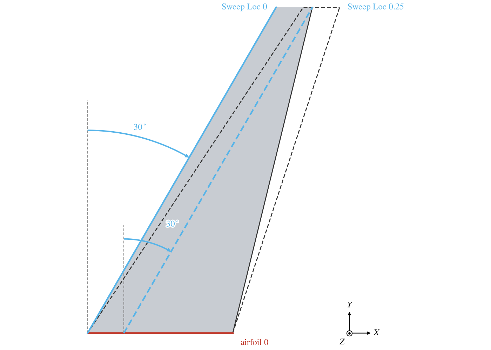

*Figure 5. The default section, Sweep $30^\circ$ at Sweep Loc 0 (solid), and the same Sweep at Sweep Loc 0.25
(dashed).  The root stays, the quarter chord line takes the $30^\circ$, and the leading edge sweeps further.*

## Dihedral

*Dihedral* $\Gamma$ tilts the section up about the $X$ direction at its root airfoil: the section's span $b$ runs at
$\Gamma$ from the horizontal, and its tip rises by $b\sin\Gamma$ (Figure 6).  The section's sweep and chords are those
of its own plane, so seen from above a section with dihedral is foreshortened along $Y$ by $\cos\Gamma$.  The Sect
tab reports that span seen from above as *Projected Span*, $b\cos\Gamma$.

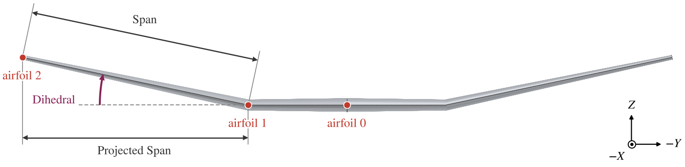

*Figure 6. The wing of Figure 1 seen from upstream; section 2 has $12^\circ$ of dihedral.  Its Span is measured along
the section, and its Projected Span is the span seen from above.*

*Dihedral Reference* on the Plan tab chooses what each section's dihedral is measured from.  *Abs*, the default,
measures each from the horizontal.  *Rel* measures each from the section inboard of it, so the angles add up from the
root.

## Airfoil Orientation at a Dihedral Break

At a change of dihedral the airfoil can stand upright, in the $XZ$ plane, or turn about $X$ to lie across the
dihedral (Figure 7).  A turned airfoil between two sections lies on the bisector of their dihedrals; the tip airfoil
lies across the tip section, and the root airfoil across section 1.

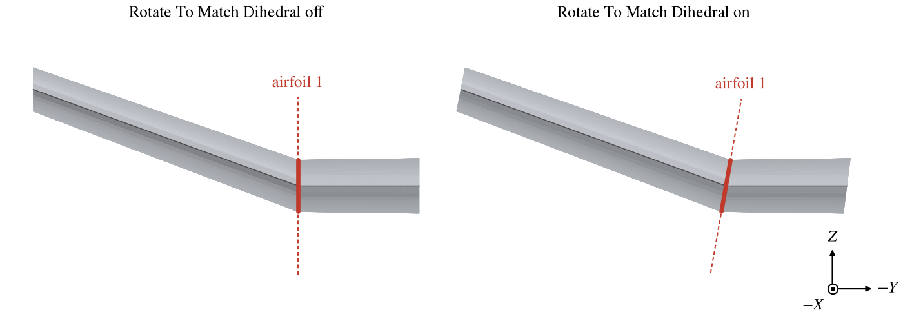

*Figure 7. Airfoil 1, at a break from $0^\circ$ to $20^\circ$ of dihedral, seen from upstream.  The airfoil is the red
line across the surface; its plane is dashed.*

Two sets of controls decide which airfoils turn, one for the whole wing and one for each airfoil.

- On the Plan tab, *Rotate To Match Dihedral* has two buttons (Figure 8).  *All But Root*, on by default, turns every
  airfoil except the root.  *Wing Root*, off by default, turns the root airfoil.
- On the Sect tab, each section's *Rotate Tip Foil To Match Dihedral* turns the airfoil at that section's outboard end.
  These buttons are greyed while All But Root is on, and what they are set to is then ignored.  They and Wing Root are
  also greyed while *Twist All Foils In XZ Plane* is on, but then they still act: an airfoil whose button was left on
  stays turned, so turn such buttons off before turning on Twist All Foils In XZ Plane.

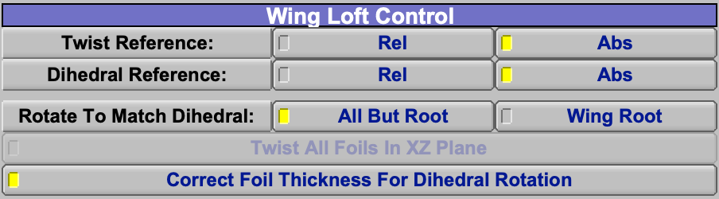

*Figure 8. The Wing Loft Control group of the Plan tab at its defaults: All But Root and Correct Foil Thickness on,
Wing Root off, and Twist All Foils In XZ Plane greyed while All But Root is on.*

An airfoil turns if either control that reaches it is on.

| Airfoil                | Turned when                                                    | Lies across              |
|:-----------------------|:---------------------------------------------------------------|:-------------------------|
| Root, airfoil 0        | Wing Root is on                                                | section 1                |
| Between two sections   | All But Root, or the inboard section's Rotate Tip Foil, is on  | the bisector of the two  |
| Tip                    | All But Root, or the tip section's Rotate Tip Foil, is on      | the tip section          |

An airfoil turned to the bisector of a break of $\Delta\Gamma$ meets each section at $\Delta\Gamma/2$, which would
make the sections thinner than the airfoil.  *Correct Foil Thickness For Dihedral Rotation*, on by default, thickens
such an airfoil by $1/\cos(\Delta\Gamma/2)$ so the thickness across each section is the airfoil's.  It also thickens
an upright root airfoil by $1/\cos\Gamma_1$, where $\Gamma_1$ is section 1's dihedral, for the same reason.  Other
upright airfoils are not thickened: where a section with dihedral $\Gamma$ meets an upright airfoil, the wing
measured across the section is only $\cos\Gamma$ of the airfoil's thickness.

Leave these at their defaults (All But Root on, Wing Root off, Correct Foil Thickness on).  Every airfoil away from
the root then lies across the surface, and the wing keeps the airfoils' thickness through every break.  Leave the
root upright when the wing's root lies on the symmetry plane or against a fuselage side: the two halves then meet in
the $XZ$ plane.  Turn on Wing Root when the root is free, as on a wing that starts from another surface.  Turn All
But Root off only when particular airfoils must stay upright, and then turn the others with Rotate Tip Foil, section
by section.

A model may arrive with other settings: All But Root off, with Rotate Tip Foil on for some sections and off for
others, or Correct Foil Thickness off.  Its airfoils then stand upright wherever their own button is off, and the
wing is thinner than its airfoils across every section with dihedral that meets an upright airfoil.  Turning All But
Root on turns all of them at once, which is usually what such a model needs, but it changes the surface, so check
what depends on it.

## Twist and Root Incidence

*Twist* turns a section's tip airfoil about the point *Twist Loc*, a fraction of its chord (0.25 by default).
Positive twist raises the leading edge (Figure 9).  The root airfoil belongs to no section; its twist is the
*Incidence* in the Plan tab's Root Incidence group, about *Incidence Loc*, a fraction of the root chord (0.25 by
default).

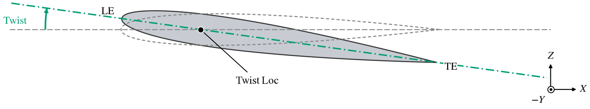

*Figure 9. The default wing's tip airfoil seen from the side, untwisted (dashed) and with $8^\circ$ of twist about
Twist Loc 0.25.*

*Twist Reference* on the Plan tab chooses what each twist is measured from.

- *Abs*, the default: each airfoil's twist is its section's Twist.  The Incidence turns the root airfoil only, so it
  changes the twist across section 1 alone, which runs from the Incidence at the root to section 1's Twist.
- *Rel*: each section's Twist is added to the twist of the airfoil inboard of it, starting from the Incidence.  The
  Incidence then turns every airfoil by the same angle, each about its own Twist Loc point.

Root incidence is not the same as turning the wing with *YRot* on the XForm tab (Figure 10).  Twist and Incidence turn
each airfoil in place, about a point on its own chord.  Those points, the Twist Loc line (the quarter chord by default),
stay where the planform puts them, so the span, sweep and dihedral of that line do not change.  *YRot* turns the
whole wing as a rigid body about a line parallel to $Y$ through one point, the rotation origin; on a wing, *Rot
Origin(X)* places it at a fraction of section 1's root chord, so 0.25 turns the wing about the root's quarter chord.
Every point aft of that point moves down as the leading edge rises: on the default wing, $8^\circ$ of *YRot* about
Rot Origin(X) 0.25 lowers the tip's quarter chord by 0.62 (by 0.76 about the default Rot Origin(X) of 0, the root
leading edge), where $8^\circ$ of Incidence with Rel twist leaves it in place.  *YRot* turns the wing's own axes
too, so the sweep and dihedral turn with it, and so do the components that take their orientation from the wing.  Both
raise the leading edge for a positive angle.

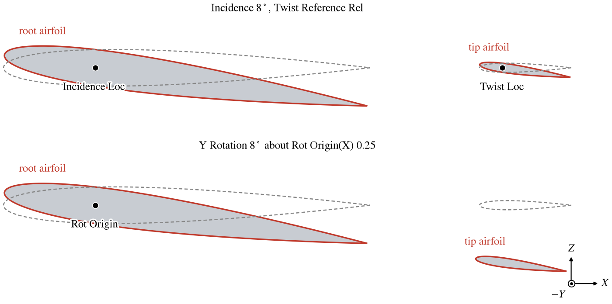

*Figure 10. The default wing's root and tip airfoils seen from the side, turned by $8^\circ$ of Incidence with
relative twist (top) and by $8^\circ$ of *YRot* about Rot Origin(X) 0.25 (bottom), over the unturned airfoils
(dashed).*

Use *YRot* for the angle at which the wing as a whole is set on the aircraft: the wing is built as designed and
then mounted at that angle.  Use the Incidence, with Abs twist, for the root airfoil's place in the twist
distribution, as the first value of the wing's twist from root to tip.

A section's tip airfoil is twisted about the direction of its section's span, which tilts with the dihedral.  When the
airfoil is not turned to match the dihedral, that tilts it out of the $XZ$ plane.  *Twist All Foils In XZ Plane* on
the Plan tab, or *Twist Tip Foil In XZ Plane* for one section on the Sect tab, twists about the $Y$ direction instead,
which keeps the airfoil in the $XZ$ plane.  Twist All Foils In XZ Plane is greyed while All But Root is on, and has no
effect on an airfoil whose own Rotate Tip Foil is on; Twist Tip Foil In XZ Plane is greyed whenever its airfoil is
turned or Twist All Foils In XZ Plane is on.

## Total Planform

The Plan tab reports the planform of the whole wing.  With symmetry, the span and area include both halves; they are
doubled for any symmetry, whatever the number of copies.

| Total        | Value                                                                                         |
|:-------------|:----------------------------------------------------------------------------------------------|
| Span         | The sum of the sections' spans, each measured along its dihedral.                             |
| Proj Span    | The sum of the sections' projected spans, $b\cos\Gamma$.                                      |
| Chord        | The mean of the sections' average chords, each section counted once whatever its span.       |
| Area         | The sum of the sections' trapezoid areas, each in its own plane.                              |
| MAC          | The mean aerodynamic chord of one side, from the actual leading and trailing edges.           |
| Curved Area  | The area from the actual leading and trailing edges.                                          |
| Aspect Ratio | Proj Span squared over Area.                                                                  |

The mean aerodynamic chord and the curved area are integrals over the span of the chord $c$, the distance from the
leading to the trailing edge, along the edges as built, blending included:

$$
\mathrm{MAC} = \frac{\int c^2\,ds}{\int c\,ds}, \qquad \mathrm{Curved\ Area} = \int c\,ds
$$

where $s$ runs along the sections' spans.  Without blending, Curved Area equals Area.  Note that the Aspect Ratio
divides a projected span by an area that is not projected, and that Chord is not Area divided by Span unless the
sections have equal spans.

Span, Proj Span, Chord and Area can also be set, to scale the whole wing.

- Span or Proj Span scales every section's span by one factor; the chords stay.
- Chord scales every chord by one factor; the spans stay.
- Area scales every span and chord by the square root of the area ratio, so each section keeps its aspect ratio
  and taper.

In every case the sweeps, dihedrals and twists stay.

## Tip Treatment

*Root Cap Type* and *Tip Cap Type* close the ends of the wing.  A new wing has a Flat cap at both ends, so it is a
closed body.  Each cap is built across the end airfoil, station by station along the chord, so its height follows the
airfoil's thickness.  Figure 11 shows the shapes from upstream.

| Cap            | Shape                                                                                          |
|:---------------|:-----------------------------------------------------------------------------------------------|
| None           | The end is left open.                                                                          |
| Flat           | A flat face across the airfoil.                                                                |
| Round          | A circular arc tangent to the upper and lower surfaces.                                        |
| Edge           | Two flat faces from the upper and lower surfaces, meeting in an edge.                          |
| Sharp          | Like Edge, but each face leaves the surface along it and curves into the edge.                 |
| Round Ext ...  | The round cap with its reach carried out to the leading edge, trailing edge, or both.          |

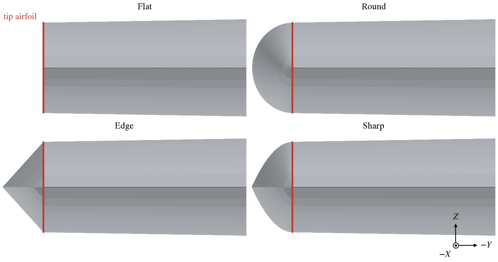

*Figure 11. The default wing's tip from upstream, with each cap type at Length 1; Sharp has its default Strength,
0.5.  The red line is the tip airfoil.*

The caps other than None and Flat take a *Length*, which scales how far the cap reaches beyond the end airfoil (1 is
a circle for Round), and an *Offset*, which moves its tip up or down by a fraction of the local thickness.  Sharp
also takes a *Strength*, from 0 to 1: how far each face follows the surface's direction before it turns toward the
edge.  At 0 it is the Edge shape.  As the Strength rises the faces meet at a shallower angle, but the edge persists
almost to the end: at 0.9 and Length 1 they still meet at about $12^\circ$.  At 1 the edge is gone and the cap is
smooth across its tip, like Round but slightly fuller, reaching about 1% farther.  Use Round for a smooth tip, and
Sharp below 1 for a tip that ends in an edge.  Choosing Round sets the Strength to 1, Edge to 0, and Flat or None to
0.5; Sharp keeps the value it finds, so Sharp chosen after Round starts at 1, with no edge.

At Length 1 the Round, Edge and Sharp caps reach out by half the local thickness, so their reach falls to nothing at
the thin leading and trailing edges and the tip is rounded in plan.  The extended round caps hold the full reach of
the thickest station out to the leading edge (*Round Ext LE*), the trailing edge (*Round Ext TE*) or both (*Round Ext
Both*), which squares off those corners in plan (Figure 12).  *Round Ext None* builds the Round shape.

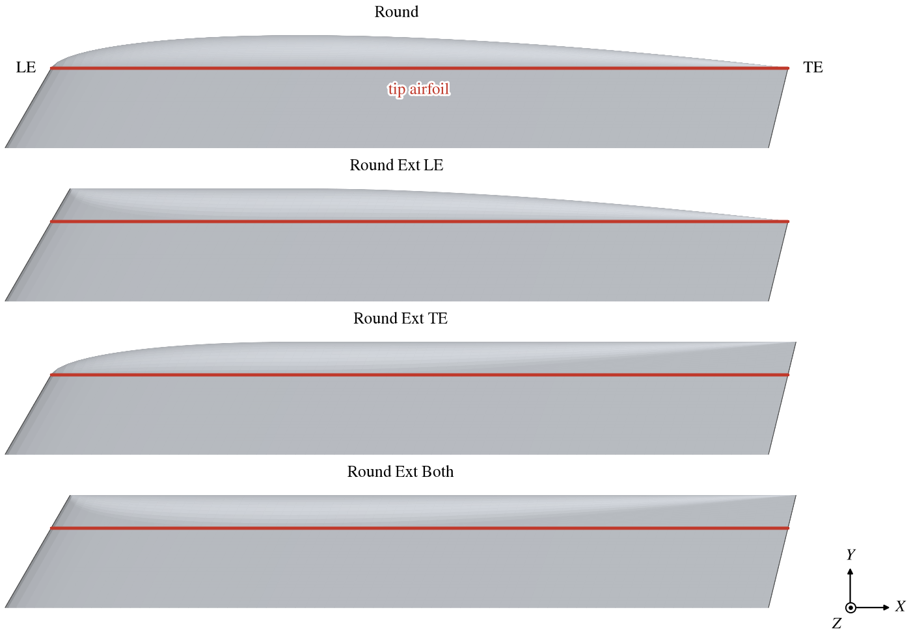

*Figure 12. The default wing's tip from above, with the Round and extended Round caps.*

On a swept wing the surface meets the end airfoil at an angle, and a cap built along the surface reaches out less,
measured square to the end.  *Sweep Stretch* lengthens the cap to make up for it, so that it reaches as far as on an
unswept wing.

*Cap Tess* sets the number of tessellation lines across both caps, and across a blunt leading or trailing edge
made on the Modify tab.

## Blending

Without blending, each section's leading and trailing edges are straight lines between the airfoils.  The Blending
tab curves them: at each airfoil it sets the direction, and how strongly it holds, in which the leading and trailing
edges leave the airfoil, separately on its inboard and outboard sides.  Between the airfoils the surface is then
lofted through airfoils fitted between the curved edges.  Blending changes the surface, the MAC and the Curved Area,
but not the section's planform quantities on the Sect tab, which stay those of the trapezoid.

Each of the four sides (leading edge inboard and outboard, trailing edge inboard and outboard) has a *Match* mode.

| Match                       | The edge leaves the airfoil                                                         |
|:----------------------------|:------------------------------------------------------------------------------------|
| FREE                        | with no condition; with both ends free, the edge is straight.                       |
| ANGLES                      | at the Sweep and Dihedral given, with the Strength given.                           |
| IN_LE_TRAP, IN_TE_TRAP      | along the straight leading or trailing edge of the section inboard.                 |
| OUT_LE_TRAP, OUT_TE_TRAP    | along the straight leading or trailing edge of the section outboard.                |
| IN_ANGLES (outboard side)   | at the inboard side's Sweep and Dihedral.                                           |
| LE_ANGLES (trailing edge)   | at the leading edge's Sweep and Dihedral on the same side.                          |

The inboard side of the root airfoil and the outboard side of the tip airfoil have nothing to blend, and are greyed.
The root's outboard sides cannot match the section inboard (IN_LE_TRAP, IN_TE_TRAP), nor the tip's inboard sides the
section outboard (OUT_LE_TRAP, OUT_TE_TRAP).  IN_ANGLES needs the inboard side on ANGLES (for the trailing edge, ANGLES
or LE_ANGLES), and LE_ANGLES needs the leading edge on that side on ANGLES (outboard, ANGLES or IN_ANGLES).  Every mode
is listed on every side; a mode that does not apply there is changed to ANGLES, except IN_ANGLES on an inboard side
and LE_ANGLES on a leading edge, which stay as chosen and act as ANGLES.
In FREE, the sliders show the angles and the strength the edge takes; in the other matching modes they show the
angles it takes, and Strength remains an input.

The angles are measured from the airfoil: *Sweep* from the airfoil's normal, positive aft as for wing sweep, and
*Dihedral* about the chord, positive with the edge rising outboard on both sides, so a straight edge rising at
$\Gamma$ through an upright airfoil reads $+\Gamma$ inboard and outboard.  IN_ANGLES takes the inboard Sweep and
Dihedral, so the edge continues smoothly through the airfoil.  An older model or script may give the inboard Dihedral
with the opposite sign, which shows as an edge that kinks where it was meant to run smoothly; change the sign of the
inboard Dihedral (`InLEDihedral`, `InTEDihedral` in a script) to restore the intended shape.

*Strength* scales the edge's tangent at the airfoil: it multiplies the distance to the neighboring airfoil's leading
(or trailing) edge.  The default is 1; larger values hold the edge to its direction farther from the airfoil, and
smaller values let it turn toward the neighbor sooner.  Do not set a Strength to 0: the edge then has no tangent at
the airfoil, a degenerate curve that causes trouble in export and analysis.  For a sharp corner in the edge, leave
that side FREE instead.

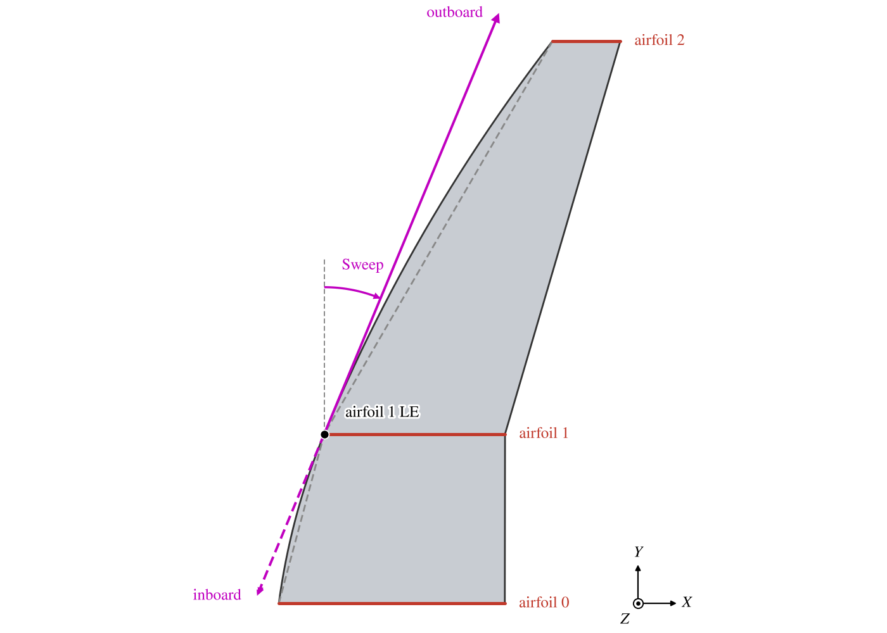

*Figure 13. The leading edge of the wing of Figure 1, straight (dashed) and blended at airfoil 1: inboard ANGLES with
$22.5^\circ$ of sweep, outboard IN_ANGLES.  The vectors are the blend tangents, inboard dashed.*

*Show Blending Vectors* draws the tangents at the chosen airfoil in the 3D view, the inboard ones dashed.  To round a
crank, as in Figure 13, set the inboard leading edge to ANGLES with a sweep between those of the two sections and the
outboard side to IN_ANGLES (Figure 14).

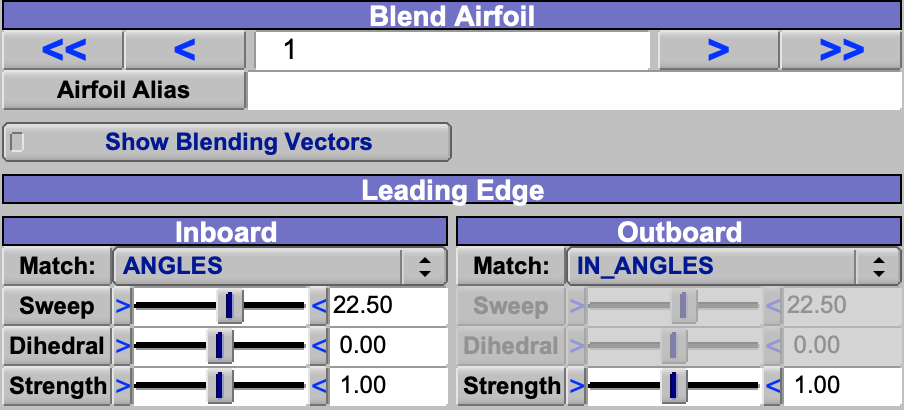

*Figure 14. The Blend Airfoil and Leading Edge groups of the Blending tab for the blended crank, at airfoil 1: the
inboard side ANGLES with $22.5^\circ$ of sweep, the outboard side IN_ANGLES, whose Sweep and Dihedral are greyed and
show the inboard angles.  Strength stays an input on both sides.*

### Example: a root fillet and a blended winglet

Blending works on edges that already exist, so plan the sections for it.  A wing with a fillet at the root and a
winglet at the tip takes four sections: a short root section for the fillet, the main wing, a short transition
section, and the winglet.  Lay out the straight-edged planform first, then the dihedral: put the turn from the main
wing up to the winglet half at each end of the transition section, with the airfoils at both ends turned to match
the dihedral.  Then set the blending by what each edge must do.

- Fillet: at the root airfoil, set the outboard leading and trailing edges to ANGLES with a Sweep of 0, so they leave
  the root square to it; at airfoil 1, set the inboard edges to OUT_LE_TRAP and OUT_TE_TRAP, so they arrive along the
  main wing's straight edges.
- Transition: at airfoil 2, set the outboard edges to IN_LE_TRAP and IN_TE_TRAP, so they leave along the main wing's
  edges; at airfoil 3, set the inboard edges to OUT_LE_TRAP and OUT_TE_TRAP, so they arrive along the winglet's.

Every other side stays FREE, so the main wing and the winglet keep their straight edges.  A side switched out of FREE
keeps the Strength it showed in FREE, which can be far from the default of 1, so set the Strength of each blended side
to 1 and adjust from there until the curves have the shape you want (Figure 15).  The TRAP modes match the neighbor's
edge closely but not exactly: where an edge turns sharply, as at a fillet that turns the leading edge from $0^\circ$
to $30^\circ$ of sweep, a kink of a degree or two remains at the airfoil.

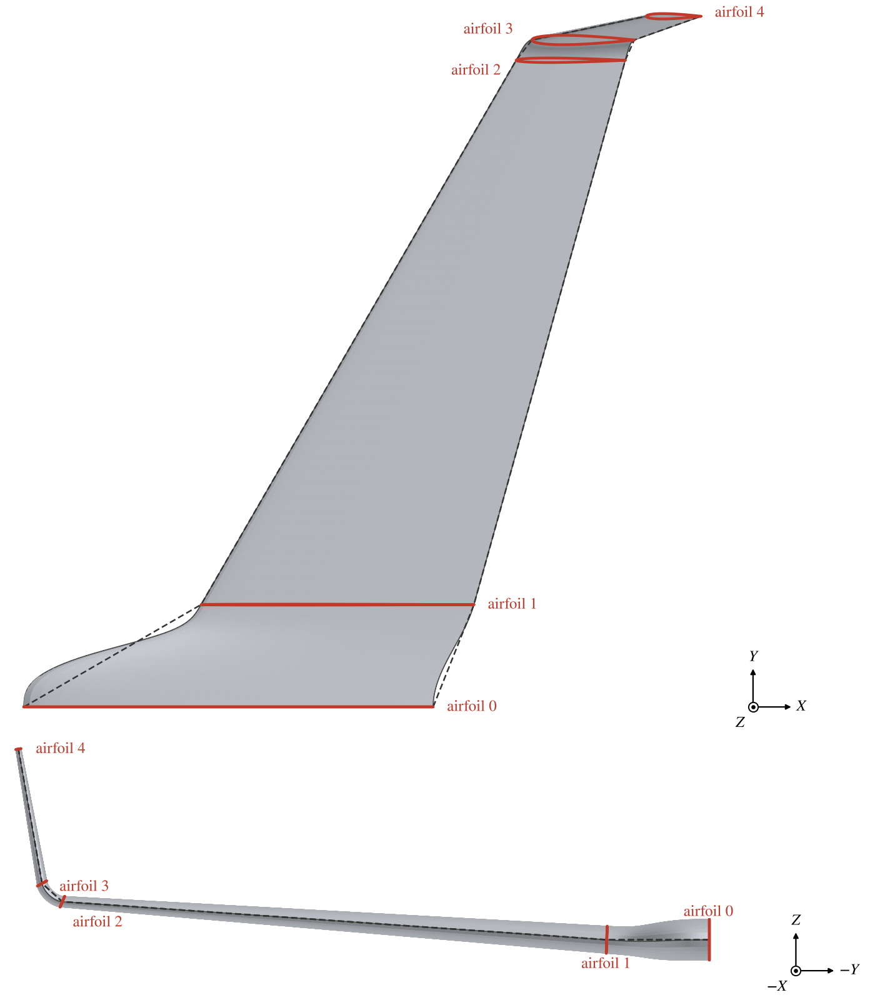

*Figure 15. The example with every blended Strength 1, over its straight-edged planform (dashed): a fillet section
of span 1.5 from a root chord of 6, the main wing with $4^\circ$ of dihedral, a transition section of span 0.4 with
$42^\circ$, and a winglet with $80^\circ$.*

## Airfoils on a Wing

On a wing the XSec tab is named Airfoil.  Its shape types and their parameters are described in
[Cross Section Curves](XSecCurves.md) and [Airfoils](Airfoils.md).  The wing adds these rules.

- The planform sets every airfoil's chord: the root airfoil takes section 1's Root C, and every other airfoil the
  Tip C of the section ending at it.  An airfoil type scales with its chord, keeping its thickness ratio.  Another
  shape, such as an ellipse, takes the chord as its width and keeps the height it is given.
- *Copy* and *Paste* on the Airfoil tab copy only the airfoil's shape; the Sect tab's Copy and Paste copy the whole
  section.
- Without blending, the surface between two airfoils is ruled: corresponding points of the two airfoils are joined
  by straight lines.  A thickness or camber changes linearly across the section, so to hold an airfoil over part of
  the span, place the same airfoil at both ends of that part.

The Modify tab holds the modifications common to all airfoils, described in [Airfoils](Airfoils.md).  On a wing, a
trailing edge flap set on one airfoil and not on its neighbor fades out linearly across the section between them; a
flap set the same on both ends of a section is constant across it.  For a control surface that an analysis deflects,
use the [Control Surface](SubTab.md#control-surface) sub-surface on the Sub tab, which marks the region without
changing the geometry.

## Tessellation

The spanwise tessellation is set for each section on the Sect tab, under *Interpolated XSecs*; the Gen tab's Num U
is greyed on a wing.  *Num U* sets the number of tessellation lines across the section, and *Rt. Cluster* and
*Tip Cluster* set the spacing at its inboard and outboard ends as a fraction of uniform spacing: 1 is uniform, and
smaller values pack the lines toward that end.

The chordwise tessellation, Num W, is on the Gen tab.  *LE Clustering* and *TE Clustering* on the Plan tab set the
spacing at the leading and trailing edges the same way; the defaults, 0.25, make the panels there about a quarter of
the uniform size.  Two outputs help keep the panels suitable for panel and vortex lattice codes: *Minimum LE/TE Panel
Width*, the narrowest first panel at the leading or trailing edge of any airfoil, in model units, and *Maximum Growth
Ratio*, the largest size ratio of neighboring chordwise panels that the clustering makes.

## Spanwise Coordinate Eta

Every component's surface carries the coordinates U, along it, and W, around it, and its volume the coordinates R, S,
T and L, M, N (see [Attachment Coordinates](XFormTab.md#attachment-coordinates)).  A wing adds a third way to name a
place along it: $\eta$, the fraction of its span.  U is awkward on a wing.  Each airfoil sits at a whole number of U
whatever the span of the sections between them, and each cap takes a whole unit of U, so the same U lands at a
different place when a section's span changes, a section is split, or a cap is added.  $\eta$ is tied to the span
instead.

$\eta$ is 0 at the root airfoil and 1 at the tip airfoil.  At each airfoil it is the sum of the *Span*s of the
sections inboard of it, divided by the sum of all the sections' Spans; between two airfoils it is linear in U
(Figure 16).  On a section without blending the surface is spread evenly along the span, so there $\eta$ is in
proportion to distance along the section.  A few properties follow.

- The Spans are measured along each section's dihedral, not seen from above, so $\eta$ is a fraction of the length
  of the wing, not of $Y$.  On a wing that turns up into a winglet, $\eta = 0.9$ may be well up the winglet.
- The caps are not part of it.  $\eta = 0$ is the root airfoil whether or not there is a root cap, and $\eta = 1$
  is the tip airfoil, however far a tip cap reaches beyond it.  A place inside a cap has no $\eta$: a station given
  by U in a cap converts to $\eta = 0$, even in the tip cap, so keep spanwise stations within the airfoils before
  switching them from U to $\eta$.
- With symmetry, each half has its own $\eta$, from 0 at its root to 1 at its tip; the mirror image of a station
  has the same $\eta$.
- Only the sections' Spans enter.  Chords, sweep, dihedral, twist, airfoils, blending and caps leave a station given
  by $\eta$ at the same fraction of the span; changing one section's Span moves every station, in proportion.

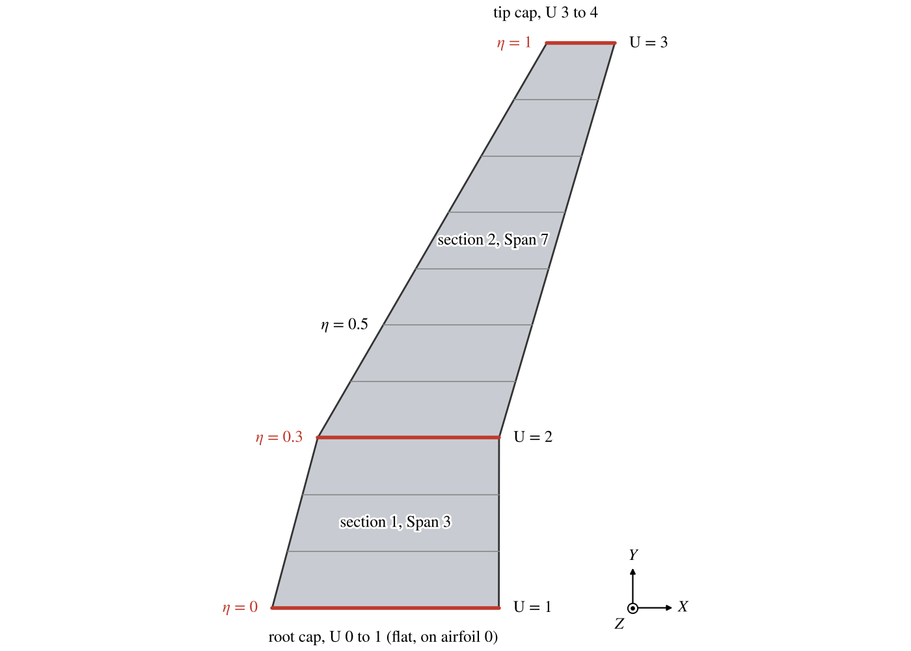

*Figure 16. The right half of the wing of Figure 1, from above, with a round tip cap: lines of constant $\eta$ every
0.1, the airfoils (red) with their $\eta$ and U, and the U taken by the caps.*

$\eta$ is offered wherever something is placed along a wing.  OpenVSP keeps the $\eta$ and converts it to U at every
update, so whatever is placed by $\eta$ stays at its fraction of the span as the wing changes.

| Where                                              | Use                                                         |
|:---------------------------------------------------|:------------------------------------------------------------|
| [XForm](XFormTab.md#attachment-coordinates)        | Attach a child by $\eta$MN: $\eta$, then M and N as in LMN. |
| [Control Surface](SubTab.md#control-surface)       | *Use Eta for Spanwise Coordinate*: Start Eta and End Eta.   |
| [Conformal](Conformal.md#trimming-a-wing)          | Trim along the span by *Eta Min* and *Eta Max*.             |
| [Routing](Routing.md#placing-a-point)              | Place a routing point by $\eta$MN.                          |
| [Gear](Gear.md#stowed-position)                    | Attach the stowed position or the mechanism by $\eta$MN.    |
| Structures (FEA)                                   | Place a polygon spar's points by $\eta$.                    |

Attachment by $\eta$MN is offered only when the parent is a Wing, or a Clone of one.  A Propeller's Control Surface
also offers $\eta$, but there it is $r/R$, the fraction of the propeller's radius, from the root airfoil's radius
fraction to 1 at the tip (see [Propeller](Propeller.md)).

## Scripting

A section's parameters are in the parm group of its outboard airfoil: section $i$'s *Span*, *Sweep* and *Dihedral*
are in group `XSec_i`, and the root Incidence is the *Twist* in `XSec_0`.  The totals are in group `WingGeom`.  The
API offers a few functions for wings.

| Function                           | Purpose                                                                         |
|:-----------------------------------|:--------------------------------------------------------------------------------|
| `SetDriverGroup`, `GetDriverGroup` | Set or read a section's three drivers, named by the `WING_DRIVERS` enum.        |
| `SplitWingXSec`                    | Split a section, as the Split button does.                                      |
| `ConvertUtoEta`, `ConvertEtatoU`   | Convert between U and $\eta$, below.                                            |

The drivers are named by the `WING_DRIVERS` enum, one value for each of the eight quantities of
[Section Planform](#section-planform).

| Value                   | Driver  | Quantity                    |
|:------------------------|:--------|:----------------------------|
| `AR_WSECT_DRIVER`       | AR      | Aspect ratio                |
| `SPAN_WSECT_DRIVER`     | Span    | Span                        |
| `AREA_WSECT_DRIVER`     | Area    | Area                        |
| `TAPER_WSECT_DRIVER`    | Taper   | Taper ratio                 |
| `AVEC_WSECT_DRIVER`     | Ave C   | Average chord               |
| `ROOTC_WSECT_DRIVER`    | Root C  | Root chord                  |
| `TIPC_WSECT_DRIVER`     | Tip C   | Tip chord                   |
| `SECSWEEP_WSECT_DRIVER` | Sec SW  | Secondary sweep             |

`NUM_WSECT_DRIVER` is their number.  The enum also names `SWEEP_WSECT_DRIVER`, `SWEEPLOC_WSECT_DRIVER` and
`SECSWEEPLOC_WSECT_DRIVER`, for the Sweep, Sweep Loc and Sec SW Loc that every section sets; they are not drivers
and must not be passed to `SetDriverGroup`.

`SetDriverGroup( geom_id, section_index, driver_0, driver_1, driver_2 )` takes the section's index, which is the
index of its outboard airfoil (1 for the first section), and three different drivers in any order.  A set the Sect
tab would not offer is refused with the error `VSP_INVALID_DRIVERS`, and the section keeps its drivers.  Choose the
drivers first, then set their values, then call `Update`:

```python
wing_id = AddGeom( "WING" )
SetDriverGroup( wing_id, 1, AREA_WSECT_DRIVER, AR_WSECT_DRIVER, TAPER_WSECT_DRIVER )
xsec = GetXSec( GetXSecSurf( wing_id, 0 ), 1 )
SetParmVal( GetXSecParm( xsec, "Area" ), 30.0 )
SetParmVal( GetXSecParm( xsec, "Aspect" ), 6.0 )
SetParmVal( GetXSecParm( xsec, "Taper" ), 0.4 )
Update()
```

`GetDriverGroup( geom_id, section_index )` returns the three drivers in the order they were set.

`ConvertUtoEta` and `ConvertEtatoU` convert between U and the [$\eta$ of the span](#spanwise-coordinate-eta).  They
work in the wing's own U, which runs from 0 at the root end to the number of sections plus caps at the tip end, so
with a root cap the root airfoil is at U = 1 and airfoil $i$ at U = $i + 1$.  Divide by that number for the 0 to 1 U
of `CompPnt01` and the other surface functions.  They accept a Wing or a Clone of one, and report `VSP_WRONG_GEOM_TYPE`
for any other component.
