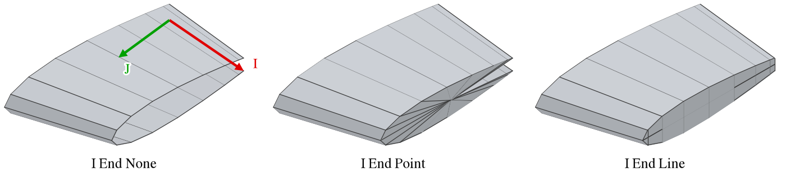
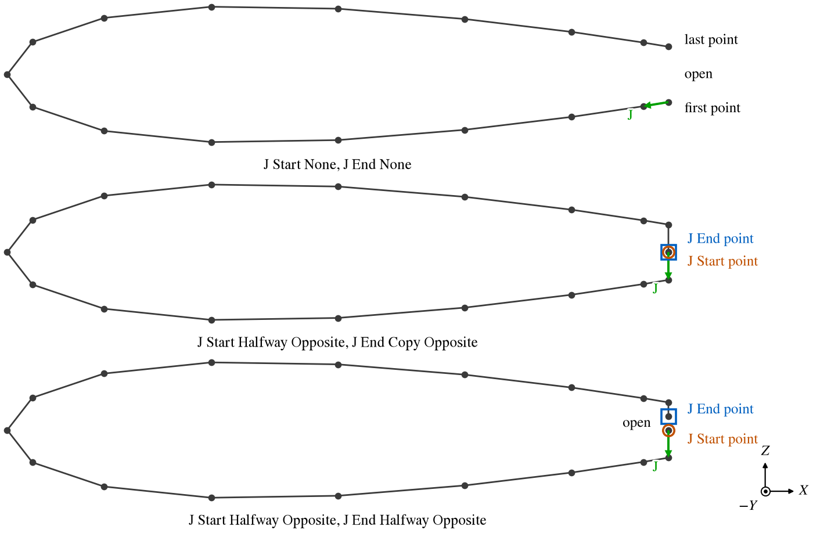

A Wireframe component is a structured grid of points: rows of points that form a surface of quadrilaterals, the way
legacy geometry and many CFD tools describe a shape.  It comes from an XSec (.hrm) or Plot3D (.p3d) file, and the
controls on its WireFrame tab rearrange and tidy the grid -- turn it, trim it, thin it and close its open edges --
so that it can take part in OpenVSP's analyses.  The points themselves cannot be moved one by one.

| Topic                                              | Tab       |
|:---------------------------------------------------|:----------|
| [Quick Start](#quick-start)                        |           |
| [Importing a Grid](#importing-a-grid)              |           |
| [The Grid: I and J](#the-grid-i-and-j)             | WireFrame |
| [Type and Normals](#type-and-normals)              | WireFrame |
| [Rearranging the Grid](#rearranging-the-grid)      | WireFrame |
| [Closing Open Edges](#closing-open-edges)          | WireFrame |
| [Using a Wireframe](#using-a-wireframe)            |           |
| [Scripting](#scripting)                            |           |

The Gen and XForm tabs are the ones every component has; see [Gen](GenTab.md) and
[XForm](XFormTab.md).  A wireframe has no mass, symmetry or sub-surfaces.

## Quick Start

1. Choose *File > Import* and *XSec as Wireframe (.hrm)* or *Plot3D as Wireframe (.p3d)*.  Each component of the
   file becomes a wireframe, under a new Blank.
2. Place the Blank with the XForm tab; the wireframes move with it.
3. Check each wireframe's *Type* and normals, and close its open edges with the *Patch* choices.

## Importing a Grid

### XSec files

The XSec (.hrm) format is OpenVSP's own cross section format, also written by *File > Export > XSec*.  Each component
is a set of cross sections with the same number of points in each:

```
 HERMITE INPUT FILE

 NUMBER OF COMPONENTS = 2

WingGeom
 GROUP NUMBER      = 0
 TYPE              = 0
 CROSS SECTIONS    = 10
 PTS/CROSS SECTION = 33
  4.00000000000000000e+00    0.00000000000000000e+00    0.00000000000000000e+00
  3.92363234218945145e+00    0.00000000000000000e+00   -3.09158494470971589e-16
  ...
```

The name line names the wireframe, with its spaces turned to underscores, and *TYPE* sets its
[Type](#type-and-normals): 0 for lifting, 1 for non-lifting.  The cross sections are the grid's rows in I and the
points of each section its columns in J.  The same file imported as *XSec as Tri Mesh* becomes one [Mesh](Mesh.md)
of all its components instead.

### Plot3D files

A Plot3D (.p3d) grid file holds one or more blocks, each a grid of $n_i \times n_j \times n_k$ points.  The file
may be formatted (text) or unformatted (Fortran records), in single or double precision, with or without the
iblank array, and with $x$ and $y$ only (a planar grid, at $z = 0$) or $x$, $y$ and $z$; all of these are told
apart by the file's content.  Each block becomes a wireframe with I along the block's first index and J along its
second.  Only the first $k$ plane of each block is kept, so a block should be a surface grid, $n_k = 1$.

A block with only one row or column of points is a curve, not a surface: it is drawn as a line and takes no part in
the analyses.

### Orientation on import

On import each wireframe checks which way its grid faces, from the sign of the volume it encloses, and sets
*Invert* so that its normals point outward.  For a closed body this is right; for an open grid such as a thin wing
it is a guess.

## The Grid: I and J

The grid is a set of rows: I counts the rows and J the points along each row.  Each cell of four neighboring points
is a quadrilateral of the surface, and analyses split each into two triangles.  With the feature lines on (*Feature*
in the Geom Browser), a red line runs from the grid's first point in the direction of I and a green one in the
direction of J, each half way across the grid.  Figure 1 marks I and J in the same colors.

## Type and Normals

*Type* says what the grid represents: *Lifting* a wing and *Non-Lifting* a body.  It decides how the degenerate
geometry is built from the grid, and so how the analyses built on it see the wireframe: in VSPAERO's thin set, a
lifting wireframe becomes a camber surface and a non-lifting one a set of plates.  The type is also written to an
XSec export.

*Invert* reverses the normals, the side of the surface that counts as outside.  The analyses that intersect the
model, such as CompGeom and Mass Properties, depend on it.  CompGeom's report is a quick check: a closed wireframe
whose normals point in has a negative volume.

## Rearranging the Grid

The controls act in this order, each on the result of the one before.

| Control                    | Parm                     | Effect                                                         |
|:---------------------------|:-------------------------|:---------------------------------------------------------------|
| Swap I/J                   | `FlipIJFlag`             | Exchanges rows and columns: I becomes J and J becomes I.       |
| Reverse I                  | `RevIFlag`               | Reverses the order of the rows.                                |
| Reverse J                  | `RevJFlag`               | Reverses the order of the points in every row.                 |
| I Start Skip, I End Skip   | `ISkipStart`, `ISkipEnd` | Drop that many rows from the start or the end.                 |
| J Start Skip, J End Skip   | `JSkipStart`, `JSkipEnd` | Drop that many points from the start or the end of every row.  |
| I Stride, J Stride         | `IStride`, `JStride`     | Keep every nth row, or every nth point, and always the last.   |
| I Start, I End, J Start, J End | `IStartPatchType` ... | Add a row at that edge; see [Closing Open Edges](#closing-open-edges). |

Swapping and reversing turn the grid over, so each also reverses the normals internally to keep the outside where it
was; *Invert* does not change.  Skips trim rows of points that are not wanted, such as a duplicated section or the
wake rows of a CFD grid.  A skip that leaves no rows leaves no grid.  Strides thin a dense grid to keep the
analyses fast; a stride of 1 keeps every row.

## Closing Open Edges

A grid made for another tool often has open edges: a wing whose tip is not closed, a blunt trailing edge, a body of
revolution whose sections stop short of repeating their first point.  Each *Patch* choice adds one row of points at
its edge of the grid, built from the edge row itself or from the opposite edge:

| Patch            | The new row                                                                 | Use                                       |
|:-----------------|:----------------------------------------------------------------------------|:------------------------------------------|
| None             | No row is added.                                                            |                                           |
| Point            | Every point at the centroid of the edge row.                                | Close the open end of a body, or a wing tip, with a flat cap. |
| Line             | The edge row folded on itself: its first and last points meet at their midpoint, its second and second-to-last, and so on. | Close a wing tip onto its camber line. |
| Copy Opposite    | A copy of the opposite edge row.                                            | Close the seam of sections that go all the way round but do not repeat their first point. |
| Halfway Opposite | The midpoints between the edge row and the opposite edge row.               | At the start edge, with Copy Opposite at the end edge, close a gap on its midline, such as a blunt trailing edge. |

The patches act in the order I Start, I End, J Start, J End, each on the grid the one before made, so a patch can
build on another.  Halfway Opposite at J Start and Copy Opposite at J End close a blunt trailing edge to a sharp one:
the first adds a row on the trailing edge's midline, the second a copy of that row at the other end.  Halfway Opposite
at both edges does not close the gap, since the second midpoint is taken to the first (Figure 2).  Figure 1 shows the
tip of a wing closed with Point and with Line.



*Figure 1. A wing grid imported from an XSec file.  I runs root to tip and J round each section from the lower
trailing edge, both from the grid's first point.  I End Point closes the tip with a flat cap to its centroid; I End
Line closes it onto the camber line.*



*Figure 2. The root section of the wing grid of Figure 1, with its blunt trailing edge open, closed on its midline,
and left open by Halfway Opposite at both edges, whose J End point lies three quarters of the way up the trailing
edge.*

## Using a Wireframe

A wireframe is placed like any component, with the XForm tab, including *Scale* and *Flip*.  Its grid takes part in
the analyses as a surface of quadrilaterals:

- CompGeom, Mass Properties, the slicing analyses and the mesh exports take its triangles, two per cell.  For these
  the grid should be closed and its normals should point out.
- Degenerate geometry and the analyses built on it take the grid as a wing or a body, by its *Type*.
- An XSec export writes the grid as it has been rearranged and placed, so a wireframe cleaned up here can be written
  out for another tool.

It is not a smooth surface: it has no sub-surfaces and takes no part in CFD Mesh, FEA Mesh, Fit Model or
projections.  The model file keeps the points as they were imported, and the controls are applied again each
time it is opened, so any of them can be changed later.

## Scripting

A wireframe has no functions of its own in the API: import it with `ImportFile` and `IMPORT_XSEC_WIRE` or
`IMPORT_P3D_WIRE`, which returns the ID of the Blank holding the wireframes, and set the Parms in the table above.
They are in the group `WireFrame`, except `FlipIJFlag`, `RevIFlag`, `RevJFlag` and `InvertFlag`, which are in the
group `Wireframe`.  *Type* is `WireType`, 0 for lifting and 1 for non-lifting, and the patch types are `PATCH_NONE`,
`PATCH_POINT`, `PATCH_LINE`, `PATCH_COPY` and `PATCH_HALFWAY`.

```python
import openvsp as vsp

blank = vsp.ImportFile( "wing.hrm", vsp.IMPORT_XSEC_WIRE, "" )
wire = vsp.GetGeomChildren( blank )[ 0 ]
vsp.SetParmVal( wire, "IEndPatchType", "WireFrame", vsp.PATCH_LINE )
vsp.Update()
```
