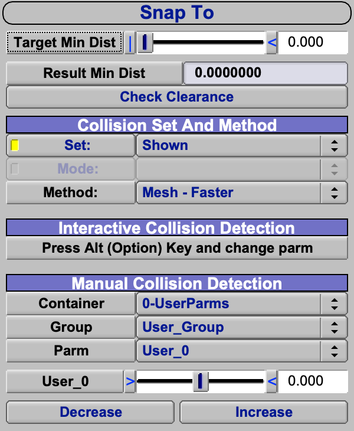
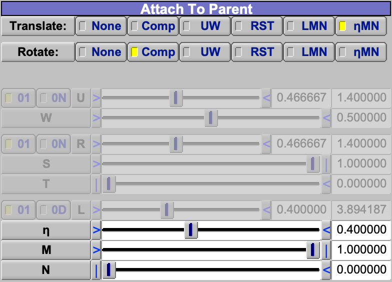
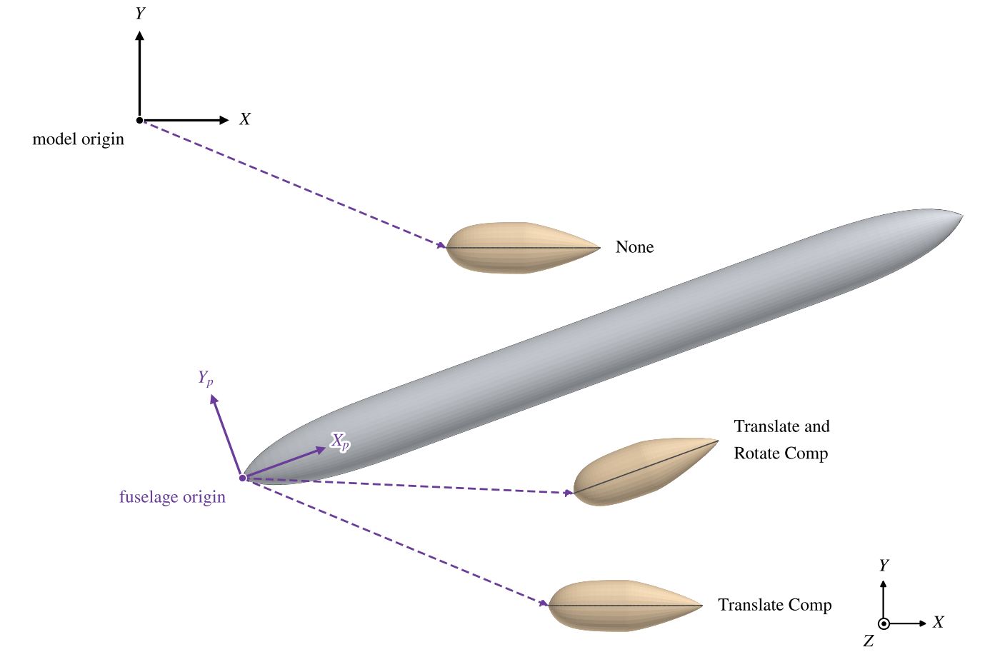
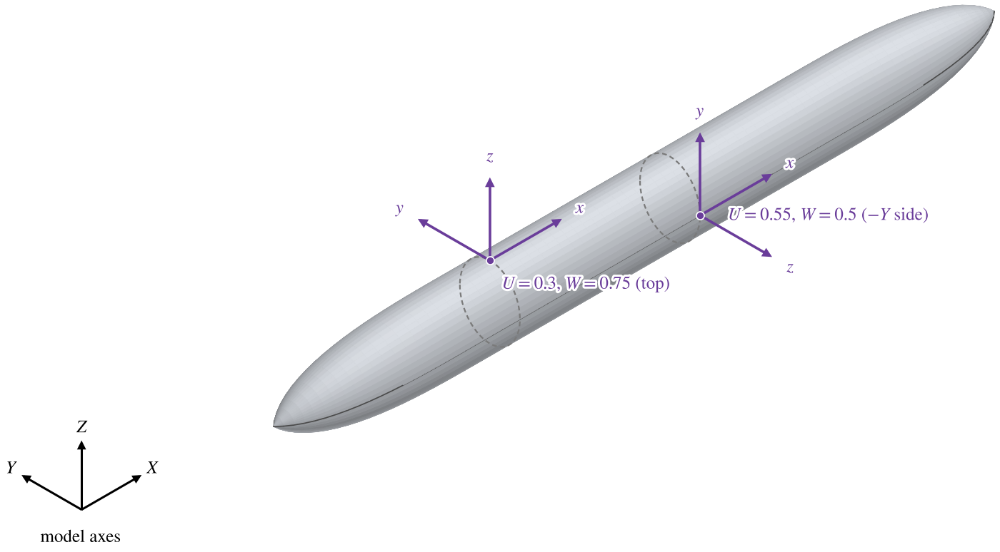
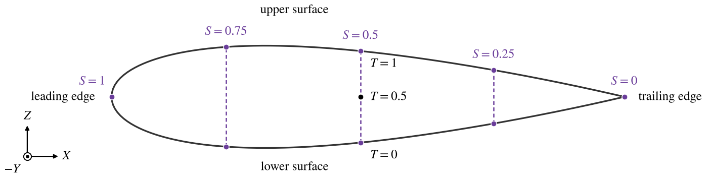
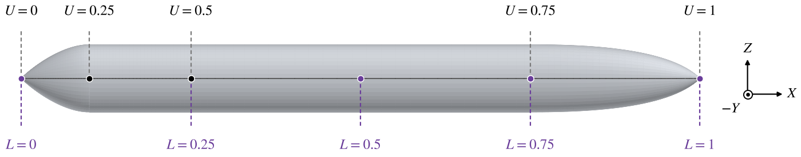
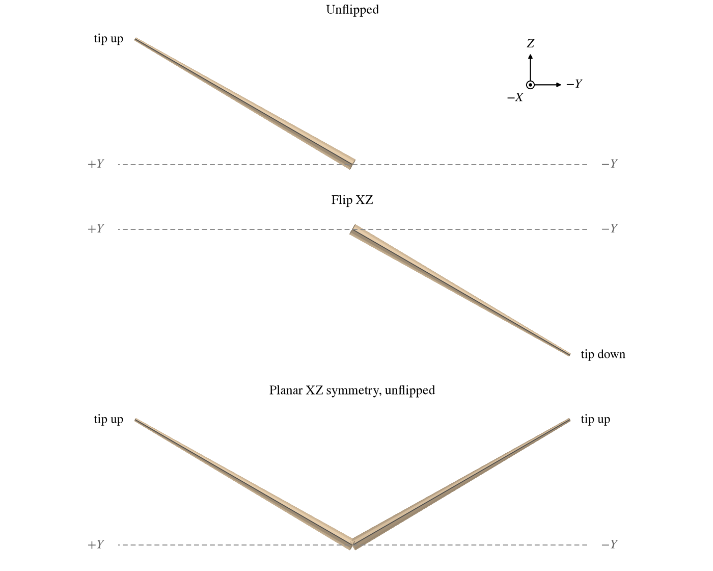
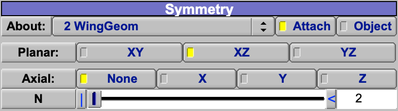
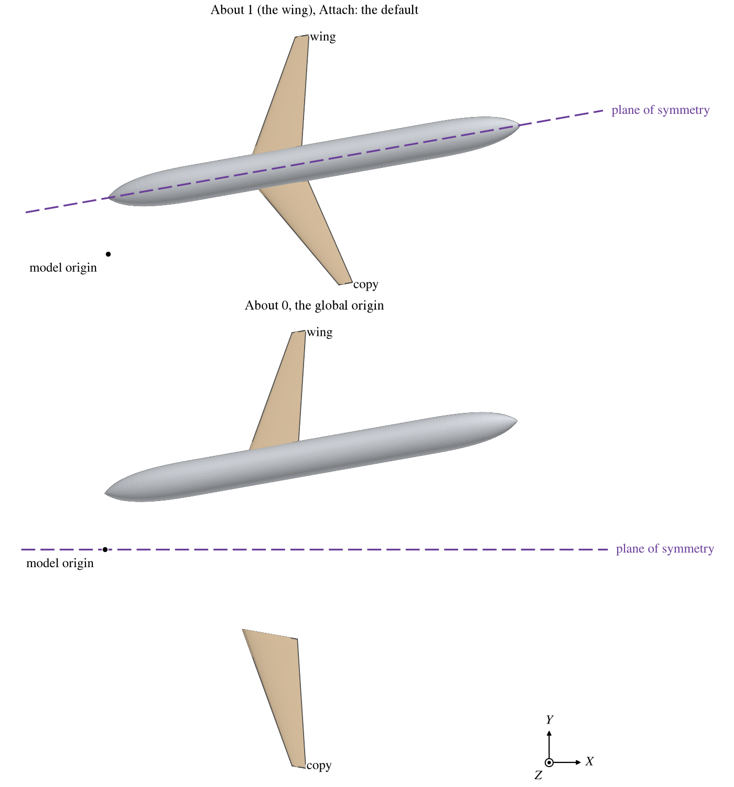

Every component (Geom) in OpenVSP is edited in a window whose first tabs are the same for all of them:
[Gen](GenTab.md), XForm, [Mass](MassTab.md) and [Sub](SubTab.md).  The XForm tab places the Geom in the model: where
it is and how it is turned, what it is attached to, whether it is reflected, mirrored or repeated, and its overall
size.  Every Geom is built in its own axes and then placed by these settings, which
[How the Placement Is Built](#how-the-placement-is-built) puts together.

| Topic                                                     |
|:----------------------------------------------------------|
| [Quick Start](#quick-start)                               |
| [Location and Rotation](#location-and-rotation)           |
| [Abs and Rel](#abs-and-rel)                               |
| [Attach to Parent](#attach-to-parent)                     |
| [Flip](#flip)                                             |
| [Symmetry](#symmetry)                                     |
| [How the Placement Is Built](#how-the-placement-is-built) |
| [Scale](#scale)                                           |
| [Scripting](#scripting)                                   |

## Quick Start

A part that belongs to another part, such as a wing on a fuselage or a nacelle under a wing, is made a child of it
and attached to it, so that it moves with it.  In the Geom Browser, select the parent before you click *Add*: the new
Geom becomes its child.

### A wing on a fuselage

1. Select the fuselage and add a Wing.
2. On the XForm tab, set *Attach To Parent* to Translate *Comp* and Rotate *Comp*.
3. Place the wing with *XLoc*, *YLoc* and *ZLoc*, now measured from the fuselage's origin in the fuselage's axes.
4. Leave *Symmetry* at its default, Planar *XZ* about the wing's attachment: the left wing is the mirror image of the
   right one in the fuselage's center plane, wherever the fuselage is moved.

### A nacelle under a wing

1. Select the wing and add a Pod.
2. Set Translate to *$\eta$ MN* and Rotate to *Comp*, so that the nacelle sits at a fraction of the span and keeps
   the wing's axes.
3. Set $\eta$ to the spanwise station and *M* 1 for the leading edge (where *N* has no effect), then move the
   nacelle forward and down with *XLoc* and *ZLoc*, now measured from that point in the wing's axes.
4. To repeat it on the other wing, set Symmetry *About* to the wing (2 in the list), keep *Attach*, and check Planar
   *XZ*: the nacelle is mirrored in the same plane as the wing (see [Symmetry](#symmetry)).

## Location and Rotation

*XLoc*, *YLoc* and *ZLoc* move the Geom; *XRot*, *YRot* and *ZRot* turn it, in degrees.  The rotations are applied in
the order ZRot, YRot, XRot, each about an axis that stays fixed: the shape is first turned about $Z$, the result about
$Y$, and that about $X$.  The same turn is reached by turning about the Geom's own axes in the order X, Y, Z, each turn
carrying the axes for the next.

The Geom turns about its *Rot Origin(X)*: a point on its own $X$ axis, given as a fraction of its length.  For a
Fuselage, Pod, Cobra, Ellipsoid or BOR this is the fraction of its length along $X$ from the nose, for a Wing of the
root chord of its first section; for Stack, Propeller and the Geoms without a length along $X$ it has no effect.  The
rotation origin is also the point the location refers to: *XLoc*, *YLoc*, *ZLoc* in *Abs* give where the rotation
origin lies in the model, while in *Rel* they give how far it has been moved.  A 10-unit pod with Rot Origin 0.5 and
nothing else changed shows an absolute *XLoc* of 5 and a relative one of 0.

### Placing a Part Against Others

To put a part a set distance from the rest of the model, such as a battery or a tank packed inside a fuselage, use *Snap
To* in the Model menu (Figure 1) rather than adjusting by eye.  Set the *Target Min Dist* and the Set of components to
keep clear of.  Then either hold Alt (Option) while dragging one of the part's sliders, *XLoc* for example, and the part
stops at that clearance instead of passing into the others; or pick a parameter in *Manual Collision Detection* and
click *Increase* or *Decrease* to move it until the clearance is reached.  *Check Clearance* reports the present minimum
distance.

*Figure 1. The Snap To dialog with its default settings.*

## Abs and Rel

The location and rotation are kept two ways, absolute (*Abs*: in the model's axes) and relative (*Rel*: in the
axes the Geom is attached to, see [Attach to Parent](#attach-to-parent)).  The *Coord System* buttons choose which of
the two the sliders show and set; the other is computed from it.  A Geom that is not attached to anything has the same
absolute and relative values, apart from the rotation origin's effect above.

The choice does not change what happens when the parent moves.  A child always keeps its relative placement when its
parent moves, so an attached child moves with its parent even while its sliders show absolute values; *Abs* is a way
to put a child at a known point in the model, not a way to pin it there.

The choice does matter when the child's own attachment changes.  In *Rel*, the child keeps its relative values and
jumps to the same relative place in the new axes.  In *Abs*, it keeps its place in the model and its relative values
are recomputed for the new attachment.  To attach a part that is already where it belongs, switch to *Abs*, change
the attachment, and switch back to *Rel*: the part does not move, and from then on it follows its parent.

## Attach to Parent

A child Geom may be attached to its parent.  Attachment chooses the axes its relative location and rotation are measured
in, separately for the two: *Translate* chooses the origin of those axes and *Rotate* their directions (Figure 2).
With both at *None*, the default, the child is placed in the model's axes and stays where it is when the parent moves.

*Figure 2. The Attach To Parent group of a Pod whose parent is the default Wing, attached by Translate $\eta$ MN and
Rotate Comp at $\eta$ 0.4, M 1 and N 0.  The rows of the coordinates not chosen are greyed and show where the same
point lies in them.*

| Choice | Translate: origin at                         | Rotate: axes along                                  |
|:-------|:---------------------------------------------|:----------------------------------------------------|
| None   | the model's origin                           | the model's axes                                    |
| Comp   | the parent's origin                          | the parent's axes                                   |
| UW     | a point on the parent's surface              | the surface there (below)                           |
| RST    | a point inside the parent's volume           | the volume coordinates there (below)                |
| LMN    | a point inside the parent's volume, by distance | as RST                                           |
| $\eta$ MN   | a point inside a wing, by fraction of span   | as RST                                              |

Translate and Rotate are independent: Translate *Comp* with Rotate *None* follows the parent's moves but not its
turns, which keeps a part level however the parent is turned (Figure 3).

*Figure 3. A fuselage moved and turned by ZRot 20, with a child pod at the same relative location (12, -5, 0) attached
three ways.  Each dashed arrow is that location, measured from the origin and along the axes the attachment chooses: the
model's ($X$, $Y$) or the fuselage's ($X_p$, $Y_p$).*

Changing the attachment moves the child or not depending on *Abs* and *Rel* (see [Abs and Rel](#abs-and-rel)).
The attachment is computed on the parent's first surface, not on its symmetric copies.  For a parent without a
surface, such as a Blank, UW and the others act as Comp.  A child of a Hinge is always carried by the hinge and its
attachment controls are greyed (see [Hinge](Hinge.md)); a child of a Routing Geom cannot be attached.

While a Geom is selected, the 3D view draws the frame it is attached in as dashed axes (red $X$, green $Y$, blue
$Z$), at the point its relative location is measured from.  With attachment None that is the model's origin and axes.
In the Geom Browser, the line joining an attached child to its parent is drawn thick, and the lines from a Hinge to
its children are double.  A Geom whose attachment is set but which has no parent, for example after it was moved out
from under its parent, has its name drawn lighter; it is placed as if attached to nothing.

Attachment is the way to keep a model together as it changes.  Attach each part to the part it is mounted on, so that
moving or resizing a fuselage carries its wing, and the wing its nacelles; an unattached part stays behind and has to
be moved by hand every time.  Where an assembly should not hang off one of its parts, attach it to a
[Blank](Blank.md) and move the Blank.

### Attachment Coordinates

UW is a point on the parent's surface.  *U* runs along the parent from 0 at its start to 1 at its end, and *W* around
each section from 0 to 1.  With *0N* instead of *01*, U counts sections, with each cross section at a whole number;
on a Wing the root and tip caps count as sections, so a one-panel wing runs U = 0 to 3 and its panel lies between
U = 1 and 2.  Where W starts depends on the Geom: on a Wing, W = 0 is the trailing edge, 0.25 the lower surface,
0.5 the leading edge and 0.75 the upper surface; on a Fuselage W = 0 is the $+Y$ side and W runs down, round the
bottom; on a Pod W = 0 is the top and W runs toward $+Y$.  The UW axes are $X$ along the surface in the direction of
increasing U, $Z$ the outward normal, and $Y$ completing the set (Figure 4).

*Figure 4. UW attachment axes at two points of a fuselage.  $z$ is the outward normal and $x$ points along increasing U;
the dashed lines are the sections at those U.*

RST is a point inside the parent.  *R* is the same as U.  At that station, *S* picks a pair of points on the
surface, one on each half of the section: at W = S/2 and W = 1 - S/2.  On a wing, S = 0 is the trailing edge and
S = 1 the leading edge.  *T* places the point on the straight line between them, from 0 on the first half (a wing's
lower surface) to 1 on the second (its upper surface); T = 0.5 is midway.  So T = 0 or 1 lies on the surface, and
values between lie inside (Figure 5).

*Figure 5. RST at the root section of a wing of 20% thickness.  Each S picks a point on each surface (dots, joined by
dashed lines); T runs along that line from the lower surface to the upper.*

LMN is RST measured by distance.  *L* is the fraction of the parent's length along its center line (*0D* gives it
as a length instead), where R, like U, counts the parent's sections whatever their lengths.  *M* is the fraction of the
distance from the S = 0 edge to the S = 1 edge, along the line midway between the two halves; on a wing it is the
fraction of the chord from the trailing edge, so M = 0.25 is at 75% chord.  *N* is the same as T.  Use LMN to place
something at a fraction of a length or a chord.

The difference between U (or R) and L is large when the cross sections are unevenly spaced (Figure 6).  Each span
between neighboring cross sections takes an equal share of U, however long it is: on a fuselage of five cross
sections, U = 0.25 is always the second and U = 0.5 the third, wherever they have been placed, while L = 0.5 is always
half way along.  Choose by what the part should stay with when the parent is reshaped: U or R to stay at a cross
section, such as a wing at a fuselage frame; L to stay at a fraction of the length.

*Figure 6. A fuselage 30 long with its cross sections at 0, 3, 7.5, 22.5 and 30.  Above, the points U = 0 to 1 on its
center line fall at the cross sections; below, the points L = 0 to 1 are evenly spaced along it.*

*$\eta$ MN* is offered when the parent is a Wing (or a Clone of one).  $\eta$ is the fraction of the wing's span
from root to tip, measured over its sections without the caps, and M and N are as in LMN; see [Spanwise Coordinate
Eta](Wing.md#spanwise-coordinate-eta).  On a wing, $\eta$ is the spanwise choice that corresponds to L: U and R count
the wing's sections and caps, so a part placed by U stays with a section when a panel's span is changed, while a part
placed by $\eta$ stays at its fraction of the span.  Use $\eta$ MN for nacelles, pylons and stores placed at a
fraction of the semispan.

The RST, LMN and $\eta$ MN axes are $X$ along R (along the parent), $Z$ normal to the R and S directions, and $Y$
completing the set.

UW, RST and LMN describe one point, and while one of them is in use OpenVSP keeps the others up to date.  Switching
from one to another therefore leaves the attachment point where it was.

## Flip

*Flip* reflects the Geom's shape in the chosen planes of its own axes, in place: it makes the mirror image of the Geom,
not a second copy.  Use it for one opposite-handed part made from the same definition, such as a single left-hand
nacelle or a counter-rotating Clone of a propeller (see [Propeller](Propeller.md#clones-of-a-propeller)).  It is not
offered for Blank and Routing Geoms, which have no shape to reflect, nor for Auxiliary and Conformal Geoms, which take
their parent's flip.

The reflection happens in the Geom's own axes, before it is turned and moved.  A wing flipped in its XZ plane becomes a
left wing; turned by XRot 30 as well, that left wing tips down, not up, because the turn acts on the reflected shape.
A left wing made by Planar XZ symmetry is the mirror image of the turned right wing, so it tips up (Figure 7).

*Figure 7. The default Wing, without its symmetry, turned by XRot 30 (top), flipped in its XZ plane and turned by XRot
30 (middle), and with Planar XZ symmetry and XRot 30 (bottom), seen from the front.  The dashed line is the model's
$Y$ axis.*

A flip changes the shape, not the Geom's axes.  Children attached by *Comp* follow the parent's unreflected axes;
children attached by UW, RST, LMN or $\eta$ MN follow the reflected surface.  Two planes of flip together amount to a
half turn, not a reflection.

## Symmetry

*Symmetry* adds copies of the Geom.  Each *Planar* plane doubles the number of copies by reflecting all of them in it.
*Axial* makes $N$ copies, each turned $360/N$ degrees from the last about the chosen axis.  Planar symmetry is applied
first and axial symmetry to its result, so XZ with Axial X and $N = 3$ gives six copies.  The copies are part of the
Geom: they carry its sub-surfaces and its specified mass, and they appear in every analysis, but its children are not
copied; give each child its own symmetry.

A new Wing has Planar XZ symmetry.  When a wing is turned XRot 90 to make a vertical tail on the center plane, its copy
lands on top of it.  Coincident surfaces trouble meshing and the analyses: CFD Mesh leaves the tail and its copy out of
the mesh altogether, with a warning in its console.  The wing's total span also counts both.  Uncheck XZ for a single
vertical tail; keep it only for twin tails moved off the center plane.

The planes and the axis belong to a frame chosen by *About* and the two buttons beside it (Figure 8).  The list holds
the global origin (0), the Geom itself (1), its parent (2), its grandparent (3), and so on.

*Figure 8. The Symmetry group of the same Pod: About its parent, 2 WingGeom, with Attach, and Planar XZ.*

- *Attach* uses the frame that Geom is attached in: its parent's origin and axes, or the surface point, if it is
  attached; the model's origin if it is not.
- *Object* uses that Geom's own origin and axes, where it has been placed.

The default, the Geom itself with *Attach*, mirrors a Geom in the frame it is attached in.  For a wing attached to its
fuselage by Comp, that is the fuselage's center plane, wherever the fuselage is (Figure 9).  When the attachment is a
point on the surface (UW, RST, LMN or $\eta$ MN), the frame sits at that point, so the default mirrors the wing about
a plane through the attachment point instead of the fuselage's center: choose the fuselage in the list, with
*Object*.  To mirror in the model's own planes, choose 0, the global origin.

*Figure 9. A fuselage moved and turned by ZRot 10, with a wing attached by Translate and Rotate Comp and Planar XZ
symmetry.  Top: the default, about the wing's attachment, mirrors it in the fuselage's center plane.  Bottom: about the
global origin, it is mirrored in the model's XZ plane.*

## How the Placement Is Built

A point $\mathbf{p}$ of the Geom as it is built in its own axes is placed in the model at

$$
\mathbf{x}_k = Q\,S_k\,Q^{-1}\; A\; T(\mathbf{t})\; T(\mathbf{c})\,
R_X(\theta_X)\, R_Y(\theta_Y)\, R_Z(\theta_Z)\, T(-\mathbf{c})\; F\;\mathbf{p}
$$

read right to left:

- $F$ is the flip, a reflection in each checked plane of the Geom's own axes;
- $\mathbf{c}$ is the rotation origin, $T(\cdot)$ a move, and $R_X(\theta_X)$ etc. the rotations by XRot, YRot, ZRot;
- $\mathbf{t}$ is the relative location;
- $A$ is the attachment: the parent's frame chosen by Translate and Rotate ($A = I$ for None);
- $Q$ is the symmetry frame chosen by *About*, and $S_k$ the $k$-th symmetric copy, a combination of the planar
  reflections and axial turns ($S_0 = I$, the Geom itself).

The absolute location and rotation are the move and turn of $A\,T(\mathbf{t})\,T(\mathbf{c})\,R\,T(-\mathbf{c})$
expressed in the model's axes; children attached by Comp hang off this same product, without $F$.

## Scale

*Scale* multiplies the Geom's dimensions (lengths, diameters, chords, spans, and sub-surface and CFD source sizes
given as lengths), keeping its proportions; the shape grows about the Geom's own origin.  It does not move the Geom,
and it does not scale its children or their placement.

The factor is relative to the size when it was last accepted.  Setting it back to 1, or *Reset*, returns the Geom to
that size; *Accept* makes the current size the new size at 1.  An edit made while scaled is scaled back with
everything else: a pod scaled by 2 whose length is then set to 25 is 12.5 long when the scale returns to 1.  So
accept a scale before editing the scaled Geom.

## Scripting

Every control on this tab except the Scale's *Reset* and *Accept* buttons is a Parm, set and read with `SetParmVal`
and `GetParmVal` by name and group; `GetParmActiveFlag` tells whether a control is active or greyed, as of the last
Update.  *Reset* is `ResetGeomScale` and *Accept* is `AcceptGeomScale`.  The parent a Geom is attached to is set
with `SetGeomParent` (or chosen when the Geom is added with `AddGeom`) and read with `GetGeomParent`.

| Control                       | Parm                                                       | Group        |
|:------------------------------|:-----------------------------------------------------------|:-------------|
| XLoc, YLoc, ZLoc (Rel)        | `X_Rel_Location`, `Y_Rel_Location`, `Z_Rel_Location`       | XForm        |
| XRot, YRot, ZRot (Rel)        | `X_Rel_Rotation`, `Y_Rel_Rotation`, `Z_Rel_Rotation`       | XForm        |
| XLoc, YLoc, ZLoc (Abs)        | `X_Location`, `Y_Location`, `Z_Location`                   | XForm        |
| XRot, YRot, ZRot (Abs)        | `X_Rotation`, `Y_Rotation`, `Z_Rotation`                   | XForm        |
| Coord System                  | `Abs_Or_Relitive_flag`: `ABS` or `REL`                     | XForm        |
| Rot Origin(X)                 | `Origin`                                                   | XForm        |
| Scale                         | `Scale`                                                    | XForm        |
| Translate, Rotate             | `Trans_Attach_Flag`, `Rots_Attach_Flag`: `ATTACH_TRANS_*`, `ATTACH_ROT_*` | Attach |
| U, W                          | `U_Attach_Location` (or `U_Attach_Location0N` with `U_01` 0), `V_Attach_Location` | Attach |
| R, S, T                       | `R_Attach_Location` (or `R_Attach_Location0N` with `R_01` 0), `S_Attach_Location`, `T_Attach_Location` | Attach |
| L, M, N                       | `L_Attach_Location` (or `L_Attach_Location0Len` with `L_01` 0), `M_Attach_Location`, `N_Attach_Location` | Attach |
| $\eta$                         | `Eta_Attach_Location`                                      | Attach       |
| Flip planes                   | `Flip_Flag`: a sum of `SYM_XY`, `SYM_XZ`, `SYM_YZ`         | Sym          |
| Symmetry About, Attach/Object | `Sym_Ancestor` (0 global origin, 1 the Geom, 2 its parent, ...), `Sym_Ancestor_Origin_Flag` (1 Attach, 0 Object) | Sym |
| Planar                        | `Sym_Planar_Flag`: a sum of `SYM_XY`, `SYM_XZ`, `SYM_YZ`   | Sym          |
| Axial, N                      | `Sym_Axial_Flag`: `SYM_ROT_X`, `SYM_ROT_Y`, `SYM_ROT_Z` or 0; `Sym_Rot_N` | Sym |

To set a child's absolute location or rotation from a script, call `UpdateGeom` on the child right after setting
it, or set it with `SetParmValUpdate`, which sets the Parm and updates the Geom in one call.  The child then takes
its relative values from the new absolute ones.  `Update` alone updates the parent first, which places the child from
its relative values, so the new absolute ones are replaced.

The attachment coordinates can be evaluated and converted without attaching anything: `CompPnt01` gives the point at
U, W and `CompPntRST` the point at R, S, T; `ProjPnt01` and `FindRST` find the coordinates of a point;
`ConvertRSTtoLMN` and `ConvertLMNtoRST` convert between volume coordinates, and `ConvertUtoEta` and `ConvertEtatoU`
between U and $\eta$ on a wing.  All but the last two have vector forms (`CompVecPnt01`, `FindRSTVec`, ...) for
many points at once.
