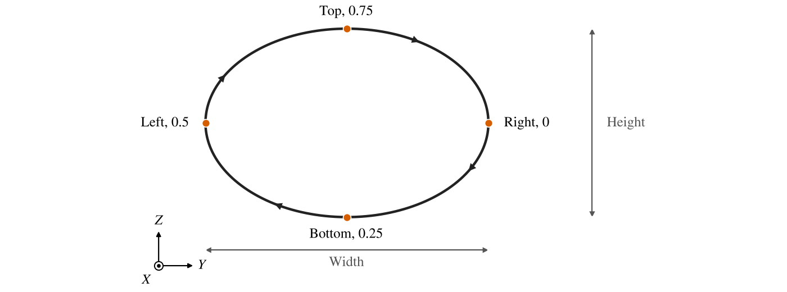
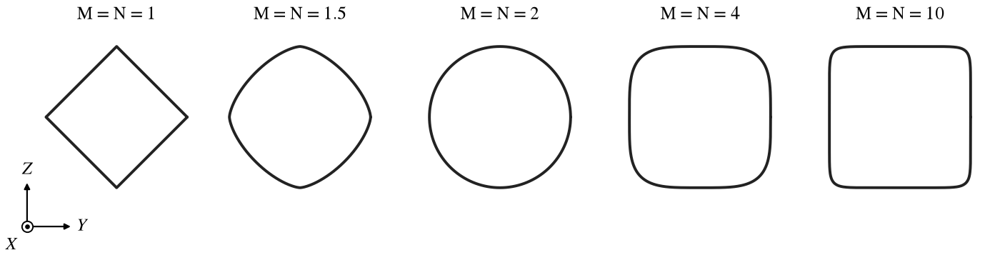
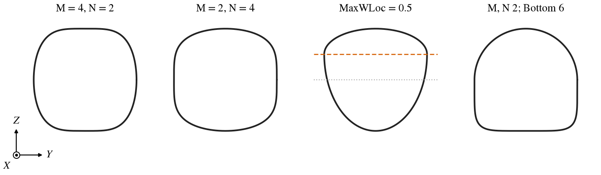
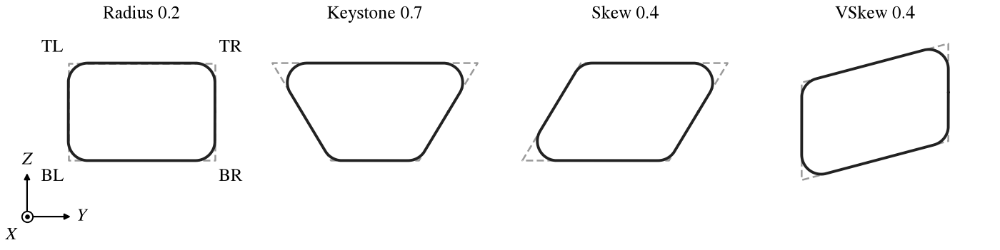
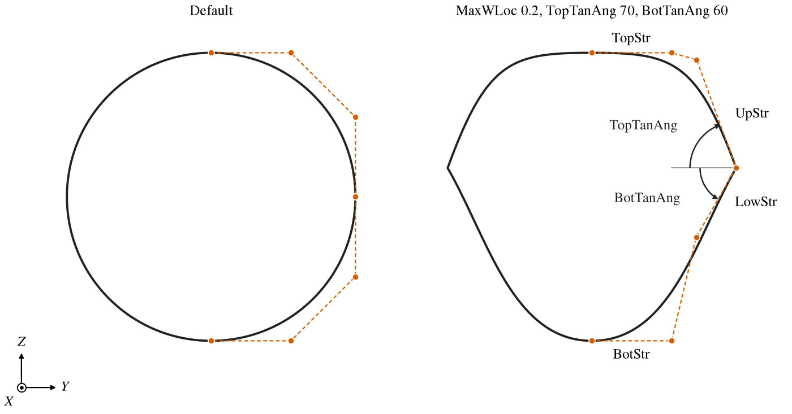
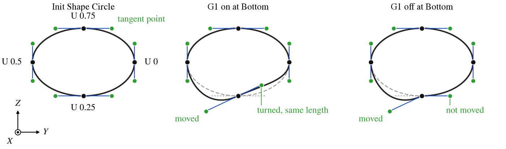
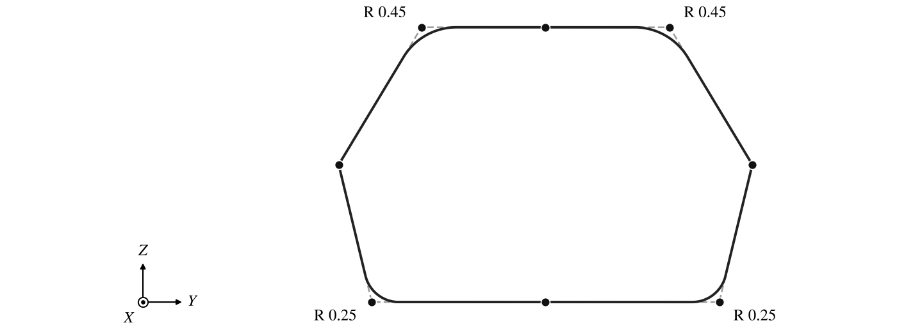
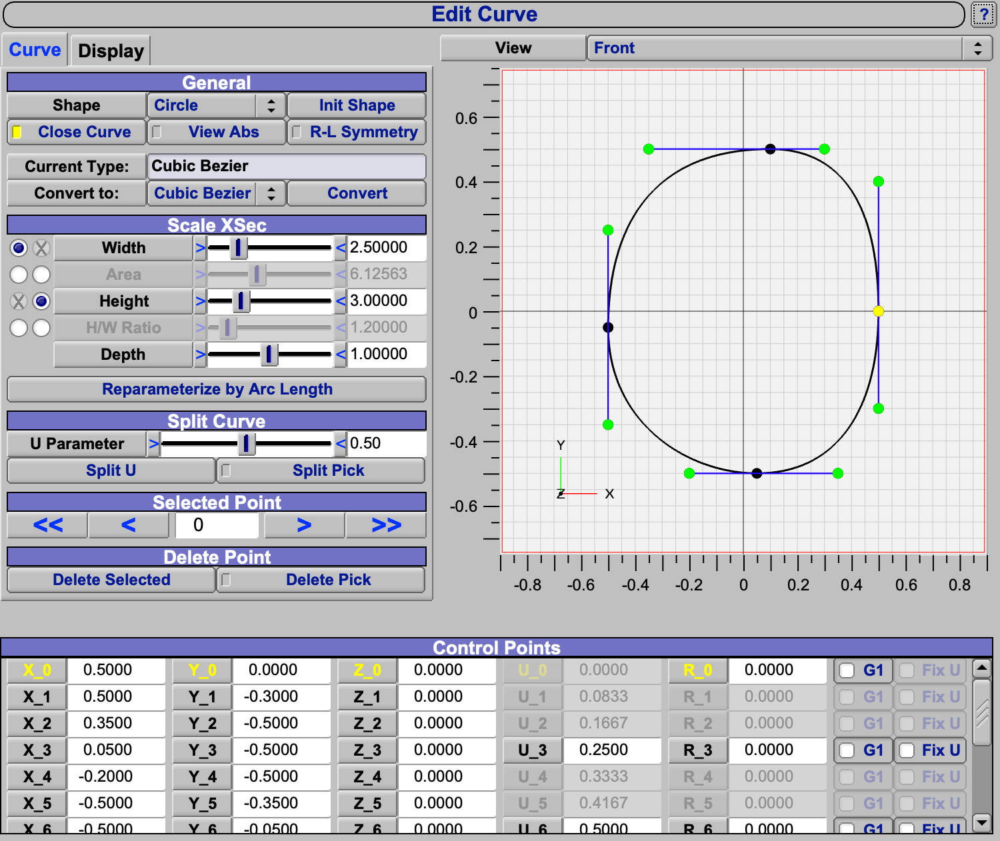
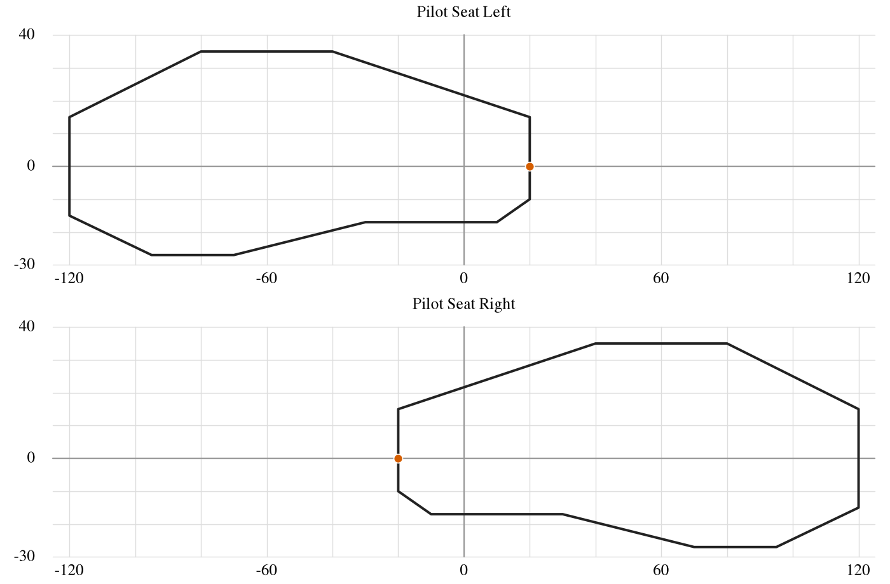

A cross section curve is the closed outline that a component is built from: a Fuselage or Stack is lofted through a
series of them, a Wing or Propeller through a series of airfoils, and a Body of Revolution sweeps one around an axis.
The XSec tab chooses each section's shape with *Choose Type* and sets that shape's parameters.  This page covers the
body shapes; the airfoils, which every one of these components can use too, are on [Airfoils](Airfoils.md), and the
controls for adding, removing and lofting sections are on [Cross Sections and Skinning](XSecSkinning.md).

| Topic                                                             | Shape                          |
|:------------------------------------------------------------------|:-------------------------------|
| [How a Section Is Laid Out](#how-a-section-is-laid-out)           | all                            |
| [Choosing a Shape](#choosing-a-shape)                             | all                            |
| [Width, Height, Area and H/W Ratio](#width-height-area-and-hw-ratio) | all but the airfoils        |
| [Point](#point)                                                   | POINT                          |
| [Circle and Ellipse](#circle-and-ellipse)                         | CIRCLE, ELLIPSE                |
| [Super Ellipse](#super-ellipse)                                   | SUPER_ELLIPSE                  |
| [Rounded Rectangle](#rounded-rectangle)                           | ROUNDED_RECTANGLE              |
| [General Fuse](#general-fuse)                                     | GENERAL_FUSE                   |
| [Fuse File](#fuse-file)                                           | FUSE_FILE                      |
| [Edit Curve](#edit-curve)                                         | EDIT_CURVE                     |
| [AC 25.773 Pilot Vision](#ac-25773-pilot-vision)                  | AC25_773                       |
| [Scripting](#scripting)                                           |                                |

## How a Section Is Laid Out

Every section is a closed curve in its own plane, sized by a *Width* and a *Height*.  The curve's parameter runs from
0 to 1 once around it, starting at the right-hand side, down through the bottom, around the left and over the top
(Figure 1).  The four quarter points have names that the rest of OpenVSP uses: *Right* at 0, *Bottom* at 0.25, *Left*
at 0.5 and *Top* at 0.75.  The skinning controls act at these four points, the lofted surface's seam runs through the
Right points, and a Fuselage or Stack section's *Spin* moves where the curve starts.

On a Fuselage or Stack whose sections are not rotated, the section is seen from behind, looking forward: Right is
$+Y$ and Top is $+Z$.  An airfoil has its own layout, with the chord in place of the width (see
[Airfoils](Airfoils.md#how-an-airfoil-is-laid-out)).



*Figure 1. An ellipse 3 wide and 2 high: where the curve starts, which way it runs, and the four named points.*

Every shape is built from polynomial (Bezier) pieces, and so are the surface lofted through it and the STEP and IGES
files written from that surface.  A polynomial cannot draw a circle exactly: a Circle or an Ellipse is four cubic
pieces, and a Circle departs from a true circle by 0.02 percent of its radius; a Super Ellipse is fitted with many more
pieces and is much closer.  That is far below anything an analysis can see, but a CAD system receives a fitted curve,
not a circle or cylinder it can recognize as one.

## Choosing a Shape

*Choose Type* replaces the active section's curve with a new one of the chosen type.  The new curve takes the old one's
width and height, so the section stays about the same size: a Circle takes the mean of the two as its diameter, and an
airfoil takes the width as its chord and the height as its thickness.  Everything the two types share by name comes
across too, such as the Modify tab's settings, and the section keeps its position and skinning.  Parameters the old
type had and the new one does not are lost, so changing back does not restore them.

*Show* opens a window that draws the active section on its own.  *Convert CEDIT* turns the active section, of whatever
type, into an [Edit Curve](#edit-curve) of the same shape, so a standard shape can be the starting point for a custom
one.  Most shapes become a cubic Bezier fitted to the curve; a Rounded Rectangle and the AC 25.773 shape become straight
lines, with the rectangle's corner radii kept as point radii.  The new Edit Curve has *R-L Symmetry* off.

## Width, Height, Area and H/W Ratio

Most body shapes are sized by any two of *Width*, *Height*, *Area* and *H/W Ratio*; choose the two that drive with the
toggles beside them, and the other two are computed.  A Circle is sized by its *Diameter* or its *Area*.

The area is the area inside the curve before any Modify operation.  When it drives, OpenVSP scales the shape until the
area matches.  A shape that scales with its width and height gets there in one pass; corner radii given as lengths,
as on a Rounded Rectangle or an Edit Curve, take a few.  Driving by area is the way to lay out a body to an area
distribution, as in area ruling; holding the H/W ratio as well keeps the section's proportions while it does.

## Point

A section of no size: a point at the section's center.  It closes a body at its nose or tail.  The Propeller does not
offer it.

## Circle and Ellipse

A Circle has a single size, its *Diameter*, so it cannot become oval; use it where a section must stay round, such as
a duct.  An Ellipse is the shape of a [Super Ellipse](#super-ellipse) with both exponents 2 and *MaxWLoc* 0, drawn
with fewer pieces; start from a Super Ellipse instead when the section may later need to depart from an ellipse.

## Super Ellipse

The super ellipse generalizes the ellipse.  With $w$ the width, $h$ the height, $y$ across and $z$ up from the center,
its top half is

$$
\left|\frac{y}{w/2}\right|^{M} + \left|\frac{z - z_0}{h/2 - z_0}\right|^{N} = 1
$$

and its bottom half is the same with $h/2 + z_0$ in place of $h/2 - z_0$.  $M$ and $N$ are 2 for an ellipse.  The
height $z_0$ of the widest point is *MaxWLoc* times $h/2$; it is 0 by default, the widest point at mid height.

Raising both exponents squares the section off toward a rectangle with rounded corners; lowering them pinches it, to a
diamond at 1 and a concave diamond below 1 (Figure 2).  $M$ goes with the width, so raising it alone flattens the top
and bottom; $N$ goes with the height, so raising it alone flattens the sides (Figure 3).  With *T/B Symmetric Exponents*
off, *M Bottom* and *N Bottom* shape the bottom half separately.



*Figure 2. A square super ellipse with equal exponents.*



*Figure 3. Unequal exponents; MaxWLoc 0.5, with the widest point (dashed) above mid height (dotted); and a bottom
half with its own exponents.*

## Rounded Rectangle

A rectangle *Width* by *Height* whose corners are rounded to the radii *TR Radius*, *TL Radius*, *BL Radius* and *BR
Radius*: top right, top left, bottom left and bottom right, with right toward $+Y$ (Figure 4).  The radii are lengths,
not fractions.  *Symmetry* ties them together: *All* uses TR for every corner, *R/L* uses TR for both top corners and BR
for both bottom ones, and *T/B* uses TR for both right corners and TL for both left ones.

Three parameters make the rectangle a quadrilateral, and they combine:

- *Keystone* sets how the width is shared between top and bottom.  The top is $2k$ times the width and the bottom
  $2(1-k)$ times it, so the default 0.5 is a rectangle and larger values widen the top.
- *Skew* slides the top toward $+Y$ and the bottom toward $-Y$, each by Skew times half the width.
- *VSkew* raises the right side and lowers the left, each by VSkew times half the height.



*Figure 4. A rounded rectangle 1.5 by 1 with every radius 0.2, and the effect of Keystone, Skew and VSkew.  Dashed,
the same with square corners.*

*Key Corner* decides where each corner falls in the curve's parameter.  On, the default, each corner sits at the middle
of its quarter of the curve, whatever the lengths of the sides.  Off, the corner's position follows the lengths of the
two sides beside it.  Leave it on when lofting between rounded rectangles of different proportions: the corners of
neighboring sections then match up, and the corner lines of the surface run straight between them.

## General Fuse

The General Fuse shape is built from two cubic Bezier curves on each side: one from the top center down to the widest
point, and one from there to the bottom center.  The left side mirrors the right.  Its parameters place the Bezier
control points (Figure 5):

| Control   | Meaning                                                                                          |
|:----------|:-------------------------------------------------------------------------------------------------|
| MaxWLoc   | Height of the widest point, as a fraction of half the height.                                    |
| TopTanAng | Angle of the side above the widest point, from the horizontal; 90 is vertical, less leans in.    |
| BotTanAng | Angle of the side below the widest point, from the horizontal; 90 is vertical, less leans in.    |
| TopStr    | Length of the top's level tangent at the centerline, in thirds of the width; more is flatter.    |
| BotStr    | The same for the bottom.                                                                         |
| UpStr     | Length of the side's tangent above the widest point, in thirds of the height; more is fuller.    |
| LowStr    | The same below the widest point.                                                                 |
| CornerRad | Rounds the widest point, as a fraction of the height.                                            |

With both angles at 90, the default, the side is smooth through the widest point.  Any other pair makes a corner
there, a chine, unless the two add to 180.  *CornerRad* rounds that corner.



*Figure 5. The general fuse shape with its control points (dashed polygon), at the defaults and with a chine.  Both
are 2 wide and 2 high.*

## Fuse File

*Read File* takes a section from a file of points (`*.fxs`).  The file starts with the line `OPENVSP_XSEC_FILE_V1` and
then lists one point per line, $y$ then $z$:

```
OPENVSP_XSEC_FILE_V1
0.5 0.0
0.4 -0.3
...
0.5 0.0
```

The points must go around the section the way the curve does: from the right-hand point down through the bottom, around
the left and over the top.  A file whose points run the other way is refused, and the section keeps the shape it had.
Give them centered on the origin and symmetric about the vertical centerline: OpenVSP takes the bottom and top to be the
points nearest that line, and the left-hand point to be twice as far down the list as the bottom.  The points are
normalized by their extent, which becomes the section's Width and Height; changing those then stretches the shape.  The
curve passes through every point, as a smooth spline whose parameter follows the arc length between the bottom, side and
top.

## Edit Curve

An Edit Curve is a section drawn by hand, point by point, in the *Edit Curve* window that *Edit Curve* opens.  It is
for shapes no standard type gives, and is often started from one with *Convert CEDIT* (see
[Choosing a Shape](#choosing-a-shape)).

### Curve Types

The curve passes through its points in one of three ways, shown as *Current Type*: *Linear* (straight segments),
*Spline (PCHIP)* (a smooth curve that does not overshoot between points) or *Cubic Bezier* (every third point is on
the curve and the two between are its tangent points).  *Init Shape* starts over from a Circle (Bezier), an Ellipse
(spline) or a Rectangle (linear).

Cubic Bezier is the default and the type to use for a smooth shape: it is the only type whose tangents can be set, and
splitting it adds a point without changing the shape.  For a shape of straight sides and rounded corners, use Linear
with corner radii (see [Corner Radius](#corner-radius)); it takes the fewest points.  Avoid Spline.  It cannot carry
corner radii or set a tangent, and the shape between two points depends on their neighbors, so adding a point changes
the curve around it.  Its Init Shape Ellipse departs from a true ellipse by more than half a percent; the Circle, sized
with Width and Height, is the better start.

Converting to Cubic Bezier keeps the shape exactly, adding the tangent points that reproduce it, and keeps the corner
radii.  Converting a Bezier to Linear or Spline keeps only its points on the curve, and Linear and Spline pass through
the same points in different ways, so those conversions change the shape between the points.

### Points and Size

The points are given as fractions of the section's Width and Height, so the Scale XSec controls stretch the curve
rather than move its points; a curve whose points run from -0.5 to 0.5 is exactly Width wide and Height high.  *View
Abs* shows the points in model units instead.  *R-L Symmetry* mirrors the right half to the left; the top and bottom
points are held on the centerline, with level tangents if they have G1, and the curve must be closed.  *Close Curve*
joins the last point to the first.

### Points of a Bezier Curve

Each point on a Bezier curve has a tangent point on either side of it, joined to it by a line in the window; the curve
leaves the point toward one and arrives from the other (Figure 6).  On a closed curve the first point is repeated as
the last, so the point at U 0 also has a tangent point on each side.  Dragging a point on the curve carries its two
tangent points with it; typing a new coordinate for it does so only when it has G1.

*G1* on a point keeps the curve smooth there.  Moving one of its tangent points then turns the other to stay in line
with it, without changing that one's length, so the curve stays smooth while the two sides keep their own fullness.
Switching G1 on lines up the two tangents along their average direction.  With G1 off, the point is a corner whenever
its tangents are not in line.  A point made by *Split* is smooth but has G1 off, as is every point of the Init Shape
Circle; switch G1 on before moving the tangent points of a point that should stay smooth.



*Figure 6. A Cubic Bezier Edit Curve 3 wide and 2 high: its points on the curve (black), each with a tangent point
(green) on either side, and the same tangent point at the Bottom moved with G1 on and off.  Dashed, the curve before;
dotted, the tangents before.*

### Corner Radius

A corner point can carry a radius *R*, which replaces the corner with a circular arc of that radius, tangent to both
sides (Figure 7).  Linear points take a radius, and so do the points on a Bezier curve that have G1 off.  The radius
is a length in model units: it does not change when Width or Height do, and scales with the component's Scale.

A polygon with corner radii describes a shape in a few numbers that each mean something, where a Bezier curve needs
two tangent points placed by hand for every rounded corner.  The shape is easier to set and to change, and it stays
a polygon with round corners however the points move.



*Figure 7. A Linear Edit Curve 3 wide and 2 high with radii at four of its eight points; dashed, the same points with
no radii.  The points at the sides and on the centerline have none.*

### U Parameter

Each point has a parameter *U* from 0 to 1.  U 0, 0.25, 0.5 and 0.75 are the Right, Bottom, Left and Top of the
section (Figure 1), where skinning acts.  Between sections, points of equal U are joined by the loft, so give a sharp
feature, such as a chine or a corner, the same U on every section it runs through; otherwise the feature line twists
across the surface.  On a Bezier curve only the points on the curve have a U to set.

*Reparameterize by Arc Length* keeps the points and resets their U to follow the distance along the curve.  Use it when
a curve with many points meshes unevenly round the section.  It keeps the U of the first and last points, of the Bottom
and Top with R-L Symmetry on, and of every point marked *Fix U*, and spaces the rest by length between them.  Mark Fix
U on every point whose U was chosen, including the Bottom, Left and Top when R-L Symmetry is off; a point that is not
fixed moves, and a Top that leaves U 0.75 is no longer where the skinning acts.

### Depth

The points also have a third coordinate, a fraction of *Depth*, which is a length, so a section need not be flat.
Positive values move a point along the component: aft on a Fuselage or Stack whose sections are not rotated, and
outboard on a Wing.  The *View* choice edits the curve from the front, the top or the left.  A curved section can shape
an end that no plane section can, such as a lip that curves back along the body, but every point then needs a third
value set by hand and kept consistent with its neighbors; use it only where a section must leave its plane.

### Editing the Points

Points can be dragged in the window's plot, or typed in the table below it (Figure 8), where the selected point is
highlighted.  *Split U* adds a point at the U given, and *Split Pick* where the curve is clicked; *Delete Selected* and
*Delete Pick* remove one.  On a Bezier curve these act on a point on the curve together with its two tangent points.

In the plot, the points on the curve are black and, on a Bezier curve, the tangent points green, each joined to its
point on the curve by a blue line.  The selected point is yellow, or grey when R-L Symmetry is on and it lies on the
left half, which follows the right.  In the table the selected point's labels are yellow, and a tangent point's U, R,
G1 and Fix U are greyed: only points on the curve carry them.



*Figure 8. The Edit Curve window on the middle section of a Fuselage, a Cubic Bezier curve with R-L Symmetry off and
point 0, at the Right, selected.*

Splitting, converting and Init Shape rebuild the curve's points, and so does deleting with R-L Symmetry on, so any
Link, Advanced Link or Design Variable that used a point's coordinates, U, radius or G1 is lost.  Settle the number of
points before linking them.

The *Display* tab sets the curve's color, point size and line thickness, and places an image behind the curve for
tracing.  *Lock Image* keeps the image fixed to the curve as the plot is zoomed and panned.  *Copy Settings to All
XSecs* gives every section of the component the same image, scale and offset, so each section can be traced against
one drawing.

## AC 25.773 Pilot Vision

The AC25_773 shape is the pilot's vision envelope of FAA Advisory Circular 25.773-1, the region a pilot must be able
to see through the windows.  It is laid out in degrees (Figure 9): across, from 20 degrees toward the far side to 120
degrees toward the pilot's own side; up, from 17 degrees below the horizon straight ahead, and 27 below it to the side,
to 35 above.  It has no size parameters: its Width and Height are zero, and as a section of a body it spans 140 by 62
model units.  *Pilot Seat* mirrors it for a pilot in the left or the right seat.  It is the default section of the
[Auxiliary](Auxiliary.md) component's Super Cone, which reads a section's coordinates as angles in degrees and builds
the cone of sight from the pilot's eye.



*Figure 9. The AC 25.773 envelope for each seat, in degrees across and up.  The dot is where the curve starts.*

## Scripting

The API reaches a section through its Geom's cross section surface (`GetXSecSurf`, then `GetXSec`), and its
parameters with `GetXSecParm`.

| Call                                                           | Purpose                                                        |
|:---------------------------------------------------------------|:---------------------------------------------------------------|
| `ChangeXSecShape`, `GetXSecShape`                              | Set or read a section's type, `XS_CIRCLE`, `XS_ELLIPSE` and so on. |
| `SetXSecWidthHeight`, `SetXSecWidth`, `SetXSecHeight`          | Size a section, whatever its type calls width and height.     |
| `GetXSecWidth`, `GetXSecHeight`                                | Read its size.                                                 |
| `ComputeXSecPnt`, `ComputeXSecTan`                             | A point or tangent at a fraction around the section.           |
| `ReadFileXSec`, `SetXSecPnts`, `GetXSecPnts`                   | Fuse File points.                                              |
| `ConvertXSecToEdit`                                            | Convert a section to an Edit Curve, as *Convert CEDIT* does.   |
| `EditXSecInitShape`, `SetEditXSecPnts`, `GetEditXSecCtrlVec`, `GetEditXSecUVec`, `MoveEditXSecPnt`, `EditXSecSplit01`, `EditXSecDelPnt`, `EditXSecConvertTo`, `ReparameterizeEditXSec` | Edit an Edit Curve. |
