Fuselages, Stacks, Wings and Propellers are lofted through a list of cross sections.  The XSec tab adds, removes and
copies those sections and sets each one's shape.  The Skinning tab of the Fuselage and Stack then controls how the
surface leaves and arrives at each section: its angle, how strongly it holds that angle, and its curvature, on each
side of the section, at the four sides of the section and at any other points around it.  The shapes themselves are
on [Cross Section Curves](XSecCurves.md) and [Airfoils](Airfoils.md).

| Topic                                                             | Tab      |
|:------------------------------------------------------------------|:---------|
| [Working with Sections](#working-with-sections)                   | XSec     |
| [How the Surface Is Lofted](#how-the-surface-is-lofted)           | Skinning |
| [Stations: Sides and Spines](#stations-sides-and-spines)          | Skinning |
| [Angle](#angle)                                                   | Skinning |
| [Slew](#slew)                                                     | Skinning |
| [Strength](#strength)                                             | Skinning |
| [Curvature](#curvature)                                           | Skinning |
| [Left, Right and Continuity](#left-right-and-continuity)          | Skinning |
| [Set, Equal and Symmetry](#set-equal-and-symmetry)                | Skinning |
| [Spines](#spines)                                                 | Skinning |
| [Angle Basis From Curve](#angle-basis-from-curve)                 | Skinning |
| [Showing and Clearing Skinning](#showing-and-clearing-skinning)   | Skinning |
| [Advice](#advice)                                                 |          |
| [Scripting](#scripting)                                           |          |

## Working with Sections

The arrows at the top of the XSec tab choose the active section, which every control below them acts on.  Sections
are numbered from 0 at the front of a Fuselage or Stack, the root of a Wing or the hub of a Propeller.  The alias
fields name the section and its curve; the names show in the Parm pickers and the API.

| Control    | Effect                                                                                                    |
|:-----------|:----------------------------------------------------------------------------------------------------------|
| Insert     | Adds a copy of the active section after it, and makes the copy active.                                     |
| Cut        | Removes the active section and keeps it for pasting.  A component keeps at least two sections.             |
| Copy       | Keeps a copy of the active section for pasting.                                                           |
| Paste      | Replaces the active section with the copied one, in the active section's place.                           |
| Choose Type | Changes the active section's shape; see [Choosing a Shape](XSecCurves.md#choosing-a-shape).              |
| Convert CEDIT | Turns the active section into an editable curve of the same shape; see [Edit Curve](XSecCurves.md#edit-curve). |

A pasted section keeps the place of the one it replaces: on a Fuselage its location, but not its rotation or spin;
on a Stack its steps, turns, Coord System, Spin and V Align; on a Propeller its radius.

An inserted copy is placed between the active section and the next: on a Fuselage, halfway between them in X; on a
Propeller, at the mean of their radii.  On a Stack, whose sections are placed relative to the one before, the copy takes
the active section's offset (an offset of 1 along X if the active section has none there), and the sections after it
move along by that much.  A section can be inserted after the last only on a Stack whose order policy is FREE; see
[Fuselage and Stack](FuselageStack.md).

A copy can be pasted into another component of the same kind, a Fuselage into a Fuselage for example.  Pasted into a
different kind, only its curve comes across.  The Wing has these controls on its Sect tab, but its Insert pastes the
copied section rather than copying the active one, and its Airfoil tab copies and pastes the airfoil alone; see
[Wing](Wing.md).

## How the Surface Is Lofted

The surface passes through every section.  Between two sections, each point of one section's curve is joined to the
point at the same parameter on the next (the parameter runs once around the curve, as on
[Cross Section Curves](XSecCurves.md#how-a-section-is-laid-out)).  Each of these lines along the body is a smooth
curve through the sections, built independently of the others.

With nothing more said, the lines between two sections are straight.  The Skinning tab of the Fuselage and Stack adds
conditions at each section: the direction and length of the line's derivative where it leaves or arrives at the
section, and its second derivative.  The conditions are set at a few points around the section, called stations, and
interpolated smoothly around it between them.

Between two sections each line is a single polynomial, and every condition at either end raises its degree by one
(Figure 1).  With nothing enforced it is straight.  An angle at one end makes it a parabola, which bends one way
only; an angle at both ends makes it a cubic, which can turn and turn back, an S between two sections of different
size.  Curvature at both ends as well gives the most a span can carry, a fifth-degree line.  A span therefore bends
only as much as its conditions ask, and the shape you want decides how many you need: to have the surface leave one
section and arrive at the next both parallel to the axis, enforce the angle at both.

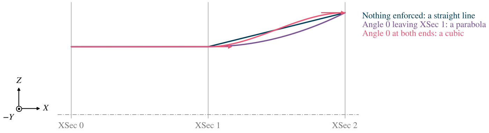

*Figure 1. The top line of a Stack of circles two apart, the last 3 across instead of 2, with conditions only on the
span from XSec 1 to XSec 2.  The arrows are the directions enforced.*

The result is one untrimmed surface for the whole body.  Its U parameter runs
along the body, one equal share for each span between sections however long the span is, and W runs around the
sections; at a Point section every W meets at one point.  U and W are the coordinates used to attach other
components to the body; see [Attachment Coordinates](XFormTab.md#attachment-coordinates).

In what follows, the line's direction is measured along the body, toward the later sections.  The *left* side of a
section is the part of the surface between it and the section before; the *right* side is between it and the section
after.

## Stations: Sides and Spines

Every section has four stations, its sides: *Right*, *Bottom*, *Left* and *Top*, at the curve's parameters 0, 0.25,
0.5 and 0.75 (Figure 2).  On a Fuselage or Stack whose sections are not turned, Right is toward $+Y$ and Top toward
$+Z$; *Spin* on the XSec tab moves where the curve starts, and the sides move with it.  The *Sides* tab sets the
skinning at these four stations.

The *Spines* tab adds more stations, anywhere around the section (see [Spines](#spines)).  A spine can be mirrored
left to right, top to bottom or both, which adds a station at each mirror image.

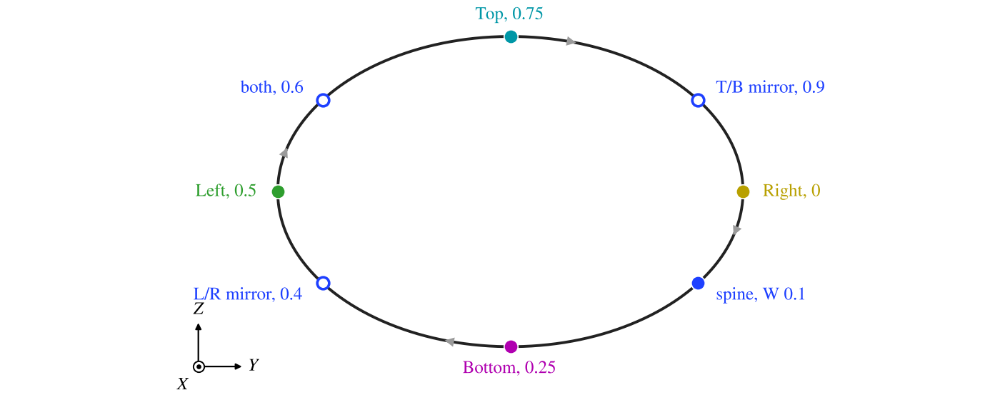

*Figure 2. The four sides of a section, and a spine at W 0.1 with its three mirrors, in the colors the 3D view draws
them.  The arrows show which way the curve's parameter runs.*

Between stations, each quantity is interpolated around the section so that it stays between the values at the
stations either side and does not overshoot them.  A station therefore affects the surface only as far as the stations
next to it.

## Angle

*Angle* turns the surface's direction toward or away from the body's axis, in degrees.  At 0 the surface runs along
the axis; positive angles lean it out, away from the axis, as it goes toward the later sections, and negative angles
lean it in (Figure 3).  The angle is measured in the plane through the axis and the station, so a Top angle tilts the
surface up or down, and a Right angle tilts it sideways.

At a Point section, the angle sets how blunt the end is: 0 leaves the point along the axis, a sharp tip, and 90 leaves
it square to the axis, a rounded end.  A new Fuselage or Stack starts and ends with point sections whose angles of 45
and -45 round its nose and tail.

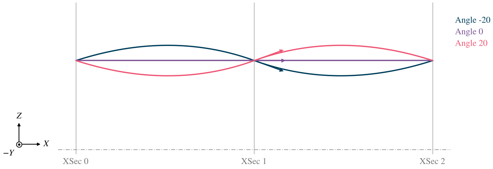

*Figure 3. The top line of a Stack of three equal circles, two apart, with the middle section's Top Angle at -20, 0
and 20 on both its sides; the arrows are the direction leaving it, and the dash-dot line is the axis.  The first and
last sections enforce nothing.*

## Slew

*Slew* turns the surface's direction around the section instead of toward the axis, in degrees: it twists the surface
as it leaves the station.  Its sense depends on the side, so that the symmetry toggles mirror the surface rather than
twist it: a positive Slew swings the surface at the Top and the Bottom toward the Right side, and at the Right and the
Left toward the Bottom.  A spine's positive Slew swings it the way the curve's parameter runs, toward the next station
in Figure 2; its left to right and top to bottom mirrors take the opposite sense, and the mirror in both the same.

Slew is enforced together with the Angle; it has no Set toggle of its own.

## Strength

*Strength* is the length of the surface's derivative where it leaves or arrives at the section: how far the surface
carries the angle before it turns toward the next section (Figure 4).  It is measured in units of the distance to the
nearer of the neighboring sections, which counts half the change in width or height between them as well as the
distance between their centers.  A Strength of 1 then gives about the derivative of a straight line between evenly
spaced sections; larger values hold the angle longer and bulge the surface, smaller values let it turn sooner.

Strength is enforced together with the Angle; it has no Set toggle of its own.

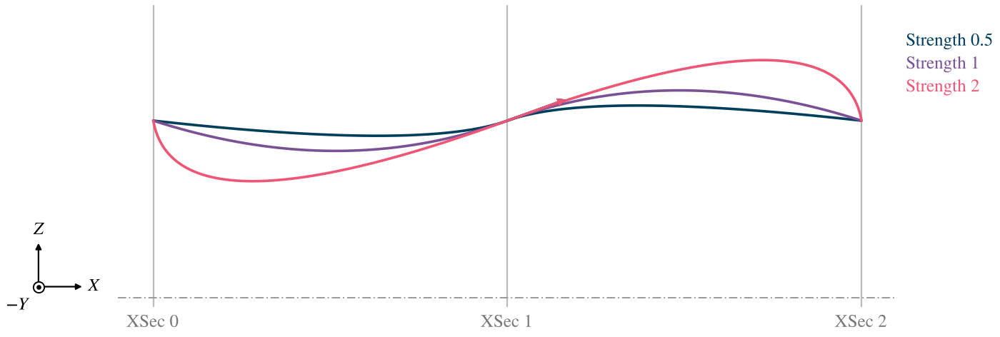

*Figure 4. The same Stack with the middle section's Top Angle 20 and Strength 0.5, 1 and 2.*

## Curvature

*Curvature* sets the surface's second derivative where it leaves or arrives at the section, in the plane the angle is
measured in, in the same units as Strength (Figure 5).  Positive values bend the surface away from the axis, so the
section sits in a waist; negative values bend it toward the axis, so the section is a local bulge.  It is enforced
with its own Set toggle.

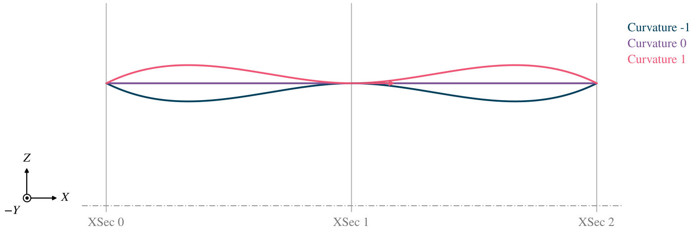

*Figure 5. The same Stack with the middle section's Top Angle 0, Strength 1 and Curvature -1, 0 and 1.*

## Left, Right and Continuity

Each quantity has a left and a right value, for the surface on the section's left and right sides.  When they differ,
the surface has a corner at the section: a crease along the body (Figure 6).

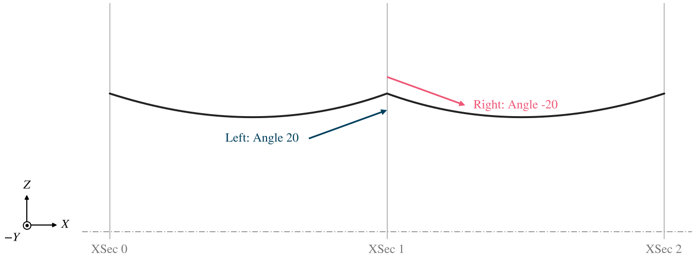

*Figure 6. The middle section's left Top Angle 20 and right Top Angle -20: a ridge at the section.*

*Enforce*, the continuity, decides whether the two sides must agree.  It is one setting for the whole section, made
in the Top side's header.  At *C0* the two sides need not agree.
At *C1* the surface's direction and derivative are continuous through the section: the right values follow the left,
and where no angle is enforced, the two sides of the surface are made to meet smoothly.  At *C2* the curvature is
continuous as well.  Figure 7 shows a section where nothing is enforced: at C0 the surface runs straight to it from
each side and has a corner there; at C1 and C2 it passes through smoothly.  The first and last sections are always
C0, because the surface has only one side there.

With no angle set, C1 has to bend one of the two spans to make them meet, and it chooses which: the span with fewer
conditions on it, or, when they have as many, the span before the section.  The other stays as it was.  In Figure 7
the span before the middle section sags below two sections of the same size at C1, while the span after it stays
straight.  At C2 both spans bend.  Continuity is a quick way to a smooth body where you have nothing to say about
its shape; where you do, set the angle and leave the continuity at C0, so that you, not the loft, decide where the
surface bends.

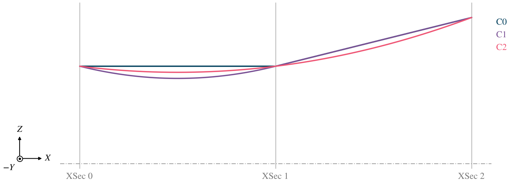

*Figure 7. The middle section's continuity, with no skinning enforced and the last section 3 in diameter instead of
2.*

At the first section, which has no left side, the *left* values set the surface leaving it; the right values are not
used.  At the last section the left values set the surface arriving at it.

## Set, Equal and Symmetry

Each quantity's row has a *Set* toggle for each side and an *=* toggle between them.  A value whose Set is on is
enforced.  A value whose Set is off is not an input at all: OpenVSP shows there what the surface actually does at
that station, so the sliders tell you the angle, strength and curvature the loft chose.  Turning Set on then holds
the surface to those values, which you can adjust from there.

Each station's toggles are its own: the angle can be held at the Top and left free at the Right, and the surface
there follows what the loft does.  Only the continuity is shared by the whole section.

The = toggle makes the right value equal the left.  The toggles also follow the continuity: from C1 up, the right
angle, slew and strength always equal the left; at C2 the curvature does too.

The button carrying the quantity's name (Angle, Slew, ...) is the left value's Parm button, for linking it or making
it a design variable.  The small blank button beside it is the right value's.

On the *Sides* tab, symmetry toggles copy one side's whole skinning to others: *All Sym* copies the Top to every side,
*T/B Sym* the Top to the Bottom, and *R/L Sym* the Right to the Left.  They make the settings symmetric, not the
surface: the surface is symmetric only where the section's shape, its position and rotation, and its neighbors are
too.

A new Fuselage or Stack has T/B Sym and R/L Sym on, continuity C0, and no curvature set (Figure 8).  Each section
between the ends enforces Angle 0 with = on, so the body passes every section parallel to its axis, and Strength 1 on
each side, with no = between the two, so they can be changed apart.  The end sections are the Point sections described
under [Angle](#angle).

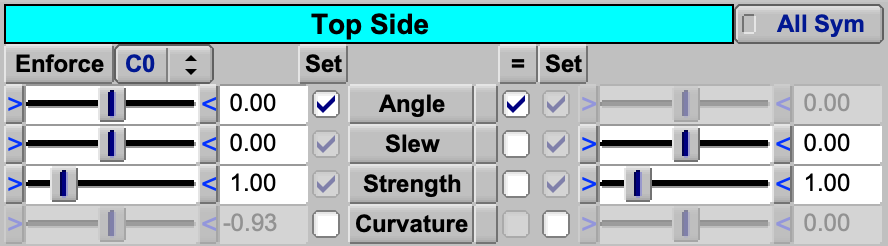

*Figure 8. The Top side of section 1 of a new Fuselage: Angle 0 enforced, with = on so the right value follows the
left; Slew and Strength enforced with it, each side its own; Curvature free, showing the value the loft gives.*

## Spines

A spine is a station placed by you, at a position *W* from 0 to 1 around the section, measured as the curve's parameter
is (Figure 2).  *Add* places a new spine in the middle of the widest gap between stations; it enforces nothing and
starts from what the surface already does there, so adding it changes the surface very little.  *Delete* and *Delete
All* remove spines.  The controls below the list edit the spine picked in it (Figure 9).  *L/R Sym* and *T/B Sym* add
the spine's mirror images, left to right and top to bottom, as stations of the same skinning.  A spine or mirror that
lands on another station, within 0.00025 in W, is ignored; the four sides always win.

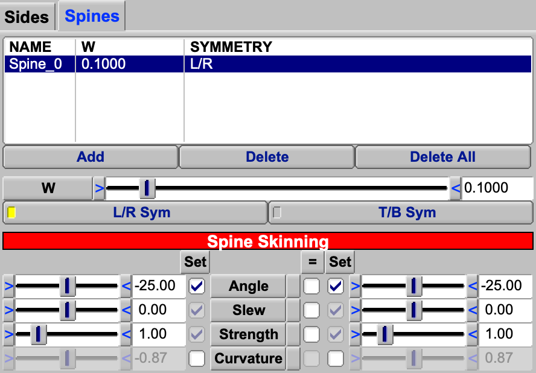

*Figure 9. The Spines tab on section 1 of a Stack with one spine, picked in the list: W 0.1, mirrored left to right,
with Angle -25 enforced on both sides.*

Spines belong to the whole component: a spine has the same W, symmetry and name on every section, and adding or
deleting one does it on all of them.  Its skinning values, like a side's, are set separately on each section.

A spine controls the surface only between the stations either side of it (Figure 10), so a few spines shape a body
locally: a chine, a fairing, a flat panel.

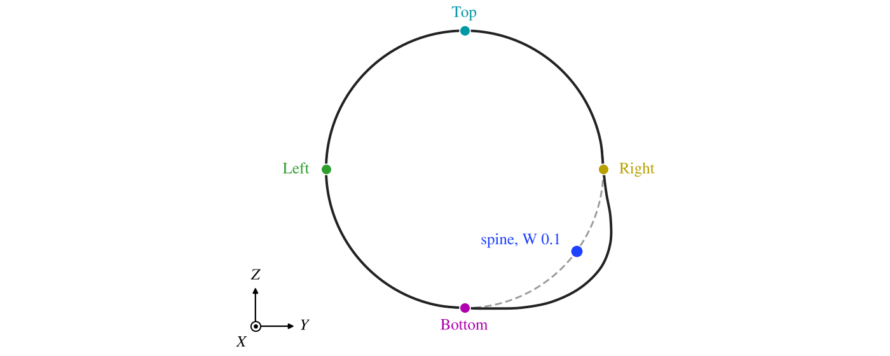

*Figure 10. The Stack cut halfway between its first two sections.  Dashed, with the four sides of the
middle section enforcing Angle 0; solid, with a spine at W 0.1 enforcing Angle -25 as well.  Only the quarter between
the Right and Bottom sides changes.*

## Angle Basis From Curve

An angle needs a direction to lean the surface toward.  By default OpenVSP takes it from a circle: at a parameter
$t$ around the section, the outward direction a circle would have there.  That is exact at the four sides of any
section symmetric left to right and top to bottom, but away from them, on any shape that is not a circle, it is not
the direction the section actually faces.  *Angle Basis From Curve* takes the direction from the section's curve
instead: square to the curve at the station, in the plane of the section (Figure 11).

Turn it on when you set angles at spines on a section that is not a circle; with it off, such an angle also slews the
surface.  At the four sides of a symmetric section the two agree.

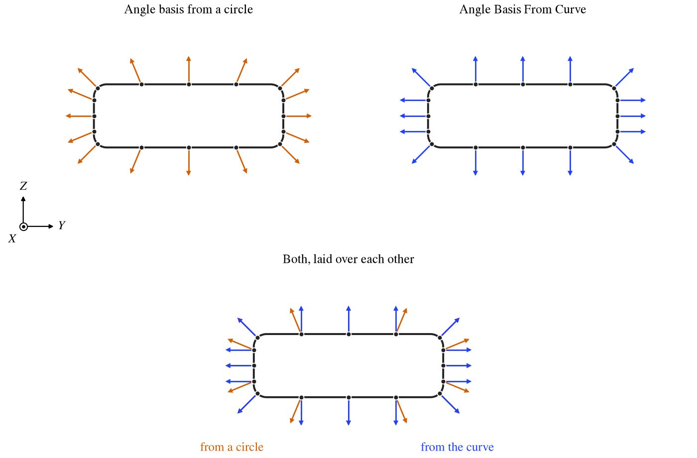

*Figure 11. A rounded rectangle three times as wide as it is high, with Angle 30 enforced at its sides and at twelve
spines.  The arrows are the part of the surface's direction across the body: from the circle (orange), they fan out as
from a circle; from the curve (blue), they stand square to each flat side.  Below, the two are laid over each other;
they agree only at the four sides.*

## Showing and Clearing Skinning

*Show Tangent Vectors* draws, at every station of the active section, the surface's derivative on each side: solid
where the surface leaves toward the next section, dashed where it arrives from the one before, at full length, in the
station's color.  *Show Curvature Vectors* draws the
second derivatives the same way.  They show what is enforced and, for what is not, what the surface does.

*Clear Skinning For XSec* turns off every Set and = toggle on the active section, its spines included, so the surface
there is free, and turns All Sym on; *Clear Skinning For Entire Stack* does it for every section.

## Advice

- Leave a section free where you have nothing to say; set what matters.  A free section reports what the surface does
  there, which is often the best starting point for setting it.
- Start from few conditions and add them one at a time, looking at the surface after each; every condition raises
  the degree of the spans it touches, and more of them make a body that is harder to predict, not a better one.
- With nothing enforced, choose C1 or C2 for a smooth body; at C0 the surface runs straight between sections.  Where
  the shape matters, set angles instead of relying on continuity.
- Use the sides first, and the symmetry toggles for a symmetric body.  Add spines only where the sides cannot reach,
  and turn on Angle Basis From Curve when you do on a section that is not a circle.
- Use Strength to shape a nose or tail, and Left and Right angles at C0 for a deliberate crease.

## Scripting

The API sets a section's skinning by side, and its spines by ID:

| Call                                                                                         | Purpose                                      |
|:---------------------------------------------------------------------------------------------|:---------------------------------------------|
| `InsertXSec`, `CutXSec`, `CopyXSec`, `PasteXSec`                                             | Insert, cut, copy and paste sections.        |
| `SetXSecContinuity`, `GetXSecContinuity`                                                     | The section's continuity, 0 to 2.            |
| `SetXSecTanAngles`, `SetXSecTanSlews`, `SetXSecTanStrengths`, `SetXSecCurvatures`            | Set the Top, Right, Bottom and Left values of one side of the section. |
| `GetXSecTanAngles`, `GetXSecTanSlews`, `GetXSecTanStrengths`, `GetXSecCurvatures`            | Read them.                                   |
| `ClearSkinning`                                                                              | Clear one section's skinning, or every section's, as the Clear Skinning buttons do. |
| `ResetXSecSkinParms`                                                                         | Clear a section's skinning and also set every angle, slew, strength and curvature to 0, with All, T/B and R/L Sym on. |
| `AddSkinSpine`, `DelSkinSpine`, `DelAllSkinSpines`, `GetNumSkinSpines`                       | Add and remove spines.                       |
| `GetSkinSpineID`, `GetSkinSpineIDVec`, `GetSkinSpineParm`, `SetSkinSpineName`                 | Reach a spine on a section, and its parms.   |

The Set, = and symmetry toggles are parms of the section, found with `GetXSecParm`: `TopLAngleSet`, `TopLRAngleEq`,
`AllSym` and so on.
